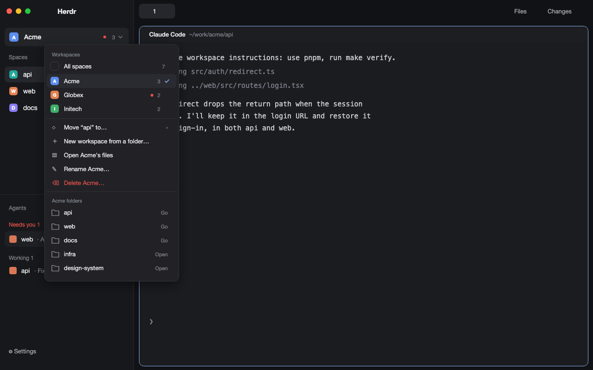

# Workspaces for Herdr

A Herdr layout that groups spaces into workspaces: a folder of repos, with its
own agent instructions. A switcher at the top of the sidebar picks one; the
spaces and agents lists show only what's in it. Each workspace has a task board (as columns or a list):
one markdown file per task, cards that start an agent on their task (in the
repo or a fresh worktree) and then show that agent's live status. Agent presets
(herdr-core templates: a command plus instructions) can be global or per
workspace, are managed in the Agent presets screen (model and effort included;
open it from the sidebar footer), and start from the tab bar's + menu or a
card's Start;
`examples/presets/` has three to start from, among them an orchestrator that
splits a task across helper agents with herdr-core's `hc`; its helpers show
under it in the Agents list. Automations start an agent by
themselves: on a schedule (once or repeating), when a task enters a board
column, when an agent finishes or needs you, when files change, when a PR or
issue is opened on GitHub (asked every 2 minutes through `gh`), or when another
app calls `herdr-ws-run`. Each run is a tab in the workspace's Automations space;
`examples/automations/` has one to start from. You make one by saying what it
should do and when, in your own words: Claude drafts the trigger, the agent,
its model and the prompt, and you read the draft before it's saved. Agents in a
workspace can add one themselves with `herdr-ws-run --add`, so you can tell one
"tomorrow at 6, check X and if so do Y". After a reboot or a logout, the Claude
agents you hadn't closed come back in their tabs, resumed with their
conversations, helpers included.



`RECIPE.md` describes it in full: it's the brief an agent builds it from.

## Install

Ask your agent to add this layout (Herdr's own guide, `~/.config/herdr-app/AGENTS.md`,
says how), or by hand:

1. Copy `layouts/workspaces.json` to `~/.config/herdr-app/layouts/` and the nine
   folders in `mods/` to `~/.config/herdr-app/mods/` (rename them if a name is taken).
2. For agent instructions from the + menu, put the launcher on your `PATH` and
   point `programs.json` at it. `herdr-ws-run` starts automations from other
   apps and lets agents add them:
   ```sh
   ln -s ~/.config/herdr-app/mods/ws-switcher/bin/herdr-ws-agent ~/.local/bin/
   ln -s ~/.config/herdr-app/mods/ws-switcher/bin/herdr-ws-run ~/.local/bin/
   ```
   ```json
   { "programs": { "claude": { "run": ["herdr-ws-agent", "claude"] },
                   "codex":  { "run": ["herdr-ws-agent", "codex", "--no-daemon"] } } }
   ```
3. To bring Claude agents back after a restart, add this line to
   `~/.config/herdr-core/config.toml`. herdr-core then starts terminals through
   `herdr-ws-resume`, which resumes a terminal's agent, else runs your usual shell.
   The switch at the foot of the Agent presets screen turns it off and on again
   (or `herdr-ws-resume --off` / `--on`). The `ln` line puts `herdr-ws-resume`
   (`--status`, `--list`, `--forget`) on your `PATH`:
   ```toml
   shell = ["/bin/sh", "-c", "r=\"$HOME/.config/herdr-app/mods/ws-switcher/bin/herdr-ws-resume\"; [ -x \"$r\" ] && exec \"$r\"; exec \"${SHELL:-/bin/sh}\" -l"]
   ```
   ```sh
   ln -s ~/.config/herdr-app/mods/ws-switcher/bin/herdr-ws-resume ~/.local/bin/
   ```
4. Switch to it: `herdr-app do layout.switch '{"name":"workspaces"}'`
   (`ctrl-shift-l` cycles back).
5. Open the switcher and pick **New workspace from a folder…**. The board button
   beside the switcher opens the workspace's board.

**What it touches:** it reads `~/.herdr/workspaces` and the folders of
each workspace's root. It writes `~/.herdr/workspaces/.index`, a new
workspace's files when you make one, its `workspace.jsonc` when you rename it,
task files in `~/.herdr/workspaces/<id>/tasks/` and automation files in
`~/.herdr/workspaces/<id>/automations/` (from the Automations screen, from
`herdr-ws-run --add`, `--off` and `--on`, and `enabled: false` after a one-time
one runs). Deleting a workspace, a task or an
automation (after a confirmation) moves it to the Trash. The board's Worktree runs
`git worktree add` on a new `task/…` branch; otherwise your repos aren't
touched. It runs `sh` (editor, Trash, symlinked folders), `herdr-app do` (the
board's and automations' new tabs) and, through the launcher, Start and
automations, your agents. Automations watch the folders a files automation
names, read calls `herdr-ws-run` leaves in `~/.herdr/workspaces/.inbox` (and
delete them), and close an automation's older run tabs once their agent is done.
For restarts, the launcher keeps notes of the Claude agents it starts in
`~/.herdr/resume/` (their command and session), runs `hc ls` to drop the notes
of closed tabs, and gives Claude two hooks (`--settings`) that note its session
and drop the note when you leave it. With the `shell` line in herdr-core's
config, every new terminal starts through `herdr-ws-resume`.
Two things use the network: GitHub automations (`gh api` with your login, every
2 minutes per watched repo), and the Automations screen's Draft it and Change it,
which run `claude -p` with your Claude login and no tools. That sends Anthropic
your words, the workspace's name, root, folder names, GitHub repos and presets,
and, for a change, the automation as it stands.

Built for Herdr 0.1.14; `ws-spaces`, `ws-agents`, `ws-tabs`, `ws-new-menu` and
`ws-chrome` are copies of that version's `spaces`, `agents`, `tabs`, `new-menu`
and `workspace-chrome`.

## License

Apache License 2.0. `ws-spaces`, `ws-agents`, `ws-tabs`, `ws-new-menu` and
`ws-chrome` are modified copies of Herdr's own mods, also Apache 2.0; see `NOTICE`.

## Working on it

Edit the live files in `~/.config/herdr-app`, then copy them here with
`scripts/sync-from-home.sh`.
