# Workspaces for Herdr

A Herdr layout for multi-repo work: workspaces with their own agent
instructions, a task board that starts agents and follows their pull requests,
your GitHub project board beside it, a worktrees tab, agent presets, automations,
and agents that come back after a restart.


The pictures here are drawings with demo names, not screenshots. `RECIPE.md`
describes everything in full: it's the brief an agent builds it from.

## What you get

### Workspaces

A workspace is a folder of repos with its own agent instructions; it groups
Herdr's spaces. The switcher at the top of the sidebar picks one, and the spaces
and agents lists show only what's in it. What needs you elsewhere is in the tab
bar's bell (below), not on the switcher.

- **New space**: a click on the Spaces + makes one in the workspace's root. Hold
  it (or right-click) to name the space and choose its folder.
- **Scratch**, always last in the switcher, holds throwaway spaces for ideas that
  belong to no project. You name each one as you make it, and it gets a fresh
  folder carrying that name, tidied away when you're done unless you keep it.
- **Instructions**: a workspace's `AGENTS.md` goes to the agents you start
  there (Claude Code, Codex, Antigravity and Pi). A `BRIEF.md` beside it, where the work stands today, goes with it, and
  `~/.herdr/AGENTS.md` is a guide for the agents of every workspace.
- **Agent numbers**: a Claude Code, Pi or Antigravity agent's row in the Agents
  list also shows its model, how full its context is and how many times it was
  compacted (hover for the effort, tokens, last compaction and cost), and the
  status bar shows how much of your Claude and Antigravity plans you've used, as
  each one's own `/usage` gives it, with every limit and when it resets a click away.
- **Agent menu**: right-click an agent in the Agents list to peek at it, send it
  a message without going there, interrupt or compact it, fork its conversation
  into a new tab, rename or pin it, copy its terminal or session id, close it, or
  wipe it (close it and move its conversation to the Trash).

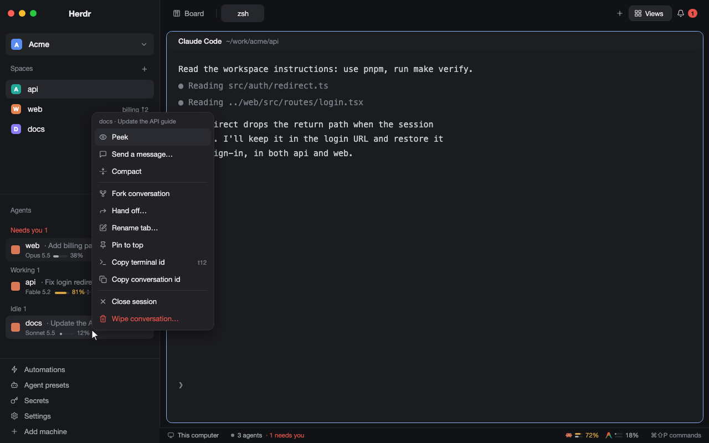

### Views

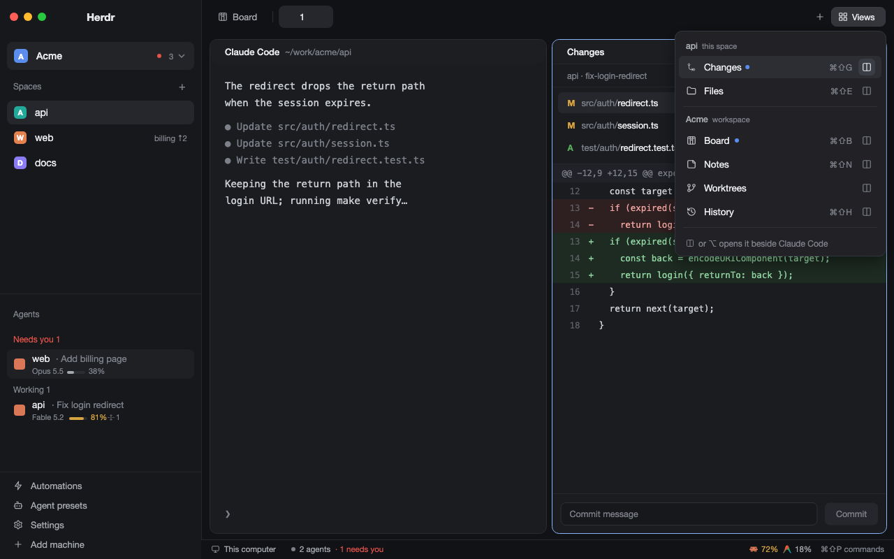

The tab bar's Views button opens the space's Changes and Files and the
workspace's Board, Notes, Worktrees and History, each full size in place of the
terminals (a pill before the tabs brings it back) or beside them as a pane.
Changes and Files follow the terminal you were using. Files edits text, code,
Markdown and SVG in place (Save, never on its own), previews Markdown, SVG and
images (Source | Preview | Split), searches the folder, and opens a file in the
app you pick (Open in … ▾, remembered per extension). Cmd-click a path in a
terminal or an agent's output and it opens in Files beside that terminal.

### Notifications

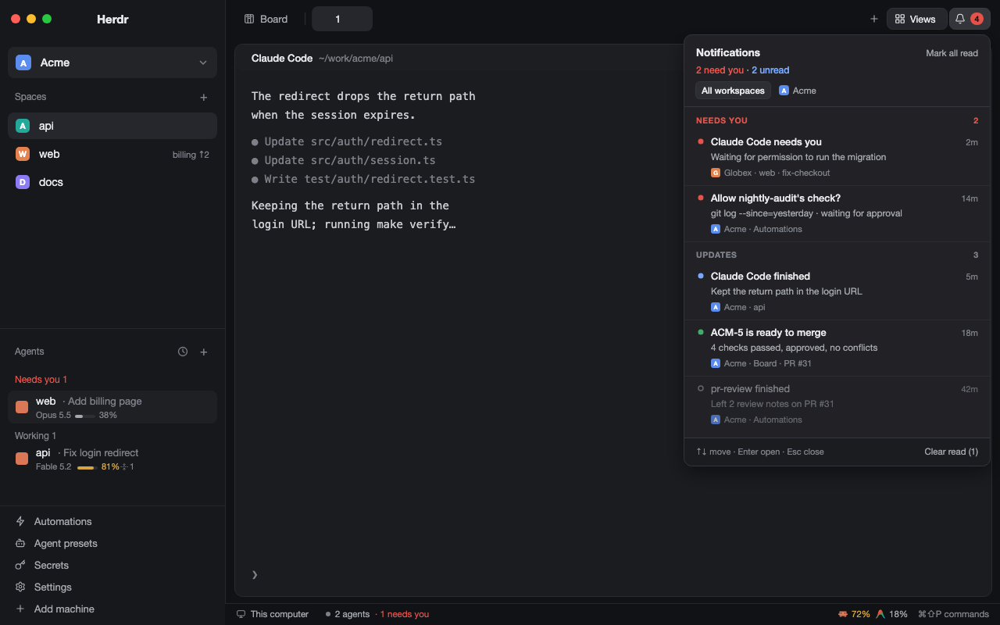

A bell at the right end of the tab bar lists what needs you and what finished,
in every workspace, with where each one is. Its count is red while anything
needs you and blue for unread updates only.

- **Needs you** stays at the top until it's resolved: an agent or a helper
  waiting on you, an automation run stuck at a question, a check you haven't
  allowed or that fails, a card's pull request failing, with changes asked for
  or conflicting while no agent works on it.
- **Updates**: an agent or an automation run that finished (not one with
  nothing to do), an automation that didn't start or was missed while Herdr was
  closed, a card's pull request ready to merge, merged or closed, and what only
  the system says (a machine needs a login, the background runner didn't
  start).
- **One click goes there**: the agent, the run's tab or the run in History, the
  card on its board, the automation. An update is read once clicked; Mark all
  read and Clear read tidy the rest, and updates go after 7 days.
- **It remembers** across restarts, the background runner's news from while
  Herdr was closed included.

### A task board

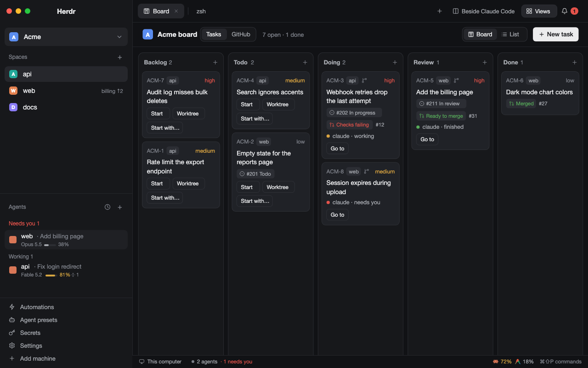

Each workspace has a board, as columns or as a list. A task is one markdown
file, so agents can read and write them too. The board belongs to the workspace,
not to one space: once opened, it's a pill before the tabs of every space of the
workspace, and it opens even when the workspace has no spaces. Open it from the
tab bar's Views, full size or beside your terminals.

- **Start** on a card starts an agent on its task, in the repo or in a fresh git
  worktree, with the preset you pick. The card then shows that agent's live
  status, and Go to takes you to it.
- **Start with…** beside it picks, for that one start, another preset or agent,
  another folder and the first message (Start's own, to edit), and starts the
  card the same way.
- **A card follows its pull request.** It shows whether checks fail, changes are
  requested, it conflicts or it's ready to merge, tells the card's agent when a
  check fails or a review arrives, and moves to the last column when it merges.
  A card still in Todo when its pull request opens moves to Review.

### Your GitHub project board

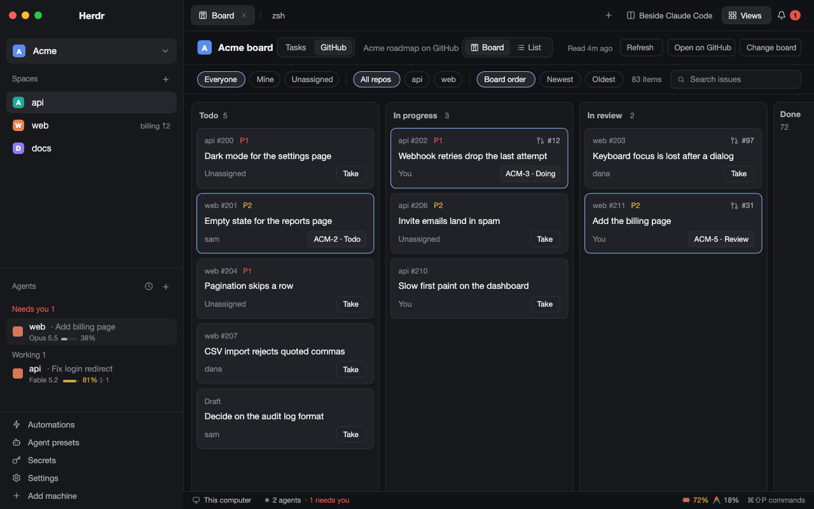

Tasks | GitHub in the board's header shows the workspace's GitHub project board
with its own status columns, or as a list with a section per status.

- **Filters**: Everyone, Mine or Unassigned, one repo, a search, and Newest or
  Oldest in place of the board's own order.
- **Take** on any item, yours or not, makes a card on your board with the
  issue's title, text, folder and priority. The card then shows the item's
  status on GitHub, follows a changed title, moves to your last column when the
  issue closes, and picks up a pull request of yours that closes it.
- **It only reads.** Nothing changes on GitHub, so assign yourself there when
  your team expects it. It needs `gh` with the `read:project` scope
  (`gh auth refresh -s read:project`).
- **A read is kept for 10 minutes**, so going back to the view shows the board
  at once. Refresh reads it now.

### Worktrees

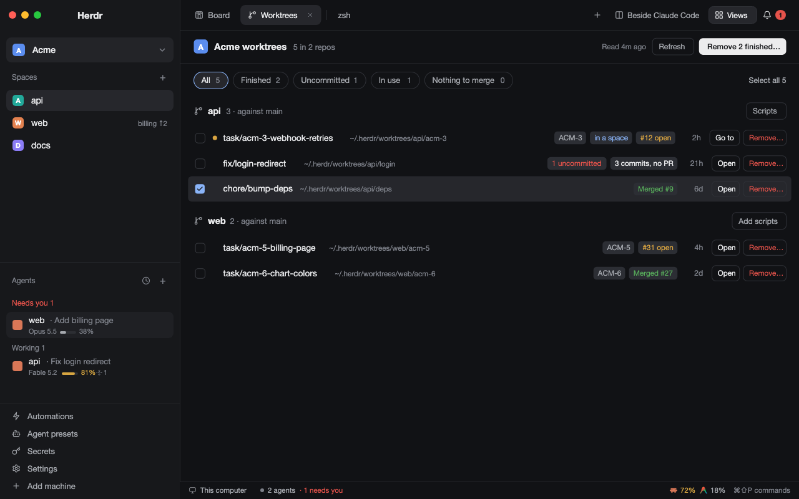

Worktrees in the tab bar's Views lists every git worktree of the
workspace's repos, wherever it was made. Like the board it belongs to the
workspace: a pill in the tab bar of each of its spaces.

- **Where each one stands**: merged, a pull request open, commits with no pull
  request, uncommitted changes, and whether a card, a space or a terminal is in it.
- **Remove N finished…** clears the merged, clean, unused ones; the branches
  stay. Checkboxes pick any others to remove together.
- **Scripts per repo**: a line to run in a new worktree (install, copy `.env`)
  and one to run before a worktree is removed. Only a line you saved or allowed
  runs.

### History

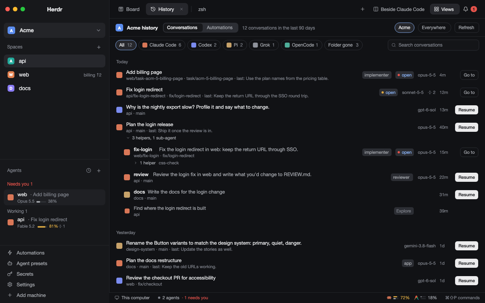

**History** in the tab bar's Views
lists the conversations your agents saved, newest first, whichever agent it
was: Claude Code, Codex, Pi, Grok, OpenCode and Antigravity. Like the board it belongs to
the workspace: a pill in the tab bar of each of its spaces.

- **Resume** continues a conversation in a new tab, in the folder it ran in.
  One started from a preset comes back as that preset.
- **Open ones say so** and offer Go to instead, so a conversation isn't opened
  twice.
- **This workspace or everywhere**, a chip per agent, and search across titles,
  prompts, folders and models.
- **Compactions**: a Claude Code, Pi or Antigravity conversation shows how many
  times it was compacted; opened, when each one was, how, how big the context
  was before and after, and what was in it at the end.
- **Automations**, the header's other side: each automation run with what its
  agent said at the end and how it went (running, needs you, done, failed,
  nothing to do), the whole report a click away, Go to while its tab is open
  and Resume once it's closed. A shell script's run shows its exit code, how
  long it took and its output, with Run again and Open log in Files.
- It only reads what the agents already keep; nothing is copied or changed.
  It needs Node 20.6 or newer.

### Notes

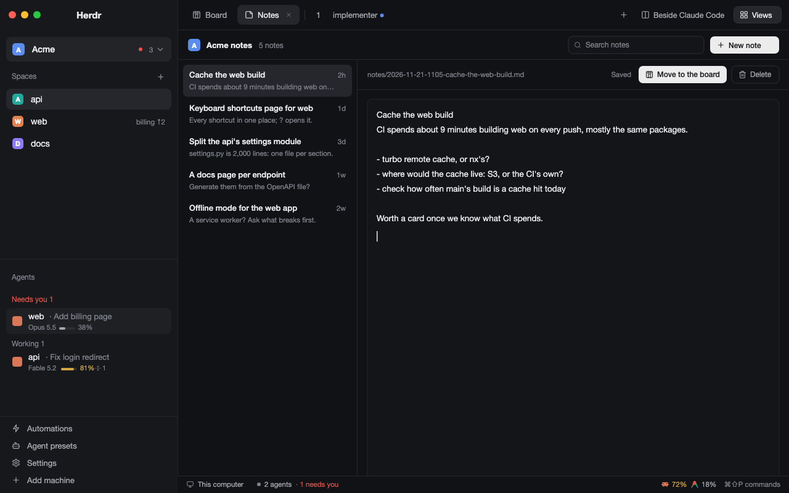

**Notes** in the tab bar's Views keeps a
workspace's rough ideas, the ones you don't want to start yet. A note is just
writing: its first line is its title, and it's saved as you type, one markdown
file each in the workspace's `notes/` folder. Like the board it's a pill in the
tab bar of each of the workspace's spaces.

- **Move to the board** when it's ready to be work: it becomes a card in the
  first column and leaves Notes (the note goes to the Trash), so work waits in
  one place and starts from the card.
- **Search**, newest edited first, and Delete moves a note to the Trash.
- An agent can add one too ("note this for later"), and a note an agent or an
  editor changes shows as it is now, unless you're typing in it.

### Automations

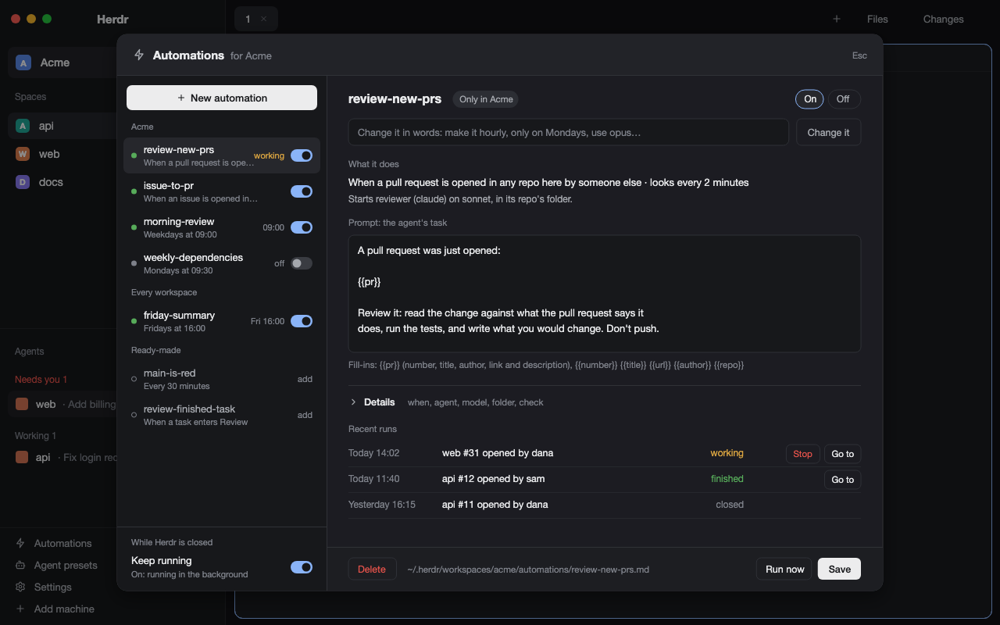

An automation starts an agent by itself, or runs a shell script with no agent
at all. You make one by saying what it should do and when, in your own words:
an agent's CLI (Claude, Codex, Antigravity or Pi, as Settings > Automations
says) drafts the trigger, the agent, its model and the prompt, or a script when
no agent is needed, and you read the draft before it's saved.

- **What sets one off**: a schedule (once or repeating), a task entering a board
  column, an agent finishing or needing you, files changing, GitHub (a PR or
  issue opened or labeled, a PR merged or waiting for your review, CI failing;
  asked every 2 minutes through `gh`), another automation finishing or failing,
  Herdr starting or the Mac waking, or another app calling `herdr-ws-run`.
- **Shell scripts** (`run: shell`): fetching repos, running tests, a backup. A
  script runs in the background by default (or in a tab), with what set it off
  as `$HERDR_…` variables; History keeps its exit code and output, and the bell
  pins a failure. Try it runs it on the spot; Preview shows what a run would
  get without starting anything.
- **Guardrails**: a timeout per automation (scripts 2 minutes by default), at
  most two agent runs at once (the rest queue), notification levels (problems
  only, results, everything, silent), quiet hours for the desktop sound, and
  what to do with a missed schedule.
- **Seven ready-made ones** to start from (issue to pull request, PR review, a
  broken default branch, a morning review and more): open one, read it, and
  Create adds it.
- **One workspace's own or for every workspace**
  (`~/.herdr/workspaces/<id>/automations/` or `~/.herdr/automations/`). A global
  one runs in each workspace as that workspace's own, a workspace's own of the
  same name replaces it there, and its switch turns it off for one workspace
  alone. `github * issue opened` watches every repo of the workspace it runs in.
- **A check first**: a command that runs before the agent, so no agent starts
  when there's nothing to do. It runs only once you've allowed it.
- **Keep running**, in Settings > Automations: a background process herdr-core
  keeps going while Herdr is closed (it needs Node 20.6 or newer). **Start at
  login** runs it after a reboot without opening Herdr, from a LaunchAgent on
  macOS or a systemd user unit on Linux; scripts then run without starting herdr-core. Without it
  they run while Herdr is open. A schedule missed while nothing was running
  runs when Herdr opens if it was due in the last 12 hours; older ones are
  reported as missed, with a toast, for Run now.
- **Each run is a tab** in the workspace's Automations space, which closes a few
  seconds after its agent finishes (not while it waits on you, while its helpers
  work, or while you're looking at it); History lists the run with Resume.
  `keep: true` keeps an automation's runs open, for one that asks you questions.
- **Agents can add one** themselves with `herdr-ws-run --add`, so you can tell
  one "tomorrow at 6, check X and if so do Y".

### Agent presets

A preset is an agent you start by name: a command (the program, its model and
effort) plus instructions. They're herdr-core templates, global or per
workspace, managed in the Agent presets screen (open it from the sidebar
footer), and they start from the tab bar's + menu, a card's Start or an
automation.

`examples/presets/` has ten to start from. Five are the usual roles: an
implementer, a reviewer, a watcher that can't push or write to GitHub (for
automations that only look), an orchestrator that splits a task across helper
agents with herdr-core's `hc`, and a foreman for when Claude's safety check
keeps cutting its helpers' replies. A helper shows under its orchestrator or
foreman in the Agents list, and a click on one opens it as a tab.

A **foreman** runs on Pi with a non-Claude model (an uncensored one by default),
cuts the work into steps of one or two tool calls, and gives each to a fresh
**hand** worker. It reads every stop, resumes the smallest missing step, halves
it if it is stopped again, and does it itself after a third. It also takes
Claude's "switch to Opus" offer for you. A **hand** works in Sonnet at low
effort and keeps its answer to a line or two; **hand-strong** is the same on Opus
at high effort, for a step Sonnet got wrong.

The other three are for what an agent would otherwise hand to a subagent of its
own, where you can't watch it or type to it:

- a **scout** finds where something is and how it works in the code, and
  answers with files and lines;
- a **researcher** answers what the repo can't, from docs, source and the web,
  with a source for each finding;
- a **planner** reads the code and writes a plan an implementer can follow.

None of them changes code. With the starter guide (see Install), Claude and
Codex start one of these where they'd use their own subagent.

### Secrets

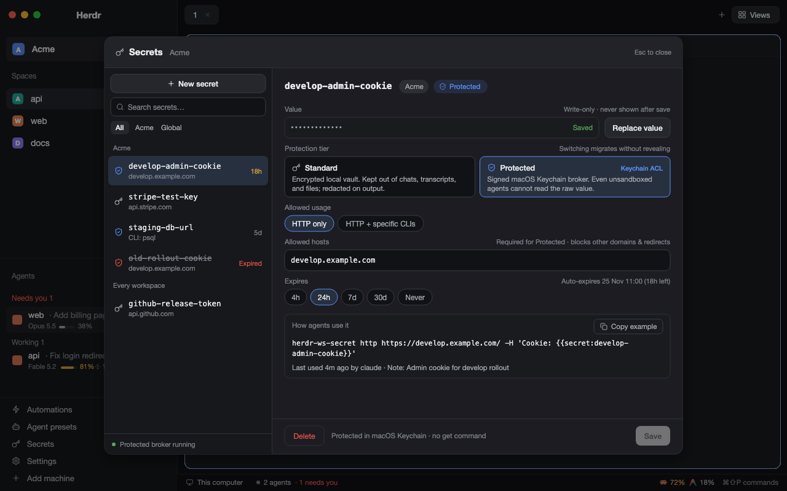

Tokens, cookies and keys that agents use by name and never see. Open Secrets from
the sidebar footer, add a secret (write-only: after Save it shows only as
`••••` · Saved), and an agent calls
`herdr-ws-secret http <url> -H 'Authorization: Bearer {{secret:name}}'` or
`herdr-ws-secret run --env VAR=name -- <command>`: the value is filled in for the
call and replaced by `[secret:name]` in whatever comes back (its plain, URL-encoded,
base64, hex and JSON forms; not a value inside something larger, or one the command
changed). No command prints a value, and none takes one as an argument. The starter
guide tells agents to use it instead of asking you to paste a token into the chat.

- **Standard** needs no setup: the value is encrypted under `~/.herdr/vault`, its
  key in your login Keychain (on Linux, your desktop's keyring through `secret-tool`,
  else a `vault.key` file beside it; `HERDR_VAULT_KEY=file` picks the file). It keeps the value out of chats and of what agents
  print, but any program running as you can still use it through
  `herdr-ws-secret`, or read it.
- **Protected** (macOS): Settings > Secrets builds and signs a small broker on your
  Mac (`/usr/bin/swiftc`, Xcode's command line tools). Each Protected secret is a
  Keychain item only that exact build can read; it goes only to the hosts you
  allow, or to commands pinned to their full paths, and anything that would widen
  that asks you in a macOS dialog first. A command you allow gets the value with
  whatever arguments the agent gives it, so allow only tools that talk to fixed
  hosts. After an update macOS asks once per Protected secret: allow that only
  right after you pressed Install or Update yourself, and Deny a prompt that comes
  on its own.
- Each secret is for one workspace or every workspace (that's for naming and lists:
  the workspace is what the agent says it's in, not a wall between projects), has an
  expiry (4h to never; an expired one is refused), and says when and by whom it was
  last used. Uses can show as quiet entries in the bell, and an automation can hand
  secrets to its check or shell script with `secret_env:` (never to an agent's own
  process: an agent uses them by name).

### Settings: Features, Agents, Automations, Files, Secrets and Experimental

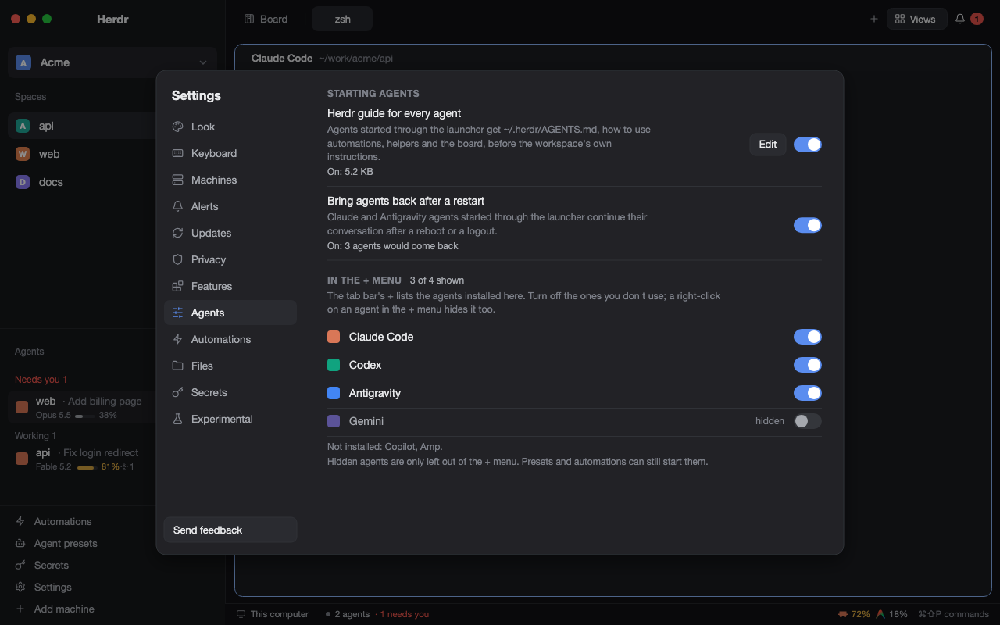

The sidebar's Settings opens Herdr's own Settings window with six sections of
ours at the end, after Privacy:

- **Features**: a switch for each of the package's add-ons (Board, Notes,
  Worktrees, History, Automations, Secrets, the status bar's plan usage, the agent
  rows' numbers and the tab bar's notifications bell), all on to start with and one setting for every workspace. Off
  hides it everywhere and stops its background work (no automation runs, no
  pull request is followed, no usage is asked); nothing is deleted, so on brings
  it back as it was. Each row says what it adds, and while off what's gone and
  what stays.
- **Agents**: every switch the package has for agents, in one place: **Starting
  agents** (the Herdr guide for every agent, with Edit / Write one, and bringing
  Claude and Antigravity agents back after a restart), **In the + menu** (which
  installed agents the tab bar's + menu lists; the menu's "Choose agents…" opens
  this page).
- **Automations**: **While Herdr is closed** (Keep running for automations and
  board cards' pull requests, and Start at login), how many agent runs go at
  once, quiet hours for the desktop sound, and which CLI drafts automations.
- **Files**: the Files view's defaults: what Markdown and SVG open in, the app
  Open in starts with, whether ignored files show, where a Cmd-clicked path
  opens (beside the terminal, full size, or off to leave it to macOS) and
  whether Files takes every file or only text, images and folders. A change
  applies at once, to every open Files.
- **Secrets**: the Protected broker (Install & enable, Restart, Update, Uninstall,
  with what it's doing now), the tier and expiry a new secret starts with, and
  which uses show in the bell (off, Protected only, always).
- **Experimental**: features that lean on things other programs don't promise to
  keep the same, each off until you turn it on and saying why it's experimental
  (the first: wiping Antigravity conversations from the Agents list's menu).
  They're kept in `~/.herdr/settings.jsonc`, each with what it does in a comment
  above it.

Herdr's sections are Herdr's: the package rebuilds its copy from Herdr's own
file whenever Herdr updates it. The macOS menu's Settings… still opens Herdr's
plain window; to have Cmd+, open this one, set `"cmd-,"` in the `global`
section of your `~/.config/herdr-app/keys.json` to `"mod.open:ws-settings"`
(or to `ws-switcher.settings/features`, `ws-switcher.settings/agents`,
`ws-switcher.settings/automations`, `ws-switcher.settings/files`, `ws-switcher.settings/vault` or `ws-switcher.settings/experimental` to open it on a section; `ws-switcher.settings/extras` opens Agents). Herdr then
leaves that file to you: new default shortcuts in its updates are added by hand.

### And when you're away

- **After a reboot or a logout**, the Claude and Antigravity agents you hadn't closed come back
  in their tabs, resumed with their conversations, helpers included.
- **Desktop notifications**: while you're in another app, Herdr's notifications
  (an agent needs you or finished, an automation's news) also show on your
  desktop, and a click takes you to the agent. With Keep running on they come
  while Herdr is closed too.

## Platforms

- **macOS**: supported. It's built and used there every day.
- **Linux**: experimental. Tried in a VM on Ubuntu 26.04 (ARM64, GNOME on Wayland):
  every screen, the background runner, automations, Files and Standard secrets
  work; Protected secrets need macOS. Not yet tried on other desktops (KDE,
  Sway), other distributions, a real GPU, or with signed-in agents and GitHub.
  Please open an issue for what breaks.
- **Windows**: experimental. Tried in a VM on Windows 11 (ARM64, running
  Herdr's x64 build under emulation): every screen, the background runner and
  Start at login, automations, Files, desktop notifications and Standard
  secrets work; Protected secrets need macOS. It needs Git for Windows (its
  `sh` runs the scripts) and Node 20.6 or newer. Not yet tried on an x64 PC or
  with signed-in agents and GitHub. See "On Windows" under Install.

What Linux and Windows use in macOS's place:

| | macOS | Linux | Windows |
|---|---|---|---|
| The scripts | `sh` | `sh` | Git for Windows' `sh`, through a `.cmd` beside each command |
| Start at login | a LaunchAgent | a systemd user unit (`systemctl --user`) | a scheduled task (Task Scheduler) |
| Standard secrets' key | the login Keychain | the desktop keyring (`secret-tool`, package `libsecret-tools`), else a file | sealed for your Windows user (DPAPI) |
| Desktop notifications | `terminal-notifier`, else `osascript` | `notify-send` (`libnotify-bin`) | a Windows toast (a click does nothing) |
| Open in ▸ | the apps macOS offers | your editors and the `.desktop` apps for the file's type (`xdg-mime`, `gio`) | your editors, the apps Windows' Open with lists, and Notepad |
| Copy | `pbcopy` | `wl-copy` (`wl-clipboard`) or `xclip` | PowerShell's `Set-Clipboard` |
| Move to trash | `trash` | `gio trash`, else `~/.herdr/trash` | the Recycle Bin |
| Clicking a path in a terminal | Cmd-click | Ctrl-click | Ctrl-click |

## Install

One line, whether you have Herdr yet or not. On macOS and Linux:

```sh
curl -fsSL https://madtocc.github.io/herdr-workspaces/install.sh | sh
```

On Windows, in PowerShell:

```powershell
irm https://madtocc.github.io/herdr-workspaces/install.ps1 | iex
```

- **Herdr missing:** it's installed first, with Herdr's own installer, which
  adds herdr-core too. (Herdr's installer has no build for Windows on ARM or
  Intel Macs: install Herdr there yourself, then run the line.)
- **Then the steps below, done for you:** the layout and mods copied, the
  commands on your `PATH`, the agents you have added to `programs.json`, and
  Herdr opening on the layout. It asks before two things: the line that brings
  agents back after a restart, and the example presets. On Windows it also
  offers Git for Windows and Node through winget.
- **Run it again to update.** A file you changed is kept in
  `~/.herdr/install/backup/` before the new one takes its place. Your
  workspaces, tasks, presets and automations are never touched.
- **Options:** `--dry-run` says what would change and changes nothing,
  `--uninstall` takes it out again, `--yes` asks nothing
  (`… | sh -s -- --yes`). The top of each script lists the rest, and
  PowerShell's way to pass them.

The two scripts download and run code. Read [install.sh](install.sh) or
[install.ps1](install.ps1) first if you prefer. From a clone, `./install.sh`
(Windows: `powershell -ExecutionPolicy Bypass -File install.ps1`) installs
that copy.

Or ask your agent to add this layout (Herdr's own guide, `~/.config/herdr-app/AGENTS.md`,
says how), or by hand:

1. Copy `layouts/workspaces.json` to `~/.config/herdr-app/layouts/` and the nineteen
   folders in `mods/` to `~/.config/herdr-app/mods/` (rename them if a name is taken).
2. For agent instructions from the + menu, put the launcher on your `PATH` and
   point Herdr's `~/.config/herdr-app/programs.json` at it. `herdr-ws-run` starts automations from other
   apps and lets agents add them, and `herdr-ws-notify --off` / `--on` is the
   switch for the desktop notifications (on macOS, `brew install terminal-notifier`
   makes a click on one go to Herdr). `herdr-ws-secret` is how agents use your
   secrets (it needs Node 20 or newer):
   ```sh
   ln -s ~/.config/herdr-app/mods/ws-switcher/bin/herdr-ws-agent ~/.local/bin/
   ln -s ~/.config/herdr-app/mods/ws-switcher/bin/herdr-ws-run ~/.local/bin/
   ln -s ~/.config/herdr-app/mods/ws-switcher/bin/herdr-ws-runner ~/.local/bin/
   ln -s ~/.config/herdr-app/mods/ws-switcher/bin/herdr-ws-notify ~/.local/bin/
   ln -s ~/.config/herdr-app/mods/ws-switcher/bin/herdr-ws-secret ~/.local/bin/
   ```
   ```json
   { "programs": { "claude": { "run": ["herdr-ws-agent", "claude"] },
                   "codex":  { "run": ["herdr-ws-agent", "codex", "--no-daemon"] } } }
   ```
   If you use Antigravity, add `"antigravity": { "run": ["herdr-ws-agent", "agy"] }`
   too, and for Pi, `"pi": { "run": ["herdr-ws-agent", "pi"] }`. Add only the agents you have: Herdr looks for the first word of the line,
   here the launcher, so a missing agent would still show as installed.
3. To bring Claude and Antigravity agents back after a restart, add this line to
   `~/.config/herdr-core/config.toml`. herdr-core then starts terminals through
   `herdr-ws-resume`, which resumes a terminal's agent, else runs your usual shell.
   The switch in Settings > Agents turns it off and on again
   (or `herdr-ws-resume --off` / `--on`). The `ln` line puts `herdr-ws-resume`
   (`--status`, `--list`, `--forget`) on your `PATH`:
   ```toml
   shell = ["/bin/sh", "-c", "r=\"$HOME/.config/herdr-app/mods/ws-switcher/bin/herdr-ws-resume\"; [ -x \"$r\" ] && exec \"$r\"; exec \"${SHELL:-/bin/sh}\" -l"]
   ```
   ```sh
   ln -s ~/.config/herdr-app/mods/ws-switcher/bin/herdr-ws-resume ~/.local/bin/
   ```
4. Switch to it: `herdr-app do layout.switch '{"name":"workspaces"}'`
   (`ctrl-shift-l` cycles back).
5. Open the switcher and pick **New workspace from a folder…**. Views, at the
   right of the tab bar, opens the workspace's board.
6. To start from the examples, copy them where Herdr reads them:
   - presets for every workspace: `examples/presets/*.md` to
     `~/.config/herdr-core/templates/` (where `hc run <name>` finds them too);
   - presets for one workspace: to `~/.herdr/workspaces/<id>/agents/`;
   - the scout, the researcher and the planner run Claude in auto mode
     (`--permission-mode auto` in their commands), so a helper never waits for
     someone to answer a prompt. If you can't use auto mode, change that word
     in Agent presets;
   - the foreman's command runs `pi` on the uncensored model
     `deepseek-v4.1-flash-uncensored`. Have `pi` set up with it, or change its
     `--model` in Agent presets to another non-Claude model you have;
   - automations need no copying: the Automations screen lists the ready-made
     ones (`mods/ws-automations/starters/`), and Create adds the one you open.
     They're written for the `implementer` and `reviewer` presets;
   - a guide for every agent the launcher starts (how to use automations, hc
     helpers and the board): open Settings > Agents and pick **Write one**
     beside "Herdr guide for every agent", which writes the starter to
     `~/.herdr/AGENTS.md` and opens it. The switch beside it turns it off.

### On Windows

Herdr's folder is `%USERPROFILE%\.config\herdr-app` on Windows too, so step 1,
and 4 to 6, are the same (with `~` as `%USERPROFILE%`). herdr-core's own folder
is `%APPDATA%\herdr-core`: presets for every workspace go in its `templates`.
In place of steps 2 and 3:

1. Install Git for Windows and Node 20.6 or newer, for instance
   `winget install Git.Git OpenJS.NodeJS.LTS`.
2. Add `%USERPROFILE%\.config\herdr-app\mods\ws-switcher\bin` to your user
   `Path` (Start, "Edit environment variables for your account", Path, New).
   Each command has a `.cmd` file there that runs it with Git's `sh`, so
   `herdr-ws-run`, `herdr-ws-secret` and the others work from PowerShell, and
   `programs.json` is the same as in step 2. Quit and open Herdr again, so
   herdr-core gets the new `Path`.
3. To bring agents back after a restart, this line in
   `%APPDATA%\herdr-core\config.toml` makes herdr-core start terminals through
   `herdr-ws-resume.ps1`, which is PowerShell, as herdr-core's own shell, with
   the terminal's agent first when it has one (`pwsh.exe` in place of
   `powershell.exe` for PowerShell 7):
   ```toml
   shell = ["powershell.exe", "-NoExit", "-ExecutionPolicy", "Bypass", "-Command", ". \"$env:USERPROFILE\\.config\\herdr-app\\mods\\ws-switcher\\bin\\herdr-ws-resume.ps1\""]
   ```
4. Keys: the recipe's Linux set doesn't suit Windows (Ctrl+Alt is AltGr there);
   it gives a Windows set.

Outside those folders it registers an app id, "Herdr", for its toasts
(`HKCU\Software\Classes\AppUserModelId\Herdr.Workspaces`), keeps two small
compiled helpers (Open in's and the Recycle Bin's) in `%LOCALAPPDATA%\herdr-ws`, and Start at login adds a
task under Task Scheduler's `\Herdr\`, which turning it off removes.

An agent's own `hc run … herdr-ws-agent …` needs its task on one line there
(cmd can't take a line break in an argument); the screens handle that for you.

**What the installer touches:** Herdr's folder (the layout, the `ws-*` mods,
`programs.json`, and `shared.json` only when Herdr has never run), links in
`~/.local/bin` (Windows: your user `Path`), herdr-core's `config.toml` and
`templates` when you say yes, and `~/.herdr/install/` (the list of files it
put in place, and the ones it replaced or took out). It reaches github.com for
the package and, when Herdr is missing, releases.herdr.dev.

**What it touches:** it reads `~/.herdr/workspaces` and the folders of
each workspace's root. The `foreman` preset writes its plan under
`~/.herdr/scratch/` and starts `hand` terminals with `hc run`; those helpers
edit the folders they are given, by their own tasks. Two of the ready-made
automations (`issue-to-pr`, `main-is-red`) tell their agent to make git worktrees under
`~/.herdr/worktrees/` and to push branches and open pull requests with your
`gh` login; two have a check that runs `git log` and `gh` in the workspace's
folders, and `morning-review`'s also runs `git fetch` in each repo. It writes `~/.herdr/workspaces/.index`, a new
workspace's files when you make one, its `workspace.jsonc` when you rename it
or change its group, `~/.herdr/workspaces/.order.json` when you drag or fold in
the switcher menu, `~/.herdr/agent-menu.json` (the agents you hide from the +
menu) when you hide one or bring it back,
task files in `~/.herdr/workspaces/<id>/tasks/` and automation files in
`~/.herdr/workspaces/<id>/automations/` and `~/.herdr/automations/` (the
ones for every workspace; from the Automations screen, a ready-made one
included, from
`herdr-ws-run --add`, `--off` and `--on`, and `enabled: false` after a one-time
one runs). Following a card's pull request writes `pr:` into its task and, when
it opens on a card still before the start column or merges, its `status:`, and types a message into the card's agent with
`hc send` when a check fails, a review arrives or it conflicts. With Keep running
on, that work is done by a Node process herdr-core holds as the terminal
`herdr-ws-runner`: it writes `~/.herdr/runner/` (a shell automation's output goes to
`~/.herdr/runner/logs/`, deleted with its run), starts runs with `hc run`, ends
old and finished run terminals with `hc kill`, and reads herdr-core's terminal list, the app's
layout document, `shared.json`, `programs.json` and `view.json` (which tab is shown),
and connects to the app's socket to see whether Herdr is open. Start at login writes
`~/Library/LaunchAgents/dev.herdr.ws-runner.plist` and loads it with `launchctl` (on Linux,
`~/.config/systemd/user/herdr-ws-runner.service`, enabled with `systemctl --user`); the runner
it starts looks for herdr-core's socket before calling `hc`, so it doesn't start herdr-core
until an agent automation fires. A shell automation runs its script (`bash`, `zsh` or `sh`)
as you, in its folder, once you've allowed it. Either runner closes an
automation run's tab once its agent has finished (unless the automation says `keep: true`),
and reads the launcher's note of which conversation that terminal held
(`~/.herdr/resume/<core>/<terminal>.session`), for History's Resume, and, for an agent
asked to end with an outcome line, its screen with `hc read` (the line and the one before it
go into the run's record, for the bell). The bell keeps its log, what you read or dismissed
and the news only a notification said, in `~/.herdr/notifications.json`. Deleting a workspace, a task or an
automation (after a confirmation) moves it to the Trash, and so does wiping an
agent from the Agents list's right-click menu: that Claude Code or Pi
conversation's transcript and the folders Claude keeps for it under
`~/.claude/`. That menu also types into an agent with `hc send` (Send a message,
Compact), presses Esc there with `hc keys` (Interrupt) and puts a terminal or
session id on the clipboard (`pbcopy`, `wl-copy` or `xclip`). Settings > Features,
Settings > Automations, Settings > Files and Settings > Experimental write `~/.herdr/settings.jsonc` (the Files
section asks the system which apps open a text file, with `command -v` and `osascript` (on Linux,
`xdg-mime` and the `.desktop` files that list its type), about
a sample file it writes once under `~/.config/herdr-app/data/ws-settings/`); the switcher, the background
runner (every 2 seconds), the status bar and `herdr-ws-run` (with `node` when it's
there) read it to know which add-ons are off, and the sidebar footer reads the shown
layout's file (`layouts/<name>.json`, at start, on a layout switch and every 30
seconds) and sizes its own block with `layout.resize` (Herdr keeps that in
`layouts/.state/`). The switcher reads Herdr's own Settings
window (`frame/settings/main.js` in Herdr's folder) to write its copy,
`mods/ws-settings/main.js`. With its experiment turned on, wiping an Antigravity
agent also edits Antigravity's own index files and prompt history in
`~/.gemini/antigravity-cli` (a copy of each, and what it removed, goes to
`~/.herdr/trash/` first, and the conversation's files go there too, until you
move that folder to the Trash), and runs `ps` and `lsof` to see whether
Antigravity runs or has it open; the Agents list runs `ps` once per Antigravity
agent's process to tell which conversation it holds. The board's Worktree runs
`git worktree add` on a new `task/…` branch; otherwise your repos aren't
touched. It runs `sh` (editor, Trash, symlinked folders), `herdr-app do` (the
board's and automations' new tabs, and `pane.split` for a view opened beside
the terminals) and, through the launcher, Start and
automations, your agents. Changes (`ws-changes`, a copy of Herdr's own) runs `git` reads (status, diff,
branch, `worktree list`) in the repo of the terminal it follows (or nested repos found up to three
levels under a non-git space folder with `sh`, or PowerShell on Windows) and, when you press Commit,
`git add -A` and `git commit` in the selected checkout, as Herdr's Changes does; Files (`ws-files`)
lists folders and reads files there, as Herdr's Files does, and also writes the
file you save (on this computer only), searches with `rg` (else `grep`), runs
`git` reads (branch, status, ignored files), `wc -c`, `head -c` and `sips` (an
image's size), links images it previews under `~/.config/herdr-app/data/ws-files/`
(`ln -sf`, `unlink`), asks macOS which apps open a file (`osascript`; on Linux,
`xdg-mime` and the `.desktop` files), looks for known editors with `command -v`,
starts the app you pick (`open`; on Linux the editor's command, `gio launch` or
`xdg-open`), or reveals it (`open -R`, `xdg-open` on its folder), and remembers the pick in `~/.herdr/files-prefs.json`. Its right-click menu makes,
renames and duplicates files and folders with `mkdir`, `mv` and `cp` (never over an existing
name), moves them to the Trash with `trash` or `gio trash` (else into `~/.herdr/trash`), counts a
folder's files with `find`, copies paths to the clipboard and opens a terminal tab there. It and its Cmd-click handler
read their defaults from `~/.herdr/settings.jsonc`. A Cmd-click
on a path in a terminal is checked with `sh` (on that terminal's machine) before
Files takes it. The Worktrees tab reads git in the workspace's repos and
their worktrees (`worktree list`, `for-each-ref`, `status`) and each repo's pull
requests with `gh pr list`. Removing a worktree there (after a confirmation)
deletes its folder with `git worktree remove`; the branch stays. History reads the
conversations your agents keep on this computer (`~/.claude/projects`, `~/.codex/state_*.sqlite`,
`~/.pi/agent/sessions`, `~/.grok/sessions`, `~/.local/share/opencode/opencode.db`,
`~/.gemini/antigravity-cli`): titles, the
first and last thing asked, folder, branch, model and the newest reply's token counts, and in Claude's,
Pi's and Antigravity's transcripts the lines that record a compaction (the whole file once, then
only what it gained), never the rest, and it changes nothing there.
It runs `node` (and `sqlite3` when Node is older than 22.13) to read them, keeps what it read in
`~/.herdr/cache/history/index.json`, and starts your agent with its resume command when you click
Resume. With restart resume on, the launcher's hook also notes each Claude session's start command
in `~/.herdr/resume/started`. For which conversation started which, it reads Claude's sub-agent
files (`<session>/subagents/*.meta.json`) and finds the `hc run` calls in Claude transcripts in
that same reading; and the launcher, starting an agent in an hc terminal, asks `hc ls` in the
background which terminal started it (and for up to 30 seconds which session the agent opened, from
`~/.claude/sessions/<pid>.json` or Pi's stats note) and appends a line to `~/.herdr/resume/parents` (with
`~/.herdr/resume/<core>/<terminal>.parent` while it runs; the hook adds one when Claude or
Antigravity opens a session). Its right-click Wipe moves a Claude Code or Pi conversation's files
to the Trash as the Agents list's does (after `terminal.kill` on the terminal it's open in; to tell
which, it asks `hc get` for each agent terminal's program and reads Claude's `~/.claude/sessions/`,
the launcher's notes and `ps`, and `stat` to see whether its transcript was just written), puts a session id on the clipboard for
Copy session id, and hands an Antigravity one to the Agents list's Wipe. Nothing it reads leaves the computer. The Agents list's numbers
come from the same places, read by `node` every few seconds while an agent works: what Claude
Code hands its status line, which `herdr-ws-statusline` keeps in `~/.herdr/agents/<core>/`
(the launcher sets it as the status line, in that session's `--settings`, where you have none),
Claude's `~/.claude/sessions/<pid>.json` (which session a running Claude is) and its transcript,
the file the launcher's Pi extension writes there, and Antigravity's transcript; the launcher's
restart note says which. It reads only the newest reply's model and token counts, the
compactions and the cost, keeps where it stopped in each transcript in
`~/.herdr/cache/agentstats.json`, asks `hc get` which program each agent's terminal runs, and
removes its files of terminals gone two days. For the plan usage in the status bar it runs
`claude -p /usage` (no session kept, hooks and MCP servers off) and `agy -p /usage` (no
conversation kept, its log to `/dev/null`, and a do-nothing `open` first on its PATH so a signed-out
Antigravity can't open a sign-in page) every 10 minutes: each agent's own usage report,
which it asks Anthropic or Google for with your sign-in; the package never reads a sign-in
itself. Until that answers, the status bar reads the limits from the status line
files in `~/.herdr/agents/`. Notes writes each note to `~/.herdr/workspaces/<id>/notes/` as you
type (a new note's file is renamed while its first line is being written) and a task file from
Move to the board; that and Delete move the note to the Trash. On its first run it makes
the Scratch workspace (`~/.herdr/workspaces/scratch/`); New scratch space makes folders in
`~/.herdr/scratch/`, and there it deletes empty ones nobody is in (`rmdir`) and moves ones
with files to the Trash after 7 days unused, unless they have a `.keep` file. It looks at
nothing else there. Deleting Scratch closes its spaces and moves `~/.herdr/scratch`, kept
folders included, to the Trash with it. A repo's two
worktree scripts (`~/.herdr/workspaces/<id>/worktrees.json`) are shell lines Herdr
runs as you: setup in a new worktree the board makes, archive before a removal.
Like a check, only a line you saved or allowed in the screen runs
(`~/.herdr/workspaces/.worktree-scripts.json`). The launcher reads `~/.herdr/AGENTS.md`, your global guide, and `~/.herdr/guide/switch`, which Settings > Agents' guide switch writes; Write one there creates the guide from the starter and opens it in your editor. The launcher lets Claude, Codex and Antigravity read and edit
the workspace's root, its folders elsewhere and its `tasks` and `notes` folders; Claude gets Herdr's own folders in that one session's `--settings`, and no settings file is written. For Antigravity it writes the instructions as a rules file under `~/.herdr/agy/`, gives Antigravity that folder, and removes the folders there that no launch has used for 90 days. Pi takes no folders, so the launcher names them in Pi's instructions, and passes your `~/.pi/agent/APPEND_SYSTEM.md`, when you have one, along with them. Automations watch the folders a files automation
names, read calls `herdr-ws-run` leaves in `~/.herdr/workspaces/.inbox` (and
delete them), and close an automation's older run tabs once their agent is done.
An automation's `check:` is a shell command Herdr runs by itself, as you, in the
automation's folder before each run, to see whether there's anything to do. It runs only a line you've allowed: one you saved in the Automations screen, or one you allowed there after an agent or a file brought it.
For restarts, the launcher keeps notes of the Claude agents it starts in
`~/.herdr/resume/` (their command and session), runs `hc ls` to drop the notes
of closed tabs, and gives Claude two hooks (`--settings`) that note its session
and drop the note when you leave it. Antigravity's hook is a `.agents/hooks.json` in its
rules folder that notes its conversation. To offer each agent's models, the Presets and
Automations screens run, through your login shell and at most once a day each,
`codex debug models`, `pi --list-models`, `agy models` (it asks Antigravity's server),
`opencode models` and `grok models`, for those that are installed, and keep each answer
(or that the program isn't there) in `~/.herdr/cache/models-<program>.json`; they still
read an older `~/.herdr/cache/agy-models.json`. With the `shell` line in herdr-core's
config, every new terminal starts through `herdr-ws-resume`.
Every notification Herdr shows is also handed to `herdr-ws-notify`, and so is the
background runner's news while no window is open. It asks macOS which app is in
front (`lsappinfo`), then runs `terminal-notifier`, else `osascript`, or
`notify-send` on Linux, with the notification's title and text, and nothing when
none is installed. A click on a terminal-notifier one runs `herdr-app do` with
the toast's own action. Its switch is `~/.herdr/notify/switch`. The launcher
reads a workspace's `BRIEF.md`, when there is one, and puts it in the
instructions of the agents started there.
Secrets keeps `~/.herdr/vault/` (`0700`): `meta.json` (each secret's name, scope,
rules and last use, never a value), `standard.enc` (Standard values, encrypted),
`usage.jsonl` (one line per use, never a value), a `.lock`, the broker's socket,
log and binary (`bin/herdr-ws-vaultd`), `vault.key` only where there's no Keychain,
and for a moment the screen's `.inbox-*` handoff files, which `herdr-ws-secret ingest`
deletes. In your login Keychain it keeps one item `herdr-ws-vault-standard` (Standard's
key) and one `dev.herdr.ws-vault.protected` item per Protected secret. Installing the
Protected broker runs `/usr/bin/swiftc` and `codesign`, writes
`~/Library/LaunchAgents/dev.herdr.ws-vaultd.plist` and loads it with `launchctl`;
Uninstall unloads it and removes the plist. `herdr-ws-secret run` makes a `0700`
folder under `$TMPDIR` for `--file` secrets and removes it when the command ends.
Settings > Secrets writes the `vault` block of `~/.herdr/settings.jsonc`.
`herdr-ws-secret http` sends a request to the URL an agent (or you) gives it, with a
secret only to the hosts that secret allows; nothing else in Secrets uses the network.
Besides that, four things use the network: GitHub automations (`gh api` with your login, every
2 minutes per watched repo), cards with a `pr:` or `branch:` line (`gh pr view`
with your login, every minute per open pull request), the board's GitHub view
(`gh api graphql` and `gh project list` with your login: the linked project board
when its last read is over 10 minutes old and the view is open, and the items you
took every 5 minutes; it only reads, writes the board's link into `workspace.jsonc`
and keeps the board as last read in `~/.herdr/cache/github-boards/`), and the Automations screen's Draft it and Change it,
which run `claude -p` with your Claude login and no tools (or, as Settings >
Automations' Drafter says, `codex exec` read-only and ephemeral, `agy -p` with a
do-nothing browser shim, or `pi -p` with no tools or session, each with its own
login). That sends that CLI's provider your words, the workspace's name, root,
folder names, GitHub repos, presets and automation names, and, for a change, the
automation as it stands.

Built for Herdr 0.1.14; `ws-spaces`, `ws-agents`, `ws-tabs`, `ws-new-menu` and
`ws-chrome` are copies of that version's `spaces`, `agents`, `tabs`, `new-menu`
and `workspace-chrome`. `ws-toast` and `ws-status` are copies of 0.1.16's `toast`
and `workspace-status`.

## Updating

`CHANGELOG.md` lists what changed in each version, and your copy says which
one you have in `~/.config/herdr-app/mods/ws-switcher/VERSION` (none: older
than 0.1.0's notes, so read them all). To hear about new versions, watch the
repo on GitHub for releases (Watch → Custom → Releases).

- **You used the installer:** run the same line again (see Install). It
  replaces what changed and adds what's new.
- **You copied the files as they are:** copy `layouts/workspaces.json` and the
  nineteen folders in `mods/` again, and do what the new versions' notes say
  (a new script to link, say). Your workspaces, tasks, presets and automations
  live elsewhere and aren't touched.
- **You or your agent changed them:** tell your agent "apply what's in this
  repo's `CHANGELOG.md` after version <yours>, keeping my changes", with
  `RECIPE.md` for the details of each one.

## License

Apache License 2.0. `ws-spaces`, `ws-agents`, `ws-tabs`, `ws-new-menu`,
`ws-chrome`, `ws-toast` and `ws-status` are modified copies of Herdr's own mods, also Apache 2.0; see `NOTICE`.

## Working on it

`AGENTS.md` is the checklist for a change (for you or your agent): what to update
with it, the picture, what the mods share, how to test and release.

Edit the live files in `~/.config/herdr-app`, then copy them here with
`scripts/sync-from-home.sh`.

Every change people would notice gets a line under `## [Unreleased]` in
`CHANGELOG.md`, in the same commit. `scripts/release.sh <version>` turns that
into a version (the middle number for anything new, the last for fixes only),
writes `VERSION`, commits and tags it; `--publish` also pushes and makes the
GitHub release from those notes.

The pictures are drawn, not screenshots: `preview.png` from
`mods/ws-switcher/preview.svg` (also the picture in Herdr's layout settings), and
the ones in `previews/` from the `preview*.svg` beside each mod. Edit the live
drawing, sync, and run `scripts/render-preview.sh`.

To try a change without touching your own window, `scripts/sandbox.sh up`
opens a second Herdr with its own core, home and two demo workspaces under
`/tmp/herdr-ws-sandbox`, running copies of the live mods. `sandbox.sh app …`
and `sandbox.sh hc …` talk to it, `sync` copies the live mods in again, and
`down` ends and deletes it. Agents and `gh` aren't signed in there: Claude
stops at its first-run question, which is enough to see a run start.
