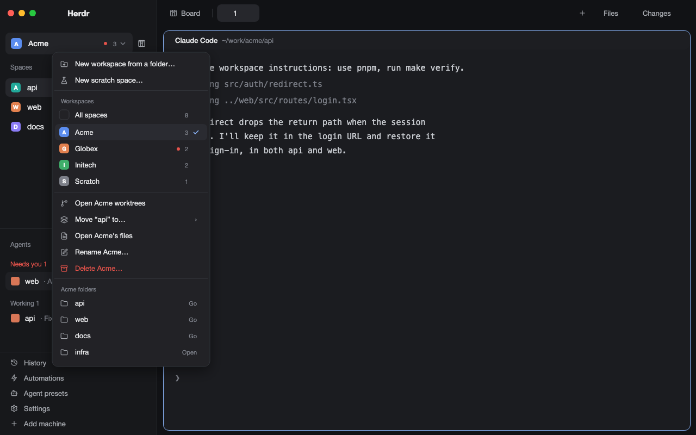

# Workspaces for Herdr

A Herdr layout for multi-repo work: workspaces with their own agent
instructions, a task board, agent presets, automations, and agents that come
back after a restart.

A workspace is a folder of repos, with its own agent instructions; it groups
Herdr's spaces. A switcher at the top of the sidebar picks one; the
spaces and agents lists show only what's in it. A Scratch workspace, always last in the
switcher, holds throwaway spaces for ideas that belong to no project: each gets a
fresh folder, tidied away when you're done unless you keep it. Each workspace has a task board (as columns or a list):
one markdown file per task, cards that start an agent on their task (in the
repo or a fresh worktree) and then show that agent's live status. A card also
follows its pull request: it shows whether checks fail, changes are requested,
it conflicts or it's ready to merge, tells the card's agent when a check fails
or a review arrives, and moves to done when it merges. Agent presets
(herdr-core templates: a command plus instructions) can be global or per
workspace, are managed in the Agent presets screen (model and effort included;
open it from the sidebar footer), and start from the tab bar's + menu or a
card's Start;
`examples/presets/` has four to start from, among them a watcher that can't
push or write to GitHub (for automations that only look) and an orchestrator that
splits a task across helper agents with herdr-core's `hc`; its helpers show
under it in the Agents list. Automations start an agent by
themselves: on a schedule (once or repeating), when a task enters a board
column, when an agent finishes or needs you, when files change, when a PR or
issue is opened on GitHub (asked every 2 minutes through `gh`), or when another
app calls `herdr-ws-run`. They run while Herdr is open, or all the time once you
turn on Keep running at the foot of the Automations list: a background process
that herdr-core keeps going while Herdr is closed (it needs Node 20.6 or newer).
A schedule missed while nothing was running runs when Herdr
opens if it was due in the last 12 hours; older ones are reported as missed, with
a toast, for Run now. Each run is a tab in the workspace's Automations space;
The Automations screen lists seven ready-made ones to start from (issue to
pull request, PR review, a broken default branch, a morning review and more):
open one, read it, and Create adds it. Like presets, an automation is
either one workspace's own (`~/.herdr/workspaces/<id>/automations/`) or for
every workspace (`~/.herdr/automations/`): a global one runs in each workspace
as that workspace's own, a workspace's own of the same name replaces it there,
and its switch turns it off for one workspace alone. `github * issue opened`
watches every repo of the workspace it runs in. An automation can have a check, a
command that runs first, so no agent starts when there's nothing to do; it runs only once you've allowed it. You make one by saying what it
should do and when, in your own words: Claude drafts the trigger, the agent,
its model and the prompt, and you read the draft before it's saved. Agents in a
workspace can add one themselves with `herdr-ws-run --add`, so you can tell one
"tomorrow at 6, check X and if so do Y". After a reboot or a logout, the Claude
agents you hadn't closed come back in their tabs, resumed with their
conversations, helpers included. While you're in another app, Herdr's
notifications (an agent needs you or finished, an automation's news) also show
on your desktop, and a click takes you to the agent; with Keep running on they
come while Herdr is closed too. A workspace can hold a `BRIEF.md`, where its
work stands today, which the agents you start there are given along with its
instructions.



`RECIPE.md` describes it in full: it's the brief an agent builds it from.

## Install

Ask your agent to add this layout (Herdr's own guide, `~/.config/herdr-app/AGENTS.md`,
says how), or by hand:

1. Copy `layouts/workspaces.json` to `~/.config/herdr-app/layouts/` and the eleven
   folders in `mods/` to `~/.config/herdr-app/mods/` (rename them if a name is taken).
2. For agent instructions from the + menu, put the launcher on your `PATH` and
   point `programs.json` at it. `herdr-ws-run` starts automations from other
   apps and lets agents add them, and `herdr-ws-notify --off` / `--on` is the
   switch for the desktop notifications (on macOS, `brew install terminal-notifier`
   makes a click on one go to Herdr):
   ```sh
   ln -s ~/.config/herdr-app/mods/ws-switcher/bin/herdr-ws-agent ~/.local/bin/
   ln -s ~/.config/herdr-app/mods/ws-switcher/bin/herdr-ws-run ~/.local/bin/
   ln -s ~/.config/herdr-app/mods/ws-switcher/bin/herdr-ws-runner ~/.local/bin/
   ln -s ~/.config/herdr-app/mods/ws-switcher/bin/herdr-ws-notify ~/.local/bin/
   ```
   ```json
   { "programs": { "claude": { "run": ["herdr-ws-agent", "claude"] },
                   "codex":  { "run": ["herdr-ws-agent", "codex", "--no-daemon"] } } }
   ```
3. To bring Claude agents back after a restart, add this line to
   `~/.config/herdr-core/config.toml`. herdr-core then starts terminals through
   `herdr-ws-resume`, which resumes a terminal's agent, else runs your usual shell.
   The switch at the foot of the Agent presets screen turns it off and on again
   (or `herdr-ws-resume --off` / `--on`). The `ln` line puts `herdr-ws-resume`
   (`--status`, `--list`, `--forget`) on your `PATH`:
   ```toml
   shell = ["/bin/sh", "-c", "r=\"$HOME/.config/herdr-app/mods/ws-switcher/bin/herdr-ws-resume\"; [ -x \"$r\" ] && exec \"$r\"; exec \"${SHELL:-/bin/sh}\" -l"]
   ```
   ```sh
   ln -s ~/.config/herdr-app/mods/ws-switcher/bin/herdr-ws-resume ~/.local/bin/
   ```
4. Switch to it: `herdr-app do layout.switch '{"name":"workspaces"}'`
   (`ctrl-shift-l` cycles back).
5. Open the switcher and pick **New workspace from a folder…**. The board button
   beside the switcher opens the workspace's board.
6. To start from the examples, copy them where Herdr reads them:
   - presets for every workspace: `examples/presets/*.md` to
     `~/.config/herdr-core/templates/` (where `hc run <name>` finds them too);
   - presets for one workspace: to `~/.herdr/workspaces/<id>/agents/`;
   - automations need no copying: the Automations screen lists the ready-made
     ones (`mods/ws-automations/starters/`), and Create adds the one you open.
     They're written for the `implementer` and `reviewer` presets.

**What it touches:** it reads `~/.herdr/workspaces` and the folders of
each workspace's root. Two of the ready-made automations (`issue-to-pr`,
`main-is-red`) tell their agent to make git worktrees under
`~/.herdr/worktrees/` and to push branches and open pull requests with your
`gh` login; two have a check that runs `git log` and `gh` in the workspace's
folders, and `morning-review`'s also runs `git fetch` in each repo. It writes `~/.herdr/workspaces/.index`, a new
workspace's files when you make one, its `workspace.jsonc` when you rename it,
task files in `~/.herdr/workspaces/<id>/tasks/` and automation files in
`~/.herdr/workspaces/<id>/automations/` and `~/.herdr/automations/` (the
ones for every workspace; from the Automations screen, a ready-made one
included, from
`herdr-ws-run --add`, `--off` and `--on`, and `enabled: false` after a one-time
one runs). Following a card's pull request writes `pr:` into its task and, when
it merges, its `status:`, and types a message into the card's agent with
`hc send` when a check fails, a review arrives or it conflicts. With Keep running
on, that work is done by a Node process herdr-core holds as the terminal
`herdr-ws-runner`: it writes `~/.herdr/runner/`, starts runs with `hc run`, ends
old run terminals with `hc kill`, and reads herdr-core's terminal list, the app's
layout document, `shared.json` and `programs.json`. Deleting a workspace, a task or an
automation (after a confirmation) moves it to the Trash. The board's Worktree runs
`git worktree add` on a new `task/…` branch; otherwise your repos aren't
touched. It runs `sh` (editor, Trash, symlinked folders), `herdr-app do` (the
board's and automations' new tabs) and, through the launcher, Start and
automations, your agents. The Worktrees tab reads git in the workspace's repos and
their worktrees (`worktree list`, `for-each-ref`, `status`) and each repo's pull
requests with `gh pr list`. Removing a worktree there (after a confirmation)
deletes its folder with `git worktree remove`; the branch stays. On its first run it makes
the Scratch workspace (`~/.herdr/workspaces/scratch/`); New scratch space makes folders in
`~/.herdr/scratch/`, and there it deletes empty ones nobody is in (`rmdir`) and moves ones
with files to the Trash after 7 days unused, unless they have a `.keep` file. It looks at
nothing else there. Deleting Scratch closes its spaces and moves `~/.herdr/scratch`, kept
folders included, to the Trash with it. A repo's two
worktree scripts (`~/.herdr/workspaces/<id>/worktrees.json`) are shell lines Herdr
runs as you: setup in a new worktree the board makes, archive before a removal.
Like a check, only a line you saved or allowed in the screen runs
(`~/.herdr/workspaces/.worktree-scripts.json`). The launcher lets Claude and Codex read and edit
the workspace's root, its folders elsewhere and its `tasks` folder. Automations watch the folders a files automation
names, read calls `herdr-ws-run` leaves in `~/.herdr/workspaces/.inbox` (and
delete them), and close an automation's older run tabs once their agent is done.
An automation's `check:` is a shell command Herdr runs by itself, as you, in the
automation's folder before each run, to see whether there's anything to do. It runs only a line you've allowed: one you saved in the Automations screen, or one you allowed there after an agent or a file brought it.
For restarts, the launcher keeps notes of the Claude agents it starts in
`~/.herdr/resume/` (their command and session), runs `hc ls` to drop the notes
of closed tabs, and gives Claude two hooks (`--settings`) that note its session
and drop the note when you leave it. With the `shell` line in herdr-core's
config, every new terminal starts through `herdr-ws-resume`.
Every notification Herdr shows is also handed to `herdr-ws-notify`, and so is the
background runner's news while no window is open. It asks macOS which app is in
front (`lsappinfo`), then runs `terminal-notifier`, else `osascript`, or
`notify-send` on Linux, with the notification's title and text, and nothing when
none is installed. A click on a terminal-notifier one runs `herdr-app do` with
the toast's own action. Its switch is `~/.herdr/notify/switch`. The launcher
reads a workspace's `BRIEF.md`, when there is one, and puts it in the
instructions of the agents started there.
Three things use the network: GitHub automations (`gh api` with your login, every
2 minutes per watched repo), cards with a `pr:` or `branch:` line (`gh pr view`
with your login, every minute per open pull request), and the Automations screen's Draft it and Change it,
which run `claude -p` with your Claude login and no tools. That sends Anthropic
your words, the workspace's name, root, folder names, GitHub repos and presets,
and, for a change, the automation as it stands.

Built for Herdr 0.1.14; `ws-spaces`, `ws-agents`, `ws-tabs`, `ws-new-menu` and
`ws-chrome` are copies of that version's `spaces`, `agents`, `tabs`, `new-menu`
and `workspace-chrome`. `ws-toast` is a copy of 0.1.16's `toast`.

## Updating

`CHANGELOG.md` lists what changed in each version, and your copy says which
one you have in `~/.config/herdr-app/mods/ws-switcher/VERSION` (none: older
than 0.1.0's notes, so read them all). To hear about new versions, watch the
repo on GitHub for releases (Watch → Custom → Releases).

- **You copied the files as they are:** copy `layouts/workspaces.json` and the
  eleven folders in `mods/` again, and do what the new versions' notes say
  (a new script to link, say). Your workspaces, tasks, presets and automations
  live elsewhere and aren't touched.
- **You or your agent changed them:** tell your agent "apply what's in this
  repo's `CHANGELOG.md` after version <yours>, keeping my changes", with
  `RECIPE.md` for the details of each one.

## License

Apache License 2.0. `ws-spaces`, `ws-agents`, `ws-tabs`, `ws-new-menu`,
`ws-chrome` and `ws-toast` are modified copies of Herdr's own mods, also Apache 2.0; see `NOTICE`.

## Working on it

`AGENTS.md` is the checklist for a change (for you or your agent): what to update
with it, the picture, what the mods share, how to test and release.

Edit the live files in `~/.config/herdr-app`, then copy them here with
`scripts/sync-from-home.sh`.

Every change people would notice gets a line under `## [Unreleased]` in
`CHANGELOG.md`, in the same commit. `scripts/release.sh <version>` turns that
into a version (the middle number for anything new, the last for fixes only),
writes `VERSION`, commits and tags it; `--publish` also pushes and makes the
GitHub release from those notes.

`preview.png` is drawn, not a screenshot: edit `mods/ws-switcher/preview.svg`
(also the picture in Herdr's layout settings) and run `scripts/render-preview.sh`.

To try a change without touching your own window, `scripts/sandbox.sh up`
opens a second Herdr with its own core, home and two demo workspaces under
`/tmp/herdr-ws-sandbox`, running copies of the live mods. `sandbox.sh app …`
and `sandbox.sh hc …` talk to it, `sync` copies the live mods in again, and
`down` ends and deletes it. Agents and `gh` aren't signed in there: Claude
stops at its first-run question, which is enough to see a run start.
