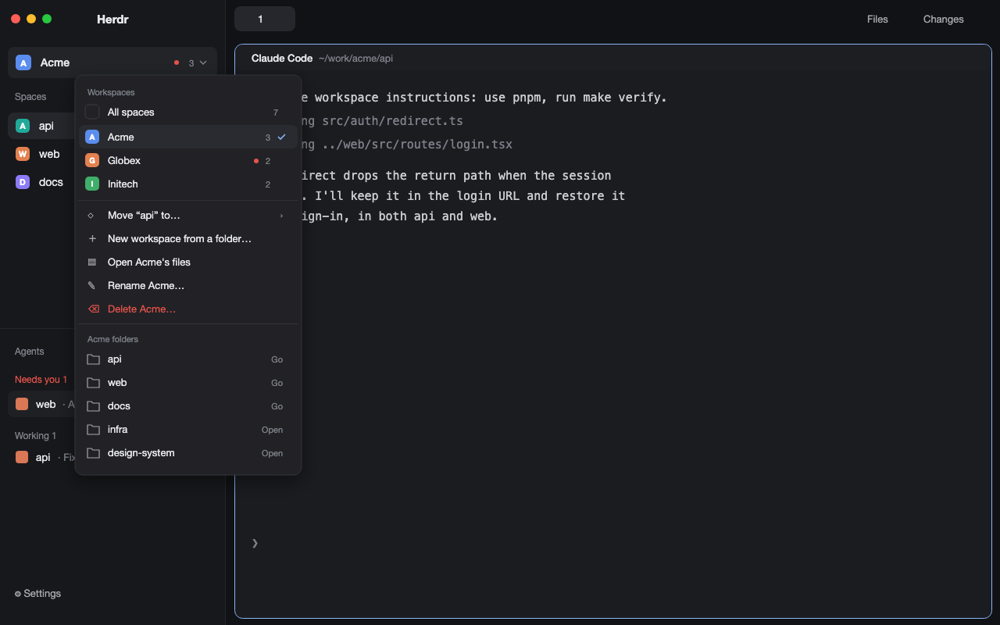

# Workspaces

Herdr's own layout with one more level above spaces: workspaces. A workspace is
a folder of repos (`~/work/acme` with `api`, `web` and `docs` in it). A switcher
at the top of the sidebar picks one, and the spaces and agents lists then show
only what is in it. Each workspace has its own `AGENTS.md`, which Claude Code
and Codex are given when they start from the + menu inside that workspace.
Spaces join their workspace by their folder, so there is nothing to sort by hand.
Each workspace also has a task board in a tab of its own: one markdown file per
task. A card starts an agent on its task, in the repo or a fresh worktree, and
then shows that agent's live status. Agent presets (a command plus instructions,
herdr-core's template format) can be global or per workspace; the switcher's
"New agent…" and the board's Start run them.



## What you see

Left to right, as in Herdr's `main` layout, with one row added to the sidebar:

- **Sidebar, 268px**, theme `chrome` background, top to bottom:
  - The brand row (46px, Herdr's `workspace-chrome`), unchanged.
  - **The switcher (44px).** One row 34px tall with 8px corners:
    - a 20px mark with 5px corners, filled with the workspace's color and showing its first letter in white bold;
    - the workspace's name at 13px medium;
    - a 6px dot when an agent in *another* workspace is blocked (theme `blocked`) or finished (theme `done`);
    - the count of spaces in the shown workspace (11.5px, `dim`);
    - an 11px chevron;
    - beside the row, for a chosen workspace, a 28px board button (`mods/ws-board/board.svg`, 15px, `muted`) that opens its board.

    With no workspace chosen, it reads "All spaces" behind an outlined mark with the layers icon. On the narrow rail (sidebar under 160px) it's a 32px cell with just the mark, the dot at its top right and the name as a tooltip.
  - **Spaces** (`ws-spaces`): Herdr's spaces list, showing only the shown workspace's spaces. A workspace with no spaces yet says "No spaces in Acme yet." and lists up to 12 of its folders (12px, `dim`, folder icon), each opening a space there.
  - **Agents** (`ws-agents`): Herdr's agents list, showing only the shown workspace's agents. When the workspace has none and other workspaces do, it says "No agents in Acme. Agents in other workspaces show in theirs."
  - The footer (97px, `ws-chrome`): Herdr's footer with an "Agent presets" row (the `presets.svg` robot icon) above Settings and Add machine. It opens the Presets screen for the shown workspace.
- **Work area**: Herdr's tab bar, panes as cards, Files and Changes panels, and status bar, all unchanged.
- **The switcher menu**: a popup 288px wide and at most 600px tall, in theme `popover`, top to bottom:
  - "Workspaces" (11px, `dim`), then "All spaces" and every workspace, each a 30px row with an 18px mark, the name, the dot when one of its agents is blocked or finished, its count of spaces, and a check on the shown one;
  - a line, then the actions: "Open <workspace> board" (for a chosen workspace), "New agent…" (with the number of presets and `›`), "Agent presets…" (opens the Presets screen), "Move “<shown space>” to…", "New workspace from a folder…", "Open <workspace>'s files" ("Open the workspaces folder" with none chosen) and, for the shown workspace, "Rename <workspace>…" and "Delete <workspace>…" (in theme `blocked`, with the `archive` icon);
  - a line, then "<Workspace> folders": one row per folder, ending "Go" when a space is already there and "Open" when there isn't. It scrolls when long.
- **The Start dialog** (`ws-presets` with `props: { start, workspace }`, 560×430):
  - "Start <name>" with the program icon, the preset's description, its command (mono, `dim`), and where it will run ("A new tab in “<space>”, in <folder>");
  - a note on how the task arrives;
  - a Task textarea with an `accent` border, focused;
  - "⌘Enter starts it" (Ctrl+Enter elsewhere), Cancel and Start.
- **"New agent…"** turns the menu into the preset list:
  - a head "New agent in “<shown space>”";
  - one row per preset, with the agent's program icon (from Herdr's program table, else a terminal icon), its name, and the workspace's name on the right when it's the workspace's own. The tooltip shows the description and command;
  - "No presets yet: add one to a presets folder." when there are none;
  - a line, then "Manage presets…" (the Presets screen), "<workspace> presets" ("none yet" when empty) and "Presets for every workspace", which open those folders.
- **The Presets screen** (`ws-presets`), a 900×640 dialog: "Agent presets" and "for <workspace>" in a 50px header, then two panes.
  - **The list** (250px, `chrome`, right border): a "New preset" button (theme `solid`), then "Only in <workspace>" and "Every workspace" sections. Each row (32px) has the program icon and the name, plus "replaces global" on a workspace preset that shadows a global one, "replaced here" on the global it shadows, and "error" in `blocked` when the file can't be used (its reason as a tooltip). The chosen row is `selected`.
  - **The editor**, top to bottom:
    - the program icon (20px), the name (16px semibold) or "New preset", a pill saying where it lives, "unsaved" in `working` while edited, and, for a new preset, two chips choosing where it goes;
    - Name (new presets only), Description, Command (in JetBrains Mono), and "Start from" chips: the installed agents from Herdr's list, which fill in the command;
    - for Claude, Codex and Pi commands:
      - **Model**: "Default", the agent's models and a small "another model, then Enter" field. Claude's models are its aliases fable, opus, sonnet and haiku; Codex's are every `model = "…"` in `~/.codex/config.toml`, its default shown as "Default (<model>)"; Pi has none listed;
      - **Effort**: "Default" and the agent's levels. Claude: low–max. Codex: minimal–max. Pi: off–max.

      The chip matching the command is highlighted;
    - Instructions, a textarea filling the rest. Its label says whether they arrive as system instructions or as the first message;
    - an error or "Saved." line;
    - a footer: Delete (in `blocked`, click twice), Duplicate, "Change for <workspace>" (on a global preset the workspace doesn't replace yet), the file's path, Start (when saved), and Save or Create.

    With nothing picked, the editor explains what presets are and where they live.
- **The board** (`ws-board`), a tab named "Board" whose only pane is the board, in theme `canvas`:
  - **Header** (48px, bottom border): the workspace's 20px mark, "<name> board" (semibold), "N open · M done" (12px, `dim`), then on the right a Board | List toggle (two 26px segments with the `board.svg` and `list.svg` icons in a 1px-bordered `chrome` pill; the chosen one in `selected`) and a "New task" button (theme `solid`, plus icon).
  - **List view**: one section per column, top to bottom.
    - A 34px section header in `chrome` with a bottom border: a fold chevron, the column name (12px semibold, `muted`), its count, and a `+` on the right.
    - Under it, a 40px row per task with a bottom border, indented 36px. The row shows the id (64px, `dim`), the title (13px, truncated, takes the rest), the priority word (52px, colored as on cards), the folder chip and branch icon (120px), and the card's agent footer on one line, right-aligned (210px).
    - When there are no tasks at all, the list says "No tasks yet. New task adds one." 
  - **Columns** (12px padding, 10px apart, equal widths that always fit), one per status, in theme `chrome` with a 1px border and 10px corners. Each has a 38px header with the column name (12px semibold, `muted`), its count and a `+`, then a scrolling list of cards. A column being dropped on gets an `accent` border. An empty column says "Empty"; the first one says "No tasks yet. New task adds one." when there are none at all.
  - **Cards** (theme `background`, 1px border, 8px corners, 10px padding):
    - a top row: the task id (11px, `dim`), the folder's name in a small `raised` chip, a branch icon when it has a worktree, the task's preset name when it has one, and the priority word on the right (high in `blocked`, medium in `working`, low in `dim`);
    - the title at 13px;
    - a footer:
      - while starting, "Starting…" or "Making the worktree…";
      - with a live agent, a 7px dot in the agent's status color, "<program> · working / needs you / finished / idle / running" and a "Go to" button;
      - otherwise, except in the last column, "Agent ended" if its agent is gone, then "Start" and "Worktree" buttons (24px, 1px border).

    The footer and top row wrap on narrow cards. A card being dragged fades to 40%.
  - **The task dialog** (600×560): the id, or "New task in <workspace>", with Esc on the right. Then, in order:
    - Title (an input);
    - Status (chips, one per column);
    - "Folder: where Start runs the agent" (chips: Workspace root, then the workspace's folders);
    - Priority (None, Low, Medium, High);
    - "Agent: who Start runs (default: <board.agent>)" (chips: Default, then the presets);
    - Notes (a textarea that fills the rest);
    - a footer with Delete (in `blocked`; a second click deletes), the file's path, Cancel, and Save or "Add task".

## How it behaves

- **Agent states** work as in Herdr's lists (working, blocked, done, idle). The switcher's dot only speaks up for blocked and done agents in workspaces that aren't shown. Blocked wins over done.
- **Choosing a workspace** (a click, or `0`–`9` while the menu is open; `0` is All spaces) filters both lists. It also shows the space you last had open in that workspace, else its first. A workspace with no spaces leaves the shown space where it is.
- **A space joins a workspace once and stays.** It joins when its first terminal is under the workspace's `root` or one of its `folders`; the longest matching folder wins, so a nested workspace beats its parent. A space in a herdr worktree (`~/.herdr/worktrees/<repo>/<branch>`) goes by the repo's name. A space with neither, made while a workspace is shown, joins that workspace once its first terminal has had 1.5s to report its folder. Spaces from before the workspace existed keep the workspace they were in.
- **The switcher follows you.** When a key, a toast or `space.next` shows a space from another workspace, the switcher switches to that workspace. A space in no workspace switches it to All spaces.
- **"Move “x” to…"** turns the menu into a list of workspaces plus "No workspace". Picking one moves the shown space there and shows that workspace. A space set to "No workspace" never joins one by its folder again.
- **"New workspace from a folder…"** opens the system folder picker. It writes `~/.herdr/workspaces/<slug>/workspace.jsonc` (listing the folder's subfolders, with the next unused color) and an `AGENTS.md` that is only a comment, then shows the new workspace.
- **"Open … files"** opens the workspace's folder in the first installed editor of `zed`, `cursor`, `code` and `subl`, else with `open` / `xdg-open` (Explorer on Windows).
- **"Rename…"** opens a 420×210 dialog: "Rename workspace", a Name field with the current name selected, and Cancel / Save. Enter saves and Esc cancels; an empty name is refused. It rewrites only the top-level `"name"` string in `workspace.jsonc`, keeping comments, other keys and the folder id. If there is no `"name"`, it adds one after the opening `{`. The write fails if the file changed since it was read.
- **"Delete…"** opens a 420×200 dialog: "Delete “Acme”?", saying the folder and its two files go to the Trash, your repos aren't touched, and its spaces stay open. Cancel / "Move to Trash"; Enter confirms and Esc cancels. The folder goes to the Trash with `trash` (macOS) or `gio trash` (Linux), else to `~/.herdr/workspaces/.trash/<id>-<time>`. A toast says where. Its spaces are decided again: they join the workspace their folder is in, else show under All spaces. A workspace deleted by hand is handled the same way.
- **The + menu** (when `programs.json` points at the launcher; see Built from): Claude Code and Codex started inside a workspace get its `AGENTS.md`, without HTML comments, plus `--add-dir` for the workspace root and for any folder outside it. Elsewhere they start as before. An `AGENTS.md` that is only a comment adds nothing.
- **The `+` in the Spaces header** makes a space in the shown workspace's root.
- Config edits apply within a second: the switcher watches `~/.herdr/workspaces`.
- **Folders reached through a symlink** (macOS's `/tmp` is `/private/tmp`) match by both paths. Terminals report the real one.

**Agent presets:**
- **What one is**: herdr-core's template format, a markdown file whose name is the preset's name. Front matter has `description` and `command` (a shell line, values taken as written, the model and flags included), and the body is its instructions. HTML comments in the body are left out.
- **Where they live**:
  - global presets are herdr-core's templates in `~/.config/herdr-core/templates/`, which agents can also start with `hc run <name> "<task>"`;
  - a workspace's own are in `~/.herdr/workspaces/<id>/agents/`, and win over a global one by name;
  - both folders are watched.
- **In the Presets screen**:
  - **Model and Effort chips** rewrite the command, setting, replacing or removing (Default) the agent's own flag:
    - Claude: `--model x`, `--effort x`;
    - Codex: `--model x` (it also reads `-m x`), `-c model_reasoning_effort="x"`;
    - Pi: `--model x`, `--thinking x`.

    `--flag=x` is read too. Rewriting re-quotes the command's words.
  - **Picking a preset** loads its file into the editor. With unsaved edits, the first click on another preset only warns, and a second click discards them.
  - **Save** rewrites `description` and `command` (one line each, as written) and the body, keeping the file's other front matter lines (`ready`, `submit`, …). It fails if the file changed on disk since it was opened.
  - **Create** writes `<name>.md` in the chosen place and refuses an existing name. A name is letters, digits, dots, dashes or underscores.
  - **Duplicate** opens a new preset filled in from this one, named `<name>-copy`.
  - **"Change for <workspace>"** opens a workspace copy with the same name, which then replaces the global one there.
  - **Delete** moves the file to the Trash.
  - **Start** closes the screen and opens the Start dialog.
  - The list updates at once after Save, Create and Delete.
- **Starting a preset by hand** goes through the Start dialog, from "New agent…" or the Presets screen's Start. Whatever is in Task becomes its first message: after the instructions for agents that get them in that message. Left empty, the agent starts idle.
- **"New agent…" → a preset**, then **Start**, opens a tab named after it in the shown space, in its focused terminal's folder. With no space shown, it makes a new space in the workspace's root.
- **How a preset starts**:
  - with the launcher installed and a `claude` or `codex` command, the preset's instructions become system instructions, after the workspace's. The command runs as `herdr-ws-agent --instructions <file> <command>`, and the task, if any, is the first message;
  - any other agent gets the instructions, then the task, as its first message, as `hc run` does;
  - a leading `herdr-ws-agent` in the command is fine (it's added once), and `VAR=x` assignments go before it;
  - either way, the instructions start with a line naming the preset: `You are the "<name>" agent, started from the Herdr agent preset of that name (<file>). Its instructions:`. That's how the agent knows which preset it is.

**The board:**
- **Opening it** (the switcher's board button, or "Open … board" in the menu) shows the board tab that is already open in one of the workspace's spaces. Otherwise it makes one in the shown space (if that space is in the workspace), else in the workspace's first space, else in a new space in its root.
- **Columns** are the workspace's `board.columns`, by default `backlog, todo, doing, review, done`. A task whose status isn't a column shows in the first one. The last column counts as done: it has no Start buttons and isn't in the "open" count. Within a column, cards sort by priority (high first), then by id number.
- **Dragging a card** to another column sets its status, shown at once and written to its file. Dropping doesn't open the card. Clicking a card opens the task dialog.
- **Board | List** switches the view. Each board tab remembers its choice, and Board is the default.
- **In the list**:
  - clicking a section header folds or unfolds it. Each board tab remembers its folded sections, and the last column (done) starts folded;
  - a section's `+` adds a task in that column;
  - clicking a row opens the task dialog.

  Rows sort as cards do. There's no dragging in the list: change a status in the dialog.
- **"New task"** or a column's `+` opens the dialog for a new task in the first column or that column.
  - "Add task" writes `tasks/<PREFIX>-<n>.md`, one more than the highest number there. The prefix is `board.prefix`, by default the workspace id's first three letters in capitals.
  - A title is required; Enter in the title saves.
- **Saving an existing task** writes only the fields changed in the dialog, so an agent's edits made in the meantime stay. The notes replace the body only if they changed.
- **Delete** in the dialog asks with a second click, then moves the task's file to the Trash (else `~/.herdr/workspaces/.trash/`).
- **Start** runs the task's preset (its `agent:` field, set in the dialog), else `board.agent` (by default `claude`). Either one can be a preset's name, started as above, or a program from Herdr's agent list, started the way Herdr's + menu starts it (so through the launcher too). It runs in the task's folder:
  - as a new tab named after the task id in the workspace's space that holds that folder (the deepest one);
  - else as a new space there.
- **Worktree** first runs `git worktree add -b task/<id>-<title-slug> ~/.herdr/worktrees/<repo>/<slug>` from the repo's HEAD, the same place Herdr's worktree menu uses. It reuses the branch or folder if they already exist, then opens a new space there with a tab named after the task id. That space joins the workspace through the worktree rule above.
- **After either Start**, the card moves to `board.start` (default `doing`), and the task records:
  - `terminal`, the agent's address;
  - `started`;
  - for Worktree, also `worktree` and `branch`.
- **The agent's first message** is the id and title, the notes, then where the task file is and what to do when finished: set `status:` to `board.finish` (default `review`), put anything left open under "## Notes", and leave the other front-matter lines alone.
- **A card with an agent** shows that agent's status live, from `agents()` by address. When the address is a live terminal but not an agent, it says "running". When the terminal is gone, it says "Agent ended" and offers Start again. "Go to" runs `agent.focus`.
- **Task files are watched**: an agent's or a person's edit shows within a second.

## Built from

**Layout** `layouts/workspaces.json`: Herdr's `main` (0.1.14) cloned. The sidebar column gets a block `{ "id": "workspace-switcher", "size": { "px": 44 }, "content": { "mod": "ws-switcher" } }` after `brand`. The `spaces` block uses `ws-spaces` and the `agents` block uses `ws-agents`. Root `"preview": "mods/ws-switcher/preview.svg"`. Everything else is `main` unchanged: `workspace-chrome`, `tabs`, `pane`, `files`, `changes` and `workspace-status` are Herdr's shipped mods.

**Workspace files** (not part of the package; people make their own), `~/.herdr/workspaces/<id>/`:

```jsonc
// workspace.jsonc: comments and trailing commas are fine
{
  "name": "Acme",            // shown in the switcher
  "color": "ansi4",          // ansi1..ansi6 or "#rrggbb"
  "root": "~/work/acme",     // spaces under it join
  "folders": ["api", "web", "~/shared/design-system"],  // relative to root, or absolute
  // "instructions": "AGENTS.md",   // default: AGENTS.md next to this file
  // "board": { "columns": ["backlog", "todo", "doing", "review", "done"],
  //            "prefix": "ACM", "agent": "claude", "start": "doing", "finish": "review" },
}
```

**`mods/ws-switcher`** (`mod.json`: `{ "place": "none" }`). The only mod that decides anything:
- reads every `workspace.jsonc` with a small JSONC parser and lists each root's subfolders (`fs/promises` `readdir`). It resolves each root and folder's real path with one `sh` call (`cd && pwd -P`), kept as `real` in each def; the matching uses both;
- waits on `watchFolder(~/.herdr/workspaces)`, falling back to a 5s timer if that fails;
- places spaces (`spaces()`, `panes()`) and records which ones it has decided, in `render()` and on a 500ms timer, because Herdr doesn't draw while its window is in the background;
- loads presets: it watches `~/.config/herdr-core/templates`, retrying every 10s while the folder doesn't exist, and each workspace's `agents/`. It publishes `workspaces.presets` (`{ global, workspaces: { id: [...] } }`, each preset `{ name, file, scope, description, command, body, error }`) and `workspaces.launcher` (whether `herdr-ws-agent` is on `PATH`);
- writes this shared state:
  - `workspaces.defs`: the parsed configs;
  - `workspaces.active`: the shown workspace's id, null for all;
  - `workspaces.assigned`: space id → workspace id, or `false` for "No workspace";
  - `workspaces.last`: workspace id → last shown space;
  - `workspaces.create`: the menu asks the sidebar copy to run the folder picker, because a popup's tasks end when it closes;
  - `workspaces.board`: `{ id, at }`, the menu asks the sidebar copy to open a board, for the same reason;
  - it also reads `workspaces.launch` (`{ workspace, name, task, at }`) from the Start dialog and starts that preset with that task;
- handles those requests (create, launch, board) in `render()` and on the 500ms timer, because Herdr doesn't draw in the background. A request older than 15s is dropped, so a click from earlier never starts an agent late, and a reload drops what was pending;
- opens a board: finds a `panes()` entry with `mod: "ws-board"` in one of the workspace's spaces, else runs `tab.new { space, name: "Board", mod: "ws-board", props: { workspace } }`. It makes the space first with `herdr-app do space.new` when the workspace has none, because `run()` doesn't return what it made;
- opens its own menu as `openOverlay({ mod: "ws-switcher", kind: "popup", props: { popup: true } })`, and its rename and delete dialogs as `kind: "dialog"` with `props: { dialog: "rename" | "delete", id }`. Each dialog does its file work before it closes itself, because a closed overlay's tasks are cancelled;
- runs `space.select` and `space.new {folder}`;
- writes `~/.herdr/workspaces/.index` with `writeTextFile`, only when it changes: tab-separated `ws`, `dir` and `repo` lines for the launcher;
- uses Herdr's icons from `mods/workspace-chrome/` (`layers`, `chevron-down`, `check`, `folder`, `folder-plus`, `file-text`, `square-pen`, `archive`), and `InputState` / `Input` from `gpui-base` for the Name field.

**`mods/ws-switcher/bin/herdr-ws-agent`**: the POSIX `sh` launcher, `herdr-ws-agent [--instructions FILE]... <agent> [args...]`. Each `--instructions` file's body (front matter and HTML comments left out) is added after the workspace's instructions, in or out of a workspace, under the line naming the preset (the file's name without `.md`).
- It reads `.index`, finds the workspace holding `pwd -P`, and puts its extra words before the caller's:
  - for Claude Code: `--append-system-prompt <text>` and `--add-dir`;
  - for Codex: `-c developer_instructions="<TOML string>"` and `--add-dir`.
- `awk` drops `<!-- -->` comments and `sed` escapes the text for TOML.
- `HERDR_WS_AGENT_DRY=1` prints the command instead of running it.
- To wire it into the + menu, put it on `PATH` (for example `ln -s ~/.config/herdr-app/mods/ws-switcher/bin/herdr-ws-agent ~/.local/bin/`), then add to `programs.json`:
  ```json
  { "programs": { "claude": { "run": ["herdr-ws-agent", "claude"] },
                  "codex":  { "run": ["herdr-ws-agent", "codex", "--no-daemon"] } } }
  ```

**`mods/ws-board`** (`mod.json`: `{ "place": "none", "title": "Board" }`, plus `board.svg` and `list.svg`). It's a pane mod with `props: { workspace }`. The same mod draws the task dialog, opened as `openOverlay({ mod: "ws-board", kind: "dialog", width: 600, height: 560, props: { dialog: "task", workspace, task, status } })`.

- **Task file**: `~/.herdr/workspaces/<id>/tasks/<ID>.md`:
  ```md
  ---
  id: ACM-3
  title: Fix the login redirect
  status: todo
  folder: api
  priority: high
  created: 2026-11-09
  ---

  Keep the return path in the login URL.
  ```
  - The front matter is simple `key: value` lines. Values are quoted (JSON style) only when YAML would read them differently.
  - Unknown lines and inline `# comments` are kept. Fields are set by rewriting or appending their line, and an empty value removes the line.
  - `folder` is relative to the root, or absolute / `~`.
- **Live data**: it waits on `watchFolder(~/.herdr/workspaces/<id>)` (`tasks/` may not exist yet), reads `agents()` and `terminals()` for card status, and gets the board settings from the switcher's `workspaces.defs` (`board`).
- **Writes**: `writeTextFile` with the text it just read as `expected`. It reads again and retries up to three times when the file changed under it, and a new task's write uses `expected: null`, so a taken ID moves on to the next.
- **Start**:
  - a preset goes through `presetLaunch()`, with the brief as its task. `presetLaunch()` and `words()` are copies of the switcher's and must stay the same;
  - otherwise the agent's `run` from `knownAgents()` (else `[agent]`) is the `argv`, and the brief is the `task` (Herdr appends it as the agent's last argument);
  - it calls `herdr-app do tab.new` / `space.new` through `exec`, to learn the new terminal's address, because `run()` returns nothing;
  - Worktree runs `git` in the task's folder: `rev-parse --git-common-dir`, `show-ref`, `worktree add`.
- **View and folds** live in the copy's `localStorage` (`view`: `"board"` or `"list"`; `folded`: a JSON array of columns). The card and the list row share one helper for the agent footer: wrapping on a card, one right-aligned line in a row.
- **Dragging** is `on_mouse_down` on the card plus `on_mouse_move` / `on_mouse_up` on the columns. A drop sets a timestamp that keeps the card's `on_click` from opening the dialog for 300ms.
- **The columns row** uses `items_stretch()` so the columns fill the height. Cards must not use `line_height`: it's a multiple, not pixels.

**`mods/ws-presets`** (`mod.json`: `{ "place": "none", "title": "Agent presets" }`):
- **Opening it**: the switcher opens it as `openOverlay({ mod: "ws-presets", kind: "dialog", width: 900, height: 640, props: { workspace } })`.
- **Reading**: it reads the list from `workspaces.presets`, but each file afresh when it's picked, because the shared copy has HTML comments taken out.
- **Writing**: `writeTextFile`, with the text it read as `expected` (null for Create). It then updates `workspaces.presets` itself.
- **Delete** uses the same Trash script as the rest.
- **Start** sets shared `workspaces.launch` (`{ workspace, name, at }`) and closes. The switcher's sidebar copy starts the preset, because a dialog's tasks end when it closes.
- **Inputs**: three `InputState`s and a `TextareaState` are made once in `init` and refilled with `set_value` when another preset is picked. Each field gets the `accent` border while it has focus. A preset is read in a `cx.spawn` after the click, and that task's `cx` must make the redraw. The click's own `cx` is gone by then, and using it leaves the editor blank until something else redraws.

**`mods/ws-chrome`**: Herdr's `workspace-chrome` (0.1.14), cloned for the footer only (`props: { footer: true }`; the brand row keeps Herdr's own). It adds `openOverlay` and an "Agent presets" row above Settings. The layout's `sidebar-footer` block uses it and is 97px tall.

**`mods/ws-spaces`** and **`mods/ws-agents`**: Herdr's `spaces` and `agents` 0.1.14, cloned with `mod.clone`. The changes are described at the top of each file:
- **ws-spaces**:
  - `workspace()` and `inWorkspace()` helpers;
  - `grouped()` filters rows by `workspaces.assigned`, keeping the shown space while it is still being placed;
  - other machines with nothing in the workspace are left out;
  - `emptyWorkspace()` lists the folders;
  - the header `+` runs `space.new {folder: root}`.
- **ws-agents**:
  - `inWorkspace()` takes an agent's workspace from its `space`;
  - `render()` filters the list after `hold()`, so `setAgentOrder` and `agent.next`/`agent.prev` follow the filtered list;
  - the empty text names the workspace.

**What it touches:**
- It reads `~/.herdr/workspaces` and lists the subfolders of each workspace's root.
- It writes `~/.herdr/workspaces/.index`, a new workspace's two files when you make one, and `workspace.jsonc` when you rename one. The board writes task files in `~/.herdr/workspaces/<id>/tasks/`.
- It moves a workspace's folder, or a task's file, to the Trash when you delete it, and only after you confirm.
- It runs programs:
  - `sh`, to open an editor, move things to the Trash and resolve symlinked folders;
  - `herdr-app do`, for the board's new tabs and spaces;
  - `git worktree add`, for a task's Worktree;
  - `explorer`, on Windows;
  - your agents, through the launcher and the board's Start.
- It doesn't use the network.

## Watch out

- `ws-spaces` and `ws-agents` are copies of Herdr 0.1.14's lists and won't get Herdr's later fixes. On another version, rebuild them from this recipe on top of that version's `spaces` and `agents`: the changes are small and listed above.
- `ctrl-1…9` (`space.select:N`) and `space.next` still count every space. The switcher follows, so they jump between workspaces.
- Workspaces are folders on this computer. A space on another machine only joins a workspace when it's made while that workspace is shown, or with "Move to…".
- Spaces keep their workspace, even after a `cd` elsewhere or when a nested workspace is added later. Use "Move to…".
- `programs.json` runs a quoted command: `~` isn't expanded. Use a name on `PATH` or an absolute path.
- The launcher is `sh`, `awk` and `sed`: macOS and Linux. On Windows the + menu works, but agents don't get the instructions.
- The launcher reads `.index`, which the switcher rewrites while Herdr runs. Config edits made while Herdr is closed reach the launcher on Herdr's next start.
- `--add-dir <root>` lets the agent read and edit the whole workspace, sibling repos included. That's the point of a multi-repo workspace, but it's broader than one repo.
- Codex gets the instructions through `developer_instructions`. The TOML quoting is checked; how a given Codex version weighs those instructions is up to Codex.
- A popup's tasks end when it closes. That's why "New workspace" goes through `workspaces.create` to the sidebar copy, and why "Edit" is a single `exec`.
- `preview.png` is a drawing of the layout with demo names, not a screenshot.
- The board needs `herdr-app` on `PATH` (an installed macOS app makes the `~/.local/bin` link) to learn the terminal a Start made. Without it, Start shows an error toast.
- The brief is the agent's last argument, so it's limited by the system's argument length; very long notes are better as a file the notes link to.
- An agent can break a task's front matter. The card then falls back to the file name for its id and the notes' first line for its title, and its status goes to the first column.
- A task's `terminal` is an address on this machine. After Herdr-core restarts or the terminal ends, the card shows "Agent ended". Start runs a new one, and Worktree reuses the task's branch and folder.
- The board only finds a board tab by the workspace of its space: a board left in a space moved to another workspace isn't found, and a new one is made.
- Boards, Start and Worktree work on this computer's spaces only.
- A first click on a background window only focuses it in some setups, so a chip or button may need a second click when the window wasn't in front.

- Herdr's own Settings screen can't take new sections (Herdr rewrites it), which is why Agent presets is a footer row of its own.
- The model lists are short on purpose: Claude's aliases always mean its latest models, Codex's come from your config, and any other model is typed in. Effort levels a given CLI version doesn't accept fail when the agent starts.
- Mods can't read environment variables, so presets are always read from `~/.config/herdr-core/templates`. A changed `XDG_CONFIG_HOME` isn't followed.
- herdr-core reads front matter values exactly as written, so don't quote a preset's `command`.
- Asked "were you started with an agent?", Claude can take "agent" to mean a helper agent it called, and say no. Ask which preset it is instead.
- An agent started before this line was added doesn't have it. Starting it again does.
- A preset whose command starts with `herdr-ws-agent` also gets the workspace's instructions when an agent starts it with `hc run`. Then the preset's own instructions arrive as its first message, the way hc sends them.

## Done when

- `herdr-app check` passes for `mods/ws-switcher`, `mods/ws-spaces`, `mods/ws-agents` and `mods/ws-board`, and `herdr-app status` shows no errors with `layout.switch {"name": "workspaces"}`.
- With two workspaces whose roots hold existing spaces, those spaces show under their workspace and the counts in the menu add up to "All spaces".
- Choosing a workspace with no spaces lists its folders in the sidebar, and clicking one makes a space that stays in that workspace.
- `herdr-app do space.select --id <a space in another workspace>` switches the switcher to that workspace.
- With an agent running in workspace A, workspace B's agents list says "No agents in B…", and a blocked agent in A puts the dot on B's switcher row.
- "Move “x” to… → No workspace" moves the space to All spaces only, and it doesn't rejoin by its folder.
- "Rename…" with a new name changes it in the switcher within a second, and `workspace.jsonc` keeps its comments.
- "Delete…" → "Move to Trash" removes the workspace from the menu, puts its folder in the Trash, and its spaces show under the workspace their folder is in (else All spaces). Cancel and Esc change nothing.
- Writing `Use pnpm.` in a workspace's `AGENTS.md`, then running `HERDR_WS_AGENT_DRY=1 herdr-ws-agent claude` in one of its folders, prints `--append-system-prompt` with that text and `--add-dir <root>`. In a folder outside every workspace it prints `claude` alone.
- With a workspace whose root is under `/tmp` (macOS), a space opened in one of its folders joins that workspace, not the shown one.
- The board button opens a "Board" tab showing the workspace's columns; three hand-written task files appear in their columns, sorted high priority first.
- Dragging a card to another column changes its `status:` line and nothing else, and doesn't open the dialog.
- In the dialog, changing only Priority and saving adds or changes just the `priority:` line; an `# inline comment` an agent left on `status:` survives.
- With `"board": { "agent": "echo" }`, Start on a card with `folder: app` opens a tab named after the task in the space at `app`, which prints the brief. The card moves to `doing` and its file gets `terminal:` and `started:`.
- Worktree on a card in a git repo makes `task/<id>-<slug>` and `~/.herdr/worktrees/<repo>/<slug>`, opens a space there that stays in the workspace, and the file gets `worktree:` and `branch:`.
- Board | List switches the view, and the choice survives the mod reloading. In the list, Done starts folded; clicking its header unfolds it, and a row with a live terminal shows "<program> · running" and Go to.
- A workspace preset `agents/x.md` with `command: HERDR_WS_AGENT_DRY=1 claude --permission-mode plan` and a body, started from "New agent…" in one of the workspace's folders, prints `--append-system-prompt` with the workspace's instructions, then the line naming `x` and its instructions, plus `--add-dir <root>` and `--permission-mode plan`. A preset with `command: echo` prints its body.
- A task with `agent: x` started from the board runs that preset with the task's brief as its first message.
- In the Presets screen, Create on a new workspace preset adds it under "Only in <workspace>" with the file in `agents/`. Changing its instructions and saving keeps any other front matter lines. Delete puts the file in the Trash, and Start opens it as a tab.
- In the Presets screen, picking Model "opus" and Effort "high" on `herdr-ws-agent claude` makes the command `herdr-ws-agent claude --model opus --effort high`; Default takes each flag out again. On a Codex command, Effort sets `-c 'model_reasoning_effort="high"'`.
- The sidebar footer shows Agent presets above Settings, and it opens the Presets screen.
- "New agent…" → a preset opens the Start dialog. A task typed there arrives as the agent's first message, and Start with no task starts it idle. A test preset with `command: echo` prints its instructions in its new tab.
- Asked which preset it is, a Claude started from the implementer preset answers "implementer" and names its file.
