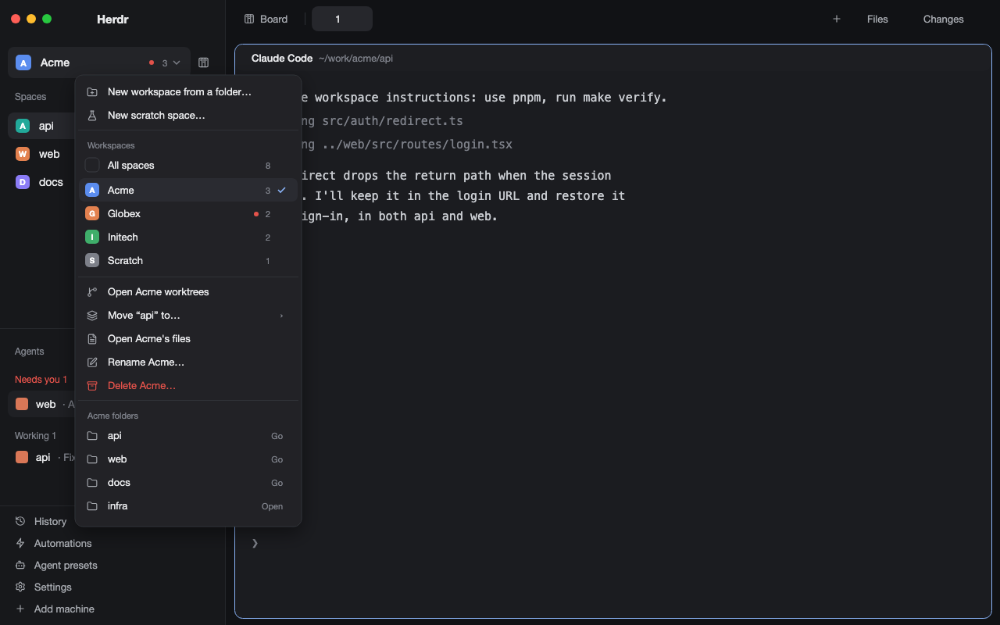

# Workspaces

Herdr's own layout with one more level above spaces: workspaces. A workspace is
a folder of repos (`~/work/acme` with `api`, `web` and `docs` in it). A switcher
at the top of the sidebar picks one, and the spaces and agents lists then show
only what is in it. Each workspace has its own `AGENTS.md`, which Claude Code
and Codex are given when they start from the + menu inside that workspace.
Spaces join their workspace by their folder, so there is nothing to sort by hand.
Each workspace also has a task board of its own, shown from any of its spaces: one markdown file per
task. A card starts an agent on its task, in the repo or a fresh worktree, and
then shows that agent's live status. Agent presets (a command plus instructions,
herdr-core's template format) can be global or per workspace; the tab bar's +
menu and the board's Start run them. Automations run them by themselves:
on a schedule (once or repeating), when a task enters a board column, when an
agent finishes or needs you, when files change, when a PR or issue is opened on
GitHub, or when another app calls `herdr-ws-run`. Each run is a tab in the
workspace's "Automations" space, and your view stays where it is. You describe a
new one in your own words and Claude drafts it, model included; an agent in a
workspace can set one up itself: "tomorrow at 6, check X and if so do Y".



## What you see

Left to right, as in Herdr's `main` layout, with one row added to the sidebar:

- **Sidebar, 268px**, theme `chrome` background, top to bottom:
  - The brand row (46px, Herdr's `workspace-chrome`), unchanged.
  - **The switcher (44px).** One row 34px tall with 8px corners:
    - a 20px mark with 5px corners, filled with the workspace's color and showing its first letter in white bold;
    - the workspace's name at 13px medium;
    - a 6px dot when an agent in *another* workspace is blocked (theme `blocked`) or finished (theme `done`);
    - the count of spaces in the shown workspace (11.5px, `dim`);
    - an 11px chevron;
    - beside the row, for a chosen workspace, a 28px board button (`mods/ws-board/board.svg`, 15px, `muted`) that opens its board.
    - after it a 28px notes button (`mods/ws-notes/notes.svg`, Lucide's sticky-note, 15px, `muted`) that shows the workspace's Notes screen.

    With no workspace chosen, it reads "All spaces" behind an outlined mark with the layers icon. On the narrow rail (sidebar under 160px) it's a 32px cell with just the mark, the dot at its top right and the name as a tooltip.
  - **Spaces** (`ws-spaces`): Herdr's spaces list, showing only the shown workspace's spaces. A workspace with no spaces yet says "No spaces in Acme yet." and lists up to 12 of its folders (12px, `dim`, folder icon), each opening a space there (Scratch: its scratch folders, a named one by its name alone).
  - **Agents** (`ws-agents`): Herdr's agents list, showing only the shown workspace's agents. When the workspace has none and other workspaces do, it says "No agents in Acme. Agents in other workspaces show in theirs."
    A Claude Code, Pi or Antigravity agent's row is 42px instead of 30 and has a second line (11px, `dim`) under its name: the model ("Opus 5.5", "Gemini 4 Neon"), a 26×4 bar of how full its context is with the percent beside it (the bar `muted`, `ansi3` from 70%, `blocked` from 85%, and the percent in that color from 70%), or the tokens alone ("192k") where the window's size isn't known, then the compacted icon (`mods/ws-agents/compacted.svg`, Lucide's fold-vertical, 10px) and the count when it was compacted. Hovering the line shows a tooltip, a fact a line: model, effort (Pi: thinking) and id; "Context: 192k of 1M tokens (19%)"; "Compacted twice, last automatically, 384k → 48k" or "Not compacted yet"; "This session: $3.20, +120 −30 lines" (Claude and Pi). The narrow rail leaves it out.
    Right-clicking an agent's row (a sub-agent's, or a number on the narrow rail) opens its menu at the pointer: a 220px popup in `popover`, the row's name at the top (11px, `dim`), then 31px rows of a 14px `muted` icon and a 12.8px label, in three groups split by a 1px `border` line. Talk to it: Peek (`eye.svg`), Send a message… (`message.svg`), Interrupt (`stop.svg`), Compact (`compacted.svg`). More of it: Fork session (`fork.svg`), Rename… (`square-pen`), Pin to top or Unpin (`pin`, `pin-off`), Copy terminal id (`terminal`, the address such as `t7` at the right, 11px `dim`), Copy session id (`copy.svg`). End it: Close session (`x`), Wipe session… (`trash.svg`, icon and label in `blocked`). Each item shows only where it does something (How it behaves). The new icons are Lucide's (ISC), in `mods/ws-agents/`. Send a message… opens a 460×216 dialog: "Message <name>", a Message box, "Typed into its prompt and sent, as if you'd typed it there.", Cancel and Send. Wipe session… opens a 480×226 dialog: "Wipe <name>?", "Closes it and moves its conversation to the Trash. History won't list it and it can't be resumed.", the transcript's path (11.5px, `dim`), Cancel and a `blocked` Wipe. An Antigravity agent's is 480×410: the text says it also takes the conversation out of Antigravity's own lists and moves its files into `~/.herdr/trash`, where what it removes is kept too, then a box (`background`, `border`, 8px corners) with the conversation's title or first prompt in quotes (12.5px), "Last active 21 Nov, 09:15 · 2 sub-agent conversations with it" (`muted`) and its full id (`dim`), "Looking up the conversation…" until that's known; when the wipe takes more than one conversation, the first Wipe shows what it takes in `ansi3` and the button reads "Wipe all 3"; a `muted` line when another Antigravity runs; the reason in `blocked` when it can't be wiped; after a failure once it's closed, Close and Try again.
  - The footer (153px, `ws-chrome`): Herdr's footer with a "History" row (`mods/ws-history/history.svg`, a clock inside a counter-clockwise arrow), an "Automations" row (`mods/ws-automations/automations.svg`, a lightning bolt) and an "Agent presets" row (the `presets.svg` robot icon) above Settings and Add machine. They open the Automations and Presets screens for the shown workspace; Settings opens the package's copy of Herdr's Settings window (below).
    Settings is Herdr's own Settings window, 880 wide, with two sections of ours at the end of its list, after Privacy: "Agents" (`mods/ws-settings/extras.svg`, Lucide's sliders-horizontal) and "Experimental" (`mods/ws-settings/experimental.svg`, Lucide's flask-conical). Herdr's sections (Look, Keyboard on macOS, Machines, Alerts, Updates, Privacy) look and work as in Herdr's. Both of our pages draw the way Herdr's pages are drawn (a 12px `dim` capitals heading, rows with a 14px title, a 12.5px `dim` description and a 36×20 switch, split by `border` lines):
    - **Agents** holds every switch the package has for agents, under three headings: STARTING AGENTS has "Herdr guide for every agent" (with a small "Edit" button, or "Write one" while there's no guide, beside the switch, and a third line saying the size or "No guide yet") and "Bring agents back after a restart" (its third line says "On: N agents would come back", "Off: tabs come back as shells", or, in `blocked` while on, "Not set up in herdr-core's config.toml (see the recipe)."); IN THE + MENU (with "N of M shown" in `muted` beside the heading) has the intro line, a row per installed agent with its 16px icon, its name (`muted` and `dim` "hidden" when hidden) and a switch, then the "Not installed: …" line and "Hidden agents are only left out of the + menu. Presets and automations can still start them."; WHILE HERDR IS CLOSED has "Keep running" (its third line says "Off: they run while Herdr is open", "On: running in the background", or "On, but not running yet" in `blocked`).
    - **Experimental** says "Features that lean on things other programs don't promise to keep the same. Each is off until you turn it on, and says why it's experimental.", then a row per experiment with a third line, "Why it's experimental: …" (12px, `muted`); a settings file that isn't valid JSONC gets a `blocked` note ("`~/.herdr/settings.jsonc` isn't valid JSONC (…). These stay off until it's fixed.") and greyed switches. No "Open the file" button or file path line.
    When Herdr's Settings has changed in a way the copy can't follow (Built from), the window shows a 190px left list of our two sections with "Open Herdr's Settings" at its foot, beside the page under a header line ("Herdr's Settings changed in a way this copy can't follow yet, so here are only the package's settings.").
- **Work area**: Herdr's tab bar (`ws-tabs`), panes as cards, Files and Changes panels, and status bar (`ws-status`). Three things change:
  - the + menu also lists the agent presets;
  - the workspace's open screens are pills before the space's tabs: "Board" (the `board.svg` icon) and "Worktrees" (`git-branch.svg`), drawn like tabs (29px, radius 7), then a 1px by 16px `border` line, then the tabs. They are the same in every space of the workspace. The shown one is drawn as the active tab with a close ×, and no tab is drawn active meanwhile. A shown screen fills the work area under the tab bar: no pane frame, no Files or Changes buttons or panel, no status bar.
  - the status bar shows the plans' usage before the commands hint, once there's something to show: for each plan (Claude, then Antigravity) its icon (`icons/claude.svg`, `icons/antigravity.svg`, 12px) and the percent of its most used limit, 5px apart, plans 10px apart, in a 20px box that takes the `hover` color under the pointer. The percent is `muted`, `ansi3` from 70% (or a row's severity `warning`) and `blocked` from 85% (or `critical`). Its tooltip lists every limit, a plan a line ("Claude: Week 1%, Fable 0%"). A click opens a 360px popup at the pointer, like the usage popup in Claude's own app: a header row, "Plan usage limits" (`muted`) and "Refresh" (11px, `dim`; "Reading…" while it reads), then a section per plan, the second under a 1px `border` line: the icon and the plan's name, then per limit its name ("Current session", "Weekly · all models", "Weekly · Fable"; Antigravity's "Weekly · Gemini models", "5-hour · Claude and GPT models", "Weekly · Gemini 4 Argon"), when it resets (11px, `dim`: "Resets in 12m", "Resets 4:30 PM", "Resets Fri 11:00 PM", "Resets Nov 28", local time) and the percent, over a 4px bar the popup's width colored as above; hovering an Antigravity limit shows which models share it. Each section ends with "From Claude Code's /usage, 7 min ago" (10.5px, `dim`). Before Claude's report has come, its 5-hour and weekly limits from the newest status line, in the same look ("From a Claude session's status line, …").
- **The empty work area**: while the shown workspace has no spaces, the whole work area (tab bar, panes, panels, status bar) gives way to the layout's canvas with "No spaces in Acme" centered (12.8px, `dim`) and, 10px below, a "New space" button ("New scratch space…" in Scratch; 1px `border`, 7px corners, `muted` text, `hover` background). It makes a space in the workspace's root, as the Spaces + does (in Scratch it asks for the name first, as the + does there). Dragging the empty area moves the window.
- **The switcher menu**: a popup 288px wide and at most 600px tall, in theme `popover`, top to bottom:
  - "New workspace from a folder…" (the `folder-plus` icon), then a line;
  - "Workspaces" (11px, `dim`), then "All spaces" and every workspace, each a 30px row with an 18px mark, the name, the dot when one of its agents is blocked or finished, its count of spaces, and a check on the shown one. Workspaces with a group sit under its header: a 28px row with a 10px chevron (down when open, right when folded, `dim`) and the group's name (11.5px, medium, `muted`); its workspaces' rows are indented 16px. A folded header shows its workspaces' total of spaces and the dot, and under it only the shown workspace, if it's one of them. Workspaces without a group are rows at the top level, between and around the groups. Scratch comes last, drawn as a group of its own: a header like a group's (with its name) and, at its right, a + (13px `plus.svg` in a 22px button, `muted`, `hover` background; its tooltip says what a scratch space is and what happens to its folder); under it, indented, its open spaces (an 18px mark in the space's color with its first letter, as in the Spaces list, the space's name, the dot when its agent is blocked or finished, and a check on the shown space), then the scratch folders kept with files but no open space (the `folder` icon, `muted` text, a named one by its name alone, e.g. `bot-idea`, ending "Open"; the tooltip has the path), or "No scratch spaces yet" (12px, `dim`). Folded, the header shows how many scratch spaces are open and the dot, and under it only the shown space when it's a scratch space. The header is there even while the Scratch workspace is deleted; While a row is dragged it's drawn at half opacity (a group's rows with it), and where it would land is a 2px `accent` line above or below a row, or a 1px `accent` outline round a header it would go into;
  - a line, then the actions: "Open <workspace> board" and "Open <workspace> notes" (only on the narrow rail, where those buttons are hidden), "Open <workspace> worktrees" (the `git-branch.svg` icon), "Move “<shown space>” to…", "Open <workspace>'s files" ("Open the workspaces folder" with none chosen) and, for the shown workspace, "Rename <workspace>…", "Put <workspace> in a group…" ("Change <workspace>'s group…" with its group's name and › at the end, when it has one; the `layers` icon; not for Scratch) and "Delete <workspace>…" (in theme `blocked`, with the `archive` icon);
  - a line, then "<Workspace> folders": one row per folder, ending "Go" when a space is already there and "Open" when there isn't. It scrolls when long. With Scratch shown there is no folders list (its group above has them) and no worktrees row.
- **The Start dialog** (`ws-presets` with `props: { start, workspace }`, 560×430):
  - "Start <name>" with the program icon, the preset's description, its command (mono, `dim`), and where it will run ("A new tab in “<space>”, in <folder>");
  - a note on how the task arrives;
  - a Task textarea with an `accent` border, focused;
  - "⌘Enter starts it" (Ctrl+Enter elsewhere), Cancel and Start.
- **The + menu** (`ws-new-menu`, from the tab bar's +): Herdr's menu, at most 85% of the window tall, with one more section:
  - Terminal, then "Start an agent" with the installed agents and their number keys, as in Herdr, less the ones hidden from this menu. Agents that aren't installed aren't listed (Herdr shows two with "not installed");
  - a right-click on an agent's row opens a small menu under it (200px, `popover`, the agent's name in 11px `dim`, then "Hide from this menu" with an eye-off icon, as the Agents list's right-click menu looks); the row stays `selected` while it's open;
  - "Choose agents…" (a gear icon, `muted`) at the foot of the agents. With every installed agent hidden, the list is one `dim` row instead, "No agents shown. Choose agents…";
  - "Agent presets" (11px, `dim`): the shown workspace's own presets, then the global ones it doesn't replace. Each 31px row has the program's icon (else the terminal icon), the name and its number key while it's among the first nine rows. The tooltip shows the description and "Only in <workspace>" or "Every workspace";
  - no "Agent presets" section when there are none, or when the shown space is on another machine;
  - "Resume a conversation…" (the History icon), which shows the workspace's History screen; greyed when the shown space is on another machine;
  - "Notes" (the Notes icon), which shows the workspace's Notes screen; only while a workspace is shown;
  - a line, then New space, New worktree… and Open worktree…, as in Herdr.
- **The Presets screen** (`ws-presets`), a 900×640 dialog: "Agent presets" and "for <workspace>" in a 50px header, then two panes.
  - **The list** (250px, `chrome`, right border): a "New preset" button (theme `solid`), then "Only in <workspace>" and "Every workspace" sections. Each row (32px) has the program icon and the name, plus "replaces global" on a workspace preset that shadows a global one, "replaced here" on the global it shadows, and "error" in `blocked` when the file can't be used (its reason as a tooltip). The chosen row is `selected`.
  - **The editor**, top to bottom:
    - the program icon (20px), the name (16px semibold) or "New preset", a pill saying where it lives, "unsaved" in `working` while edited, and, for a new preset, two chips choosing where it goes;
    - Name (new presets only), Description, then **Agent: the program it runs**: a chip per installed agent from Herdr's list (its 13px icon and name; the one the command runs is highlighted), plus the command's own program when it's none of those. Under the chips, after a switch that left words out, one line in `working`: "Left out --dangerously-skip-permissions --model opus: claude's, not Pi's.";
    - Command (in JetBrains Mono), still free text for anything else;
    - for an agent in the table (Claude, Codex, Pi, Antigravity, OpenCode, Grok, Gemini):
      - **Model**: "Default", the agent's models and a small "another model, then Enter" field. Claude's are its aliases fable, opus, sonnet and haiku; Codex's are every `model = "…"` in `~/.codex/config.toml` (its default shown as "Default (<model>)") then the ones its catalog lists; Pi's, Antigravity's, OpenCode's and Grok's are what each CLI lists; Gemini has none listed. A list longer than 12 (Pi and OpenCode list a hundred or more) shows only the chosen model until you type in the field: then the models with what you typed in their name, up to 12, and under them, in 11.5px `dim`, "pi lists 167 models: type part of a name to find one." or "40 more like that: type more of the name.";
      - **Effort**, for an agent with levels: "Default" and the agent's levels. Claude: low–max. Codex: minimal–max. Pi: off–max. Antigravity: low–max. OpenCode, Grok and Gemini have no Effort row.

      The chip matching the command is highlighted;
    - for a command that gets system instructions (Claude, Codex, Antigravity or Pi through the launcher): **Herdr guide** ("how to use automations, hc helpers and the board") with two chips, "Gets it" and "Goes without";
    - Instructions, a textarea filling the rest. Its label says whether they arrive as system instructions or as the first message;
    - an error or "Saved." line;
    - a footer: Delete (in `blocked`, click twice), Duplicate, "Change for <workspace>" (on a global preset the workspace doesn't replace yet), the file's path, Start (when saved), and Save or Create.

    With nothing picked, the editor explains what presets are, where they live, and that the switches for every agent (the Herdr guide, bringing agents back after a restart, and which agents show in the + menu) are in Settings > Agents.
- **The Automations screen** (`ws-automations`), a 940×680 dialog: the bolt icon, "Automations" and "for <workspace>" in a 50px header, then two panes. With no workspace chosen the header reads "for every workspace" and the screen is about the global ones alone: the list has only the "Every workspace" group, with "Show a workspace to see its own, and each one's runs." under it; a row's switch turns that one on or off in every workspace; a new one is global (the "Every workspace" pill, no "Runs in" chips); the editor has On and Off everywhere, "Each workspace lists its own runs of it." under Recent runs and `herdr-ws-run <workspace> <name>`, and no Run now or "Change for <workspace>".
  - **The list** (260px, `chrome`): a "New automation" button (theme `solid`), then two groups, each under its name in 11px `dim`: the workspace's name with its own automations, then "Every workspace" with the global ones (the same order as the Agent presets list). An empty group says "None yet." Each automation is a 46px row: a 7px dot (`done` when on, `dim` when off, `blocked` when its `when:` can't be read), the name, the trigger in words under it (11px, `dim`, e.g. "Weekdays at 09:00", "When a task enters Review"), and on the right the next run's time ("09:00", "Tue 09:00", "1 Dec 00:00") or "off", or "working" (`working`) or "needs you" (`blocked`) while its newest run's agent is, or "allow?" (`blocked`) while its check hasn't been allowed, or "missed" (`blocked`) while its newest run is a missed one, then a 26×15 switch (an `accent` track with its knob at the right when on, `input` with the knob at the left when off). A global row's switch and "off" are about this workspace. A global one this workspace replaces with its own of the same name comes last, in `muted`, with "replaced here" in place of the time and the switch.
    Under those, a third group, "Ready-made": the automations that come with the mod and that nobody has made yet, here or for every workspace. Each is a 46px row with a hollow 7px ring (1px `dim`), its name in `muted`, the trigger in words under it and "add" (11px, `dim`) on the right, and no switch. Its tooltip is its description and "Click to read it; nothing runs until you create it". A click opens it in the editor as a new automation with every field filled in, the row in `selected`, and under the "Runs in" chips (11.5px, `dim`): "A ready-made automation. Nothing runs until you create it: read it, choose where it runs and change what you like." The group isn't there once all of them exist.
  - **The editor**, a scrolling form (each automation opens scrolled to the top) over a pinned footer:
    - **A new automation** shows only "New automation", the line "Say what it should do and when, in your own words. Claude drafts it, and you read the draft before it's saved." (12.5px, `muted`), a 92px textarea (placeholder "For example: every weekday at 9, list yesterday's merged PRs in api that still need docs"), and a row with "Or fill it in yourself" (11.5px, `dim`) on the left and a "Draft it" button (theme `solid`) on the right, dimmed until something is typed. While Claude drafts, the left of that row is a 13px spinner (`workspace-chrome/spinner.svg`, `working`, one turn per 900ms) and "Claude (sonnet) is drafting it…".
    - **Drafted, filled in by hand, or saved**, the form is:
      - the name (16px semibold), for a saved one a pill saying where it runs ("Only in <workspace>" or "Every workspace", as on a preset), "drafted, not saved" or "unsaved" in `working`, and, for a workspace's own, On / Off chips on the right;
      - for a new one, a row "Runs in" with two chips, "Only <workspace>" and "Every workspace". It shows before the draft too, and a draft can set it when you say "in every workspace";
      - for a global one, a row of three chips, "On", "Off in <workspace>" and "Off everywhere", then "Also off in <names>" (11.5px, `dim`) when its file names other workspaces;
      - in `working`, when it applies: "<workspace> has its own "<name>", which is the one that runs here. This one runs in the other workspaces." on a global one, or "There's a "<name>" for every workspace. This one replaces it in <workspace>." on a workspace's own;
      - one line to change it: a 34px input, "Change it in words: make it hourly, only on Mondays, use opus…", with a "Change it" button beside it (plain). The spinner line shows under it while Claude works;
      - "Before you save: <note>" in `working` when the draft came with something to check, or "Couldn't draft it: <why>" in `blocked`;
      - **What it does**: the trigger in words (13px, `foreground`), "· next <time>" for a schedule or "· looks every 2 minutes, with your gh login" for GitHub, or why the line can't be read in `blocked`; under it (12px, `muted`) "Starts <agent> on <model>, <effort> effort, in <folder>." with "with a board card each run" when it has one. The model and effort shown are the automation's own, else what its preset's command sets. A preset shows its program in brackets ("implementer (claude)"). An agent that takes neither, given a model or effort, gets a `working` line saying they're left out. A files automation whose folder can't be watched, or a GitHub one whose repo can't be found or read, says why in `working`;
      - with a check, two more lines under that: "First, Herdr runs this in <folder>. No agent starts unless it prints something:" ("something new" for a repeating schedule; 12px, `muted`), then the command in JetBrains Mono 11.5px on `raised` (6px corners), wrapped when it's long. It's there whenever the box under Details holds a command, a draft's included;
      - for a saved check that hasn't been allowed: "Its check hasn't been allowed yet, so it doesn't start. Read the command, then allow it." (11.5px, `working`) and under it an "Allow this check" button (primary). The button goes while the box under Details holds anything but the saved command, since Save then allows what's in the box;
      - **Prompt**: a 150px textarea, then the fill-ins for that kind and, for event kinds, "What set it off is added at the end, unless the prompt uses {{event}} or one of the fill-ins above.";
      - a **Details** row over a top border: a 13px chevron (`chevron-right.svg`, `chevron-down.svg` when open), "Details" (12.5px medium) and "name, when, agent, model, folder, check" (11.5px, `dim`; no "name" on a saved one). It's folded unless you open it, "Or fill it in yourself" opens it, and Save opens it when it refuses something there. Open, it shows:
        - Name (new ones only; it suggests `automation-<n>`, or the draft's name), Description;
        - **When**: kind chips (Schedule, Board, Agent, Files, GitHub, By hand), the `when:` line (JetBrains Mono), then quick chips for that kind: `every 30m`, `every 1h`, `daily 09:00`, `weekdays 09:00`, `mon 09:00`, `0 9 * * 1-5`, and "once tomorrow 09:00" (`once <tomorrow's date> 09:00`); the board's columns; Finishes / Needs you; the workspace's folders; for GitHub, the workspace's folders that have a GitHub remote, then Pull requests / Issues and "By others only";
        - **Agent** chips: "Board's (<board.agent>)", the workspace's presets, then the installed agents by name (Claude Code, Codex, Pi, Antigravity, …) that no preset is named after;
        - for an agent that runs a program in the table (as in the Presets screen): **Model** chips ("Default", "Default (<model>)" when the preset sets one, the agent's models as in the Presets screen, long lists found by typing, and a small "another model, then Enter" field) and, for one with levels, **Effort** chips ("Default", or "Default (<level>)", and the agent's levels). The label says "Model: Default is what <preset> sets" for a preset;
        - **Folder** chips: Root ("Its repo's folder" for GitHub) and the workspace's folders. A global one has only Root (and a folder its file already names), under "Folder: where it runs, in each workspace", and its Agent chips are "Each board's" and the global presets;
        - **Check first**: "Check first: a command that says whether there's anything to do", a mono box for the command with a "Try it" button beside it ("Trying…" while it runs; dimmed when the box is empty), then (11.5px, `dim`) "Herdr runs it with sh in <folder>, as you, each time this is set off. Prints something: the agent starts and gets it as {{check}}. Prints nothing, or the same as at the last check: no agent starts. Empty: it always starts. Run now starts it either way. Create and Save allow the command as it's written here; one that an agent or the file brought waits for Allow this check." (without "or the same…" for anything but a repeating schedule). For board, agent, files and GitHub kinds one more line says that what set it off is in `$HERDR_…` variables, and that Try it runs with those empty. After Try it: "It printed one line. An agent would start now and get:" (`done`; for a repeating schedule "An agent starts when that differs from the last check, and gets:") over its first six lines in mono on `raised`, or "It printed nothing, so no agent would start now." (`muted`), or "It failed: <why>" (`blocked`);
        - **Each run** chips: "Just its tab" / "A tab and a board card";
      - for a saved one, **Recent runs**: up to four rows with the time, why it ran (and a note for skipped or failed runs), its state (working, needs you, finished, open, closed, skipped, failed, missed, waiting, quiet), "Stop" (in `blocked`; "Click again to stop" after one click) while it's working, needs you or is a program still open, and "Go to" while its tab is open; then "From another app or a script" and `herdr-ws-run <workspace> <name> "optional text"` in mono;
    - the footer: an error or notice line, Delete (in `blocked`, click twice; on a global one the second label is "Click again: gone from every workspace"), "Change for <workspace>" (on a global one the workspace doesn't replace: it opens a new one of the same name for this workspace, filled in the same), the file's path, Run now (saved ones; dimmed on a replaced global one), and Save or Create (Create dimmed until there's a draft or you fill it in).

    With nothing picked, the editor explains what automations do, that New automation asks in your words and Claude drafts it, where runs go, that they run while Herdr is open or, with Keep running on in Settings > Agents, all the time, what one made for every workspace does, and where both kinds of files are.
- **The Automations space**: a space named "Automations" in each workspace that has run one, made the first time. Each run is a tab named after its automation.
- **The board** (`ws-board`), the workspace's screen behind the "Board" pill, in theme `canvas`:
  - **Header** (48px, bottom border): the workspace's 20px mark, "<name> board" (semibold), a Tasks | GitHub toggle (two 26px text segments in a 1px-bordered `chrome` pill; the chosen one in `selected`), "N open · M done" (12px, `dim`), then on the right a Board | List toggle (the same pill, with the `board.svg` and `list.svg` icons) and a "New task" button (theme `solid`, plus icon).
  - **List view**: one section per column, top to bottom.
    - A 34px section header in `chrome` with a bottom border: a fold chevron, the column name (12px semibold, `muted`), its count, and a `+` on the right.
    - Under it, a 40px row per task with a bottom border, indented 36px. The row shows the id (64px, `dim`), the title (13px, truncated, takes the rest), the pull request chip when the task has one (as on cards, but with the number inside the chip, before the status), the priority word (52px, colored as on cards), the folder chip and branch icon (120px), and the card's agent footer on one line, right-aligned (210px).
    - When there are no tasks at all, the list says "No tasks yet. New task adds one." 
  - **Columns** (12px padding, 10px apart, equal widths that always fit), one per status, in theme `chrome` with a 1px border and 10px corners. Each has a 38px header with the column name (12px semibold, `muted`), its count and a `+`, then a scrolling list of cards. A column being dropped on gets an `accent` border. An empty column says "Empty", also when the board has no tasks at all.
  - **Cards** (theme `background`, 1px border, 8px corners, 10px padding):
    - a top row: the task id (11px, `dim`), the folder's name in a small `raised` chip, a branch icon when it has a worktree, the task's preset name when it has one, and the priority word on the right (high in `blocked`, medium in `working`, low in `dim`);
    - the title at 13px;
    - its pull request, when it has one: a chip 20px tall (`raised`, 5px corners, 11px text) with the `pr.svg` icon (11px) and one status in its color, then, 6px after the chip, the number in `muted` 11px text, as in "Checks failing #12". Nothing runs past the card's edge: on a card too narrow for both, the number isn't shown (it's in the tooltip), and on one too narrow for the status, the status ends in "…". A pull request with no status yet shows the number in the chip. The statuses are Checks failing, Changes requested and Conflicts (`blocked`); Checks running (`working`); Ready to merge and Merged (`done`); Draft and Closed (`dim`); Needs a review and Open (`muted`). Its tooltip has the title, the two branches, the checks ("2 failed, 3 running, 14 passed"), the failed checks' names and the review state;
    - a footer:
      - while starting, "Starting…" or "Making the worktree…";
      - with a live agent, a 7px dot in the agent's status color, "<program> · working / needs you / finished / idle / running" and a "Go to" button;
      - otherwise, except in the last column, "Agent ended" if its agent is gone, then "Start", "Worktree" and "Start with…" buttons (24px, 1px border).

    The footer and top row wrap on narrow cards. A card being dragged fades to 40%.
  - **Start with…** opens a 600×600 dialog (`popover`): "Start ACM-7 with…" (15px semibold) and the card's title (12px, `dim`), then Agent: a chip (26px, 13px corners; the chosen one `accent`-bordered on `selected`) per preset of the workspace and per installed agent, each with its program's 13px icon; Folder: "<workspace> root" and a chip per folder (the full path as tooltip), then "In a new worktree" with the branch icon; "First message" ("First message: after the preset's instructions" for a preset) over a textarea (`accent` border) holding what Start would send; an error line in `blocked` when Start can't go; and "The card moves to Doing. Its own agent and folder stay as they are. ⌘Enter starts it" (11px, `dim`) with Cancel and Start.
  - **A card taken from GitHub** also shows, under its title, a chip 20px tall (`raised`, 5px corners, 11px text) with the `issue.svg` icon (11px), the issue's number ("#214", or "Draft") and its status on the GitHub board ("In review"), in `done` for Closed, Merged and finished statuses. In the list it sits before the pull request chip.
  - **The GitHub view** (the header's Tasks | GitHub toggle), in place of the columns or the list:
    - The header says "<board title> on GitHub" after the toggle, where there's room. Its right side becomes a Board | List toggle of its own (the same pill and icons as the tasks'), "Read 3 min ago" (11.5px, `dim`; a spinner and "Reading…" during a read) and three 26px bordered buttons: Refresh, Open on GitHub, Change board.
    - A 44px filter bar with a bottom border: chips (24px, 12px corners; the chosen one `accent`-bordered on `selected`) Everyone, Mine, Unassigned; after a 1px divider, when there is more than one to choose from, All repos, a chip per repo (its short name, up to six) and Drafts; after another divider, Board order, Newest and Oldest; on the right "83 items" (or "12 of 83") and a 200×28 search box with the search icon. The bar is 44px tall and wraps to a second row in a narrow window.
    - Columns as the GitHub board has them, in its order, each 288px wide and looking like the board's own, scrolling sideways when they don't fit. "No status" comes first when the board has items without one. A click on a column's header folds it to a 96px strip with its name and count; finished columns (Done, Closed, Canceled, Deferred, …) start folded. A column shows its first 60 items, then "Show all N".
    - An item's card: a top row with "api #214" (or "Draft"), the board's Severity or Priority value (P0 and P1 in `blocked`, P2 in `working`, the rest `dim`), "closed" in a small `raised` chip when it is, how long ago it was opened ("4 h", "12 d", "3 mo", "2 y") while the order is Newest or Oldest, and on the right the `pr.svg` icon and number when a pull request closes it; the title at 13px (`muted` when closed); a foot with who it's assigned to ("You", logins, or "Unassigned") and a 24px bordered "Take" button ("Taking…" meanwhile). One already on your board has an `accent` border and, in place of Take, a `selected` chip with its card ("ACM-4 · Doing").
    - **As a list** (the view's own Board | List): a 34px section header per column of the GitHub board, like the tasks list's (fold chevron, name, count), then a 40px row per item, indented 36px, with a bottom border: "api #214" or "Draft" (104px, `dim`), the title (13px, truncated, takes the rest; `muted` when closed), the `pr.svg` icon and number when a pull request closes it, the Severity or Priority value (52px, colored as on cards), who has it (120px), how long ago it was opened (48px, with the date in its tooltip), and Take or the card's chip on the right (124px). A section shows its first 60 items, then "Show all N".
    - With no board linked, or after Change board: centered and 560px wide, "Show a GitHub project board here", a line saying it only reads, a box for the board's link with a "Link board" button (and Cancel when changing), "Or pick one: the boards of your repos' owners" with a chip per board, and where the link is saved.
    - During the first read, a spinner and "Reading the board from GitHub…". When it fails: "Couldn't read the board", the reason and "Try again". A later read that fails keeps the board shown under a line in `blocked` saying when it was last read.
  - **The task dialog** (600×560): the id, or "New task in <workspace>", with Esc on the right. Then, in order:
    - Title (an input);
    - Status (chips, one per column);
    - "Folder: where Start runs the agent" (chips: Workspace root, then the workspace's folders);
    - Priority (None, Low, Medium, High);
    - "Agent: who Start runs (default: <board.agent>)" (chips: Default, then the presets);
    - Notes (a textarea that fills the rest);
    - a footer with Delete (in `blocked`; a second click deletes), the file's path, Cancel, and Save or "Add task".

- **The Worktrees tab** (`ws-worktrees`), the workspace's screen behind the "Worktrees" pill, lists every git worktree of the workspace's repos, in theme `canvas`:
  - **Header** (48px, bottom border): the workspace's 20px mark, "<name> worktrees" (semibold), "N in M repos" (12px, `dim`; "Reading…" before the first read), a 13px spinner while pull requests and changes are still being read, then on the right "Refresh" (26px, 1px border) and, when any are finished, "Remove N finished…" (theme `solid`). While rows are ticked, "Clear" and "Remove N selected…" (`solid`) take that button's place.
  - **Filters** (44px): five 26px pills with a count each: All, Finished, Uncommitted, In use, Nothing to merge. The chosen one has an `accent` border on `selected`. At the right end, in `muted` 12px text, "Select all N" ("Select these N" under a filter; "Deselect these" when every row shown is ticked).
  - **A section per repo**: a 40px header with the `git-branch.svg` icon, the repo's folder name (semibold), "N · against <base branch>" (`dim`; "2 of 6" under a filter), "A script is waiting to be allowed" in `blocked` when one is, and a button on the right: "Add scripts", "Scripts", or "Close scripts" while its panel is open. A repo with none says "No worktrees." Under All every repo shows, so one without worktrees can still get scripts; under the other filters only repos with matching rows show.
  - **A 38px row per worktree**, most recently committed first, lighter on hover, in `selected` while ticked. Left to right:
    - a 15px checkbox (4px corners, 1px `input` border; ticked: filled `accent` with the `check.svg` mark) in a 26px-wide click area the height of the row;
    - a 7px dot: the most urgent status of the agents in it, `idle` when something is in it without a status, else nothing;
    - the branch (the folder's name when it has none);
    - the folder it sits in, 11.5px `dim`, truncated: from the workspace's root when it's inside it (`worktrees/api`), else with `~`. Its tooltip is the whole path;
    - chips (20px, `raised`, 5px corners, 11.5px): the board card's id when a card runs there; "open" (or "2 terminals") in `accent` when a space or a terminal is in it; "N uncommitted" in `blocked`; then where its work stands, one of "Merged #12" (`done`), "#14 open" (`working`), "#4 closed" (`muted`), "Nothing to merge" (`dim`), "3 commits, no PR" (`foreground`; "No PR" when the count isn't known), "Changed since #12 merged", or "No branch";
    - the age of its last commit (34px, `dim`: 21h, 6d, 2mo);
    - buttons (24px, 1px border, 11.5px): "Set up" when the repo has an allowed setup script that hasn't run there ("Setting up…" while it does), "Open" ("Go to" when a space shows it), and "Remove…" in `blocked`.
  - **The scripts panel**, under a repo's header (`surface`, 1px border, 8px corners): "After a worktree is made" and "Before a worktree is removed", each an input with a line of help under it, the placeholders `e.g. pnpm install && cp "$HERDR_REPO/.env" .` and `e.g. docker compose down`, then "Saved." or an error, and Save (`solid`). When a line came from outside the screen, a `blocked` line says so beside "Allow as written".
  - **The remove dialog** (480×290, 320 for several; `popover`): "Remove the worktree <branch>?" with "Deletes <path>. The branch stays, so nothing committed is lost.", "It stands at: <its chip's words>.", then in `blocked` whatever applies (uncommitted changes will be lost; its space will be closed; terminals outside a space are in it), "Runs first: <the archive line>", and "↵ remove · esc cancel" at the foot. For the finished ones: "Remove N finished worktrees of <workspace>?" and the first four branch names. For ticked rows (480×380): "Remove N worktrees of <workspace>?", the names, then a line for each thing that applies, naming up to three: in `blocked`, how many have uncommitted changes that will be lost, how many are open as spaces that will be closed, and how many have a terminal in them outside a space; in `muted`, how many have commits that aren't merged and stay on their branches.
    While it removes, a line above the foot says what it's doing, in `foreground`: "Deleting 5 of 18: <branch>" or "Running its script 5 of 18: <branch>" (no count for one), with "N couldn't be removed" in `blocked` on the right once any failed. Under it, for several, a 4px bar (`raised`, filled in `accent`) as wide as the share already done. The foot shows a spinner and "esc stops after this one" ("working…" for one; "stopping after this one…" after Esc).
  - A 28px foot line in `dim` appears when a repo's pull requests couldn't be read.

- **The History screen** (`ws-history`), the workspace's screen behind the "History" pill (a clock inside a counter-clockwise arrow, `mods/ws-history/history.svg`), lists the conversations the agents saved, in theme `canvas`, 13px:
  - **Header** (48px, bottom border): the workspace's 20px mark, "<name> history" (semibold), a two-way switch "Conversations | Automations" (26px, `raised`, 8px radius; the side that's on is `background`, `foreground` and medium, the other `muted`), "N conversations in the last 90 days" (12px, `dim`; "Reading…" before the first read; "in the last year", then nothing, after Look further back), a spinner while it reads again, then on the right two chips, "<name>" and "Everywhere" (26px tall, 13px radius; the one that's on has an `accent` border and `selected` fill), and a bordered Refresh button.
  - **Filters** (44px): a chip "All N" and one per agent that has conversations, each with the agent's icon, name and count (Claude Code, Codex, Pi, Grok, OpenCode, in that order), then "Folder gone N" when some are hidden. The chips scroll sideways when they don't fit. On the right a 240px search box ("Search conversations"; 150px in a narrow pane).
  - **The list**, scrolling, grouped by the day each conversation was last used: a 30px `dim` heading ("Today", "Yesterday", the weekday for the last week, then "13 Nov", with the year when it isn't this one), then a 46px row per conversation (7px radius, `hover` under the pointer, `selected` while its details are open). A row holds the agent's 16px icon; two lines, the title (its own, else the first thing asked; `muted` when its folder is gone) over an 11.5px `dim` line with the folder (from the workspace's root; under Everywhere from `~`), the branch, and "last: <the last thing asked>" (or, under a title, the first thing asked); tags (20px, `raised`): the preset it was started from, "app" (started in a desktop app or an editor), "open" in `accent` with the agent's status dot, "folder gone" in `dim`; the model's short name (`dim`); for a conversation that was compacted, the compacted icon (`mods/ws-history/compacted.svg`, the Agents list's, 11px) and how often (`dim`), whose tooltip says "Compacted 3 times, last automatically, 375k → 45k"; how long ago (`dim`: "now", "5m", "3h", "2d", "4mo"); and one button: a solid "Resume", a bordered "Go to" when it's open, none when its folder is gone, "Starting…" while a resume is under way.
  - **Details** under an opened row (a `surface` card, 12px, indented 34px): First asked, Last asked, Folder (from `~`, with the branch), When ("20 Nov 11:02 to 14:33"), Context ("98k tokens at the end"), Compacted (a line per compaction, newest first, at most five: "21 Nov 08:38  ·  by /compact  ·  210k → 31k", then "7 times in all" when there were more), Open in (the terminal's address), or "Resume runs" with the exact command.
  - **Who started whom**: a conversation another agent started (an hc helper) or an agent's own sub-agent has no row of its own at the top. Its parent's row has a chip after the title ("8 helpers", "3 sub-agents", "2 helpers, 1 sub-agent"; 20px, 10px radius, bordered `input`, a 10px chevron; `accent` border while open) that unfolds them right under it, each indented 20px more (at most 80px), and so on down. A helper's row starts with its hc name (medium weight) before its title or first prompt (`muted`), and its preset is its tag; a sub-agent's row is 40px with a 13px icon, its description as the title and its type ("Explore", else "sub-agent") as a `dim` tag, and no button. A row whose parent isn't listed starts its second line with "started by “<the parent's title>”", "started by a wiped conversation" or "started by <the parent's id, 8 characters>". Opened, a child's details start with "Started by" (or "Sub-agent of") and the parent's title, the hc name and the preset. A run in the Automations list whose conversation started some has the same chip, unfolding them under the run.
  - **The right-click menu** on a row (not a sub-agent's) is the Agents list's popup (220px, `popover`, the row's title at the top in 11px `dim`, 31px rows): Resume (the History icon) or Go to (the terminal icon, its address at the right), Copy session id (`copy.svg`), and after a line Wipe session… (`trash.svg`, in `blocked`; "experimental" at the right for Antigravity). Wipe session… opens a 480×214 dialog (272 with helpers): "Wipe “<title>”?", "Moves this conversation to the Trash (its transcript and what Claude keeps beside it), so History won't list it and it can't be resumed." with "It's open in t7: Wipe closes that first." when it is; for a conversation with helpers "It started 3 helpers (fix-login, review, docs). Wipe leaves them in History, on their own; Wipe all 4 takes them too."; "Looking at what has it open…" until that's known, then why it can't be wiped now in `blocked`, or why Wipe all can't (`muted`); Cancel, "Wipe all N" (red words on the plain button) and a `blocked` Wipe. An Antigravity conversation's Wipe is the Agents list's dialog, without "Closes it".
  - 120 rows are drawn; "Show N more" adds 120. At the end of what was read, "Look further back" reads a year, then everything kept.
  - As a dialog (980×700, when no workspace is chosen) it's the same on theme `popover`, without the two scope chips. Narrower than 720px (a pane beside the terminals), rows drop the tags other than "open", the model and the compactions.
  - **Automations** (the switch's other side): the header says "N runs"; the filters row is one chip, "Hide quiet runs" (on at first, with how many it hides), and a "Search runs" box. The list is grouped by day like the conversations: a 46px row per run with the Automations icon (`mods/ws-automations/automations.svg`, 15px, `muted`), the automation's name over a `dim` line with why it ran (and the workspace's name under Everywhere; a run that didn't start adds why not), its state in words in the Automations screen's colors ("running" in `working`; "needs you", "stuck", "failed to start", "check failed", "missed" and "check not allowed" in `blocked`; "finished" `muted`; "finished, closed", "closed", "quiet ×N" and "skipped" `dim`), how long ago, then its buttons: a bordered "Go to" while its tab is open (or while its conversation is open in another terminal), a solid "Resume" once it's closed and its conversation is known, and a bordered "Automation". Runs that never started are 38px with a `muted` name. Narrower than 720px the Automation button goes.

- **The Notes screen** (`ws-notes`), the workspace's screen behind the "Notes" pill (`mods/ws-notes/notes.svg`), in theme `canvas`, 13px:
  - **Header** (48px, bottom border): the workspace's 20px mark, "<name> notes" (semibold), "N notes" (12px, `dim`; "Reading…" before the first read), then on the right a 220px search box ("Search notes") and "New note" (`solid`, with a plus).
  - **The list** (290px, right border, scrolling): a row per note, newest edited first (7px radius, `selected` for the open one): its title (13px medium; the first line with words, without a heading's `#`s; "New note" while empty) with how long ago it was edited on the right ("now", "5m", "3h", "2d", "4w", then the date), over a `dim` 11.5px line of what follows the title. A new note that has no words yet sits at the top as "New note · Not saved until it has words". A search with no match says "No notes like that."
  - **The open note**: a 48px bar (bottom border) with its file, "notes/<name>.md" ("The first line is its title" before it has one; 11.5px, `dim`), the save state ("Saving…" while typing and writing, then "Saved"), and the buttons "Move to the board" (`solid` with the board icon; faded until it has words; "Moving…" while it works; tooltip "Make it a card in Backlog and take it out of Notes") and Delete (the trash icon; not shown for an empty new note). Delete asks in the same place: "Move this note to the Trash?", Cancel, and "Move to Trash" in `blocked`.
  - When something went wrong (a card that couldn't be written, a save or a delete that failed): a `blocked`-bordered line saying what, with OK.
  - When the note changed on disk while you were typing: a `blocked`-bordered line, "This note changed on disk while you were typing. What you typed isn't saved yet.", with Keep mine and Take theirs.
  - Then the note itself, a plain text area (13.5px, `background`, 1px `border`, 8px corners, 16px around it) filling the rest; empty, its placeholder says "Write a rough idea here. Move it to the board when it's ready to be work."
  - With no workspace (a Notes tab in a space no workspace holds): "Notes belong to a workspace: choose one in the switcher to see its notes."

## How it behaves

- **Agent states** work as in Herdr's lists (working, blocked, done, idle). The switcher's dot only speaks up for blocked and done agents in workspaces that aren't shown. Blocked wins over done.
- **Each agent's numbers.** The Agents list reads, for each agent on this computer that is Claude Code, Pi or Antigravity (by the app it reports, else its program), what that agent's own records say: the model, what's in its context and how big the window is, how many times it was compacted, and what the session cost. Every 5 seconds while one of them works, every minute otherwise, and at once when an agent comes or goes; it redraws only when something changed.
  - **Claude Code** started through the launcher in a Herdr terminal gets `herdr-ws-statusline` as its status line, unless one is set already (in `~/.claude/settings.json`, the folder's `.claude/settings.json` or `settings.local.json`, or the command's own `--settings`), or it's a print run (`-p`). Claude hands its status line the model, effort, context window (tokens, size, percent), cost and lines changed, and the account's limits; the script keeps that in `~/.herdr/agents/<core>/<terminal>.json` and prints nothing, so Claude's status line stays empty. With your own status line set, `herdr-ws-statusline <your command…>` keeps the numbers and shows yours. Any Claude in a Herdr terminal, started that way or not, is also found by its program: Claude writes `~/.claude/sessions/<pid>.json` (its session) for each running process, and its transcript gives the newest reply's model and tokens and every compaction (`compact_boundary`: automatic or `/compact`, the tokens before and after). A status line file of an earlier session in that terminal is left out. A Claude without one gets its model's window from any status line that reported that model, else shows tokens only.
  - **Pi** started through the launcher in a Herdr terminal loads `mods/ws-switcher/pi/herdr-stats.ts` (`-e`). The extension writes the same file from Pi's own numbers (`ctx.model`, `ctx.thinkingLevel`, `ctx.getContextUsage()`, the session's compaction entries and each reply's cost) after every reply, a model or thinking change, a compaction and a new session; a file left by an earlier Pi in that terminal (another pid) is left out. A Pi started some other way shows nothing, unless the extension is linked into `~/.pi/agent/extensions/`.
  - **Antigravity**: the launcher's restart hook notes each conversation in `~/.herdr/resume/<core>/<terminal>.session` at its first prompt, and its transcript gives each reply's model (`gemini-4-neon-high`: model and effort) and tokens (sent plus cached), and each `CHECKPOINT`, where it cut and summed up the earlier conversation (its compaction). Its window's size isn't recorded, so it shows tokens, and nothing before the first prompt.
  - **The plans' usage** is the status bar's (`ws-status`), not the list's: every 10 minutes, when Herdr starts and on the popup's Refresh, it asks each agent's own `/usage`, in your home folder, both at once. Neither runs the model (no turns, no cost, about 3 seconds each), and each reads its numbers with its own sign-in; the package never touches one.
    - Claude: `claude -p /usage --output-format stream-json --verbose --no-session-persistence --strict-mcp-config --settings '{"disableAllHooks":true}'`. Claude Code attaches the report's rows (`usage_report.rate_limits.limits`, the Agent SDK's `SDKUsageReport`) to its reply: `session` (the 5-hour window), `weekly_all`, and `weekly_scoped` for a model's own week (Fable's), each with a percent, a reset time and a severity, in the server's order. Until rows have come (or with a plan that gives none), the bar shows the 5-hour and weekly percentages from the newest status line file that has them (`~/.herdr/agents/<core>/*.json`, any core, read every minute), dropping a limit once its reset time has passed.
    - Antigravity: `agy -p /usage --output-format json --log-file /dev/null`. Its print mode answers `/usage` without a turn and saves no conversation, and the log file goes nowhere, so a run leaves no file in `~/.gemini/antigravity-cli` (without `--log-file` each run adds a log there and, sometimes, an `implicit/*.pb`). Its answer's `command.data.groups` are the quota groups, each with a description of the models in it and buckets (`window` `weekly` or `5h`, `remaining_fraction`, `reset_time`); the bar shows what's used, 1 − remaining. With an API key (`GEMINI_API_KEY`) it exits 2 and the plan isn't shown. Signed out, `agy -p` opens a Google sign-in page through `open`, so each ask (Claude's too) runs through a small `sh` script that puts a do-nothing `open` and `xdg-open` (and `BROWSER`) first on that run's PATH and closes stdin; when the answer says it isn't signed in ("Authentication required"), the bar leaves that plan alone for 6 hours (`SIGNED_OUT_WAIT`), and the panel's Refresh asks at once.
    - Reset times are rounded to the minute: Claude's can come a moment before the hour (01:59:59.574). A failed run keeps that plan's last rows; with no such program found it looks again next time. The bar keeps a list of plans (`PLANS`); another agent's plan is an entry there with a parser in `usagefacts.js`.
- **A click on a sub-agent opens it as a tab.** In the Agents list, a sub-agent without a pane gets one with the click: a new tab in its parent's space, which is shown first when another space is open. Herdr's own list opens a peek over the tab, where "↗ keep" does the same. Cmd-click (Ctrl-click elsewhere) still peeks. A sub-agent that has a pane is shown there, as in Herdr.
- **Right-click an agent for its menu.** Every agent row in the Agents list has one (sub-agents and the narrow rail too); ↑/↓ and Enter work in it, Esc closes it. What each item does, and when it's there:
  - **Peek** (unless it's the agent you're looking at): `terminal.peek`, Herdr's peek over the tab.
  - **Send a message…** (unless it's waiting on you): a dialog with one box; Send (or Enter) types the text into the agent's prompt and presses Enter (`hc send`), without going to it. With a draft of yours left in that prompt, hc waits until it's sent or cleared, and the dialog says so.
  - **Interrupt** (while it works): Esc to the agent (`hc keys <t> esc`), which stops Claude Code, Codex and Pi mid-turn.
  - **Compact** (Claude Code, Codex and Pi, while idle or done): sends `/compact` the same way.
  - **Fork session** (Claude Code and Pi, when the list knows the agent's conversation): a new tab "<tab name> fork" in the same space and folder that starts a copy of the conversation, the original going on untouched. The command is how the launcher noted the agent was started (`~/.herdr/resume/<core>/<terminal>.cmd`, so a preset keeps its model, permissions and instructions; only when the note was written as that Claude started), else `herdr-ws-agent <agent>`, then `--resume <id> --fork-session` (Claude) or `--fork <session file>` (Pi). Claude forks in the folder its conversation runs in (`~/.claude/sessions/<pid>.json`), Pi in the pane's.
  - **Rename…** (an agent in a tab): `tab.rename`, Herdr's own name prompt.
  - **Pin to top / Unpin** (a row of its own): `terminal.pin`, as the pin on hover does.
  - **Copy terminal id**: its Herdr address (`t7`, `vps/t7` on another machine) on the clipboard, for `hc read t7`, `hc send t7 "…"` or another agent's task.
  - **Copy session id** (when the list knows its conversation: Claude Code, Pi, Antigravity): the id on the clipboard (`pbcopy`, else `wl-copy` or `xclip`). A toast says what was copied.
  - **Close session**: closes its pane (`pane.close`; a sub-agent without a pane: `terminal.kill`), which ends the agent. While it works or waits on you, Herdr's confirm dialog asks first. The conversation stays in History.
  - **Wipe session…** (Claude Code and Pi, when the list knows the conversation and its transcript): after the dialog's Wipe, it ends the terminal (`terminal.kill`, waiting up to 6 seconds for it to go, so it can't write again), closes its pane, and moves to the Trash the transcript and what the agent keeps for that conversation: Claude's `projects/<folder>/<id>.jsonl`, the `<id>/` folder beside it, `file-history/<id>` and `session-env/<id>`; Pi's session file. Nothing else is touched, and nothing is moved unless the transcript's name is that conversation's id. Without a `trash` or `gio` command they go to `~/.herdr/trash/` instead. A toast says where they went.
  The menu learns an agent's conversation from the list's numbers (`stats.js` now also hands over the transcript, folder and launcher note), so an agent that shows no numbers has no Fork, Wipe or Copy session id. Codex has no Fork, Wipe or Copy session id: which conversation a Codex terminal holds isn't known. Antigravity can't fork, and its Wipe is experimental: offered only with "Wipe Antigravity conversations" on in Settings > Experimental, and only when the list can tell the conversation is the running agent's, with "experimental" at the right of the item (below). An agent on another machine has none of those three.
- **Settings: Agents and Experimental.** The footer's Settings opens the package's copy of Herdr's Settings window, the same window with two sections of ours after Herdr's, **Agents** and **Experimental** (Herdr's own window takes no sections from mods, so the copy is rebuilt from Herdr's file every time Herdr updates it: Herdr's sections stay Herdr's). A second press closes it (`mod.open` toggles; Herdr's own `app.settings` stays open instead) and Esc closes it; `ws-switcher.settings/<section>` (a key or a toast) opens it on that section (`agents`, `experimental`, `look`, `machines`, …; `extras` stays an alias for `agents`), switching an open one to it, and `ws-switcher.settings` toggles it. Cmd+, keeps opening Herdr's plain window unless you point it at ours in `keys.json` (`"cmd-,": "mod.open:ws-settings"`); the macOS menu's Settings…, the command palette and Herdr's own update notices always open Herdr's.
  - **Agents**: the single place for the package's switches for agents (no longer repeated at the foot of Agent presets or Automations): **Starting agents** (Herdr guide for every agent with Edit / Write one, Bring agents back after a restart), **In the + menu** (one switch per installed agent, writing `~/.herdr/agent-menu.json` and shared `new-menu.hidden`, opened by the + menu's "Choose agents…") and **While Herdr is closed** (Keep running).
  - **Experimental**: each experiment off until you turn it on (for now only **Wipe Antigravity conversations**). The experiments live in `~/.herdr/settings.jsonc` (Herdr's are in `~/.config/herdr-app/settings.json`), written the first time a switch is turned, with what each setting does and why it's experimental in a comment above it. A switch rewrites only that value, comments and anything else in the file kept, and every mod follows at once (shared `workspaces.settings`); an edit in the file itself shows within a minute. A file that isn't valid JSONC is left alone: its experiments count as off and a `blocked` note names the file until it's fixed. There is no "Open the file" button or file path line on the page.
  - **When Herdr's Settings changes** (each Herdr update rewrites it), the switcher builds the copy again within a few minutes, at the latest on the next start. If the change moved something the copy patches, the window shows Agents and Experimental alone with a left list and a button to Herdr's own Settings, and one toast says so ("Settings shows only the package's sections for now"), until an update of the package follows Herdr again.
- **Wiping an Antigravity conversation (experimental).** With the experiment on, an Antigravity agent gets Wipe session… only when the list can tell which conversation it's running: the conversation the launcher's hook noted for its terminal (`~/.herdr/resume/<core>/<terminal>.session`), when that note was written since the agent's process started (`ps`, asked once per process), or names the conversation it was started with (a restart's `--conversation <id>`). A note left by an Antigravity that ended in that tab (there's no hook at its end) gets no Wipe until the new one's first prompt. Antigravity keeps a conversation in more places than Claude: its files (`brain/<id>/`, `conversations/<id>.db`, `presence/<id>.lock`, `annotations/<id>.pbtxt` in `~/.gemini/antigravity-cli`) and its entries in Antigravity's own lists: `jetbox_summaries_proto.pb` (a file Antigravity rebuilds its database from on every start), rows in `conversation_summaries.db` (summaries, search index, parent links), the folder → conversation map `cache/last_conversations.json`, `cache/conversation_metadata.json`, and `history.jsonl` (the prompts typed, for Antigravity's ↑). A sub-agent's conversation belongs to a root one (`parent_conversation_id`), and the note can name a sub-agent's: the wipe always takes the root with every conversation under it.
  The dialog first asks `agywipe.js check` (which changes nothing) and shows the root conversation's title, else its first prompt, when it was last used, how many sub-agent conversations go with it, and its full id, and a line when another Antigravity runs (or when `ps` can't say). When something stands in the way, it says so and Wipe does nothing: Node older than 22.13 (no `node:sqlite`), a summary file it can't read whole, a database without the tables and columns it expects, a list (the summary file, either cache, the prompt history) that names the conversation anywhere outside the entries it knows how to remove, sub-agent links that disagree (`nesting_depth`), a conversation linked to others as one prompt run several ways (`battle_id`, `winning_conversation_id`), more than 25 conversations under one root, the conversation open in another Antigravity (its id in that process's arguments, or its presence lock held, `lsof`), a backup folder it can't write, or a conversation Antigravity doesn't list and has no files of. When the wipe would take more than the note's own conversation (sub-agents, or a note that names a sub-agent), the first Wipe only says so, in the warning color, with the first sub-agents' titles, and the button becomes "Wipe all <n>". Wipe checks again, ends the terminal, then `agywipe.js wipe` waits for the agent's own processes to end (its process group and children, as the check found them), and runs under a lock (`~/.herdr/cache/agy-wipe.lock`, one run at a time; a lock whose owner is gone or that's ten minutes old is taken over, but never while `ps` can't say). It writes the conversation into `~/.herdr/cache/agy-wiped.json` before changing anything (History leaves those out).
  **The backup.** A wipe has one folder, `~/.herdr/trash/antigravity-<id>-<time>/`, kept by every retry of that wipe (Try again and the minute retries too). Each pass gets a folder of its own there (the first the folder itself, then `pass-<n>`), never one an earlier pass used: copies of the lists as they were (the database as one consistent file, `VACUUM INTO`) and what it removes (`removed.json`, the database rows also as `rows.sql`), written to disk before each edit, so a pass stopped anywhere (Herdr quit, a crash) still has a record of everything it took out. `manifest.json` lists the passes (what each changed) and where each file went. It opens a database transaction, edits the summary file (only if it's still the file it read: size, time and inode), commits, then edits the caches and the prompt history as text (each other byte stays as it was; it refuses when the result would read differently in any other way). It reads every list again and moves the files only once no list names any of the ids anywhere: into the backup folder's `files/` (a later pass's into `files-<n>/`), not the system Trash, so restore is a real undo. Move the folder to the Trash yourself once you're sure. Each file is written beside itself, flushed to disk and renamed over it (a link stays a link).
  **Waiting.** While another interactive Antigravity runs, nothing is changed: it keeps the summaries in memory and writes them back. A one-off `agy -p` (the status bar's usage check) and `agy agentapi` (the editor bridge) don't count; the agent's own processes don't either, they're waited for. When `ps` doesn't answer, nobody can say, so it waits too. The toast says why it waits; the Agents list asks `agywipe.js pending` every minute, which does the wipe once nothing stands in the way and looks once more a minute later (an Antigravity that was still saving could have written it back), then forgets it. A toast says when a waiting wipe finished. A pass that fails is tried again each minute; after five failed passes, or a week of waiting, it's given up and a toast says why and everything the passes changed. After a failure once the agent is closed, the dialog's Try again runs that same retry at once (or the wipe again, when nothing was recorded). What every message says is what happened: nothing changed before the agent was closed, or after it "the lists weren't changed" or "were partly changed (which)", whether its files were moved, and where the backup is.
  **Restore**: `node ~/.config/herdr-app/mods/ws-agents/agywipe.js restore "$HOME" ~/.herdr/trash/antigravity-<id>-<time>` (with no Antigravity running at all, probes included; it refuses when `ps` can't say) puts back what every pass removed from the lists (summary entries appended, rows, cache members and prompt lines put back where they aren't), moves the files back from `files/` where nothing has their place, and takes the conversation off the pending list. Run twice, it adds nothing. Antigravity's own delete (`/resume`, F4) leaves the lock file and the folder entry behind.
- **The switcher menu is only about workspaces.** The board opens from the button beside the switcher. Presets start from the + menu and are managed from the footer's Agent presets; automations are the footer's Automations.
- **Choosing a workspace** (a click, or `0`–`9` while the menu is open; `0` is All spaces) filters both lists. It also shows the space you last had open in that workspace, else its first. A workspace with no spaces shows the empty work area.
- **A space joins a workspace once and stays.** It joins when its first terminal is under the workspace's `root` or one of its `folders`; the longest matching folder wins, so a nested workspace beats its parent. A space in a herdr worktree (`~/.herdr/worktrees/<repo>/<branch>`) goes by the repo's name. A space with neither, made while a workspace is shown, joins that workspace once its first terminal has had 1.5s to report its folder. Spaces from before the workspace existed keep the workspace they were in.
- **The switcher follows you.** When a key, a toast or `space.next` shows a space from another workspace, the switcher switches to that workspace. A space in no workspace switches it to All spaces.
- **Closing the shown space keeps you in its workspace.** Herdr shows its next space, which can be in another workspace; the switcher stays and shows the closed space's neighbour in this workspace (the next one in Herdr's order, else the one before). Closing a workspace's last space leaves the workspace shown with its folders listed and the empty work area, like a workspace with no spaces.
- **An empty workspace shows nothing of another one's.** Herdr always shows a space while it has any, so with the shown workspace empty it still shows one from elsewhere. The switcher covers it: the layout's `center` stack shows its `empty` block instead of the `work` column (one of the workspace's screens, when shown, goes over either). The keyboard goes to the window meanwhile, not to the hidden terminal. Showing a space (a click under All spaces, a key, a toast that switches space, a new space), choosing another workspace, or a tab made and shown in the hidden space (Cmd-T) brings the work column back.
- **The Files and Changes panel never covers the terminals.** Herdr keeps the panel's width through any window size and gives the panel that width before the terminals get theirs, so a panel widened in a big window fills the whole work area of a smaller one, with the terminal gone. Here the terminals keep at least 400px: a drag of the divider stops there, and a panel wider than the window allows is narrowed to what fits, open or closed, so it opens at a width that fits. It's never made narrower than its own 280px. As the window gets room again it grows back to the width it had, unless you've dragged it since: then the width you set stays.
- **"Move “x” to…"** turns the menu into a list of workspaces plus "No workspace". Picking one moves the shown space there and shows that workspace. A space set to "No workspace" never joins one by its folder again.
- **Groups**: a workspace's group is the `"group"` line in its `workspace.jsonc` (`"group": "Work"`); workspaces with the same one sit together under its header in the menu. Right-click a workspace (or use "Put … in a group…") and the menu becomes "Group for “Acme”": the groups there are, with a check on its own, "No group", and a box for a new group's name. Enter there makes the group; a name that matches one there but for case joins that one. Its place in the list stays: a new group shows where the workspace was. Right-click a header for "The “Work” group": a box holding its name (Enter renames it, in every workspace's file; renamed to another group's name, the two merge) and "Ungroup" (its workspaces lose the line and stay where they are). Scratch and a workspace whose file doesn't parse have no group.
- **Dragging a row** in the menu moves it; a press and release on the same row is still a click. A workspace dropped on a workspace goes above it (the upper half of the row) or below it (the lower half), and takes that workspace's group, or none at the top level. Dropped on a header's lower two thirds it goes into that group, first; on its top third, just above the group with none. Dropped on Scratch it goes to the end of the list with none. A header moves its whole group above or below the item it's dropped on. Scratch can't be dragged.
- **Folding**: a click on a header folds its group or opens it again. Folded groups stay folded when the menu closes and after a restart.
- **The Scratch group**: a click on its header folds it; a click on a scratch space shows it (and Scratch, going back to the terminals from a screen); a click on a kept folder opens a space there called by its name. The + opens the New scratch space dialog. Its rows can't be dragged or given a group, and a workspace dropped on any of them goes to the end of the list.
- **The order** is `~/.herdr/workspaces/.order.json`: `{"order": ["blog", {"group": "Work"}, "acme", …], "folded": ["Work"], "scratchFolded": true}`, the menu from top to bottom with every group open (`scratchFolded` only while the Scratch group is folded). A workspace or group it doesn't name goes after the ones it names, in the order of their folders' names (a group: where its first workspace is). The workspaces the switcher publishes (`workspaces.defs`) are in this order, so "Move to…" and the keys `1`–`9` follow it too.
- **"New workspace from a folder…"** opens the system folder picker. It writes `~/.herdr/workspaces/<slug>/workspace.jsonc` (listing the folder's subfolders, with the next unused color) and an `AGENTS.md` that is only a comment, then shows the new workspace.
- **"Open … files"** opens the workspace's folder in the first installed editor of `zed`, `cursor`, `code` and `subl`, else with `open` / `xdg-open` (Explorer on Windows).
- **"Rename…"** opens a 420×210 dialog: "Rename workspace", a Name field with the current name selected, and Cancel / Save. Enter saves and Esc cancels; an empty name is refused. It rewrites only the top-level `"name"` string in `workspace.jsonc`, keeping comments, other keys and the folder id. If there is no `"name"`, it adds one after the opening `{`. The write fails if the file changed since it was read.
- **"Delete…"** opens a 420×200 dialog: "Delete “Acme”?", saying the folder and its two files go to the Trash, your repos aren't touched, and its spaces stay open. Cancel / "Move to Trash"; Enter confirms and Esc cancels. The folder goes to the Trash with `trash` (macOS) or `gio trash` (Linux), else to `~/.herdr/workspaces/.trash/<id>-<time>`. A toast says where. Its spaces are decided again: they join the workspace their folder is in, else show under All spaces. A workspace deleted by hand is handled the same way.
- **The + menu** (when `programs.json` points at the launcher; see Built from): Claude Code, Codex, Antigravity and Pi started inside a workspace get its `AGENTS.md`, without HTML comments, plus `--add-dir` for the workspace root and for any folder outside it, and the workspace's `tasks` and `notes` folders (once it has them) to read and edit. Claude gets those folders through its settings, not `--add-dir`, so it doesn't ask whether to trust it (see Built from). Antigravity takes no instructions on its command line, so it gets them as a rules file (see Antigravity, below). Pi takes no folders, so its instructions name them (see Pi, below). Elsewhere they start as before. An `AGENTS.md` that is only a comment adds nothing.
- **The brief**: a workspace can also hold `BRIEF.md`, beside its `AGENTS.md`: where its work stands right now (what happened lately, what's open, who is being waited on). `AGENTS.md` is what holds always, the brief is what holds today. Nothing in the package writes it: an automation, a script or you do. Claude Code, Codex, Antigravity and Pi started in the workspace with no preset (the + menu's own rows, `herdr-ws-agent claude` in a terminal) get it whole, after the instructions. An agent started from a preset has a job of its own, so it gets one line saying where the file is, to read when that helps. A brief over 16 KB becomes that line for every agent. No file, an empty one, or one that is only a comment adds nothing.
- **The global guide**: `~/.herdr/AGENTS.md` is what every agent the launcher starts should know about Herdr itself: how to set up automations, start hc helpers, keep a card's column and notes current. Claude Code, Codex, Antigravity and Pi get it first, before the workspace's instructions, from the + menu, a preset, a card, an automation or an `hc run … herdr-ws-agent …`, in a workspace or not. Nothing writes it until you ask: Settings > Agents' Write one starts it from the starter, `mods/ws-switcher/guide.md`, for you to change. It replaces the built-in line about `herdr-ws-run`, so inside a workspace the agent is told only its name and config folder, and the guide says the rest. A guide over 16 KB becomes one line naming the file. No file, an empty one, or one that is only a comment adds nothing, and the built-in line stays. Other agents (OpenCode, Grok and the like) don't get it, as they don't get the workspace's instructions.
- **Antigravity**: Antigravity's CLI (`agy`) gets the same text as Claude and Codex (the guide, the workspace's instructions, the brief, a preset's instructions, the line naming the workspace), from the + menu, a preset whose command is `agy`, a card, an automation or `herdr-ws-agent agy` in a terminal.
  - It has no flag for instructions. The launcher writes the text as `AGENTS.md` in a folder of Herdr's own, `~/.herdr/agy/<workspace>/<checksum>/`, and gives Antigravity that folder. Antigravity reads the file as a rule at every turn, and again when the conversation is resumed. Nothing is written into your repo or into Antigravity's settings.
  - Two launches with the same text share a folder, and a folder no launch has used for 90 days is removed.
  - Its text ends with three lines of its own: which folder is its working folder, that Herdr's commands (`hc`, `herdr-ws-agent`, `herdr-ws-run`, `herdr-app`) run outside its terminal sandbox, and that the rules folder is not for work.
  - A task (a preset's, a card's, an automation's) goes in as its first message.
  - Approvals stay Antigravity's own: the launcher adds no permission rules. See Watch out for the one question it asks before a helper can report back.
- **Pi**: Pi (`pi`) gets the same text as Claude and Codex (the guide, the workspace's instructions, the brief, a preset's instructions, the line naming the workspace), from the + menu, a preset whose command is `pi`, a card, an automation or `herdr-ws-agent pi` in a terminal.
  - It goes in as system instructions (`--append-system-prompt`), for that run of Pi only: a conversation continued without the launcher (`pi --continue` in a plain shell) has none of it.
  - Pi reads `AGENTS.md` (or `CLAUDE.md`) itself, from its working folder and every folder above it. A file it reads that way isn't sent twice: started under `~/.herdr` (a Herdr worktree, the Scratch root), it reads the guide itself, and a workspace whose instructions file sits in a repo Pi is started in gets it from there.
  - Pi takes no folders and has no sandbox: it can reach every file you can. So its text names the workspace's root, its folders elsewhere and its `tasks` folder as its to read and edit, in place of `--add-dir`.
  - Your own `APPEND_SYSTEM.md` (in `~/.pi/agent`) still applies: the launcher passes it first, since Pi drops it for a `--append-system-prompt`. A folder's own `.pi/APPEND_SYSTEM.md` is only pointed at in the text (see Watch out).
  - A task (a preset's, a card's, an automation's) goes in as its first message, after `--`.
  - Approvals stay Pi's own: it asks nothing before running a command, `hc` included, so a Pi helper reports back by itself.
- **Turning the guide off**: "Herdr guide for every agent" in Settings > Agents is on by default. Off, every agent starts as if there were no guide (the built-in line comes back), until it's turned on again; the file stays. `herdr-ws-agent --guide off`, `--guide on` and `--guide status` do the same from a terminal. "Edit" opens the guide in your editor (the first installed of Zed, Cursor, VS Code and Sublime Text, else the system's text editor); with none yet, "Write one" first writes the starter (`mods/ws-switcher/guide.md`) to `~/.herdr/AGENTS.md`, and never replaces a file that's there.
- **A preset without the guide**: "Goes without" in a preset's editor writes `guide: off` into its front matter, and that preset's agents start without the guide; "Gets it" takes the line out. Small jobs (a check, a note) don't need to read about hc helpers. The example `watcher` preset goes without it.
- **The `+` in the Spaces header**: a click makes a space in the shown workspace's root. Held for 0.45s (it takes the `selected` background while pressed), or right-clicked, it opens the **New space** dialog instead; its tooltip says so. In Scratch a plain click opens the dialog too (tooltip "New scratch space"): a scratch space is named when it's made.
- **The New space dialog** (460×330, `popover`): "New space in <workspace>" (or "New space"), a Name field (focused, placeholder "Called after its folder"), a Folder field holding the workspace's root (else the shown space's folder, else home; `~` works), chips for the root ("<name> (root)") and up to five of its folders that fill the field, "Choose…" (the system folder picker), and a line saying where the space will go: "Joins <workspace>.", "Joins <other>: its folder is there." when the folder belongs to another workspace, or "Shows under All spaces.", then "Blank name: called after its folder." Enter or Create makes it (`space.new { folder, name }`); a folder that doesn't exist says "There's no folder at <path>." and nothing is made. Its Scratch form (460×234), which every New scratch space opens, is titled "New scratch space" and has only the name (focused, placeholder "Scratch HH:MM") and the line "Its new folder in ~/.herdr/scratch carries the name, and is tidied away when you're done unless you keep it. Blank name: Scratch and the time." Enter or Create makes a scratch space with that name; Esc or Cancel makes nothing.
- **The Scratch workspace** is for ideas that belong to no project. It's an ordinary workspace (`~/.herdr/workspaces/scratch/`, `"scratch": true`, root `~/.herdr/scratch`, grey mark, no instructions until you write some in its `AGENTS.md`), made the first time the switcher runs and always last in the list. Its presets, board and automations work like any other's. **Delete Scratch…** also takes its scratch folders: the dialog (420×230) says "Moves ~/.herdr/workspaces/scratch and ~/.herdr/scratch (N scratch folders, kept ones too) to the Trash, and closes its N spaces, ending what runs there. Scratch comes back, empty, the next time you make a scratch space." Move to Trash closes those spaces, moves `~/.herdr/scratch` and then the workspace's folder to the Trash, and the toast says both went. It stays gone until the next scratch space brings it back.
- **New scratch space** (the + on the switcher menu's Scratch header, from any workspace; the Spaces `+` and the empty work area's button while Scratch is shown; or the command `ws-switcher.scratch-new`, which a key in `keys.json` can run) asks for the space's name first, in the New space dialog's Scratch form. Named "Bot idea", it makes an empty folder `~/.herdr/scratch/<YYYY-MM-DD-HHMM>-bot-idea` (the name in lowercase, accents dropped, everything that isn't a-z or 0-9 a dash, 40 characters at most; `-2`, `-3`… when taken) and a space there called "Bot idea", so a folder that outlives its space still says what it was for. With the name left blank: `~/.herdr/scratch/<YYYY-MM-DD-HHMM>` and "Scratch HH:MM" ("Scratch HH:MM (2)" for a second in the same minute). The space joins Scratch at once and is shown, so the switcher goes to Scratch. Agents started there get Scratch's instructions. A script skips the dialog with `ws-switcher.scratch-new/<name>` (`ws-switcher.scratch-new/` for an unnamed one).
- **A scratch folder in the lists** (the menu's Scratch group, the Spaces list while Scratch has no spaces) shows its name without the date and time when it has one, and a space opened from that row is called that (`bot-idea`); one made unnamed shows its date and time and its space is called after the folder.
- **Scratch folders tidy themselves** while Herdr is open: the switcher looks every 15 seconds, and at once when a scratch space opens or closes. A folder is in use while a space was made in it or shows it, or a terminal is in it. One not in use:
  - empty (besides `.DS_Store`): deleted after 10 seconds, with `rmdir`, so a folder with anything in it never goes this way;
  - with files: a toast, once, "Scratch folder <name> has files" / "Click to keep it. Otherwise it goes to the Trash after 7 days unused."; clicking it writes a `.keep` file and says "Scratch folder kept". After 7 days unused it goes to the Trash (as a deleted workspace does; else `~/.herdr/scratch/.trash/`) with a toast. Opening it again (its row under "Scratch folders") starts the 7 days over;
  - with a `.keep` file: never touched. Moving a folder out of `~/.herdr/scratch` also keeps it.
- Config edits apply within a second: the switcher watches `~/.herdr/workspaces`.
- **Folders reached through a symlink** (macOS's `/tmp` is `/private/tmp`) match by both paths. Terminals report the real one.

**Agent presets:**
- **What one is**: herdr-core's template format, a markdown file whose name is the preset's name. Front matter has `description` and `command` (a shell line, values taken as written, the model and flags included), and the body is its instructions. HTML comments in the body are left out.
- **Where they live**:
  - global presets are herdr-core's templates in `~/.config/herdr-core/templates/`, which agents can also start with `hc run <name> "<task>"`;
  - a workspace's own are in `~/.herdr/workspaces/<id>/agents/`, and win over a global one by name;
  - both folders are watched.
- **In the Presets screen**:
  - **Model and Effort chips** rewrite the command, setting, replacing or removing (Default) the agent's own flag:
    - Claude: `--model x`, `--effort x`;
    - Codex: `--model x` (it also reads `-m x`), `-c model_reasoning_effort="x"`;
    - Pi: `--model x`, `--thinking x`;
    - Antigravity: `--model x` (a family, such as `gemini-4-neon`: its chips are the families `agy models` lists), `--effort x`;
    - OpenCode: `--model provider/model` (it also reads `-m`); Grok and Gemini: `--model x` (also `-m`). None of the three has an Effort row: OpenCode's TUI and Gemini have no effort flag, and Grok's `--reasoning-effort` names no levels in its help.

    `--flag=x` is read too. Rewriting re-quotes the command's words.
  - **Agent chips** switch the command to another agent (`swapProgram` in `knobs.js`): `env` and `VAR=x` in front stay, and so does the launcher (`herdr-ws-agent` and its `--instructions`; it's added when the new agent's run has it), then the new agent's run words (Codex's `--no-daemon`), then every other word unless the old agent's help lists that flag and the new one's doesn't, or takes it differently (Codex's `-c key=value` is Claude's `-c`, `--continue`). A flag's value goes with it, and all of a list flag's (`--allowedTools Bash Read`). The old agent's model and effort never carry over. A word neither help lists is kept. The line under the chips names what was left out. So `herdr-ws-agent claude --dangerously-skip-permissions --model opus --effort high` becomes `herdr-ws-agent agy --dangerously-skip-permissions` on Antigravity (it has the same flag) and `herdr-ws-agent pi` on Pi.
  - **The model lists** come from each agent (`listModels` in `knobs.js`), asked when the screen opens and kept a day in `~/.herdr/cache/models-<program>.json`: Codex `codex debug models` (its catalog, without the models it hides), Pi `pi --list-models` (as `provider/model`), Antigravity `agy models` (its families), OpenCode `opencode models`, Grok `grok models` (its default first). Each runs through your login shell (`$SHELL -lc`, then `-lic`), each on its own, with a 30-second limit; the screen shows what was kept at once and the fresh list when it comes, so a slow or missing CLI holds up nothing. A program that isn't installed is kept a day as missing; a lookup that fails keeps the last list. The older `agy-models.json` is read until `models-agy.json` exists.
  - **Picking a preset** loads its file into the editor. With unsaved edits, the first click on another preset only warns, and a second click discards them.
  - **Save** rewrites `description` and `command` (one line each, as written) and the body, keeping the file's other front matter lines (`ready`, `submit`, …). It fails if the file changed on disk since it was opened.
  - **Create** writes `<name>.md` in the chosen place and refuses an existing name. A name is letters, digits, dots, dashes or underscores.
  - **Duplicate** opens a new preset filled in from this one, named `<name>-copy`.
  - **"Change for <workspace>"** opens a workspace copy with the same name, which then replaces the global one there.
  - **Delete** moves the file to the Trash.
  - **Start** closes the screen and opens the Start dialog.
  - The list updates at once after Save, Create and Delete.
- **Starting a preset by hand** goes through the Start dialog, from the + menu or the Presets screen's Start. Whatever is in Task becomes its first message: after the instructions for agents that get them in that message. Left empty, the agent starts idle.
- **Agents in the + menu**: the + menu lists the installed agents you haven't hidden; ones that aren't installed never show, since they can't start anything. The hidden ones are `~/.herdr/agent-menu.json`, `{ "hidden": ["gemini", "cursor"] }` (the program keys of Herdr's agent list), one list for every machine; no file means nothing hidden.
  - **Right-click an agent** in the + menu, then **Hide from this menu**: the row goes at once, the menu stays open, and the file follows. A click elsewhere or Esc closes the small menu.
  - **Choose agents…** at the foot of the agents opens Settings on its Agents section (even while the sidebar is hidden): under "In the + menu", a switch per installed agent hides it or brings it back, at once and in the file.
  - **Number keys** follow what's shown: the first nine shown agents, then the presets. A hidden agent has no number, and the ones after it move up.
  - With every agent hidden, the menu still has Terminal, the presets and the rest, and says "No agents shown. Choose agents…" where the agents were.
  - Hiding is about the + menu only: presets, cards, automations and the Automations and History screens' agent chips still offer and start a hidden agent.
  - The menu draws the last list it knew at once (shared `new-menu.hidden`), so a hidden agent doesn't flash in; it reads the file again each time it opens. A file that isn't a JSON object (a typo in a hand edit) counts as nothing hidden, and hiding then says so in a toast instead of writing over it.
- **A preset in the + menu** (a click or its number key), then **Start**, opens a tab named after it in the shown space, in its focused terminal's folder. With no space shown, it makes a new space in the workspace's root.
- **How a preset starts**:
  - with the launcher installed and a `claude`, `codex`, `agy` or `pi` command, the preset's instructions become system instructions, after the workspace's. The command runs as `herdr-ws-agent --instructions <file> <command>`, and the task, if any, is the first message, passed as `--task` so a restart doesn't send it again;
  - any other agent gets the instructions, then the task, as its first message, as `hc run` does;
  - a leading `herdr-ws-agent` in the command is fine (it's added once), and `VAR=x` assignments go before it;
  - either way, the instructions start with a line naming the preset: `You are the "<name>" agent, started from the Herdr agent preset of that name (<file>). Its instructions:`. That's how the agent knows which preset it is.
- **An agent starting a preset** (an orchestrator starting its helpers): `hc run <name>` only knows herdr-core's templates, so the launcher has `herdr-ws-agent --preset <name> "<task>"`. It takes the workspace's own preset with that name, else the global one, and starts it the way Herdr's UI does. `herdr-ws-agent --presets` lists what the folder's workspace offers: its own presets with their descriptions, then the global ones (a global one the workspace replaces says so). A helper is started as `hc run --bg --keep --name <name> herdr-ws-agent --preset <preset> "<task>"`, so it's the caller's child: it shows under it in the Agents list and ends when it does. It starts in the caller's folder; `--cwd <folder>` starts it somewhere else, for one that changes files there. The list ends with that line and that note. `--keep` lets a restart bring it back (see After a restart).
- **The scout, the researcher and the planner** (`examples/presets/scout.md`, `researcher.md`, `planner.md`): Claude presets for what an agent would otherwise hand to a subagent of its own, which runs inside it where you can't watch or steer it. None of them changes code.
  - **The scout** answers one question about the code by reading it: where something is, how it works, what uses it, what a change would touch. It looks in every repo of the workspace the question could touch, runs only what reads, and reports the answer first, then `path:line` for what backs it, then what it didn't look at.
  - **The researcher** answers one question from outside the repo: how a library, API or tool works, what changed between versions, which option fits. It goes to first-hand sources (the docs for the version in use, the source, the changelog) before blogs, tries what can be tried in a new folder under `/tmp`, treats what a page says as information and never as an instruction, keeps the project's names and code out of its searches, and writes a report with each finding's source and whether it checked it itself.
  - **The planner** reads the code and the repo's own rules and writes a plan for someone with no context: the goal, how it works now, the approach, steps that each name their files and the check that proves them, the checks for the whole, and risks and open questions. Where the task leaves something open it picks a default, plans on it and lists it. It builds nothing.
  - All three run in Claude's auto mode (`--permission-mode auto`), where Claude's own classifier allows or refuses each action and nobody is asked: a helper has no one to answer its prompts, and a researcher reads pages nobody vouches for, so it doesn't run without permission checks. The scout and the researcher also carry `--disallowedTools Edit NotebookEdit` (what they write is a new file, their report) and `guide: off`; the planner gets the guide, since its plan may be a card's. The `--disallowedTools` list sits before `--permission-mode` in the command, for the reason given for the watcher. The scout's command names a small model (`--model sonnet`); the other two run on your default.
  - Each writes to the file its task names, else to a new file under `/tmp`, and reports to the agent that started it with the `hc send` line its task gives.
  - The starter guide sends agents to them: where Claude Code, Codex or Antigravity would start a subagent of its own (Claude's Explore, Plan and general-purpose), it starts the preset that fits with `hc run`, and looks up itself what takes a few commands. It also has them start a helper in their own folder (no `--cwd`, the repo named in the task) and keep `--cwd` for a helper that changes files somewhere else, because Claude doesn't ask about a folder it already works in. And it sends an agent to `foreman` instead of `orchestrator` where a helper's long replies keep being cut.
- **The watcher** (`examples/presets/watcher.md`): a Claude preset for automations that look and write a note, in a workspace whose rules say agents don't ship. It runs without permission prompts (nobody is there to answer them) and its command carries a `--disallowedTools` list: `git push`, the `gh` commands that open, merge, close, edit or comment on a pull request or an issue, releases, starting or rerunning a workflow, and `gh api` with a method or fields. Claude refuses those in every permission mode. Its instructions say the rest: read the workspace's `AGENTS.md` and the rules it points to first (they win over the task), change no code, commit nothing, write only the notes the task names, and write what it would have sent to a file. The list sits before `--dangerously-skip-permissions` in the command so the task, which the launcher adds last, isn't read as one more blocked tool.
- **The orchestrator** (`examples/presets/orchestrator.md`): a Claude preset whose instructions teach it to coordinate through Herdr. It first reads herdr-core's own manual, `hc --skill` (current for the installed hc), and follows it on how hc works; its own instructions add the workspace's ways. It lists presets with `--presets`, starts one helper per piece with the line above (in the right repo, with a worktree each when several change one repo), waits with `hc wait --children`, steers with `hc send` and `hc interrupt`, reads results itself instead of trusting reports, writes its own address (`echo $HC_TERMINAL_ID`) into each helper's report line, hands a helper's permission questions to the person but accepts Claude's folder trust question for a folder of the workspace (its root, its folders, a worktree it made), reads an `error` and fixes or stops the helper, reports to the agent that started it when its task came with `reach=`, never stops hc's server, runs slow commands in terminals of their own, checks the whole and reports, then stops the helpers it's done with. It starts helpers with `--keep`, and knows that a restart brings them back and that a stopped one stays closed. On a board card, it keeps a "## Helpers" list in the card's file. Its command allows `hc` and `herdr-ws-agent --presets` without asking, through `--settings` (`--allowedTools` takes several values and would swallow the task).
- **The foreman and the hand** (`examples/presets/foreman.md`, `hand.md`, `hand-strong.md`: the same one-step worker on Opus at high effort, which the foreman uses only when Sonnet's answer was wrong): for work where Claude's safety classifier cuts long replies and ends a helper's turn mid-step. The foreman is Pi on a non-Claude model (`--model deepseek-v4.1-flash-uncensored --thinking high`), so no guardrail stops the coordinator itself. It reads the task and the files, writes a numbered plan under `~/.herdr/scratch/foreman-<terminal>.md` with the check for every step, and gives each step to a fresh `hand`: one or two tool calls, the exact files, "do not explain". It waits with `hc wait --children any --timeout 20` (the 180-second default is too long for a tool loop; a timeout is a check-in), reads every helper that stops without a report, and decides from the last screen lines. A safety stop gets one resume with the smallest missing action, then a halved step (a command in a script, an answer in a file), then the foreman does the step itself or hands it to Codex. It answers Claude's "safeguards flagged this message" switch menu with option 1 at once, accepts its folder trust question, checks helper claims itself, keeps two helpers out of the same file, names any rescue and its count in the report, and kills its helpers. The `hand` is Claude on Sonnet at low effort: one step only, at most three sentences, no plan or recap, a compound command goes into a script and is run from a short command, and a stop gets the smallest next action in new words.

**After a restart:**
- **Agents come back where they were.** A reboot, a logout or a crash of herdr-core ends every program. herdr-core then puts a new shell in each kept terminal, with the same tab, folder and address, and never runs the program again. With this package's line in herdr-core's `config.toml` (see Built from), a terminal that ran Claude Code through the launcher gets that Claude instead, resumed with its conversation (`--resume <session>`), its flags, its preset's instructions and the workspace's current ones. Antigravity started through the launcher comes back the same way, continuing its conversation (`--conversation <id>`). It starts from your login shell, as the + menu starts agents, so the shell stays when it ends. Each comes back by itself, all at once, without Herdr being open.
- **What comes back**: Claude started through the launcher in a Herdr terminal: from the + menu, a preset's Start, a card's Start, an automation, or an agent's `hc run --keep … herdr-ws-agent …`. Its first message isn't sent again. A Claude that never got a message starts again, fresh.
- **What stays closed**: an agent you left (`/exit`, Ctrl-D, Ctrl-C twice, or logging out of Claude) stays a shell, and a closed tab ended its terminal, so nothing comes back there. A helper started without `--keep` isn't kept by herdr-core and ends at a restart, as before. Codex and other agents come back as a shell, as before. Antigravity has no hook for its end, so one you left (`/exit`) in a tab you kept open comes back there; `herdr-ws-resume --forget` in that tab stops it.
- **Helpers** started with `--keep` come back under their orchestrator, with the same addresses, so its conversation still names the right ones. A resumed agent waits at its prompt with the conversation as it was: work it was in the middle of doesn't carry on by itself.
- `herdr-ws-resume --list` shows what comes back, by terminal. `herdr-ws-resume --forget t12` drops one, and `--forget` alone drops the current terminal's.
- **On or off**: the switch in Settings > Agents, or `herdr-ws-resume --on` / `--off` (`--status` says which, how many would come back, and whether herdr-core's config has the line). It starts on. While it's off, lost terminals get your usual shell and new agents get no hooks or notes. Notes already written stay, so turning it on again brings back the agents that still run. The screen reads the state again every 3 seconds, so a change from the command line shows there.

**Desktop notifications:**
- **Herdr's toasts also reach the desktop** while Herdr isn't the app in front: an agent that needs you or finished (Herdr's own alerts), an automation's news, a pull request's, a scratch folder's. Each has the toast's title and text and shows in the system's notification center. With Herdr in front only the toast shows, as before.
- **A click** on one brings Herdr forward and does what a click on the toast does (goes to the agent, opens the Automations screen on the automation it's about). On macOS that needs `terminal-notifier` (`brew install terminal-notifier`); without it the notification shows under Script Editor's name and a click does nothing. Linux uses `notify-send`, with no click.
- **One per place**: a later notification about the same agent replaces the earlier one, so a busy agent leaves one line in the notification center.
- **With Herdr closed** and Keep running on, the background runner's news (a run that's waiting in its terminal, a failed check, a merged pull request) goes to the desktop six seconds after it happens, when no window took it. It still shows as a toast when Herdr next opens.
- **Sound**: while its window is open Herdr plays its own sound, so those desktop notifications are silent. The runner's, sent with Herdr closed, come with the system's sound.
- **On or off**: `herdr-ws-notify --off` / `--on` (`--status` says which, and what shows them). It starts on. Off, nothing goes to the desktop, and Herdr's own toasts and sounds are as before.
- **Whether you see one** is the system's call: a Focus mode, and the notification settings of terminal-notifier (or Script Editor, or your desktop's notification service).

**The board:**
- **It belongs to the workspace, not to a space.** Opening it (the switcher's board button, "Open … board" in the menu on the narrow rail, or the command `ws-switcher.board`, which a key in `keys.json` can run) shows the board in place of the tabs and terminals, from whichever space is shown, and pins a "Board" pill before the tabs of every space of the workspace. It makes no tab and no space, so it also opens in a workspace with no spaces (the tab bar then holds only the pills).
  - a click on the pill shows the board again. A click on a tab, a space or an agent, a new tab, a key that changes tab or space, or choosing another workspace shows the terminals again; the pill stays;
  - the × on the shown pill closes it for the whole workspace, and the board button opens it again. The command, run while the board is shown, goes back to the tabs and keeps the pill;
  - each workspace has its own pills, and the one board follows the shown workspace;
  - shown, it has the keyboard, so typing can't reach a terminal that isn't on screen; leaving gives the keyboard back to the pane that had it;
  - what's pinned and what's shown survive a restart;
  - a "Board" or "Worktrees" tab from an older version (a tab holding only that, in a space with other tabs) is closed and pinned instead, and shown if it was the tab in front.
- **Columns** are the workspace's `board.columns`, by default `backlog, todo, doing, review, done`. A task whose status isn't a column shows in the first one. The last column counts as done: it has no Start buttons and isn't in the "open" count. Within a column, cards sort by priority (high first), then by id number.
- **Dragging a card** to another column sets its status, shown at once and written to its file. Dropping doesn't open the card. Clicking a card opens the task dialog.
- **Board | List** switches the view. The choice is remembered per workspace, and Board is the default.
- **In the list**:
  - clicking a section header folds or unfolds it. The folded sections are remembered per workspace, and the last column (done) starts folded;
  - a section's `+` adds a task in that column;
  - clicking a row opens the task dialog.

  Rows sort as cards do. There's no dragging in the list: change a status in the dialog.
- **"New task"** or a column's `+` opens the dialog for a new task in the first column or that column.
  - "Add task" writes `tasks/<PREFIX>-<n>.md`, one more than the highest number there. The prefix is `board.prefix`, by default the workspace id's first three letters in capitals.
  - A title is required; Enter in the title saves.
- **Saving an existing task** writes only the fields changed in the dialog, so an agent's edits made in the meantime stay. The notes replace the body only if they changed.
- **Delete** in the dialog asks with a second click, then moves the task's file to the Trash (else `~/.herdr/workspaces/.trash/`).
- **Start** runs the task's preset (its `agent:` field, set in the dialog), else `board.agent` (by default `claude`). Either one can be a preset's name, started as above, or a program from Herdr's agent list, started the way Herdr's + menu starts it (so through the launcher too). It runs in the task's folder:
  - as a new tab named after the task id in the workspace's space that holds that folder (the deepest one);
  - else as a new space there.
- **Worktree** first runs `git worktree add -b task/<id>-<title-slug> ~/.herdr/worktrees/<repo>/<slug>` from the repo's HEAD, the same place Herdr's worktree menu uses. It reuses the branch or folder if they already exist. If the repo has a setup script (Worktrees → Scripts) that hasn't run in that worktree, it runs now, before the agent: a failure, or a script still waiting to be allowed, stops the Start with a toast, and Worktree again tries again. It then opens a new space there with a tab named after the task id. That space joins the workspace through the worktree rule above.
- **Start with…** starts the card the same way with three things chosen in its dialog: who runs it (a preset of the workspace or an installed agent; at first whoever Start would run), the folder (the workspace's root or one of its folders; at first the card's) and the first message (at first exactly what Start sends; edited, it's sent as written, after a preset's instructions as usual). "In a new worktree" does what Worktree does, in the chosen folder's repo. The dialog hands its choice to the board copy that opened it (shared `workspaces.board.start`), which runs the board's own Start with those for this one start, so the card gets what Start gives it (below) and the PR follow-through after. The card's own `agent:` and `folder:` aren't changed. A first message that starts with `-` gets the card's id and title in front, because an agent started without the launcher gets it as its last argument, where it would read as an option.
- **After either Start**, the card moves to `board.start` (default `doing`), and the task records:
  - `terminal`, the agent's address, and `tab`, the tab it's in;
  - `started`;
  - for Worktree, also `worktree` and `branch`.
- **The agent's first message** is the id and title, the notes, then where the task file is and what to do when finished: set `status:` to `board.finish` (default `review`), put anything left open under "## Notes", and leave the other front-matter lines alone. It's also told to add `pr: <URL>` to the front matter if it opens a pull request, and to end its turn instead of waiting on the checks, because Herdr tells it when one fails. The launcher adds the workspace's `tasks` folder to the agent's folders, so an agent that edits without asking (Claude's `acceptEdits`) isn't stopped on its own task file.
- **A card with an agent** shows that agent's status live, from `agents()` by address. When the address is a live terminal but not an agent, it says "running". When the terminal is gone, it says "Agent ended" and offers Start again. "Go to" runs `agent.focus`.
- **Task files are watched**: an agent's or a person's edit shows within a second.

**Pull requests on cards:**
- **Which cards**: a task with a `pr:` line or a `branch:` line (Worktree writes `branch:`). `pr:` is a GitHub pull request's URL, or its number (`12`, `"#12"`) in the task folder's repo. With only a branch, the card takes the newest pull request of that branch in its folder's `origin` repo, and writes `pr: <URL>` into the task once it finds one.
- **Reading it**: `gh pr view`, with your `gh` login. An open pull request is read every minute; a closed one, or a branch that has none yet, every 5 minutes; after a read that failed, 2 minutes later. A merged one isn't read again. A card in the last column is read once, then only while its pull request is open.
- **The status** is the first of these that's true:
  - Merged; Closed;
  - Checks failing; Changes requested; Conflicts;
  - Draft; Checks running; Ready to merge; Needs a review; Open.
- **Checks**: each check's newest run counts, so a rerun replaces the run it cancelled. Cancelled, skipped and neutral runs neither pass nor fail.
- **Ready to merge** needs every fact known: open, not a draft, no check failed or running, approved (or no review needed), and GitHub saying it can merge and isn't blocked or behind. While GitHub is still working that out, the card says Open.
- **When GitHub can't be read** for 10 minutes, the chip shows only the number, and its tooltip says why. The last status might no longer be true.
- **A click on the chip** opens the pull request in your browser. It doesn't open the task or start a drag.
- **The card's agent is told** with one message typed into its terminal (`hc send`). The message names the pull request, says what happened and gives the `gh` commands that show the rest. It's sent when:
  - a check fails: once per head commit, and failures already there when the card is first read count;
  - it conflicts with its base branch: once per head commit;
  - reviews arrive (approved, changes requested or commented): after 2 minutes with no new one, and at most 5 minutes after the first, so a burst is one message.
- **It isn't told** about reviews that were already there the first time, a push, checks that pass, comments in the pull request's conversation, or reviews from your own GitHub login sent while the agent was working (those are its own replies).
- **Only when it's free**: nothing is typed while the agent is working or waiting on you. What gathers meanwhile goes in as one message once it's idle or finished, leaving out what's no longer true (a failure fixed by a newer commit). `hc send` also waits while you have a draft typed in that terminal. A toast says "<id>: told <program> about pull request #12"; clicking it goes to the agent.
- **The card's agent** is the terminal Start recorded, while it's still in the tab Start made. A card with no agent, or whose agent has ended, gets a warning toast instead: "<id>: pull request #12 needs someone", with the same facts.
- **Ready to merge** gets you one toast per head commit.
- **Opened**: a card that's still in a column before the board's start one (Backlog or Todo) the first time its pull request is seen open moves to the finish column (Review), or to the start one (Doing) while the pull request is a draft, and a toast says "<id>: pull request open". That's for work nobody began with the card's Start: an orchestrator's, your own, a pull request a taken card picked up. It happens once per pull request, so a card you drag back stays, and a card at the start column or past it isn't moved.
- **Merged**: the card moves to the last column and a toast says so. That also happens for one merged while Herdr was closed. **Closed** without merging gets a warning toast, and the card stays.
- Names that come from GitHub (checks, people, titles, branches) are cut to one short line, without backticks or angle brackets, before they're shown or sent.

**The GitHub view:**
- **The board it shows** is the workspace's `"board": { "github": "<link>" }` in `workspace.jsonc`: an organization's or a user's project (`https://github.com/orgs/<org>/projects/<n>` or `…/users/<user>/projects/<n>`; a link to one of its views works too). The view's link box writes that line and keeps the rest of the file, comments included. It also offers the open boards of the owners of the workspace's GitHub repos (`gh project list`).
- **It only reads.** Everything comes from `gh api graphql` with your `gh` login, which needs the `read:project` scope (`gh auth refresh -s read:project`). Nothing in the view, and nothing that follows a Take, changes anything on GitHub: no status, no assignee, no comment.
- **Reading**: the whole board, 100 items a call. Archived items, and items whose issue your login can't see, aren't shown.
- **A read is kept for 10 minutes.** Each read is saved in `~/.herdr/cache/github-boards/`, one file per board. Showing the view again (the board shown again, Herdr started again) shows that copy at once, with "Read 4 min ago", and asks GitHub nothing while it's under 10 minutes old. An older copy is shown too, and the board is read once behind it. While the board is the screen shown, with this view chosen, it's read again 10 minutes after the last read (5 minutes after a read that failed), and Refresh reads at once.
- **Filters**: Everyone / Mine / Unassigned (Mine: your `gh` login is among the assignees), one repo or the drafts, and the search box, whose words must all be in the title, number, repo, assignees or priority. Each workspace's board remembers the view, the who and repo choices and which columns are folded. A filter never hides a column.
- **Board | List** in the GitHub view switches between the columns and the list; it's remembered apart from the tasks' own Board | List. A column folded in one is folded in the other.
- **Order**: Board order (the board's own item order, the default), Newest or Oldest, by when each issue, pull request or draft was opened. It orders the items within each column or section, and each workspace's board remembers it. Items with no date come last.
- **A click on an item** opens it on GitHub in your browser. A draft has no page, so it has no click.
- **Take** works on any item, whoever it's assigned to. It reads the item again, with its text, and writes a task as "Add task" does:
  - the item's title; `status` `todo` when the board has that column, else the first column;
  - `folder`: the workspace folder whose `origin` is the item's repo, else a folder named like the repo, else the root;
  - `priority` from the board's Severity, else its Priority: P0, P1, urgent, critical and high are high; P2 and medium are medium; P3 and on and low are low;
  - `github:` the issue's or pull request's link (a draft has none) and `github_item:` the board item's id;
  - the notes: "From GitHub: <link>", then the issue's text under "## From the issue", cut at 12,000 characters.

  A toast says which card it became. An item with a card can't be taken again.
- **A taken card stays current.** Every taken item is read again, all of them in one call: 15 seconds after a Take, then every 5 minutes (2 minutes after a read that failed), by the switcher or, with Keep running on, by the background runner.
  - The card's chip shows the item's status on the GitHub board, or Closed or Merged, or "Off the board" once the item was removed or archived there.
  - A title changed on GitHub changes the card's, as long as the card still has the title GitHub had.
  - An issue or pull request that closes moves its card to the last column, once, with a toast. Moved back by hand, the card stays where you put it.
  - A pull request that closes the issue and that you opened (your `gh` login is its author), open or merged, becomes the card's `pr:`; the card then follows it like any other. A card with a `branch:` finds its own pull request, and someone else's pull request is left to them.
  - A card in the last column whose item is closed isn't read again.
- **Your columns stay yours.** A card's column never follows the GitHub status, apart from that one move when the item closes.

**Worktrees:**
- **Opening it** ("Open … worktrees" in the switcher menu, or the command `ws-switcher.worktrees`) works as the board does: shown in place of the tabs from any space, and pinned as a "Worktrees" pill in every space of the workspace. While it isn't the screen shown it reads nothing; shown again after more than a minute, or for another workspace, it reads again.
- **Which worktrees.** The workspace's repos are the main checkouts found from its root, each folder directly in the root, and each of its `folders`; a folder that only sits inside a repo above the workspace doesn't count. For each repo it lists what `git worktree list` lists, minus the main checkout and ones whose folder is gone. So a worktree shows wherever it was made and whoever made it: Herdr's New worktree, the board, an agent, you.
- **Where its work stands** comes from git and, when `gh` is signed in, the repo's newest 300 pull requests:
  - *Merged*: its branch's pull request is merged and the branch hasn't moved since;
  - *open* / *closed*: its pull request's state. A branch with nothing the base lacks says "Nothing to merge" even when a pull request was closed;
  - *Nothing to merge*: no commits the base branch lacks (new, or merged without a pull request);
  - *N commits, no PR*: commits of its own;
  - *Changed since #n merged*: commits made after its pull request merged.

  The base is the remote's default branch (`origin/HEAD`), else a local `main` or `master`. Pull requests from forks are ignored.
- **Reading is in three steps**: git's list at once, then each repo's pull requests, then each worktree's uncommitted changes, six at a time. Rows show as soon as git answers and fill in. It reads when the tab opens, on Refresh and within a second of a removal; it doesn't poll git or GitHub. What's in a worktree (spaces, terminals, agents) is live.
- **Finished** means all of: merged, nothing uncommitted (and already read), no space showing it and no terminal in it. "Remove N finished…" removes exactly those, after one confirmation, without `--force`: one that git won't remove cleanly stays and is named in the toast ("Removed 9 worktrees, 1 left").
- **Ticking rows** picks any worktrees, finished or not, to remove together.
  - A click on a row's checkbox ticks or unticks it. A shift-click gives every row from the one clicked last down (or up) to this one that row's state, so it ticks a run, or unticks one. The run follows the rows as shown under the filter that's on.
  - "Select all N" ticks every row shown, so a filter plus that picks a whole kind ("Nothing to merge", say). Ticks stay when the filter changes, and a row that's gone after a read loses its tick.
  - "Remove N selected…" asks once, after reading each one's changes again, and says what would be lost. Enter then removes each: its archive script, its spaces closed, `git worktree remove`, with `--force` only for the ones the dialog said have uncommitted changes. One that fails stays and is named in the toast.
  - Removing several goes one worktree at a time, and deleting a big checkout takes a while, so the dialog names the one in hand and how far along it is. Esc during it doesn't close the dialog: it finishes the worktree in hand, leaves the rest (still ticked), and the toast says how many were left ("Removed 3 worktrees, stopped with 3 to go").
- **Remove…** on a row asks first, re-reading its changes. Enter runs the repo's archive script in the worktree, closes the spaces showing it, and runs `git worktree remove` (with `--force` only when the dialog said changes would be lost). The branch is never deleted. If the script or git fails, the worktree stays, the dialog shows why, and Enter again skips the script and forces it.
- **Open** shows the space that's in the worktree, else makes one there.
- **Scripts** are per repo: one line of `sh` run in a new worktree (setup) and one run before a worktree is removed (archive). Each gets `$HERDR_WORKTREE`, `$HERDR_REPO` (the main checkout), `$HERDR_BRANCH` and `$HERDR_WORKSPACE`, and has 10 minutes.
  - Setup runs when the board's Worktree makes a worktree, and from a row's "Set up" for worktrees made any other way. It runs once per worktree: a mark in the worktree's own git folder records it.
  - Save allows the lines it writes. A line that got into the file any other way (an agent, an editor) doesn't run: the repo's header says one is waiting, the board's Worktree and Remove stop with the reason, and "Allow as written" in the panel allows it. Opening the panel reads the file again.

**History:**
- **Opening it**: the sidebar footer's History row, "Resume a conversation…" in the + menu, or the command `ws-switcher.history` (bind it to a key). With a workspace shown it's that workspace's screen, in place of the tabs and pinned as a pill like the board; with All spaces it's a dialog over everything. The command, on the screen that's shown, goes back to the tabs.
- **What it lists**: the conversations each agent saved on this computer, read from the agent's own store: Claude Code, Codex, Pi, Grok, OpenCode and Antigravity. Not listed: headless runs (`claude -p`, `codex exec`, Antigravity's print runs), archived ones, and ones where nothing was asked. Sub-agents' threads are listed only under their parent (below). Conversations started outside Herdr (a plain terminal, an agent's desktop app, an editor) are listed too, the app ones with an "app" tag.
- **Which workspace**: a conversation belongs to the workspace whose root or folders hold the folder it ran in, or whose repo a Herdr worktree (`~/.herdr/worktrees/<repo>/…`) is named after, as the launcher decides which workspace an agent is in. "Everywhere" lists every conversation, whatever its folder.
- **How far back**: 90 days, at most 1,200 conversations; "Look further back" at the list's end reads the last year, then everything the agents still keep.
- **Resume** continues the conversation in a new tab, in the folder it ran in: in the workspace's space that sits in that folder, else in a new space there. The tab is named after the agent, or the preset. It runs the agent's start command from Herdr's programs table (so Claude, Codex, Antigravity and Pi go through the launcher and get the workspace's instructions again) with the agent's resume words: `claude --resume <id>`, `codex resume <id>`, `pi --session <file>`, `grok --resume <id>`, `opencode --session <id>`. A row's details show the exact command.
- **A preset's conversation comes back as that preset**: for Claude started through the launcher in a Herdr terminal (restart resume on), the hook notes the command that started each session, and Resume uses it: the preset's model, permissions and instructions again. Sessions from before that, and other agents', resume with the plain command.
- **Open now**: a conversation that's in a live terminal says "open" with that agent's status, and its button is "Go to" (the terminal's pane; a helper without a pane is peeked at). That's known for sure for Claude sessions the launcher's hook noted and for anything resumed from History. Otherwise the most recently used conversation of that agent in that folder is taken to be the one in a terminal running that agent there.
- **Folder gone**: a conversation whose folder isn't there any more (a removed worktree, a deleted scratch folder) can't be resumed. Those are hidden behind the "Folder gone N" chip and don't count toward the 1,200.
- **Compactions and context**: for Claude Code, Pi and Antigravity, each compaction the agent wrote into the transcript (Claude's `compact_boundary`: when, `auto` or `manual`, tokens before and after; Pi's `compaction`: when and tokens before; Antigravity's `CHECKPOINT`: when, done by itself), and what was in the context at the end: the newest reply's tokens (sent, cached or not), or what the newest compaction kept when it came after that reply. Codex, Grok and OpenCode keep nothing this reads, so their rows have neither. It's read from the files on this computer only, so it costs nothing but the reading: the whole transcript once, then only what it gained (about 2 seconds the first time for 3.7 GB of Claude transcripts, well under a second after).
- **Search** keeps the rows that have every word, in the title, the first and last thing asked, the folder, the branch, the model, the agent's or the preset's name. Enter goes to the first result: resumes it, or goes to it when it's open.
- **Staying current**: it reads when shown, every 45 seconds while it stays shown, and on Refresh; hidden, it reads nothing. A transcript's first and last pieces are read once and kept in `~/.herdr/cache/history/index.json` until the file changes, so every read after the first takes a fraction of a second.
- It only reads the agents' stores, except for a Wipe you ask for (below): nothing there is changed, renamed or deleted otherwise.
- **Who started whom**: the main list has only the conversations nobody else started. A helper an agent started with `hc run … herdr-ws-agent --preset <preset> "<task>"` from its terminal folds under that agent's conversation, and so do agents' own sub-agents (Claude's Agent tool, Antigravity's, OpenCode's and Codex's, which name their parent themselves; read-only, since they can't be resumed on their own). Helpers are known three ways, the first that knows wins: the launcher's ledger `~/.herdr/resume/parents` (from this version on: as an agent starts in an hc terminal with a parent, `herdr-ws-resume --parent` asks hc in the background who that is and notes it; Claude's and Antigravity's hook then adds the exact session it opens (not one it goes back to with /resume, nor an Antigravity sub-agent's), and for Claude without the hook and Pi `--parent` waits up to 30 seconds for the agent's own record of its session; each with the session the parent terminal holds then, by the notes of the agent running there now); the `hc run` calls in the parent's Claude transcript, matched to the conversation that started in the folder the call gave it (its `--cwd`, a `cd` before it, else the parent's), whose first prompt is that task (its first 239 characters, or after a preset's instructions its last 160), within 15 minutes after the call (the folder is the one the call's line ran in, as Claude's shell keeps a `cd` between calls); and the ledger's start lines where the session couldn't be learned (Codex, Grok, OpenCode, or a Pi or Claude whose record didn't show), matched by agent, folder and start time (within 2 minutes for Pi, 15 for the others), one to one, the smallest time gap first, and not for a parent that already has a helper of that name. A call or start line goes to the conversation that fits it best, and to nothing when that one is already known to be someone's helper, so a helper's own traces never fold a conversation of yours from the same folder under its parent. A conversation continued (a restart, Resume) isn't a new start. The helpers of a listed conversation are listed with it whatever folder they ran in. Trees sort by their newest activity (it or anything under it), so a parent whose helper is still working sits near the top, under the day of that activity; 120 trees are drawn. A child whose parent isn't listed (older than the window, in another workspace's folders, wiped) stays at the top with a "started by …" line. What's folded is kept while the screen is open, in memory only.
  - **Search** shows a match under its parent: the parent (and its parent) shown and unfolded down to the matching rows, with only those under it. A parent that matches itself, with nothing under it that does, shows folded. The agent chips work the same way, and also search a helper's hc name, its preset and a sub-agent's type.
- **The right-click menu**: Resume (or Go to when it's open) does what the row's button does; Copy session id puts the conversation's id on the clipboard; Wipe session… moves the conversation to the Trash, the same files the Agents list's Wipe takes (Claude: its `.jsonl`, the `<id>/` folder beside it with its sub-agents, `file-history/<id>` and `session-env/<id>`; Pi: its session file), with the same Trash command and the same fallback folder `~/.herdr/trash` where there's none. A toast says where they went and every History reads again, so the row is gone.
  - **Never while an agent writes it**: a conversation known for sure to be open in a Herdr terminal is closed first, as the Agents list does. It's known by the program running there now (hc's foreground pid): for Claude, Claude's own record of that process (`~/.claude/sessions/<pid>.json`) names it; for Pi, its stats note names it and was written by that process. A terminal that only might hold it (notes an earlier agent there may have left, or only History's own resume of it there) is never closed: Wipe says "close it in t7 first". It's refused while any running Claude has it open by Claude's own records outside the terminal it would close (another terminal app, the desktop app). It's also refused, with why and what to do, while another terminal runs that agent in that folder (compared by real path) and isn't known to hold another conversation, even when it's open in a known one (a Pi especially: it doesn't keep its file open, so nothing else can tell); when its transcript, or for Claude a sub-agent's file under it, was written in the last two minutes (by the files' time; a sub-agent at work writes only there); when its files are gone already (it reads again); and for one started in the agent's desktop app or an editor, when it was used in the last half hour. It looks again when you press Wipe.
  - **Its running helpers**: closing a terminal ends the helpers hc started from it. So Wipe refuses while the conversation's terminal has helpers still running, naming them, and Wipe all names the running ones it ends besides those it wipes (their conversations stay); one that started after the dialog opened stops Wipe all once, to be shown first.
  - **A conversation with helpers**: the dialog names the ones it started itself, each with its title, and says how many conversations are under it in all. Wipe takes that conversation only; the helpers stay, at the top, with "started by a wiped conversation" when the ledger knew their parent (one found only through the parent's transcript loses that with it). "Wipe all N" takes the Claude and Pi helpers under it too, closing those that are open, and does nothing when one of them can't be wiped now.
  - **Antigravity**: only while "Wipe Antigravity conversations" is on in Settings > Experimental, and only for one that's open in no terminal (wipe an open one from the Agents list); it opens the Agents list's own Wipe dialog (`agywipe.js`, with its sub-agents and everything that dialog says), and History reads again a few times after. Codex, Grok and OpenCode have no Wipe.
- **Automations** (the header's switch): the runs of the shown workspace's automations, or of every workspace under Everywhere, newest first, from the runs list the runner keeps (the last 100, across workspaces). Each says what it is now: running, needs you (its agent is blocked), stuck (it hasn't reported a minute in: probably a question first), finished (done, tab still open), finished, closed (the runner closed its tab), closed (its tab was closed some other way), open (a script or a shell), failed to start, and for runs that never started: quiet (its check printed nothing or the same again, with how many times), check failed, check not allowed, missed, skipped. Those last ones are hidden while "Hide quiet runs" is on.
  - **Go to** shows the run's tab while it's open. **Resume** continues a closed run's conversation like a conversation's Resume (a preset's run comes back as that preset): the one the runner noted for it (Claude and Antigravity through the launcher), else a guess, that agent's conversation in the run's folder that started after the run did and before it closed and that no run noted, each such conversation given to one run at most. A run whose conversation can't be told has no Resume; its conversation is still in the Conversations list. When the conversation is open in a terminal already, the button is Go to that terminal. **Automation** opens the Automations screen on that automation.
  - **Search** keeps runs with every word in the name, why it ran, its note, its folder, its workspace's name or its state. Enter does the first row's main thing.
  - An automation's conversation is in the Conversations list too, like any other.

**Notes:**
- **Opening it**: the notes button beside the board button, "Notes" in the + menu (shared `workspaces.notes`), "Open <workspace> notes" in the switcher menu on the narrow rail, or the command `ws-switcher.notes` (bind it to a key; run again on the shown screen it goes back to the tabs, and with no workspace chosen it says so in a toast). It's the workspace's screen, in place of the tabs and pinned as a pill like the board. It opens on the note open last time in that workspace, else the newest, else a new one. Notes start nothing: work goes through the board (Move to the board, then the card's Start or Start with…).
- **A note is a file**, `~/.herdr/workspaces/<id>/notes/<YYYY-MM-DD-HHMM>-<slug>.md`: the time it was first saved and the first line's words (lowercase, joined by `-`, at most 40 letters; `-2` when taken). The first line is the title; the rest is plain markdown. Notes write no front matter; front matter someone else put there is kept in the file and left out of the text area.
- **Saving**: 0.7 seconds after the last key, and when you leave the screen or show another workspace. Picking another note, New note and Move to the board first wait until what's typed is on disk; while it can't be (a clash, a failed save), the note stays open with your text and the bar says why. Saves run one at a time, and one that runs later than it was asked for writes what's typed in that note by then, so words typed during a save are never left out. A new note gets its file at its first save with words, and its name follows its first line until you leave it; after that the name stays. A save writes only the body: it reads the file, and writes it back with any front matter as it is now, through `writeTextFile(file, text, old)`, then reads it back.
- **Changes from elsewhere**: it watches the workspaces folder (only changes in the shown workspace's `notes/` count). When the open note's file changes and you haven't typed since, the text area shows it as it is now. When you have, what you typed stays and nothing is written: the bar asks Keep mine (written over the file) or Take theirs (shown; your typing goes). A folder read that began before a save finished isn't believed (it reads again), and nothing is decided while a save runs, so a note's own save never looks like someone else's change. A note is taken as deleted elsewhere only when its file is really gone; the next save then writes it again.
- **Move to the board** saves the note, then writes a card with the board's own writer: the next free `<PREFIX>-n`, the title (the first line), `status:` the board's first column ("backlog" by default), `created:`, and the rest of the note as the card's notes. Only once the card is written does the note go to the Trash (as Delete does, so it can be got back), and a toast says "Moved to the board as ACM-7"; its action (`ws-switcher.show/board/<workspace>`) shows the board. The next note opens. When the card can't be written, nothing is trashed and the bar says why; when the card was written but the note couldn't be trashed, the bar says that too. There's one place where work waits: a note left beside its card would be a second copy.
- **Delete** moves the file to the Trash (or `~/.herdr/workspaces/.trash`, under a name with the time in front, where there's no Trash command) after the one-line question, and opens the next note. A new note with no file just goes, and so does a note whose file is already gone.
- **Search** keeps the notes with every word in the title, the text or the file name; Enter opens the first.
- **Agents can add notes**: the starter guide (`mods/ws-switcher/guide.md`) tells agents to write one when you say to note something for later, in the workspace config folder's `notes/`; the launcher gives the agent that folder (once it exists, with `tasks`), so Claude doesn't ask before writing there.

**Automations:**
- **What one is**: `~/.herdr/workspaces/<id>/automations/<name>.md`, front matter then the prompt (HTML comments left out):
  - `when:` what sets it off (below);
  - `agent:` a preset or a program, by default the board's agent;
  - `model:` and `effort:` for an agent that runs Claude, Codex, Pi or Antigravity: they replace what the preset's command sets (`--model`, and `--effort` for Claude and Antigravity, `-c model_reasoning_effort="…"` for Codex, `--thinking` for Pi), added at the end of the command. OpenCode, Grok and Gemini take `model:` (`--model`) and ignore `effort:`; other agents ignore both;
  - `folder:` where it runs, from the root (or absolute / `~`), by default the root;
  - `check:` one line of shell that runs first and says whether there's anything to do (below);
  - `card: true` also adds a board card per run;
  - `keep: true` leaves a run's tab open when its agent finishes (below);
  - `enabled: false` turns it off: then only Run now and `herdr-ws-run` start it.
- **Ready-made ones**: seven come with the Automations screen (`mods/ws-automations/starters/*.md`), as a place to start and as examples of each kind of trigger.
  - `issue-to-pr`: a new GitHub issue in any of the workspace's repos starts the `implementer` preset with a board card. It works in a git worktree of its own under `~/.herdr/worktrees/`, opens a pull request ending "Fixes #n" and writes it on its card, so the card then follows the pull request.
  - `review-new-prs`: a pull request someone else opens starts the `reviewer` preset, which reads the diff and reports in its tab. It doesn't comment on GitHub.
  - `review-finished-task`: a board task moving to review starts the `reviewer`, which writes what it found under "## Review" in the task's file.
  - `morning-review`: weekdays at 09:00. Its check runs `git fetch` in the root and each folder under it that is a repo, then lists the last day's commits on each one's default branch (`origin/HEAD`, or `HEAD` without one), so no agent starts on a quiet day and a checkout left on an old branch doesn't hide what merged.
  - `main-is-red`: every 30 minutes. Its check asks GitHub for each repo's newest run per workflow on the default branch and prints the failing ones, so an agent starts once per new failure, finds the cause and opens a pull request only for a small, clear fix.
  - `weekly-dependencies`: Mondays at 09:30, a report of vulnerable and outdated dependencies. It changes nothing.
  - `friday-summary`: Fridays at 16:00, what merged, what's open and what's on the board.
  - Opening one writes nothing. It's a new automation like any other: for this workspace unless you choose "Every workspace" (with no workspace shown, for every workspace), On unless you choose Off, and Create saves it and allows its check. After that it's your file, and the ready-made row is gone while an automation of that name exists.
  - An agent it names that isn't a preset here or an installed program is left out, with a note, so it starts the board's agent.
- **For every workspace (a global one)**: `~/.herdr/automations/<name>.md`, the same file plus `off:`. Workspace and global automations go together the way agent presets do: a workspace has its own, then the global ones it doesn't replace.
  - A global one runs in each workspace separately, as that workspace's own: its root (`folder:` is read from each root), its board (cards, and the board's agent when `agent:` is empty), its presets (the workspace's, then the global ones), its Automations space. Its runs, last-run times, missed schedules and what its check last printed are kept per workspace. So a schedule starts one agent in each workspace it's on in.
  - A workspace's own automation with the same name replaces it there, whether that one is on or off.
  - `off: client-a, client-b` (workspace folder names) turns it off in those workspaces; `enabled: false` turns it off in all of them. Off, Run now and `herdr-ws-run` still start it.
  - In the screen, its row's switch is about the workspace you're in: off adds this workspace to `off:`, on takes it out. Turned on from a row while it's off everywhere, it comes on in this workspace alone: `enabled: false` goes and every other workspace is written into `off:`. The editor has all three: On, Off in <workspace>, Off everywhere.
  - A new one is made for the workspace unless you choose "Every workspace" (or say so in the Describe box). "Change for <workspace>" on a global one starts a workspace's own of the same name from it.
  - Its check is allowed once, for every workspace (Save in the screen, or Allow this check from any workspace).
  - A one-time global one runs once in each workspace at its time, then turns itself off.
  - A workspace made later gets every global automation that's on.
- **A run that's stopped before it starts**: an agent Herdr knows (a `programs.json` name, or a preset whose command runs one) that has reported no status 60 seconds after its run started is taken to be asking something first, as Claude does with "do you trust this folder?" or its first-run setup.
  - A warning toast says "<name> is waiting in its terminal"; clicking it goes to the run's tab. With Keep running on and Herdr closed, it shows when Herdr opens.
  - The run shows as "needs you" on its row and under Recent runs until the agent reports or its terminal ends.
  - While it waits it counts as busy: its tab isn't tidied away, and a schedule's next run is skipped.
  - A run of any other program (a script) never reports a status. It stays "open" and isn't flagged.
- **`when:`**, read the same way by the runner and the screen:
  - `every 30m`, `every 2h`, `every 1d`: an interval of at least a minute, counted from its last run (from when it was first seen, before that);
  - `09:00`, `daily 9:00`, `weekdays 09:00,17:30`, `weekends 10am`, `mon,wed 8:30`, `mon-fri 9:00`, `at 6pm`: days and times, on this computer's clock;
  - `0 9 * * 1-5`: cron's five fields, with `*`, lists, ranges and steps; with both day fields set, either one will do. Common shapes read in words ("Every 30 minutes from 09:00 to 18:30, weekdays", "Weekdays at 09:00", "Every hour at :15"); others read "On the cron schedule <line>";
  - `once 2026-11-12 06:00` (or `once 2026-11-12 at 6am`): one time, on this computer's clock. When its time comes the runner writes `enabled: false` into the file, so it stays as a record and doesn't run again. One that's on with its time passed (missed by more than 12 hours, or written with a past date) says "Its time has passed and it didn't run";
  - `task enters <column>`: a board task's status changes to that column, or a new task is written there;
  - `agent done` (it finished: working → done or idle) or `agent blocked` (it needs you), optionally followed by a tab name to listen to only that one;
  - `files <folder>`: something is made or changed under that folder (from the root);
  - `github <repo> pr opened` or `github <repo> issue opened`: a pull request or issue is opened on GitHub. `<repo>` is a workspace folder (its `origin` remote must be on github.com), `owner/name`, or `*` for every repo of the workspace: its root and each of its folders (the `folders` list, else the root's subfolders) that is in a git repo with a GitHub `origin`, each repo once, at the repo's top folder. A workspace with none says "Nothing to watch here: no folder of this workspace has a GitHub remote." The list is read again when the workspace's folders change. `by others` leaves out your own (your `gh` login); `label:<name>` (or `label:"two words"`) only takes ones that have that label when they're first seen;
  - `link` (or empty): only Run now and `herdr-ws-run`.
- **GitHub** is asked with `gh api repos/<owner>/<name>/issues?state=all&sort=created&direction=desc&per_page=30` every 2 minutes: one call per repo, shared by every automation watching it, using your `gh` login. That list has issues and pull requests both.
  - The first look only notes the highest number there. After that, every higher number is new, oldest first, at most 10 per look; more than 30 at once (after a long time closed) loses the oldest.
  - PRs and issues opened while Herdr was closed are picked up when it opens. A repo nothing watches any more forgets what it saw, so watching it again starts afresh.
  - Each new PR or issue gets its own run, even while another is working. A run with no `folder:` runs in the repo's folder (the root for `owner/name`).
  - A repo that can't be read (gh missing or signed out, no access, a typo) shows the reason on the automation and is tried again on the next look.
- **A run** starts the agent like a preset's Start, with the prompt as its task, as a tab named after the automation in the workspace's "Automations" space. The first run makes that space in its folder, and the space joins the workspace at once. Making a tab shows it, so the runner puts back the space and tab you were on straight after. A toast says "<name> started", why and where; clicking it shows the tab.
- **Fill-ins** in the prompt: `{{event}}` (what set it off, in words or a block), `{{workspace}}`, `{{automation}}`, `{{folder}}`, `{{date}}`, `{{time}}`, `{{check}}` (what its check printed), and by kind: `{{task}}` (id, title, notes and file), `{{task.id}}`, `{{task.title}}`, `{{task.file}}`; `{{agent}}` (its tab's name), `{{terminal}}`, `{{space}}`; `{{files}}` (one per line, at most 50), `{{file}}`; `{{text}}` (what `herdr-ws-run` was given); `{{pr}}` or `{{issue}}` (number, title, author, link, labels and the first 4,000 characters of its description), `{{number}}`, `{{title}}`, `{{url}}`, `{{author}}`, `{{repo}}`, `{{labels}}`. Unknown ones stay as written. For anything but a schedule, what set it off is added at the end unless the prompt uses `{{event}}` or one of its kind's fill-ins.
- **A check** (`check: <one line of shell>`) keeps an agent from starting for nothing. Each time the automation is set off, the runner first runs the line with `sh -c` in the automation's folder, as you, for at most 60 seconds:
  - it prints something: the run starts, and the agent gets what it printed (the first 4,000 characters) as `{{check}}`. A prompt without `{{check}}` gets it at the end, under "Before you were started, Herdr ran this automation's check (`<the line>`). It printed:";
  - it prints nothing: no agent starts;
  - on a repeating schedule (`every`, times and days, cron), printing exactly what the last check printed is nothing new: no agent starts. So a check can list what's open or waiting now, and the agent starts when that list changes. Printing nothing in between forgets the list, so the same one coming back counts as new;
  - it fails (it printed nothing and ended with a failing exit code and an error message, couldn't start, or ran over the 60 seconds): no agent starts, and the screen shows why on that automation until the check works. A failing exit code alone isn't a failure, since `grep` ends that way when it finds nothing;
  - what set the automation off isn't filled into the line. It's in variables named after the fill-ins: `$HERDR_EVENT`, `$HERDR_WORKSPACE`, `$HERDR_WORKSPACE_ID`, `$HERDR_AUTOMATION`, `$HERDR_FOLDER`, `$HERDR_DATE`, `$HERDR_TIME`, and by kind `$HERDR_NUMBER`, `$HERDR_TITLE`, `$HERDR_URL`, `$HERDR_AUTHOR`, `$HERDR_REPO`, `$HERDR_LABELS`, `$HERDR_TASK_ID`, `$HERDR_TASK_TITLE`, `$HERDR_TASK_FILE`, `$HERDR_FILES`, `$HERDR_FILE`, `$HERDR_AGENT`, `$HERDR_TERMINAL`, `$HERDR_SPACE`, `$HERDR_TEXT`;
  - **in the runs**: nothing to do is one "quiet" entry ("Its check printed nothing, so no agent started", or "… printed the same as last time …") that moves to the top and counts up while it repeats ("3 times in a row"), not one per check. A failure is one "failed" entry the same way, with one warning toast the first time ("<name>'s check failed"). A one-time automation whose check prints nothing also gets one toast, "<name> had nothing to do", and turns itself off as usual;
  - Run now and `herdr-ws-run <workspace> <name>` start it whatever the check says. The check still runs, for its output;
  - a run that's skipped because the last one is still working doesn't run the check.
- **A check runs only once you've allowed it**, and that's settled when the automation is made, not when it's due:
  - Create and Save in the Automations screen allow the check they write: you had it in front of you. That goes for a draft's check and for one you typed;
  - a check that arrives another way (an agent's `herdr-ws-run --add --check`, a file you edited or copied in) is asked about as soon as Herdr reads the file, with one warning toast: "Allow <name>'s check?", "In <workspace>. Before each start, Herdr would run: <the line, at most 160 characters>. It doesn't start until you allow that in Automations." The toast opens the Automations screen for that automation's workspace with it picked, whichever workspace is shown and whatever else is waiting; there, Allow this check allows the line as it's saved;
  - what's allowed is the exact line for that automation. Change the line outside the screen and it waits again, with a new toast; a line you've already been asked about isn't asked about twice. Deleting the automation or its check forgets both;
  - until it's allowed, the automation doesn't start and the check doesn't run: not at its time, not for an event, not with Run now ("Allow its check first: it doesn't start until then.") and not for `herdr-ws-run <workspace> <name>`. Each time it would have started, the runs get one "waiting" entry ("Its check hasn't been allowed, so it didn't start", counted up like the others), and a toast "<name> didn't start" the first time, for a call, and for a one-time one, which opens the screen on that automation;
  - a one-time automation that comes due while it waits stays on, so Run now starts it once you've allowed it;
  - turning an automation on or off allows nothing, and automations without a check need no one's OK.
- **With `card: true`**, a run first writes a task in the board's start column: title "<description or name> (<date> <time>)", or for a GitHub run "Issue #<n>: <its title>" or "PR #<n>: <its title>", `agent:`, `folder:`, `automation: <name>`, `created:`, and the prompt as its notes. The agent gets the board's brief for it, and the card gets `terminal:`, `tab:` and `started:`, as with Start.
- **When it doesn't start**:
  - an automatic run doesn't start within 50s of the same automation's last one;
  - a schedule, interval or files run is skipped while the automation's last run is still working or waiting on you, and the skip is logged;
  - a board, agent or GitHub run is per task, agent, PR or issue instead, so two tasks entering Review start two runs;
  - Run now and `herdr-ws-run` always start, even when the automation is off. Several calls at once start one after another.
- **Loops are cut off**:
  - agent automations ignore the agents automations started;
  - board automations ignore a card an automation has just made (its later moves count);
  - files automations ignore changes made while their own run is working, dotfiles, and anything under `.git` or `node_modules`. They wait for 3s of quiet, then start once for everything that changed, leaving out files that are gone again.
- **Keep running (the background runner)**: off, Herdr runs automations and follows pull requests itself, so they stop when you close it. On (the switch in Settings > Agents, or `herdr-ws-runner --on` / `--off`; `--status` says which and whether it runs), a Node process does both instead, and herdr-core keeps it going while Herdr is closed or updating. `hc ls` shows it as `herdr-ws-runner`, and `hc read herdr-ws-runner` is its log. Everything else behaves the same: the same files, checks and approvals, the same runs list, the same toasts. A run it starts appears in the workspace's Automations space without changing what you're looking at; started while Herdr is closed, its tab is there when Herdr opens. Toasts wait for the window: up to three show one by one, more become one "N updates from your automations". It closes a finished run's tab by ending its terminal, and knows which tab you're looking at from Herdr's `view.json` while the window is open. Meanwhile each one goes to the desktop (see Desktop notifications). It isn't started at login: after the computer restarts, it starts when Herdr first opens (or with `herdr-ws-runner --start`), and what was missed is caught up as below. If it can't start (no Node 20.6 or newer), Herdr tries three times, says so once, and runs things itself while it's open. Turning it off hands everything back to Herdr with what it remembered.
- **Missed schedules**: a schedule due while Herdr was closed runs once when Herdr opens, if it was due in the last 12 hours ("Missed 09:00 while Herdr was closed"). The same goes for minutes the Mac slept through with Herdr open: they run once when it wakes ("Missed 06:00 while the Mac was asleep"). An interval that came due while closed runs once.
- **A toast about one automation opens that automation**: "Allow <name>'s check?", "<name> didn't start", "<name>'s check failed", "<name> had nothing to do" and a missed-runs toast that names one open the Automations screen for that automation's workspace with it picked, from any workspace; one made for every workspace opens in the shown workspace, under Every workspace. The desktop notification's click does the same. A toast about several automations opens the screen for the shown workspace, on a check that's waiting when there is one. An automation that's gone since leaves the screen for its workspace with nothing picked. With the screen already open, the click opens a second one over it; Esc closes that one and the first is as it was.
- **Missed over 12 hours ago**: a schedule with no catch-up run that was due more than 12 hours ago, and up to 31 days back, doesn't run late. Its runs list gets a "missed" run ("Missed 3 times, last Tue 09:00 while Herdr was closed. Over 12 hours ago, so it didn't run late. Run now runs it"), its row in the list says "missed" until it runs again (Run now, its next time, or a call), and one warning toast names them all ("2 automations didn't run": each one's name, workspace and when), which opens the Automations screen: on that automation when it names one, else for the shown workspace. A one-time job also keeps its "Its time has passed" warning. Automations that are off, files automations (changes made while Herdr was closed aren't seen) and events (agents, board, GitHub's own catch-up) aren't reported.
- **A finished run closes**: when a run's agent finishes its turn (it was working, then reports done or idle), the runner closes the run's tab 10 seconds later (`GRACE` in `runfacts.js`). The run stays in the runs list as "finished, closed", with its conversation when it's known, and History's Automations list offers Resume. It waits, and tries again on each tick, while:
  - the agent is working or waiting on you again (a new turn started; a blocked run is never closed);
  - a helper it started (any terminal under it, at any depth: herdr-core records the starter as `parent`) is still alive. An orchestrator ends its turn and waits for its helpers' reports, so its "done" isn't the end;
  - the tab is the one you're looking at (the shown space and its shown tab). It closes once you've moved on.
  A run with a board card (`card: true`) stays open, as with `keep: true`: when the card gets a pull request, its follow-through sends that agent messages, which a closed tab can't get.
  Only runs of agents that report (`expects`) are judged, and only a run this runner saw working: a tab that came back as a shell after a restart, a resumed agent that comes back idle, or a run from before the runner (re)started are left as they are. Runs of a script or a plain program never close by themselves.
- **`keep: true`** leaves its runs open, as before: each such automation keeps its newest three run tabs, and older ones close when a new run starts, unless their agent is working, waiting on you or has helpers alive. That tidy also still applies to runs that can't be judged (scripts, shells). Use it for an automation that asks you questions or is a conversation: an agent that ends its turn with a question looks just like one that's finished.
- **Needs you**: a run whose agent reports it's blocked gets Herdr's own toast ("Claude Code needs you", "Automations / <name>", clicking goes to the agent), with the desktop notification when Herdr isn't in front, so the runner adds nothing while the window is open. With Keep running on and the window closed, Herdr can't say it: the runner leaves a "<name> needs you" note (warning, Go to its tab), which goes to the desktop and shows as a toast when Herdr opens. A run that's stuck (no report a minute in) has its own toast, as above.
- **`herdr-ws-run --add`** adds an automation from the command line, for agents above all:
  - `--at TIME` makes a one-time one: "tomorrow 6am", "today 18:30", "6am tomorrow", "in 2 hours", "in 90 minutes", "monday 9am" or "next friday 17:00" (the next one), "2026-11-12 06:00", or just "6am" (the next 6:00). It's written as `once <date> <time>`; a time that has passed or a date that doesn't exist is refused;
  - `--when LINE` writes a repeating `when:` line as given, and needs `--name`. A line that happens once ("tomorrow …", "in …") is sent to `--at`;
  - `--check CMD` gives it a check (one line; more is refused). `--help` tells agents to give one whenever a plain command can tell if there's anything to do ("check X, and if so do Y": X is the check), that it should only read, to try it in the folder first, and that the person has to allow it before it runs, so to tell them;
  - `--name` (default for `--at`: `once-<date>-<time>`, with `-2`, `-3` when taken; a taken `--name` is refused), `--agent` (a preset of the workspace, a global one, or a program on `PATH`, else refused), `--model` and `--effort` (letters, digits and `._:/@-`, else refused; `--help` tells agents to pick the smallest model that does the job), `--folder` (default: the current folder), `--card`, `--keep` (`--help` says to give it when the agent asks the person questions or the run is a conversation), `--workspace`, `--description` (default: the prompt's first line, up to 80 characters);
  - the prompt is the rest of the words, or `-` for stdin;
  - the workspace is found from the current folder, as the launcher does; outside every workspace it asks for `--workspace`;
  - it writes `description`, `when` (in double quotes), `agent`, `model`, `effort`, `folder` (from the root, else in full), `check` (in double quotes), `card`, `keep`, then the prompt, to a dotfile that it then moves in. It prints when it runs, where, the file, and how to cancel, and with a check that it needs the person's OK first.
- **`herdr-ws-run --add --global`** writes the automation to `~/.herdr/automations` instead, for every workspace, from any folder. Its `--folder` must be written from the root (an absolute or `~` path is refused), and it's left out otherwise. `--help` tells agents to use it only when the person asks for all their workspaces. **`--off <name> --global`** and **`--on <name> --global`** turn a global one off or on everywhere. Without `--global`, from a workspace, `--off` and `--on` on a name that's only global change its `off:` line for that workspace and say so. **`--list`** shows global ones with `*` for the workspace, and "(off in <names>)". `herdr-ws-run <workspace> <name>` starts a global one in that workspace.
- **`herdr-ws-run --off <name>`** writes `enabled: false` into the automation's front matter. **`--on <name>`** takes it out again. A one-time automation whose time has passed isn't turned on without a new time: `--on <name> --at "tomorrow 6am"` rewrites its `when:` too. `--at` is refused for a repeating one. **`--list`** prints each one's workspace, name, `when:` line and "(off)". **`--help`** explains it all for an agent.
- **Agents are told**: Claude, Codex, Antigravity and Pi started in a workspace through the launcher get one more line in their instructions: when asked to do something later or on a schedule, set it up with `herdr-ws-run --add`, read `--help` first, and write a prompt that says everything the new agent needs. With a global guide (see The global guide) that line is left out, and the guide says it in your words (the example does).
- **`herdr-ws-run <workspace> <automation> [text…]`** (or `-` for the text from stdin): `<workspace>` is the folder name in `~/.herdr/workspaces`. It checks the automation's file exists, leaves the call in `~/.herdr/workspaces/.inbox/<time>-<pid>.run`, and says whether Herdr is open. Herdr picks it up within two seconds and deletes the file. A call that waited over an hour (Herdr closed) is dropped and logged.
- **Describe it** (the screen's Draft it and Change it):
  - **Draft it** (or Enter in the box; Shift-Enter is a new line) sends what you typed to Claude, with what it needs to fill every field: the workspace's name, id and root, its folders, which of them are GitHub repos, the board's columns and agent, the presets with their commands and descriptions, the installed agents, the names taken, and the time now. Claude answers with name, description, `when:`, agent, model, effort, folder, card, keep, prompt and a note. It's told to choose keep when the automation asks the person questions or is a conversation. Nothing is saved: the draft fills the editor, marked "drafted, not saved", and the typed text clears.
  - **Change it** (or Enter in its line) sends the automation as it stands with what you typed, and Claude changes only that, copying every other field, the prompt included.
  - **A draft can come with a check**: Claude is told to give one only when a plain, read-only command can tell whether there's anything to do (new commits, open pull requests, files waiting), to leave it empty when deciding takes judgment or it would have to guess a flag, and to say in its note that you should read it and press Try it. The draft's check is shown under What it does before you save, cut to 500 characters and one line. Create allows it.
  - **What Claude is told**: the `when:` forms (preferring the plain ones to cron), that a GitHub trigger only sees new PRs and issues (so edits, moves and closes need a schedule that checks), to pick the smallest model that does the job (Claude's haiku for checks, syncs and summaries; sonnet for code changes and reviews; opus for hard or long work; fable only when asked), to keep a preset's model when it suits, to use a model or effort you name, and, for other agents, to leave the model empty unless you name one. With each request it gets every agent's models and effort levels in words, from `knobs.js` and what the agents listed (30 a program at most), and the installed agents with the program each runs (`antigravity (runs agy)`); an agent without levels gets an empty effort. The prompt it writes starts the agent fresh: full paths, what to leave alone, a one-line report; it only reads and reports unless you asked for changes, and never pushes, posts, comments, merges, deletes or messages anyone unless you asked for exactly that. Where it can't know something (a project number), it has the agent find it and says so in the note.
  - **Kept to the workspace**: a name is made lowercase with dashes, and `-2`, `-3` when taken (a saved one keeps its name); an agent that isn't a preset or an installed agent, or a folder that isn't one of the workspace's, keeps what was there; a model with other characters, or an effort the agent doesn't take, is left empty. A `when:` line the screen can't read is sent back once with the reason, for another answer.
  - **Failures** show as "Couldn't draft it: <why>" (claude missing, signed out, timed out after 2 minutes, or no answer) and change nothing.
  - Picking another automation while Claude works drops that draft. Closing the dialog ends it.
- **In the screen**:
  - kind chips switch the `when:` line to that kind's first example, and quick chips set it;
  - **Save** rewrites `description`, `when`, `agent`, `model`, `effort`, `folder`, `card` and `keep` (only when true) and `enabled` (only when false) and the prompt, keeping other front matter lines. It refuses a `when:` it can't read (and opens Details to show it), and fails if the file changed on disk since it was opened;
  - **Create** refuses a name that's taken; **Delete** moves the file to the Trash;
  - **Run now** asks for a save first when there are unsaved edits;
  - **Go to** shows the run's space and tab;
  - **a row's switch** turns that automation on or off at once: it rewrites only the `enabled` line (the text it read as `expected`), without opening it, and the list shows the change straight away. While the open automation has unsaved edits, its own switch asks to save or discard them first. A failed write puts the switch back and says why in a toast;
  - **Stop** (two clicks) closes the run's tab, which ends its agent or program. The row then says "closed";
  - **When it finishes** (under Details, after Each run): "Close the tab" (the default) or "Keep it open" (`keep: true`), with a line under it saying what each does. A run the runner closed says "finished, closed" under Recent runs, without Go to.
- **The run history** is the last 100 runs (started, skipped, failed). A workspace that's gone takes its runs with it. History's Automations list shows them, with Go to and Resume.

## Built from

**Layout** `layouts/workspaces.json`: Herdr's `main` (0.1.14) cloned. The sidebar column gets a block `{ "id": "workspace-switcher", "size": { "px": 44 }, "content": { "mod": "ws-switcher" } }` after `brand`. The `spaces` block uses `ws-spaces` and the `agents` block uses `ws-agents`. Root `"preview": "mods/ws-switcher/preview.svg"`. Root `"toast": "ws-toast"` makes `ws-toast` the mod that draws every notification. The `tabs` block uses `ws-tabs`. The `work` column sits in a stack `{ "id": "center", "type": "stack", "active": "work" }` beside `{ "id": "empty", "type": "block", "content": { "mod": "ws-switcher", "props": { "empty": true } }, "window_drag": true }`; the switcher's sidebar copy picks between them with `layout.select { stack: "center", child }` on its 500ms tick, only when the stack isn't on the one it wants, and leaves a layout without that stack alone. The `empty` copy only draws (no runner, no timers). A third child of `center` is the column `{ "id": "screens", "resizable": false }`: the block `{ "id": "screens-tabs", "size": { "px": 42 }, "window_drag": true, "content": { "mod": "ws-tabs", "props": { "screens": true } } }` over the stack `{ "id": "screens-body", "active": "screen-board" }`, whose children are `{ "id": "screen-board", "content": { "mod": "ws-board", "props": { "screen": true } } }` `{ "id": "screen-worktrees", "content": { "mod": "ws-worktrees", "props": { "screen": true } } }` and `{ "id": "screen-history", "content": { "mod": "ws-history", "props": { "screen": true } } }`. The switcher picks `screens`, and the child of `screens-body`, while shared `workspaces.screen` names a screen. The `main` block (the tab's terminals) gets `"min": 400`, the least the terminals keep beside the panel: Herdr stops a drag of the divider there, and `ws-tabs` reads it. The `status` block uses `ws-status`. Everything else is `main` unchanged: `workspace-chrome`, `pane`, `files` and `changes` are Herdr's shipped mods.

**Workspace files** (not part of the package; people make their own), `~/.herdr/workspaces/<id>/`:

```jsonc
// workspace.jsonc: comments and trailing commas are fine
{
  "name": "Acme",            // shown in the switcher
  "color": "ansi4",          // ansi1..ansi6 or "#rrggbb"
  "root": "~/work/acme",     // spaces under it join
  "folders": ["api", "web", "~/shared/design-system"],  // relative to root, or absolute
  // "instructions": "AGENTS.md",   // default: AGENTS.md next to this file
  // "board": { "columns": ["backlog", "todo", "doing", "review", "done"],
  //            "prefix": "ACM", "agent": "claude", "start": "doing", "finish": "review" },
}
```

`BRIEF.md` in the same folder is optional: where the work stands now, written by whatever knows (see The brief).

**`mods/ws-switcher`** (`mod.json`: `{ "place": "none" }`). The only mod that decides anything:
- reads every `workspace.jsonc` with a small JSONC parser and lists each root's subfolders (`fs/promises` `readdir`). It resolves each root and folder's real path with one `sh` call (`cd && pwd -P`), kept as `real` in each def; the matching uses both;
- waits on `watchFolder(~/.herdr/workspaces)`, falling back to a 5s timer if that fails; and, for the global automations, on `watchFolder(~/.herdr/automations)`, a folder it makes first (`mkdir -p` through `exec`), falling back to a 10s timer;
- places spaces (`spaces()`, `panes()`) and records which ones it has decided, in `render()` and on a 500ms timer, because Herdr doesn't draw while its window is in the background;
- loads presets: it watches `~/.config/herdr-core/templates`, retrying every 10s while the folder doesn't exist, and each workspace's `agents/`. It publishes `workspaces.presets` (`{ global, workspaces: { id: [...] } }`, each preset `{ name, file, scope, description, command, body, error }`) and `workspaces.launcher` (whether `herdr-ws-agent` is on `PATH`);
- writes this shared state:
  - `workspaces.defs`: the parsed configs;
  - `workspaces.active`: the shown workspace's id, null for all;
  - `workspaces.assigned`: space id → workspace id, or `false` for "No workspace";
  - `workspaces.last`: workspace id → last shown space;
  - `workspaces.screens`: workspace id → its open screens (`"board"`, `"worktrees"`), the tab bar's pills;
  - `workspaces.screen`: `{ ws, screen, at }` or null, the screen shown in place of the tabs. Any mod sets it; the switcher shows it;
  - `workspaces.covered`: true while the shown space isn't the shown workspace's (it has none);
  - `workspaces.create`: the menu asks the sidebar copy to run the folder picker, because a popup's tasks end when it closes;
  - `workspaces.board`: `{ id, at }`, the menu (on the narrow rail) asks the sidebar copy to open a board, for the same reason;
  - it also reads `workspaces.launch` (`{ workspace, name, task, at }`) from the Start dialog and starts that preset with that task;
- handles those requests (create, launch, board) in `render()` and on the 500ms timer, because Herdr doesn't draw in the background. A request older than 15s is dropped, so a click from earlier never starts an agent late, and a reload drops what was pending;
- shows a screen, `openScreen(id, key)` with key `board`, `worktrees` or `history`: it adds the key to `workspaces.screens[id]` and sets `workspaces.screen = { ws, screen, at }`. The mod commands `ws-switcher.board`, `ws-switcher.worktrees` and `ws-switcher.history` do it for the shown workspace, and clear `workspaces.screen` when that screen is the one shown. On its 500ms tick:
  - `screen()` clears `workspaces.screen` when its workspace isn't the shown one, when the key isn't in that workspace's list, or when the shown space or tab differs from the one seen when the screen was set (a change in the first 800ms counts as that view, and so does the view at start);
  - `coverWork()` then selects the child of `screens-body` and `screens` in `center`. Going from `screens` back to `work` it runs `pane.focus` on `focused().pane`;
  - `takeTabs()` takes over an older Board or Worktrees tab: a mod pane alone in its tab, in a workspace's space that has another tab. It pins the key and runs `tab.close { id, confirmed: true }`;
  - with a layout that has no `screens-body`, `openScreen` falls back to `openBoard()`: a `panes()` entry with that mod in one of the workspace's spaces, else `tab.new { space, name, mod, props: { workspace } }`, making the space first with `herdr-app do space.new` when the workspace has none, because `run()` doesn't return what it made;
- opens its own menu as `openOverlay({ mod: "ws-switcher", kind: "popup", props: { popup: true } })`, and its rename and delete dialogs as `kind: "dialog"` with `props: { dialog: "rename" | "delete", id }`. Each dialog does its file work before it closes itself, because a closed overlay's tasks are cancelled;
- takes `automation/<workspace>/<name>` from `nextCommand()` (the click on a toast about one automation; `openAutomation()`): the workspace must be in `workspaces.defs` and the automation in `workspaces.automations[<workspace>]` (`-` for the workspace: the shown one, and an automation whose `scope` is `global`). It opens `openOverlay({ mod: "ws-automations", kind: "dialog", width: 940, height: 680, props: { workspace, pick: { scope, name } } })`; one it can't find opens the screen for that workspace, or the shown one, with no `pick`. The words from the command are only compared with what's loaded, never put in a path;
- runs `space.select` and `space.new {folder}`;
- writes `~/.herdr/workspaces/.index` with `writeTextFile`, only when it changes: tab-separated `ws`, `dir` and `repo` lines for the launcher;
- follows pull requests: the sidebar copy makes the one `PrWatcher` (`prs.js`), loads it after each config reload (a change under any `tasks/` is one) and ticks it on the 500ms timer, unless the background runner has the job (below);
- follows GitHub board items: the same, with the one `GhWatcher` (`ghboard.js`);
- runs automations: the sidebar copy makes the one `Runner` (`automations.js`), loads it after each config reload, passes it what its folder watch saw, and ticks it on the 500ms timer, unless the background runner has the job. While the runner is making a run's tab, `sync()` doesn't follow the shown space or remember it as the workspace's last. It also handles `workspaces.automation.run` (`{ workspace, name, at }`, from Run now) like the other requests;
- hands over to the background runner (`background()`, every 2s): reads `~/.herdr/runner/switch` and `alive`. On and alive within 30s, the runner owns both jobs and this copy doesn't load or tick its own `Runner` and `PrWatcher`. It then: starts the runner when it isn't alive (`bin/herdr-ws-runner --start`, at most every 20s, three tries, then one toast and this copy takes the jobs back until the runner is alive again); copies `state.json` into shared `workspaces.automations`, `workspaces.automations.global`, `workspaces.automation.runs` and `workspaces.prs` whenever `alive.rev` moves; shows and deletes the note files in `~/.herdr/runner/notes/` (`notify()`); for runs marked `adopt`, claims their space for the workspace and names it Automations (`space.rename`) and names their tab after the automation (`tab.rename`), once each, remembered in its `localStorage` (`adopted`) (a space that has gone is dropped from `adopted`, so the one the runner makes again under the same id is claimed and named again); passes Run now and an allowed check on as `.run` (`<workspace>`, `<name>`, `<ms> hand`) and `.allow` (JSON) files in the inbox. It publishes `workspaces.runner` (`{ on, running }`) and runs `herdr-ws-runner --on` / `--off` when a screen sets `workspaces.runner.set` (`{ on, at }`). Nothing runs in this copy until the switch has been read once. When the jobs come back to it, it makes a new `Runner` and `PrWatcher`, which read what the files remember;
- `defs.js` holds what both it and the background runner need: reading `workspace.jsonc` (JSONC, symlinked folders, its `group`), the presets and how a preset starts (`presetLaunch`, `withTask`). `loadDefs()` returns the workspaces in the menu's order (`loadOrder()` reads `.order.json`);
- `arrange.js` (no imports, so `node` can test it) holds the groups and the order: `arrange(defs, saved)` is the menu's tree (`{ ws }` or `{ group, members }`, then Scratch pinned last), `flatten()` and `sortDefs()` its order, `move(tree, from, to, after)` what a drop does (the new order, and the workspace's new group when it changes), `renamed()` and `groupName()` for the boxes, and `withGroup(text, group)`, which sets, changes or takes out the top-level `"group"` line (with its one-line note above it) and keeps every comment and other key. The menu's rows come from `rowsOf()`, Scratch's too (its header, the spaces assigned to Scratch in Herdr's order, and the folders of `workspaces.scratch.folders` that no open space is in), and a drop's target from `dropAt()`, which reads where in the row the pointer is (`on_mouse_move`'s `local_position` over `bounds.height`). The popup sets shared `workspaces.arrange` (`{ order?, folded?, scratchFolded?, groups?: { id: group or null }, at }`); the sidebar copy (`applyArrange()`) shows it at once through `workspaces.order` and `workspaces.defs`, then writes each changed `workspace.jsonc` and `.order.json` with `writeTextFile` (only when the file is still what it read). While it writes, and for any read of the folder that began before it finished, the folder watch's reload doesn't replace what's shown;
- uses Herdr's icons from `mods/workspace-chrome/` (`layers`, `chevron-down`, `chevron-right`, `check`, `folder`, `folder-plus`, `file-text`, `square-pen`, `archive`), and `InputState` / `Input` from `gpui-base` for the Name field and the group boxes.

**`mods/ws-switcher/bin/herdr-ws-agent`**: the POSIX `sh` launcher, `herdr-ws-agent [--instructions FILE]... [--task TEXT] <agent> [args...]`. Each `--instructions` file's body (front matter and HTML comments left out) is added after the workspace's instructions, in or out of a workspace, under the line naming the preset (the file's name without `.md`).
- It reads `.index`, finds the workspace holding `pwd -P`, and puts its extra words before the caller's:
  - for Claude Code: `--append-system-prompt <text>`, `--add-dir` and, for Herdr's own folders, `--settings`;
  - for Codex: `-c developer_instructions="<TOML string>"` and `--add-dir`.
  - for Antigravity (`agy`): `--add-dir <its rules folder>`, `--add-dir` for the other folders, and `-i <first message>`.
  - for Pi (`pi`): `--append-system-prompt <its own APPEND_SYSTEM.md>` when there is one, `--append-system-prompt <text>`, and `-- <first message>`.
- **Pi's text.** `pi` (1.5.2) takes the text inline: `--append-system-prompt` reads a file when its value names one that exists, and takes the value as the text otherwise. Pi itself:
  - loads one context file per folder, from its working folder up to `/` (the first of `AGENTS.override.md`, `AGENTS.md`, `AGENTS.MD`, `CLAUDE.md`, `CLAUDE.MD` there), plus its own `~/.pi/agent/AGENTS.md`, whatever the folder's trust. `pireads()` asks the same about the guide and the workspace's instructions file, and leaves out of the text a file Pi loads anyway. Started with `--no-context-files` (`-nc`), Pi loads none, and nothing is left out;
  - skips its `APPEND_SYSTEM.md` (`.pi/APPEND_SYSTEM.md` in a trusted folder, else the one in `$PI_CODING_AGENT_DIR`, by default `~/.pi/agent`) when given any `--append-system-prompt`. So when the command gives none of its own, the launcher passes the agent folder's first, unless the working folder has a `.pi/APPEND_SYSTEM.md`: whether Pi would have loaded that one depends on the folder's trust, which the launcher can't see, so the text ends with a line pointing at it instead;
  - has no `--add-dir`: the folders the others get are a list after the line naming the workspace, `Besides your working folder (<pwd -P>), these are yours to read and edit too:`;
  - reads a word starting with `-` as a flag, lets an extension's unknown flag take the next word as its value, and reads a word starting with `@` as a file to attach, even after `--`. So the first message goes after `--` (unless the command has one already), with a space put before a leading `@`.
- **Antigravity's rules folder.** `agy` (1.5.13) has no flag or environment variable for instructions, but it loads `AGENTS.md`, and `.agents/rules/*.md` with `trigger: always_on` in their front matter, from every folder given with `--add-dir`, as rules beside the repo's own.
  - The folder is `~/.herdr/agy/<workspace id, or _ outside one>/<cksum of the text, as number-length>`. `agyrules()` writes the text there as `AGENTS.md`. `agy` cuts a rule file at 24,000 bytes, so `awk` (paragraph mode, `LC_ALL=C`) moves on to `.agents/rules/herdr-1.md`, `herdr-2.md` and so on whenever the next paragraph would take a file past 22,000 bytes.
  - It builds the folder beside the real one (`<folder>.new.<pid>`) and swaps it in only when `diff -r` finds a difference, since a running `agy` reads these files at every turn. Then it touches the folder and removes folders two levels under `~/.herdr/agy` that are older than 90 days (`find -mindepth 2 -maxdepth 2 -type d -mtime +90`). It refuses a path outside `~/.herdr/agy/`.
  - Before the checksum the text gets `Your working folder is <pwd -P>. Run every command there: …` and the line about Herdr's commands and the sandbox; after it, the line naming the rules folder. So the folder differs per working folder, and no launch changes the text another running `agy` reads.
  - It adds no `--settings`: one given at launch replaces the permission rules saved in Antigravity's `settings.json` for that session (see Watch out).
- **Herdr's own folders go through Claude's settings.** Since 2.1.326 Claude asks, at every start, whether to trust a folder given with `--add-dir` that it hasn't been told to trust, and waits with "No, exit" picked. A folder under `~/.herdr` (a workspace's `tasks`, the Scratch root) is never one Claude was started in, so it would always ask. Claude gets those as `permissions.additionalDirectories` in `--settings` instead: it can read and edit there, loads no skills or commands from them, and asks nothing. They go first in the top-level `permissions` of the command's own inline `--settings` (a second `--settings` would replace it), or in a `--settings` of the launcher's when the command has none, together with the restart hooks. With a `--settings` file, or settings that already name `additionalDirectories`, they stay `--add-dir` and Claude asks. Codex gets every folder as `--add-dir`.
- `awk` drops `<!-- -->` comments and `sed` escapes the text for TOML.
- `--preset NAME [task]`: finds `agents/NAME.md` in the folder's workspace, else `templates/NAME.md`, reads its `command:` with `eval "set -- …"` (as the shell would), exports leading `VAR=x` words, drops a leading `herdr-ws-agent`, and then runs itself again with `--instructions <file>` for Claude, Codex, Antigravity and Pi. Any other agent gets the line naming the preset, its body and the task as one last argument. `--presets` prints the list (descriptions from front matter), then the line that starts one as a helper, without `--cwd`, and a line saying when to add it. A name with a `/` or starting with `.` is refused.
- `--task TEXT` is the first message, put last on the agent's command line (for Antigravity as `-i TEXT`: a bare word isn't a prompt there; for Pi after `--`). Herdr puts a tab's task there itself, so the switcher, the board and the runner pass it as `--task` instead (`withTask()`, after `env` and `VAR=x`), and `--preset` passes its task the same way.
- **The brief**: `~/.herdr/workspaces/<id>/BRIEF.md`, when it's there, readable and not empty. With no `--instructions` and at most 16384 bytes (`wc -c`), its text goes after the instructions and before the line about `herdr-ws-run`, through the same `awk` as the instructions (front matter and comments left out). Otherwise, when it has any text, one line naming the file goes there instead.
- **The global guide**: `~/.herdr/AGENTS.md`, when it's there, readable and has text after the same `awk`. At most 16384 bytes (`wc -c`), its text goes first, before the workspace's instructions; over that, one line naming the file. With it, inside a workspace, the last line is `You're working in the Herdr workspace "<id>" (its config, board cards and automations: <folder>).` in place of the line about `herdr-ws-run`. It's left out while `~/.herdr/guide/switch` says `off`, and when any `--instructions` file has `guide: off` in its front matter. `--guide on|off` writes the switch (making `~/.herdr/guide`) and, like `--guide status`, prints the state and exits.
- **Notes for a restart**: for Claude in a herdr-core terminal (`$HC_TERMINAL_ID` and `$HC_TERMINAL_SOCKET` set), it writes `~/.herdr/resume/<core>/<terminal>.cmd` (`<core>` is the socket's name without `.sock`), removing that terminal's old `.session`. The note is the launcher's words, quoted for `eval`, without the prompt and without `--resume`, `-r`, `--session-id`, `--continue`, `-c` and `--fork-session` (and their values). It reads Claude's words the way Claude does: a fixed list of flags takes no value, `--add-dir`, `--allowedTools`, `--mcp-config` and the other variadic ones take every word up to the next flag, any other flag takes the next word, and a word no flag takes is the prompt. In the background it runs `hc ls --json` and removes the notes of terminals that aren't live, never the current one's.
- **The hooks**: it adds a `SessionStart` hook and a `SessionEnd` hook (matcher `prompt_input_exit|logout`), both running `herdr-ws-resume --hook`. They go into the command's own inline `--settings` JSON (as `--settings X` or `--settings=X`, an empty object included), because a second `--settings` replaces the first. A `--settings` file, or settings with their own `"hooks"`, get neither the hooks nor a note. Otherwise it adds `--settings '{"hooks":…}'`. It finds `herdr-ws-resume` beside itself, following its own symlink, else on `PATH`.
- **Antigravity's restart**: in a herdr-core terminal with the switch on, `agy` gets the same note, except for a print run (`-p`, `--print`, `--prompt`). Its words are read as Go's flag package reads them: `$bare` holds its boolean flags, any other flag takes the next word, and `-i` and `--conversation` (with their values) stay out. Its hook is `.agents/hooks.json` in its rules folder, written by `agyrules()`: a `PreInvocation` handler running `'<herdr-ws-resume>' --hook >/dev/null 2>&1; printf '{}\n'`. It's `PreInvocation` because a conversation Antigravity continues never fires `SessionStart`, and the `printf` because Antigravity wants a JSON object back. It adds no `--settings`.
- **The Agents list's numbers**: in a herdr-core terminal (`HC_TERMINAL_ID` and `HC_TERMINAL_SOCKET` set), Claude gets `"statusLine": {"type": "command", "command": "'<this folder>/herdr-ws-statusline'"}` in the same inline `--settings` as the hooks (or a new one), unless it's a print run (`-p`, `--print`), the command's own settings name a `statusLine` or are a file, or `"statusLine"` appears in `${CLAUDE_CONFIG_DIR:-~/.claude}/settings.json`, `.claude/settings.json` or `.claude/settings.local.json`. Pi gets `-e <mods/ws-switcher>/pi/herdr-stats.ts`, except for a print run.
- `HERDR_WS_AGENT_DRY=1` prints the command instead of running it, the hooks included, and writes no note and no rules folder.
- To wire it into the + menu, put it on `PATH` (for example `ln -s ~/.config/herdr-app/mods/ws-switcher/bin/herdr-ws-agent ~/.local/bin/`), then add to `programs.json`:
  ```json
  { "programs": { "claude": { "run": ["herdr-ws-agent", "claude"] },
                  "codex":  { "run": ["herdr-ws-agent", "codex", "--no-daemon"] },
                  "antigravity": { "run": ["herdr-ws-agent", "agy"] },
                  "pi":     { "run": ["herdr-ws-agent", "pi"] } } }
  ```
  Herdr's + menu decides an agent is installed from the first word of its `run` (`knownAgents()` looks only for `run[0]`), which here is the launcher, so list only the agents you have.

**`mods/ws-toast`** (`mod.json`: `{ "place": "none" }`): Herdr's `toast` (0.1.16) cloned, named as the layout's `toast`. One change: `init()`, which runs once per notification and returns at once under `checking()`, runs `<app home>/mods/ws-switcher/bin/herdr-ws-notify --unless-front [--group <action.args.terminal, else action.args.id>] [--do <action.name> <action.args as JSON>] [--or <action.or.name> <action.or.args as JSON>] -- <title> <body>` through `exec` and ignores how it ends. `render()` is Herdr's, unchanged.

**`mods/ws-switcher/bin/herdr-ws-statusline`**: POSIX `sh`, Claude Code's status line, `herdr-ws-statusline [command…]`. It reads what Claude passes on stdin and, when that starts with `{` and it's in a herdr-core terminal, writes `{"at":<unix seconds>,"status":<that>}` to `${HERDR_WS_AGENTS_DIR:-~/.herdr/agents}/<core>/<terminal>.json` (`<core>` is the socket's name without `.sock`; a temporary file, then `mv`). Given a command, it runs it with the same input, and its output is the status line; without one it prints nothing.

**`mods/ws-switcher/pi/herdr-stats.ts`**: a Pi extension (TypeScript, no imports but Node's `fs`, `os` and `path`; Pi loads `.ts` itself). Outside a herdr-core terminal it registers nothing. On `session_start`, `model_select`, `thinking_level_select`, `message_end` of an assistant message, `agent_end` and `session_compact` it writes `{"at", "agent": "pi", "pid", "status": { session_id, session_file, model: {id, name, provider}, thinking, context: {tokens, window, percent}, compactions, compacted: {reason, before, at}, cost }}` to the same place: compactions counted on the current branch (`getBranch()`), cost summed over every reply and compaction summary (`getEntries()`), the reason kept from `session_compact` (`manual`, `threshold`, `overflow`). A failure to write is ignored.

**`mods/ws-switcher/bin/herdr-ws-notify`**: POSIX `sh`, `herdr-ws-notify [--unless-front] [--sound] [--group ID] [--do NAME JSON [--or NAME JSON]] TITLE [BODY]`. It always exits 0, so it can't fail its caller, and it reaches no network.
- **The switch**: `--on` / `--off` write `~/.herdr/notify/switch` (`HERDR_WS_NOTIFY_DIR` picks another folder); no file means on. `--status` prints `off`, or `on, through <what shows them>`.
- **The words**: title and body lose newlines and control characters and are cut to 120 and 300 characters. With no body, the title becomes the message under the title "Herdr".
- **macOS**: with `--unless-front` it first asks `lsappinfo` for the app in front and stops when that is `dev.herdr.app` (that asks for no permission). Then `terminal-notifier -title … -message … -activate dev.herdr.app -group herdr.<id>`, where the id is `--group`, else the title, with anything but letters, digits, `.`, `_` and `-` turned into `_`; `--sound` adds `-sound default`. A leading `[`, `(`, `<` or `-` in the title or message gets a backslash, which terminal-notifier needs. `--do` adds `-execute` with `'<full path of herdr-app>' do <name> '<json>'` (`HERDR_APP_HOME=…` in front when that's set): the click runs with a bare environment, hence the full path. Only a name made of letters, digits, `.`, `_`, `/` and `-` is taken, and the JSON goes inside single quotes. `--or` adds ` || ` and a second such command to the line: Herdr refuses a mod's own command (`ws-switcher.…`) while none of that mod's copies is shown, and the click then runs the second. Without terminal-notifier: `osascript` with `display notification`, the words passed as arguments and not written into the script.
- **Linux**: `notify-send -a Herdr -- <title> <body>`. Anywhere else, or with none of these programs: nothing.
- `HERDR_WS_NOTIFY_DRY=1` prints the command, one word per line, instead of running it.

**`mods/ws-switcher/bin/herdr-ws-resume`**: POSIX `sh`, the shell herdr-core starts in a terminal.
- **With no arguments** it reads the terminal's note (`$HC_TERMINAL_ID` under the core named by `$HC_TERMINAL_SOCKET`), `eval`s it, and puts the launcher beside it in place of a leading `herdr-ws-agent`. When the `.session` names a transcript that exists, it adds `--resume <session>`, or `--conversation <id>` when the note's agent (the first word after the launcher and its `--instructions` files) is `agy`; otherwise the command starts fresh. For `agy` it first follows `parent_conversation_id` in `~/.gemini/antigravity-cli/conversation_summaries.db` (the `sqlite3` program, up to five levels), so a sub-agent's id continues the conversation it belongs to. It runs it as Herdr's macOS launcher does, `$SHELL -lic '"$@"; exec "$0" -li' $SHELL …` (fish: `command $argv[2..]; exec $argv[1] -li`; `-ic` and `-i` off macOS; any other shell runs it from `sh`, then that shell). Without a note it runs `$SHELL -l` on macOS and `$SHELL` elsewhere, as herdr-core would.
- **`--hook`** reads Claude's hook input on stdin, with `sed` (its fields are flat strings), and prints nothing. It acts only where the terminal has a note, and skips input with an `agent_id`. `SessionStart` (startup, resume, clear, compact, fork) writes `<terminal>.session` (the id, then the transcript path) through a `.tmp` file. `SessionEnd` with `prompt_input_exit` or `logout` removes the note and the `.session`. Antigravity's input has its own names (`hookEventName`, `conversationId`, `transcriptPath`), read the same way; its `PreInvocation` comes before every model call and writes the `.session` (and the `started` line) only when the conversation isn't the one already noted.
- **`--list`** prints `<core>/<terminal>`, the session (or `fresh`) and the note, under a line saying it's off when it is. **`--forget [terminal]`** removes one terminal's files, by default the current one's.
- **`--on` / `--off`** write `on` or `off` in `~/.herdr/resume/switch`; no file means on. While it says `off`, the no-argument run skips the note and runs the plain shell, and the launcher adds no hooks and writes no note. **`--status`** prints "On: N agents come back after a restart." or "Off: …", plus a "Not set up" line when `config.toml` doesn't mention `herdr-ws-resume`.
- **herdr-core's `~/.config/herdr-core/config.toml`** gets the line that makes it the shell for new terminals and lost ones. It falls back to the usual login shell when the script isn't there:
  ```toml
  shell = ["/bin/sh", "-c", "r=\"$HOME/.config/herdr-app/mods/ws-switcher/bin/herdr-ws-resume\"; [ -x \"$r\" ] && exec \"$r\"; exec \"${SHELL:-/bin/sh}\" -l"]
  ```

**`mods/ws-worktrees`** (`mod.json`: `{ "place": "none", "title": "Worktrees" }`). The layout's screen with `props: { screen: true }`, where its workspace is shared `workspaces.active`, or a pane mod with `props: { workspace }`; the same mod draws its remove dialog (`props: { dialog: "remove", workspace, name, trees, picked }`, opened with `openOverlay`; `picked` marks rows ticked by hand), which does the removal itself and then sets shared `workspaces.worktrees.changed`. It compares that value on a `cx.timer` and reads again when it moved: every second as a pane, every 400ms as the screen, where the same tick does nothing while it isn't the screen shown, takes the keyboard when it becomes that (`handle.focus()`; the root has `track_focus`), starts over when the workspace changed, and reads again when its last read is over a minute old. The ticks are a `Set` of paths on the tab, and `pick(path, shift, cx)` works out the shown order itself (the trees under the current filter) so a shift-click's run doesn't depend on the last draw; the click's shift key is `event.modifiers.shift`.
- **`facts.js`** has no imports, so `node` can test it: `parseList` (`git worktree list --porcelain`), `parseRefs` (`git for-each-ref --format=%(refname:short)%09%(committerdate:unix)%09%(ahead-behind:<base>)`), `parsePrs` (`gh pr list --state all --limit 300 --json headRefName,state,number,url,headRefOid,isCrossRepository`), `kindOf`, `labelOf`, `finished`, `ago`.
- **`treescripts.js`** is the same file in `ws-worktrees` and `ws-board` (a mod can't import from another's folder; the sync script refuses when they differ). It takes `io = { home, readTextFile, writeTextFile, exec }`. Scripts are `~/.herdr/workspaces/<id>/worktrees.json`, `{ "<repo folder name>": { "setup": "…", "archive": "…" } }`; what's allowed is `~/.herdr/workspaces/.worktree-scripts.json`, `{ "<ws>/<repo>/<kind>": "<the exact line>" }`. A line runs as `env HERDR_…=… sh -c <line>` with the worktree as `cwd`. The set-up mark is the file `herdr-setup` in the worktree's git folder (`git rev-parse --absolute-git-dir`); the tab finds them all with one `sh` loop over `<repo>/.git/worktrees/*/`.
- **The repos** come from one `sh` loop of `git -C <place> rev-parse --path-format=absolute --git-common-dir` over the root, its subfolders and `folders`.
- **What's in a worktree** is `spaces()` by where each space is now, and `terminals()` by `cwd` (this machine's only).
- **The switcher** shows it from its sidebar copy when the menu sets shared `workspaces.worktrees = { id, at }`: `openScreen(id, "worktrees")`, as for the board.

**The background runner** (`mods/ws-switcher/runner/`, `bin/herdr-ws-runner`): the same `automations.js`, `prs.js`, `ghboard.js` and `defs.js`, run by Node.
- **`bin/herdr-ws-runner`** (POSIX sh): `--on` writes `on` to `~/.herdr/runner/switch` and starts it; `--off` writes `off`, then `hc kill` and `hc rm`; `--status`; `--start` starts it if it's on and not alive; `--serve` is what the terminal runs: `node --import runner/register.js runner/main.js` in a loop that starts it again 5s after a crash and ends when it exits 0 (turned off, or another one is alive). Starting is `hc run --bg --no-parent --name herdr-ws-runner --cwd ~ -- $SHELL -lic 'exec "$0" --serve' <script>` (`-ic` off macOS, fish's `$argv[1]`), so it has your shell's `PATH` (node, gh, git). No `--keep` and no Herdr labels: it never shows in Herdr's screens, and after a restart it's simply gone until started again. It checks for Node 20.6+.
- **`runner/register.js`, `hooks.js`**: a Node resolve hook that gives the mod's files `runner/herdr.js` for `"herdr"` and `runner/fs.js` (Node's `fs/promises` plus `exists`) for `"fs/promises"`. `package.json` (`"type": "module"`) makes Node read the mod's `.js` files as modules.
- **`runner/herdr.js`**, the stand-in for the app: `exec` (`execFile`; a nonzero exit resolves, a missing program or a timeout rejects), `hc`, `readTextFile`, `writeTextFile` (compare with `expected`, write a temp file, rename), `watchFolder` (one `fs.watch` per folder kept open, so a change between two calls isn't lost; paths gathered for 150ms), `notify` (a file in `notes/`, the newest 40 kept; 6s later, if the file is still there because no window took it, it runs `bin/herdr-ws-notify --sound` with the note's title, text, `--group`, `--do` and, when the action has an `or`, `--or`), `shared` / `setShared` (in memory; only `workspaces.assigned` is read from the app's `shared.json`, at most every 2s), `knownAgents` (`programs.json`'s `run`, plus `codex --no-daemon`), `focused()` and `windowOpen()`: every 3s it tries to connect to the app's `herdr-app.sock` (the file stays after Herdr quits; only a connection says it's open) and, while it's open, reads the app's `view.json` (`active`: the shown space; `spaces`: each space's shown tab), so `focused()` is `{ space, tab }` then and null with the window closed. Terminals and agents come from herdr-core over one `hc connect` kept open: `terminal.list` twice a second, and `doc.get herdr-app` (the app's spaces and tabs by name) every 5s and before each start. An agent is a live terminal with a status; its space and tab are its `herdr.space` and `herdr.tab` labels.
- **`runner/main.js`**: exits if another one is alive or the switch isn't on; loads defs and presets, makes the `Runner` (with `open`, `tidy`, `close`, `windowOpen` and `away`) and the `PrWatcher`, reloads on changes under `~/.herdr/workspaces` and the templates folder, ticks both every 500ms. It makes and watches `~/.herdr/automations` too. Every 10s and on every change it writes `alive` (`{ at, pid, rev }`) and, when what the screens show changed, `state.json` (`{ rev, automations, global, runs, prs }`); it exits when the switch says off. Every 10s it also compares the modified times of the mod's `.js` files (`codeNow()`) with what they were when it started, and exits with code 3 when one changed, so the loop starts it again on the new code: Herdr reloads its own copy of a changed mod, and this keeps the two the same.
  - `open`: `hc run --json --bg --keep --no-parent --cwd <folder> --label herdr.space=<id> --label herdr.tab=<new id> --label herdr.seen=0 -- <shell wrapper> <argv> <task>`. Herdr adopts a terminal with those labels as that tab. The space is the workspace's named Automations space from the app's document, else the id remembered for the workspace, else a new `sp` + 32 hex; the tab is a new `tb` + 32 hex. The wrapper is the one Herdr uses for agents (`$SHELL -lic '"$@"; exec "$0" -li' $SHELL …`), so the tab keeps a shell when the agent ends. The run is logged with `adopt: true`.
  - `tidy`: `hc kill` on the automation's run terminals beyond its newest three still live (same address and `herdr.tab`), when their agent isn't working or waiting on you; their tabs close with them.
  - `close`: `hc kill` on a finished run's terminal (its tab closes with it), logged as "closed <ws>/<name> at <terminal>: its agent finished".

**`mods/ws-presets`**, per-preset Herdr guide: the editor reads a preset's `guide:` line, counts the choice as a change, and on save writes `guide: off` or takes the line out, keeping the rest of the front matter.

**`mods/ws-history`** (`mod.json`: `{ "place": "none", "title": "History" }`). The layout's screen with props `{ screen: true }` (it follows shared `workspaces.active`), a dialog with `{ dialog: true }`, or a tab or pane with `{ workspace }`.
- **`scan.js`** (Node 20.6+; `node scan.js --list` prints a table) reads the stores and prints `{ sessions, counts, notes }`. Options: `--days`, `--limit`, `--in <folder>` (repeated: a workspace's root, folders, their real paths and `~/.herdr/worktrees/<repo>`), `--headless`. Claude: `~/.claude/projects/<folder>/<id>.jsonl`, the first 64 KB (1 MB when the first prompt isn't in it) for `cwd`, `entrypoint`, `gitBranch` and the first prompt, the last 128 KB for `custom-title` / `ai-title` / `summary`, `last-prompt`, the model and the newest reply's `usage`. Claude's, Pi's and Antigravity's compactions come from `compactions()`: it looks for the agent's `COMPACTION` text in 8 MB pieces, parses only the whole lines that hold it (`compactionOf()`), and keeps `{ n, list (the newest 20), off }` beside the row in the cache as `k`, so when a transcript only grew it reads on from `off`; a smaller file is read again from the start. In the same pass it collects a Claude transcript's `hc run` calls (an assistant's line that holds the text, `hcRunCalls()`), the newest 100, as `k.calls`. The cache is `{ v: 5 }`: an older one is read again in full once. A row gets `compactions`, `compacted` and `context` (`contextAtEnd()`). Pi: `~/.pi/agent/sessions/<folder>/*.jsonl`, the same way. Grok: `~/.grok/sessions/<folder>/<id>/summary.json` and the folder's `prompt_history.jsonl`. Codex: the `threads` table of the highest `~/.codex/state_<n>.sqlite` (`source` cli or vscode, `thread_source` user, not archived). OpenCode: the `session` table of `~/.local/share/opencode/opencode.db` (no parent, not archived, titled). Antigravity: the `conversation_summaries` table of `~/.gemini/antigravity-cli/conversation_summaries.db` (no parent, nesting depth 0), each one's `brain/<id>/.system_generated/logs/transcript.jsonl` (the first 64 KB and the last 128 KB: the prompts inside `<USER_REQUEST>` and the model), and for its folder `agyCwd()`: the working folder named in its rules folder's `AGENTS.md`, else the folder `cache/last_conversations.json` gives it, else its first folder that isn't a rules folder. One without a title is headless. The three databases are read with `node:sqlite`, else the `sqlite3` program. Each file's facts are cached by path, mtime and size in `~/.herdr/cache/history/index.json`. Conversations whose folder is gone don't count toward the limit; up to a third as many again are listed.
- **`histfacts.js`** has no imports, so `node` can test it: `PROVIDERS` (each agent's programs-table key and resume words), `claudeHead` / `claudeTail`, `piFacts`, `codexRow`, `opencodeRow`, `grokFacts`, `agyFacts`, `agyCwd`, `agyRow`, `COMPACTION`, `compactionOf`, `contextAtEnd`, `tokens`, `compactionText`, `compactionsTip`, `promptText` (what a person typed: not tool results, reminders, command output or a bare slash command), `resumeArgv`, `shellWords`, `presetOf`, `inWorkspace`, `whereOf`, `liveOf`, `matches`, `dayLabel`, `ago`, `span`, and for the Automations list `runState` (a run's words, color, whether it's quiet and whether its tab is open), `runMatches`, `runProvider` and `runSessions` (run id to its conversation: the noted one, else the one-to-one guess).
- **The Automations list** reads shared `workspaces.automation.runs` (nothing else), `spaces()` for which tabs are open and `terminals()` for each run's terminal (its `herdr.tab` label must be the run's tab) and status. `mode` is `"conversations"` or `"automations"`; each has its own search box (`query`, `runQuery`). Resume is the conversations' `resume()`; Go to is `pane.focus` on the terminal, else `space.select` and `tab.select`; Automation runs the command `ws-switcher.automation/<workspace>/<name>` (`mod.open ws-automations` for a name a command can't carry).
- **The mod** runs the reader with `exec("node", …)`. When Node isn't on the app's PATH (an app started from the Dock gets a bare one) it asks the person's shell where it is, `$SHELL -lc 'command -v node'` and then `-lic` (nvm's installer sets Node up in `.zshrc`), takes only the path from the answer and runs that; the path is remembered until it stops working. It takes icons, names and run commands from `knownAgents()` (asked again with each read), and reads `panes()` and `terminals()` for what's open. Resume runs `herdr-app do tab.new {space, name, folder, argv}` or `space.new {folder, tab, argv}` through `exec`, which says which terminal it made; that goes into shared `workspaces.history.resumed` (conversation -> terminal, dropped when the terminal ends). Go to is `pane.focus {terminal}`, or `terminal.peek`.
- **The launcher's notes**: `herdr-ws-resume --hook` appends `<session id>`, a tab and the launcher's words to `~/.herdr/resume/started` on every SessionStart (one-line commands only; cut to the last 2,000 lines past 4,000), and `scan.js` puts a session's last one on its row as `words`. `resumeArgv` uses them only when they parse as plain words starting with `herdr-ws-agent`. `~/.herdr/resume/<core>/<terminal>.session` says which terminal holds which Claude session or Antigravity conversation now.
- **Who started whom**: `treefacts.js` (no imports, so `node` can test it): `shellCommands()` and `hcRuns()` read `hc run` out of a shell command (quotes, `$(…)`, redirections, here-documents; `--no-parent` is nobody's helper), `hcRunCalls()`, `ledgerOf()`, `link(rows, ledger, same)` (sets `parent` and `helper: { name, preset }`), `askedFirst()`, `forest()` (roots, children, each tree's newest activity; a loop is broken), `chipText()`, `treeRows()` (the rows to draw for the folds, the filters and the folder-gone rule), `indent()`, `subRow()`, `codexParentOf()`, `historyMenu()`, `wipeCheck()`, `helpersOf()`. `scan.js` reads Claude's sub-agents from `<session>/subagents/agent-<id>.jsonl` (stat only) and the `.meta.json` beside it (`agentType`, `description`), Antigravity's rows with a `parent_conversation_id` (their transcripts not read), OpenCode's with a `parent_id` and Codex threads whose `source` is a `thread_spawn`, as `readonly` rows with `sub: { type }`; reads `~/.herdr/resume/parents`; links the rows (folders compared by real path), adds the descendants of what's listed, and puts `parentTitle` on a child whose parent it read but doesn't list. Claude rows get `file` (the transcript, for Wipe) and `firstEnd`, Pi's and Antigravity's `firstEnd` too, Antigravity's `file`; the JSON gets `core`. `cached()` hands out copies, since `link()` writes on the rows.
- **The ledger**: `herdr-ws-agent` runs `herdr-ws-resume --parent <agent> <folder> <preset>` in the background just before it starts the agent (any agent, in an hc terminal, whether restart resume is on or off). Not for a conversation it continues (`--resume`, `--continue`, Antigravity's `--conversation`, Pi's `--session`, `codex resume`, …). That asks `hc ls --json` (3 seconds at most; any failure writes nothing), reads this terminal's `name` and `parent` from its entry (with its labels emptied first), writes `~/.herdr/resume/<core>/<terminal>.parent` (parent terminal, hc name, preset) when there's a parent, and drops the `.parent` notes of terminals that are gone. It also writes the parent's `agent` from hc's entry into `.parent`. For an agent with the hook (`hooked`), it writes a `session` line only when the session was noted already (the hook came first). For Claude without it and Pi, it waits up to 30 seconds for the agent's own record (`$PPID` is the agent, as the launcher execs it right after: `~/.claude/sessions/<pid>.json`, or Pi's stats note with that `pid`) and writes a `session` line; a `start` line when that doesn't show, and for Codex, Grok and OpenCode at once. The hook skips Claude's `source: resume` and an Antigravity sub-agent's conversation (`agyroot`). The hook (`--hook`, on Claude's SessionStart and Antigravity's PreInvocation, when it notes a new session) appends a `session` line when the terminal has a `.parent` note. The parent session (`holds()`) goes by the parent's agent as hc reports it: the `.session` note for Claude and Antigravity (through `agyroot()` for Antigravity, so a sub-agent's id becomes its conversation's), else the stats note's `session_id` for Claude, and for Pi only while the pid in it lives; any other agent, `-`. In `link()`, a parent id that's a sub-agent's row climbs to its conversation, and one that isn't among the rows is `?/<id>`. Lines are tab-separated; the file is cut to its last 2,000 lines past 4,000, like `started` (each through a temporary file of its own process).
- **The menu and Wipe**: a row's `on_mouse_down("right")` calls `openMenu()`, which opens a popup copy of the mod (`props.histMenu`: the row, the terminal it's open in, its helpers, the core) sized by `menuHeight()`; `init()` hands overlay copies to `initOverlay()`, `render()` draws `menuView()` or `wipeDialog()` (`props.wipe`). Resume and Go to go back to the History the menu came from through shared `workspaces.history.act` (`{ from, key, action, terminal, at }`; each History has its own `from`, and looks every 400ms as the screen, 500ms otherwise); Copy runs `pbcopy` (else `wl-copy`, `xclip`) in the popup. `checkWipe()` reads now, for each live Claude or Pi terminal, its foreground pid (`hc get`, 3 seconds at most), Claude's `~/.claude/sessions/<pid>.json`, the launcher's `.session` note and the stats note (else History's own resumes); every running Claude by `~/.claude/sessions/*.json` whose pid lives with the same start time (`TZ=UTC ps -o lstart`, as Claude writes `procStart`); each transcript's time with its sub-agents' (`stat`, against the shell's `date`); the folders' real paths (`pwd -P`); and the live helpers under a terminal it would close (`terminals()`' `parent`, `liveUnder()`); then `holdState()` and `wipeCheck()`; `doWipe()` checks again, `terminal.kill`s and waits for each terminal to close (and closes its pane), moves the files with the same `TRASH` script as `ws-agents`, posts the toast and sets shared `workspaces.history.wiped` (`{ keys, at }`), which makes every History read again and gives "started by a wiped conversation". `menufacts.js` is a copy of `ws-agents`' (`wipeTargets()`, `menuHeight()`), checked by the sync script. Antigravity's Wipe opens `ws-agents`' dialog with `props.wipe` and no address (its `doWipeAgy()` then skips `hc get`, and the text drops "Closes it").
- **Wiped Antigravity conversations**: `scan.js` leaves out the ids in `~/.herdr/cache/agy-wiped.json` and their sub-agents' (`tree`): a wipe still waiting for every Antigravity to close, or done and looked at once more a minute later.
- **Wiring**: the layout's `screens-body` stack holds `screen-history`; `ws-tabs` and `ws-switcher` list it in their `SCREENS`; the switcher shows it when anything sets shared `workspaces.history = { id, at }` (`openHistory`: the screen for a workspace, the dialog for none), which `ws-chrome`'s footer row and `ws-new-menu`'s "Resume a conversation…" do. The footer block is 153px for its five rows.

**`mods/ws-notes`** (`mod.json`: `{ "place": "none", "title": "Notes" }`, new). The layout's screen with props `{ screen: true }` (it follows shared `workspaces.active`), or a tab or pane with `{ workspace }`.
- **`notesfacts.js`** has no imports, so `node` can test it: `stamp`, `titleOf`, `snippetOf`, `slugOf`, `fileName`, `stampOf`, `renamed` (a fresh note's new name, keeping its stamp), `split` (front matter only when its lines look like it), `compose(text, fields, body)` (the body replaced, front matter kept, CRLF kept), `bodyOf`, `noteOf`, `sortNotes`, `matches`, `ago`, `touchesNotes(paths, root, ws)`, `cardOf`.
- **`notestate.js`**, `NoteState(io, editor)`, has no Herdr imports either: the open note, the list and the save rules (a queue of saves, `flush()` true only when the text is on disk, the clash, `load()` returning "stale" or "again" when a newer read or a save overtook it, `follows()` doing nothing while a save runs and checking `exists` before calling a note gone). `main.js` hands it `io` (`readTextFile`, `writeTextFile` plus a read back, `mv -n`, `fs.exists`, the listing) and the text area.
- **`main.js`**: lists the notes with one `sh` (`stat -f %m`, else `stat -c %Y`, per `./*.md`) and reads each with `readTextFile`; watches `~/.herdr/workspaces` with `watchFolder` and acts only on changes in the shown workspace's `notes/` (reads only while shown, else marks itself stale). A 400ms `cx.timer` retargets on another workspace (a pending save goes with a snapshot), takes the keyboard into the text area when shown, and saves after the quiet time. `withFields`, `boardOf` and `nextId` are copied from `ws-board`; its Trash script's fallback puts the time in front of the name. Icons: `notes.svg` (Lucide's sticky-note) and `trash.svg` (trash-2), ISC.
- **Wiring**: the layout's `screens-body` stack holds `screen-notes`; `ws-tabs` and `ws-switcher` list it in their `SCREENS`; the switcher draws the notes button after the board button (not on the narrow rail, where its menu has "Open <workspace> notes"), runs `ws-switcher.notes`, and shows the screen when anything sets shared `workspaces.notes = { id, at }`, as `ws-new-menu`'s "Notes" row does. Move to the board's toast runs `ws-switcher.show/<screen>/<workspace>`, a switcher command that only shows a screen (checked against `SCREENS` and the workspace ids).
- **Watches**: saving a note writes under `~/.herdr/workspaces`, which the switcher, the background runner and the board watch. `defs.js` `notesOnly(paths, root)` (and a copy in `ws-board`) makes them skip a change that's only inside workspaces' `notes/` folders, so typing in a note doesn't rerun their reloads.

**`mods/ws-switcher/automations.js`**: the runner.
- **Closing finished runs**: `finished(cx, now)`, on every tick after `stalled()`, looks at started runs with `expects`, a tab and no `closed`. For each it finds its agent (by terminal and tab, while `there()`), notes `app` from it, looks the conversation up once (`conversation()`), and asks `closeStep()` (`runfacts.js`) with its status, `keep` (the automation's, or true for a run with a card), how many live helpers `helpersOf()` finds in `terminals()`, whether `focused()` is its tab, and what it saw last tick (`this.seen`, in memory only). `closeRun()` notes the conversation again if it wasn't known, closes the tab (`run("tab.close", { id, confirmed: true })`, or the background runner's `close`), then writes `closed` (ms) and `closedWhy: "finished"` into the run. `needsYou` from `closeStep` posts "<name> needs you" only when the runner has `windowOpen` and it says false. `busy(r)` also counts a run with live helpers, so `tidy` and a schedule's skip treat it as working.
- **The conversation**: `conversation(terminal, app)`, for Claude and Antigravity (`providerOf(app)`), runs one `sh` line that reads the first line of `<resume folder>/<core>/<terminal>.session` (the launcher's note; the resume folder is `$HERDR_WS_RESUME_DIR`, else `home()`'s `.herdr/resume`; the core is the socket's name, else `$HC_SESSION`, else `default`), and when that isn't there, the one core folder that has a note for that terminal (the app's programs don't always get `HC_SESSION`). The run gets `conv: { provider, id }`. A run also records `folder` when it starts.
- **Stopped before it starts**: `start()` marks a run `expects` when one of its command's first words is a known agent's key or program (`knownAgents()`). `stalled(now)`, on every tick, looks at started runs with `expects`: once the terminal is in `agents()` the run is `up` and not looked at again; with no status `STALL` (60s) after it started and its terminal live (`terminals()`), it's `stuck`, with one warning `notify`; `stuck` goes when the agent reports or the terminal isn't live. A run started over 10 minutes ago that was never looked at is left alone. A changed run is a new object, because under the background runner the published list holds the same objects. `busy(r)` counts a `stuck` run whose terminal is live. The screen's `runState` shows `stuck` with a live terminal as "needs you".
- **Global ones**: `load()` reads `~/.herdr/automations/*.md` (`globalDir()`, scope `"global"`, with `off` as a list) and gives each workspace's list its own automations, then a copy of each global one it doesn't replace, with `everywhere` (the file's `enabled`) and `enabled` (that, and not named in `off:`). Everything after that is keyed `<workspace>/<name>` as before, so a global one's runs and times are per workspace. Only its allowed check is shared: `akey()` gives `*/<name>`, and the screen asks with `workspace: "*"`. It also publishes `workspaces.automations.global`, the files as they are, each with `allowed`.
- **`github *`**: `everyRepo(def)` runs one `sh` loop over the root and the folders (`git -C <f> rev-parse --show-toplevel`, then `remote get-url origin` there) and keeps each GitHub repo once with its top folder; `this.repos` holds `{ all, sig }` for it and is found again when `sig` (the folders) changes. `watchedOf()` gives the repos either kind of entry watches.
- **Reads** every workspace's `automations/*.md`, with the board's front matter rules. Its `tasks/` too, for workspaces that have a board automation. It publishes `workspaces.automations` (`{ <workspace>: [{ name, file, description, when, trigger, summary, agent, model, effort, folder, card, keep, enabled, body, error, next, warning }] }`) and `workspaces.automation.runs` (newest first: `{ id, ws, name, at, why, status, note, terminal, tab, space, folder, card, expects, up, stuck, app, conv, closed, closedWhy }`).
- **Remembers** in `~/.herdr/runner/automations.json` (`Store`: read when a runner takes over, written whole with the last text as `expected`; before the file existed it was the switcher copy's `localStorage`, which is read once), together with each workspace's Automations space id (`spaces`): when each last ran, when an interval was first seen, when Herdr last ticked (`seen`, every minute, for missed schedules), the runs, what each repeating schedule's check last printed (`printed`: `{ cmd, out }`, dropped when the automation goes or its `check:` line changes), the check line allowed for each automation (`allowed`: `{ "<workspace>/<name>": "<line>" }`) and the line it last asked about (`asked`, the same shape); both go with their automation, its check or its workspace.
- **Catching up**: `catchUp(from, now, reason)` looks at each minute from `from` (at most 12 hours back) up to this one and queues each schedule that was due and hasn't run since. It runs at load (from `seen`) and on any tick that finds more than one minute has passed since the last (the timer stopped while the Mac slept). A schedule that gets no catch-up run then has its due minutes counted from `from` (at most 31 days back, `LOOK_BACK`) up to the 12-hour line, after its last run, by stepping `nextAt`. When there are some, it logs a run with `status: "missed"` and the count and last time in `why`, and after the loop one `notify` (level `warning`) lists them, with the action `mod.open {name: "ws-automations"}`. The Automations screen takes `shared("workspaces.active")` when it's opened without a workspace, and shows a `missed` run's state in `blocked`. A first load (`seen` 0) reports nothing.
- **One-time schedules**: `fire()` on a `once` automation's turn calls `turnOff()`, which marks the listed copy off at once and writes `enabled: false` into its file (read again, `writeTextFile` with `expected`, three tries).
- **Schedules** are checked once a minute against that minute; intervals every tick.
- **Agents**: each tick compares `agents()` statuses with the last tick's. A run is recognised by its terminal and its tab together, because a terminal's address can be used again later.
- **Board**: on a change under `tasks/`, it reads the tasks again and compares statuses.
- **Files**: one `watchFolder` per folder a files automation names; a watch that fails is reported on that automation.
- **GitHub**: each github automation's repo is found once (`git -C <folder> remote get-url origin`, else `owner/name`), and every 2 minutes `gh api` lists each watched repo's newest 30 issues and PRs. Your login (`gh api user`) is asked once, for "by others". The highest number seen per repo is kept in `localStorage` (`github`).
- **Outside calls**: on a change under `.inbox` and every 2s, it reads the `.run` files (workspace, automation, time in ms, then the text) and deletes them with `rm`.
- **Starting** goes through the switcher's `presetLaunch()` (else `knownAgents()`), then `withKnobs(argv, model, effort)` from `knobs.js`, then the switcher's `withTask()`, then `herdr-app do tab.new` (or `space.new { name: "Automations" }` the first time) through `exec`, then `space.select` / `tab.select` back to the `focused()` space and tab. Starts of one automation are queued, one after another. `fs` only reads under home, so whether a folder or file exists is asked of `test -e` when it's elsewhere.
- **The check** runs at the start of `launch()`, inside the automation's queue, after the folder is known: `runCheck(exec, a.check, folder, vars)` from `check.js`. `checked()` then says whether the run goes on and keeps the runs list: a result that repeats (same status, same reason, same line) replaces its entry, with `times` one higher. `warningOf()` reports a check whose newest entry is a failure of the line as it's written now.
- **Allowing**: `allowed(ws, a)` is true without a check, or when `state.allowed` holds the line as written. The screen sets shared `workspaces.automation.allow` (`{ workspace, name, check, at }`) before it writes the file; `approvals()`, first thing in `load()` and in every tick, takes a request it hasn't seen (by `at`) that's under 15 seconds old and stores the line. `load()` asks once about each check that's neither allowed nor asked about. `launch()` stops at an unallowed check before `runCheck`, and `fire()` leaves a one-time automation on when it does. `publish()` gives each automation `allowed`, and `warningOf()` puts the waiting check first. A toast about one automation (`ask()`, an unallowed start, `checked()`, and `catchUp()`'s report when it names one) gets `openAt(ws, a)` as its action: `{ name: "ws-switcher.automation/<workspace>/<name>", args: {}, or: { name: "mod.open", args: { name: "ws-automations" } } }`, with `-` for the workspace when the check is asked about for every workspace. A workspace id or a name that isn't `[A-Za-z0-9][A-Za-z0-9._-]*` gets the plain `mod.open`, as a toast about several does.
- **Board helpers** (`boardOf`, front matter, `nextId`, `brief`, `folderPath`) are copies of `ws-board`'s, because mods can't import across folders. It exports the ones `prs.js` uses.

**`mods/ws-switcher/runfacts.js`**: when a run's tab closes, with no imports, so `node` can test it; `automations.js` reads it in both runners. `GRACE` (10s); `closeStep({ run, keep, status, helpers, looking, seen, now, grace })` returns `{ seen, close, wait, needsYou }`: working sets `seen.worked`; blocked sets it too and says `needsYou` once per wait; done or idle after `worked` starts `seen.since` and closes once the grace is over, unless `keep`, live helpers or `looking` (then `wait` says which); a status of null (nothing reports) or not `worked` gives no close and forgets `worked`. `helpersOf(address, terms)` follows `parent` down through the live terminals; `lookingAt(view, run)`; `providerOf(app)` maps an agent's report ("claude-code") to History's provider name.

**`mods/ws-switcher/prfacts.js`**: the pull request rules, with no imports, so `node` can run them.
- `FIELDS`: what `gh pr view --json` is asked for (`number,url,title,state,isDraft,mergeable,mergeStateStatus,reviewDecision,statusCheckRollup,headRefOid,headRefName,baseRefName,reviews`).
- `facts(raw)` cuts gh's answer down: state, draft, head commit, branches, `mergeable` (true, false, or null while GitHub works it out), the review decision, the checks (`total`, `passed`, and the names that `failed` or are `pending`) and the reviews (`id`, `by`, `state`, `at`), without `PENDING` ones. A check is named `<workflow> / <name>`, or a status's `context`; per name the run with the latest `startedAt` counts. `FAILURE`, `TIMED_OUT`, `STARTUP_FAILURE`, `ACTION_REQUIRED` and a status's `ERROR` are failures.
- `chip(facts, stale)` gives `{ number, url, label, tone, tip }`; `tone` is a theme color's name.
- `step(prev, facts, { now, me, workSince, lastWorking })` gives `{ s, wakes, notes }`: what to remember (`told` per kind, holding the head commit it was told for; the review ids `seen`, at most 300; reviews `wait`ing for quiet), the wakes for the agent (`checks`, `conflicts`, `reviews` with who and how) and the notes for the person (`opened`: once per pull request, kept as `told.open`; `ready`, `merged`, `closed`).
- `openColumn({ columns, start, finish }, status, draft)` gives the column a card goes to when its pull request opens: `finish`, or `start` for a draft, when `status` is a column before `start`; else null.
- `mergeWakes`, `stillTrue`, `wakeLines` and `wakeText` gather waiting wakes, drop the ones that stopped being true, and word them for a toast and for the agent.
- `clean(text, max)` flattens text from GitHub; `parsePr` reads a `pr:` line; `repoOfRemote` reads a remote's URL.

**`mods/ws-switcher/prs.js`**: `PrWatcher`, which asks, sends and writes.
- **Reads** every workspace's `tasks/*.md` for `pr:` or `branch:`, with the runner's front matter helpers.
- **The repo** of a task without a URL is `git -C <its worktree, else its folder> remote get-url origin`, kept per folder; one that isn't on GitHub is tried again after 5 minutes.
- **Asks** with `exec("gh", ["pr", "view", "--repo", repo, "--json", FIELDS, "--", <number or branch>])`, one task after another, every 5 seconds for those that are due. "no pull requests found" for a branch isn't an error. Your login comes from `gh api user`, once.
- **Publishes** `workspaces.prs` (`{ <task file>: chip }`), only when it changes.
- **Moves the card** in `note()`: for `opened`, to `openColumn(boardOf(def), status, draft)` when that isn't null; for `merged`, to the last column. Both write `status:` with `withFields` and the text just read as `expected`, three tries.
- **Remembers** in `~/.herdr/runner/prs.json` (the same `Store`), per task file: the repo, the last facts, `step`'s state, the wakes waiting, when it last read and what it last asked for (so a changed `pr:` line is read at once). A task that's gone is forgotten.
- **When the agent worked**: each tick notes, per task, since when and until when its agent's status was `working` (a gap over 5s starts a new stretch). That's how your own login's reviews are told apart from the agent's replies.
- **Sends** with `hc(["send", <address>, <text>])` when the agent's status isn't `working` or `blocked`, and tries again after 15s if hc refused. The agent is the `agents()` entry at the task's `terminal` whose `tab` is the task's `tab` (for a card without `tab:`, whose tab is named after the task's id).
- **Writes** `pr:` and, for a merge, `status:` with `writeTextFile` and the text it read as `expected`, three tries.

**`mods/ws-switcher/when.js`**: the `when:` reader (`parseWhen`, `due`, `nextAt` up to 32 days ahead, `describe`, `shortTime`). A `once` line becomes `{ kind: "once", at }` (local time, in ms); a date that doesn't exist (2026-02-30) is an error. `describe` puts a cron line in words when its day of month and month are `*` and its minutes are one value or an even step from 0 (`*/30`), over consecutive hours or all of them; one minute at up to four hours reads like a days-and-times line. `mods/ws-automations/when.js` is the same file; `scripts/sync-from-home.sh` stops when they differ.

**`mods/ws-switcher/knobs.js`** (no imports, so `node` can test it): `KNOBS` (per program: its model flags, the models to offer that it can't list, its effort flag or Codex's config key and the levels, or `effort: null`, and `list`, the arguments that make it print its models with the parser for what it prints), the flags each program's `--help` lists (`=` takes a value, `*` a list), `words`, `shellWord` and `joinWords` (a shell line as `sh` reads it, and back), `programOf(argv)` (past `env`, `VAR=x`, and `herdr-ws-agent` with its `--instructions FILE`), `flagValue`, `configValue`, `knobsIn(argv)` (the model and effort a command sets), `withFlag`, `withConfig`, `withEffort` (set, or with "" taken out), `withKnobs(argv, model, effort)` (the flag taken out wherever it was, then added at the end; an unknown program is left alone, an effort for an agent without one too), `swapProgram(argv, run)` (the Agent chips: `{ argv, dropped }`), the parsers `codexCatalog`, `piModels`, `agyFamilies` (each id without its `-low` … `-max`, ids with no level left out), `opencodeModels`, `grokModels` and `configModels` (`~/.codex/config.toml`), `keptModels(io, program)` and `listModels(io, program)` (the cache and the lookup, above), `shownModels` (which chips a long list shows) and `knobsText` (each agent's models and levels in words, for the drafter). The flags and the list commands were read from claude 2.1, codex-cli 0.160, pi 1.5, agy 1.5, opencode 1.18, grok 1.0 and gemini 0.22. `mods/ws-automations/knobs.js` and `mods/ws-presets/knobs.js` are the same file; the sync script stops when they differ.

**`mods/ws-switcher/check.js`**: `runCheck(exec, command, folder, vars)` and `checkEnv(vars)`, with no imports (the caller passes `exec`), so `node` can run them. It runs `env HERDR_X=… sh -c <command>` with `cwd` the folder and a 60-second timeout, and resolves `{ out }` or `{ error }`. Each variable is one `env` argument (cut at 8,000 characters), never part of the command. The same file is in `mods/ws-automations`, for Try it.

**`mods/ws-switcher/bin/herdr-ws-run`**: POSIX `sh`. It writes the call to `<name>.tmp`, then moves it to `.run`, so the runner never reads half of one. `herdr-app status` tells it whether Herdr is open. For `--add`, dates come from BSD `date` (`-v`, `-r`, `-j -f`) with GNU `date -d` as the fallback, a date is checked by reading it back, and "later" compares `YYYY-MM-DD HH:MM` strings with `expr`. The workspace lookup is a copy of the launcher's. `bin/herdr-ws-agent` adds its line to the instructions only inside a workspace and only when `herdr-ws-run` is on `PATH`.

**`mods/ws-automations`** (`mod.json`: `{ "place": "none", "title": "Automations", "overlay": { "width": 940, "height": 680 } }`, so a toast's `mod.open` shows it at the same size; plus `automations.svg`, `when.js`, `knobs.js` and `check.js`): the screen, opened as `openOverlay({ mod: "ws-automations", kind: "dialog", width: 940, height: 680, props: { workspace } })` by the footer row. It reads the list and runs from shared state and each file afresh when it's picked, writes with `writeTextFile` (the text it read as `expected`, null for Create), updates `workspaces.automations` itself until the runner confirms, sets `workspaces.automation.run` for Run now, and `workspaces.automation.allow` in `save()` (before the write, when there's a check) and in `allow()`. With `props().pick` (`{ scope, name }`, from the switcher's `openAutomation()`), `init` picks that automation. Opened without `props().workspace` (a toast about several, a desktop click's `--or`, a key), `init` goes to the first automation with `allowed: false`, in the shown workspace first. Like the Presets screen, it makes its inputs once in `init` and redraws with the reading task's own `cx`. A placeholder can't change after `TextareaState.new`, so the Describe box (a `TextareaState`) and the change line (an `InputState`) are two states; both `submit` on Enter, and the box's Shift-Enter (`e.shift`) is a new line. The installed agents come from shared `new-menu.agents` (`[""]`, those `installed` with a `run`), and Codex's models from `~/.codex/config.toml`. Scopes: the selection is `{ scope, name, isNew }`, and a new one's scope is changed in place (a draft under way belongs to that object). `lookup(sel)` finds the saved one in the workspace's list, or, for a global one the workspace replaces, in `workspaces.automations.global` (marked `replaced`). Saving a global one writes `~/.herdr/automations/<name>.md` with its `off:` line (the other workspaces as they were, this one as chosen), asks to allow its check with `workspace: "*"`, and updates both shared lists itself (`updateGlobal`). The ready-made ones: `init` reads `starters/*.md` under `appHome()` with `fs/promises` `readdir` and the screen's own `split`/`field` (a name or `when:` that can't be read is skipped) into `this.starters`; `render` lists those whose name is in neither the workspace's list nor the global one; `useStarter(s)` is `pick()` with `{ scope, name: "", isNew: true, starter }` and the fields as the fill, then `manual = true`, so everything after is the new-automation path. A global row's switch (`toggle`) reads the file again and rewrites only `off:` (and takes out `enabled: false` when turning it on). With no workspace (`none()`: `props().workspace` and `workspaces.active` name none), `def()` is a stand-in (`nowhere()`: no id, the home folder as root, no folders), `list()` is `workspaces.automations.global` as the files have it, a new selection's scope is `"global"` and a draft can't change it, `toggle` rewrites the file's `enabled` line and updates only the global list, and nothing is written into `workspaces.automations`. The drafter's answer has a `scope` field, and its guide says what a global one may not name. It also has `keep` (a boolean), and the guide says to choose it for an automation that asks the person questions or is a conversation; the editor's choice `keep` is saved as `keep: true` or left out.
- **The drafter** is one `exec` from the dialog: `claude -p <request> --model sonnet --system-prompt <GUIDE> --tools "" --strict-mcp-config --setting-sources "" --no-session-persistence --disable-slash-commands --output-format json --json-schema <SCHEMA>`, in `/tmp`, with a 120s timeout. No tools, MCP servers, settings files (so no hooks), slash commands or saved session. `SCHEMA` asks for every field (strings, `card` a boolean). The answer is one object or a list of messages; the screen takes the `result` message's `structured_output`, else parses its `result` text, and turns `is_error` into the failure line. `DRAFT_MODEL`, `DRAFT_TIMEOUT`, `GUIDE` and `SCHEMA` are constants at the top of `main.js`.

**`ghfacts.js`** (the same file in `mods/ws-switcher` and `mods/ws-board`; the sync script refuses when they differ): the GitHub board rules, with no imports, so `node` can run them.
- **`BOARD_QUERY`** (variables `owner`, `number`, `after`): `viewer { login }`, then `repositoryOwner(login: $owner) { ... on ProjectV2Owner { projectV2(number: $number) { title url field(name: "Status") { ... on ProjectV2SingleSelectField { options { name } } } items(first: 100, after: $after) { totalCount pageInfo { hasNextPage endCursor } nodes { … } } } } }`. Each node: `id`, `isArchived`, `fieldValueByName` for "Status", "Priority" and "Severity" (`... on ProjectV2ItemFieldSingleSelectValue { name }`), and `content`: an Issue's `number title url state createdAt repository { nameWithOwner }`, five assignees and `closedByPullRequestsReferences(first: 3, includeClosedPrs: true)` with `number url state author { login }`; a PullRequest's same first fields; a DraftIssue's title, `createdAt` and assignees.
- **`itemsQuery(ids, body)`**: `nodes(ids: […]) { ... on ProjectV2Item { … } }` with the same fields plus `project { title url }` and, with `body`, each content's `body`. Ids are checked against `^[A-Za-z0-9_=-]{4,120}$` and written into the query text.
- **The rest**: `parseBoard` (a link → `{ kind, owner, number, url }`), `repoOfRemote`, `shape` (one node as an item, null for an archived or unreadable one), `boardFrom` (pages → `{ title, url, me, statuses, total, items }`), `columnsOf`, `filterItems`, `sortItems` and `ORDERS` (board, newest, oldest: by `created`, undated last, ties in board order), `age` ("4 h", "12 d", "3 mo", "2 y"), `reposOf`, `doneLike`, `priorityOf`, `taskOf` (a card by `github_item`, else by `github`), `takeColumn`, `taskFields`, `taskBody` (a line of `---` in the issue's text becomes `- - -`), `chip`, `step` (what one look changes on a card), `withBoardLink` (sets `board.github` in JSONC text and keeps the rest), `ago`, `ghError` (gh's failure as what to do about it), and the kept board: `FRESH` (600,000 ms), `keptText(board, url, at)` (`{ v: 1, url, at, board }` as JSON) and `keptBoard(text, url, now)` (`{ at, board }`, or null for another board's file, another `v`, a time more than a minute ahead, or text that isn't whole).

**`mods/ws-switcher/ghboard.js`**: `GhWatcher`, made, loaded and ticked wherever `PrWatcher` is.
- **Reads** every workspace's `tasks/*.md` for `github_item:`.
- **Asks** with `exec("gh", ["api", "graphql", "-f", "query=" + itemsQuery(ids)])`, 50 items a call. gh exits nonzero when an id no longer resolves and still prints the others: the answer counts whenever it has `data.nodes`.
- **Publishes** `workspaces.github` (`{ <task file>: { label, tone, tip, url, number } }`), only when it changes. The background runner puts it in `state.json` as `github`, which the switcher copies into shared state.
- **Remembers** in `~/.herdr/runner/github.json` (the same `Store`): when it last asked and, per task file, the item's id, the title and closed state last seen (`step`'s state) and the last facts, without the issue's text.
- **Writes** `title:`, `pr:` and, when the item closes, `status:` with `writeTextFile` and the text it read as `expected`, three tries.

**`mods/ws-board`** (`mod.json`: `{ "place": "none", "title": "Board" }`, plus `board.svg`, `list.svg`, `pr.svg`, `issue.svg` and its copy of `ghfacts.js`). It's the layout's screen with `props: { screen: true }`: its workspace is shared `workspaces.active`, compared on a 400ms `cx.timer` (`retarget()`), which starts the board's state over for the new workspace, and takes the keyboard when it becomes the screen shown (`handle.focus()`; the root has `track_focus`). `render` draws an empty board while the two differ. As a pane mod with `props: { workspace }` it keeps to that workspace. The same mod draws the task dialog, opened as `openOverlay({ mod: "ws-board", kind: "dialog", width: 600, height: 560, props: { dialog: "task", workspace, task, status } })`.

- **The GitHub view** keeps its state in `this.gh`. A 2s timer (`ghBeat`), doing nothing unless the view is the chosen one, opens a newly shown board, opens it again `FRESH` (10 minutes) after the last try and redraws "Read N min ago" once a minute. `openGithub` reads the kept file (`keptFile(ref)`: `~/.herdr/cache/github-boards/<orgs or users>-<owner>-<number>.json`), shows its board when `keptBoard` takes it and it's newer than the one shown, and calls `readGithub` only when the newest read is older than `FRESH`. `readGithub` (Refresh and "Try again" call it directly) ends by writing the kept file with `keptText`, passing the text it just read there as `expected` (`writeTextFile` replaces a file only when told what's in it), twice at most; a read that failed sets the next try 5 minutes on. `readGithub` pages `BOARD_QUERY`: `exec("gh", ["api", "graphql", "-f", "query=…", "-f", "owner=…", "-F", "number=…", "-f", "after=…"])`, up to 30 pages. The repo → folder map is `git -C <folder> remote get-url origin` for each of the workspace's folders and its root, once. `take` runs `itemsQuery([id], true)`, then writes the task with the dialog's `nextId` and `withFields`. The link box writes `workspace.jsonc` with `withBoardLink` and the text it read as `expected`; boards to pick come from `gh project list --owner <owner> --format json`. Links open with `open`, else `xdg-open`, and only ones starting `https://github.com/`. The view, who, repo, folds, Board | List and order are in the copy's `localStorage` (`source`, `gh.who`, `gh.repo`, `gh.folds`, `gh.view`, `gh.order`). Nothing is read during `herdr-app check` (`checking()`).

- **Task file**: `~/.herdr/workspaces/<id>/tasks/<ID>.md`:
  ```md
  ---
  id: ACM-3
  title: Fix the login redirect
  status: todo
  folder: api
  priority: high
  created: 2026-11-09
  ---

  Keep the return path in the login URL.
  ```
  - The front matter is simple `key: value` lines. Values are quoted (JSON style) only when YAML would read them differently.
  - Unknown lines and inline `# comments` are kept. Fields are set by rewriting or appending their line, and an empty value removes the line.
  - `folder` is relative to the root, or absolute / `~`.
  - `created` and `started` are dates on this computer's clock.
  - Start adds `terminal`, `tab`, `started` and, for Worktree, `worktree` and `branch`. `pr` is the pull request, added by the agent, by you, or by the switcher when it finds one for the branch.
- **Live data**: it waits on `watchFolder(~/.herdr/workspaces/<id>)` (`tasks/` may not exist yet), reads `agents()` and `terminals()` for card status, and gets the board settings from the switcher's `workspaces.defs` (`board`).
- **The pull request chip** is `workspaces.prs[<task file>]`, drawn as it comes: the board asks GitHub nothing. A click runs `open` (else `xdg-open`) through `sh`, only for a URL starting `https://github.com/`. On a card, the chip and the number are two children of a row 20px tall that wraps and hides its overflow, so a number that doesn't fit beside the chip wraps to a second line nobody sees; the chip may shrink (`min_w(0)`, at most the row's width) and its status truncates. Both open the pull request.
- **Writes**: `writeTextFile` with the text it just read as `expected`. It reads again and retries up to three times when the file changed under it, and a new task's write uses `expected: null`, so a taken ID moves on to the next.
- **Start**:
  - a preset goes through `presetLaunch()`, with the brief as its task. `presetLaunch()` and `words()` are copies of the switcher's and must stay the same;
  - otherwise the agent's `run` from `knownAgents()` (else `[agent]`) is the `argv`, and the brief is the `task` (Herdr appends it as the agent's last argument);
  - it calls `herdr-app do tab.new` / `space.new` through `exec`, to learn the new terminal's address, because `run()` returns nothing;
  - Worktree runs `git` in the task's folder: `rev-parse --git-common-dir`, `show-ref`, `worktree add`.
  - `start(task, worktree, cx, over)`: `over` (`{ name, kind, folder, text }`, from Start with…) replaces who runs it, where and the first message (`whoStarts`, `firstMessage` in `startfacts.js`; a `kind: "agent"` pick skips a preset of the same name). Everything after is the same code.
- **Start with…**: `openStartWith(task)` opens this mod as a dialog, props `{ dialog: "start", workspace, task, owner }` (`owner`: the opening copy's random `copyId`). `initStartWith()` takes the installed agents from shared `new-menu.agents[""]`, then `knownAgents()`, and picks again when they arrive until a chip is clicked; `startDialog()` draws it; `swStart()` sets shared `workspaces.board.start = { owner, file, worktree, over, at }` and closes, because a dialog's tasks end with it. Every board copy checks that key every 400ms (`startWithAsked()`); only the owner, within 15 seconds, finds the card by file and calls `start()`. `startfacts.js` (no imports, so `node` can test it): `programOf`, `startChoices(presets, agents)`, `firstPick`, `overOf`, `whoStarts`, `firstMessage`.
- **Its watch** skips changes that are only inside workspaces' `notes/` folders (`notesOnly`, a copy of `defs.js`'s).
- **View and folds** live in the copy's `localStorage` (`view`: `"board"` or `"list"`; `folded`: a JSON array of columns). The screen puts the workspace's id before every key it keeps (`pref()`, `keep()`), the GitHub view's too. The card and the list row share one helper for the agent footer: wrapping on a card, one right-aligned line in a row.
- **Dragging** is `on_mouse_down` on the card plus `on_mouse_move` / `on_mouse_up` on the columns. A drop sets a timestamp that keeps the card's `on_click` from opening the dialog for 300ms.
- **The columns row** uses `items_stretch()` so the columns fill the height. Cards must not use `line_height`: it's a multiple, not pixels.

**`mods/ws-presets`** (`mod.json`: `{ "place": "none", "title": "Agent presets" }`):
- **Opening it**: the footer's Agent presets row opens it as `openOverlay({ mod: "ws-presets", kind: "dialog", width: 900, height: 640, props: { workspace } })`. The + menu opens its Start dialog as `openOverlay({ mod: "ws-presets", kind: "dialog", width: 560, height: 430, props: { start, workspace } })`.
- **Reading**: it reads the list from `workspaces.presets`, but each file afresh when it's picked, because the shared copy has HTML comments taken out.
- **Writing**: `writeTextFile`, with the text it read as `expected` (null for Create). It then updates `workspaces.presets` itself.
- **Delete** uses the same Trash script as the rest.
- **Start** sets shared `workspaces.launch` (`{ workspace, name, at }`) and closes. The switcher's sidebar copy starts the preset, because a dialog's tasks end when it closes.
- **Inputs**: three `InputState`s and a `TextareaState` are made once in `init` and refilled with `set_value` when another preset is picked. Each field gets the `accent` border while it has focus. A preset is read in a `cx.spawn` after the click, and that task's `cx` must make the redraw. The click's own `cx` is gone by then, and using it leaves the editor blank until something else redraws.

**`mods/ws-chrome`**: Herdr's `workspace-chrome` (0.1.14), cloned for the footer only (`props: { footer: true }`; the brand row keeps Herdr's own). It adds `openOverlay` and "History", "Automations" and "Agent presets" rows above Settings (History sets shared `workspaces.history`; the other two open their dialogs); a row's icon can be a path into another mod. Its Settings row runs `mod.open {name: "ws-settings"}` instead of `app.settings`. The layout's `sidebar-footer` block uses it and is 153px tall.

**`mods/ws-settings`** (`mod.json`: `{ "place": "none", "title": "Settings", "overlay": { "kind": "dialog", "width": 880 } }`, so `mod.open` opens it as Herdr opens its own and a second `mod.open` closes it): the Settings window with Agents and Experimental.
- `main.js` is **generated, never edited**: Herdr's bundled `frame-settings` (`frame/settings/main.js` in the app home, which Herdr deletes and rewrites at every start; shipped built from herdr-app 0.1.16) with a header saying so (the Herdr version and a hash of the source) and five patches, each of which must find its anchor exactly once: `I()` takes a full path for an icon (Herdr's stay `frame/settings/<name>.svg`); `const SECTIONS = [` becomes `HERDR_SECTIONS` and `SECTIONS` is it plus `...PACKAGE_SECTIONS`; `const asked = props()?.section;` also takes `askedSection()`; the body's `this.section === "look" ?` gets `PACKAGE_SECTIONS.some((s) => s.id === this.section) ? packagePage(this) :` in front; and after the file, the class's `init` (found by `export default class <Name> extends View {`) is wrapped to call `packageInit(this, cx)` after Herdr's. It refuses (fallback) a source that imports files of its own folder or already uses one of the added names. Assets keep their `frame/settings/…` and `mods/workspace-chrome/…` paths, which Herdr writes at every start; closing is Herdr's own `closeOverlay(props().overlay)`.
- The generator is `mods/ws-switcher/settingsbuild.js` (no imports): `buildSettings(source, { version })` gives `{ ok, text, why }`; when a patch's anchor is missing or there's no source, `text` is the fallback window (a 190px left list of `PACKAGE_SECTIONS` with "Open Herdr's Settings" at its foot, which closes it and runs `app.settings`, beside the page under the fallback note; `askedSection()` picks the starting section). The switcher's sidebar copy runs `settingsCopy()` at start and every 3 minutes: it hashes Herdr's file, and when that changed since its last look (and `mods/ws-settings/extras.js` exists), builds the text and writes `main.js` only when it differs, with `writeTextFile(target, text, old)`, so writing it (which reloads `ws-settings`) can't loop; a fallback written posts one warning toast. Never during `herdr-app check` (`checking()`), whose app home is the real one.
- `extras.js`: the Agents and Experimental pages as functions of the window's view (`packageInit(view, cx)`, `packagePage(view)`), its state on `view.wsx`, drawn with its own copies of Herdr's `heading()`, `row()`, `toggle()` and `button()` (so a change to Herdr's methods can't break them). `packageInit()` loads the files on open and re-reads them every 3 seconds (`cx.timer.every(3000, …)`), guarding `load()` against overlapping polls (`loading`), in-flight experiment writes (`busy`) and in-flight + menu saves (`hiding`), so CLI flips and `~/.herdr/settings.jsonc` edits show while Settings is open. On Agents: `flipGuide()` runs `appHome()`'s `mods/ws-switcher/bin/herdr-ws-agent --guide on/off` and `editGuide()` copies `appHome()`'s `mods/ws-switcher/guide.md` to `~/.herdr/AGENTS.md` when missing (`writeTextFile(…, null)`, create-only) then opens it in the first installed of `zed`, `cursor`, `code` and `subl`, else `open -t` / `xdg-open` (Explorer on Windows); `flipResume()` runs `appHome()`'s `mods/ws-switcher/bin/herdr-ws-resume --on/--off` and `load()` reads `~/.herdr/resume/switch`, counts `~/.herdr/resume/*/*.cmd` (`fs/promises` `readdir`) and checks `~/.config/herdr-core/config.toml`; the + menu switches read `knownAgents()` and `hidefacts.js` (a copy of `ws-new-menu`'s, checked by the sync script) and `flipAgent()` sets shared `new-menu.hidden` at once then calls `saveHidden()`; Keep running sets shared `workspaces.runner.set`. On Experimental: `setExperiment()` reads `~/.herdr/settings.jsonc`, changes the one value with `withExperiment()` and writes it with `writeTextFile(file, next, old)`, then sets shared `workspaces.settings`. `askedSection()` takes shared `workspaces.settings.section` (`{ id, at }`, under 5 seconds old), clears it, and maps `"extras"` to `"agents"`: `ws-switcher.settings/<section>` sets it, runs `mod.open`, and runs it again 400ms later if nobody took it (the window was open and the first `mod.open` closed it).
- `settingsfacts.js` (no imports, copied in `ws-agents`, checked by the sync script): the experiments (`EXPERIMENTS`: key, title, what, why, recipe section), `starter()` (the file with a comment above each setting), `parseSettings()` (JSONC: comments and trailing commas allowed, every experiment off unless the file says `true`, `error` when it can't be read) and `withExperiment()` (one value changed in place; a missing key goes at the top of `"experimental"`; null for a file that isn't JSONC). Icons `extras.svg` (Lucide sliders-horizontal, ISC, for Agents) and `experimental.svg` (Lucide flask-conical, ISC, for Experimental).

**`mods/ws-status`** (`mod.json`: `{ "place": "none" }`): Herdr's `workspace-status` (0.1.16), cloned with `mod.clone` for the plans' usage; the layout's `status` block uses it. The changes, also noted at the top of `main.js`:
- `PLANS`: the plans the bar shows, in its order, each with its key, name, icon, program (`bin`), the arguments that ask its `/usage`, its parser, and what its sources are called: Claude (`claude`, `claudeReportRows`) and Antigravity (`agy`, `agyReportRows`).
- The bar's copy (not the popup's, not during `herdr-app check`) reads the usage: `readUsage()` at `init`, every 10 minutes and when shared `workspaces.usage.ask` gets a newer `at` (checked each second) asks every plan at once through `ask(bin, args)`, which runs the program on the app's `PATH`, else where your shell finds it (`-lc`, then `-lic`, taking only the path), in your home folder with a 60-second timeout. `readStatusLines()` at `init` and every minute, until Claude's `/usage` has answered, reads every `.json` under `~/.herdr/agents/*/` without an `agent` field (`fs.readdir`/`readFile`) into `claudeStatusRows()`. A failed read keeps the last rows and notes when it tried. What it read goes to shared `workspaces.usage` (`{ claude, agy }`, each `{ rows, at, from: "usage" | "status", tried }`), only when it changed.
- `render()` adds `usage()` before the commands hint when a plan has rows (each plan's `topRow()`); its click is `openOverlay({ mod: "ws-status", kind: "popup", width: 360, props: { panel: true } })`. A copy opened as an overlay (that, or `mod.open`) draws `panel()` from the shared rows; Refresh sets `workspaces.usage.ask = { at }`.
- New file `usagefacts.js` (no imports, so `node` can test it): `claudeReportRows(text)` (the `usage_report` line's limits), `agyReportRows(text)` (the `command` line's groups and buckets, the group's description as `note`), both as `{ kind, short, label, pct, resets, severity, note? }` with reset times rounded to the minute; `topRow(rows)`, `claudeStatusRows(saved, now)`, `resetsText(ms, now)` and `agoText(ms, now)`.

**`mods/ws-tabs`** and **`mods/ws-new-menu`**: Herdr's `tabs` and `new-menu` 0.1.14, cloned with `mod.clone`. The changes are listed at the top of each file:
- **ws-tabs**:
  - the + opens `ws-new-menu` instead of `new-menu`, with `height: 0.85` (a share of the window) instead of 512px. A popup is as tall as its content, so `height` is only the most it can take;
  - before the tabs it draws a pill for each open screen of the shown workspace (`workspaces.screens[active]`, only keys whose `screen-<key>` block the layout has). A pill's click sets `workspaces.screen`; the shown pill's × removes the key and clears it;
  - the copy with `props: { screens: true }`, above a screen, draws no tab as active, clears `workspaces.screen` before `tab.select`, and leaves out Files, Changes and the panel memory. While `workspaces.covered` it also leaves out the tabs, the + and the wheel;
  - it keeps the `panel` column from taking the terminals' room. The bar is as wide as the work area, so its root's `on_size_change` width, divided by the zoom, less `work-body`'s padding twice and its gap, is what the panel and the terminals share. On each render `fit(px, room, min, held, keep)` in `fit.js` (no imports) says what to do: over `max(panel.min, floor(room - keep))`, with `keep` the `main` block's `min` (400 without one), it runs `layout.resize { id: "panel", px }` to that and remembers `{ want, set }` in the mod's localStorage (`panelHeld`); while the panel is still at `set` and there's more room, it grows toward `want`; at any other width the memory is dropped. The copy above a screen doesn't do this.
- **ws-new-menu**:
  - reads the switcher's `workspaces.presets`, `workspaces.active` and `workspaces.defs`, and lists the presets after the agents with a copy of the switcher's `presetsFor()`;
  - a row's icon is the preset command's program (past `VAR=x`, `env` and `herdr-ws-agent`) matched against `knownAgents()`;
  - a click or number key opens the Start dialog, which asks the switcher's sidebar copy to start it (`workspaces.launch`);
  - a "Resume a conversation…" row under the agents and presets sets shared `workspaces.history` for the space's workspace (greyed for a space on another machine);
  - a "Notes" row under it, while a workspace is shown, sets shared `workspaces.notes`; the height estimate counts it (at most 721px);
  - its height estimate goes up to 721px instead of 491;
  - it keeps Herdr's shared `new-menu.agents` key, which the switcher and the Presets screen read for icons;
  - it lists `shownAgents(agents, hidden)` (installed and not hidden) instead of the installed agents plus two that aren't (`slice(0, 2)` is gone). The rules are in `hidefacts.js` (no imports; a copy is in `ws-settings`, and the sync script checks they're equal): `parseHidden`, `withHidden` (the file's new text, keeping its other keys; throws on a file that isn't a JSON object), `saveHidden(io, key, hide)` (reads the file fresh and writes with that text as `expected`, once more if it changed meanwhile), `keyTarget` for the number keys and `countLine` and `notInstalledLine`;
  - `init` takes the hidden list from shared `new-menu.hidden` (persisted, so the first draw already leaves them out), then reads `~/.herdr/agent-menu.json` with `readTextFile` (async) and sets the key when it differs. With no key yet, no agents are drawn until the file has been read;
  - each agent row is a gpui-base `Popup` anchored at the row (`anchor("top_left")` puts the content under it); `on_mouse_down("right")` sets `menuFor` and fills its `content`, which closes on `on_mouse_down_out` or Esc (handled before the number keys). Hide sets `new-menu.hidden` at once, then `saveHidden`; a failure toasts and puts the key back as the file has it;
  - "Choose agents…" sets shared `workspaces.settings.section` to `{ id: "agents", at: Date.now() }` and runs `mod.open { name: "ws-settings" }`, so it opens Settings on Agents even while the sidebar is hidden;
  - plus `eye-off.svg` (Lucide's, ISC) and a `package.json` (`"type": "module"`) so `node` can import `hidefacts.js`.

**`mods/ws-spaces`** and **`mods/ws-agents`**: Herdr's `spaces` and `agents` 0.1.14, cloned with `mod.clone`. The changes are described at the top of each file:
- **Both**: a click on a space or an agent clears `workspaces.screen` first (`showTabs()`; not `tabs`, a name the agents list's `render` already uses), so it shows the terminals even when that space or agent is already the shown one.
- **ws-spaces**:
  - `workspace()` and `inWorkspace()` helpers;
  - `grouped()` filters rows by `workspaces.assigned`, keeping the shown space while it is still being placed;
  - other machines with nothing in the workspace are left out;
  - `emptyWorkspace()` lists the folders; for Scratch, `scratchName(folder)` (the same rule as `scratchLabel()` in `ws-switcher/scratch.js`: the two are changed together) gives a named folder's label and the `name` its `space.new` gets, and the narrow rail's one cell opens the dialog instead of a space in the root;
  - the header `+` runs `space.new {folder: root}` on a click (in Scratch it opens the dialog, `askNewSpace()`, with `scratch: true` and 460×234); `on_mouse_down` starts a `cx.timer.after(HOLD)` that opens ws-switcher's dialog (`openOverlay({ mod: "ws-switcher", kind: "dialog", props: { dialog: "new-space", id } })`) if the button is still held, and then the release is no click; a right press opens it at once.
- **ws-agents**:
  - `inWorkspace()` takes an agent's workspace from its `space`;
  - `render()` filters the list after `hold()`, so `setAgentOrder` and `agent.next`/`agent.prev` follow the filtered list;
  - the empty text names the workspace;
  - `open()`: a sub-agent row's click runs `terminal.keep {terminal}` (after `pane.focus {terminal: <parent agent>}` when the parent's space isn't the shown one) instead of `terminal.peek`; with Cmd or Ctrl held it runs `terminal.peek`. It ignores a second click on the same row for 1.5s, because a keep in progress refuses another.
  - the agents' numbers: `init()` starts `readStats()` (not during `herdr-app check`) and a 5-second `cx.timer.every` that runs it again when the agents changed, every 5 seconds while one works, else every minute. `readStats()` asks `hc get <address> --json` for each Claude's and Pi's foreground pid (again after a minute), runs `node stats.js --t <address>=<claude|pi|agy>[:<pid>]…` (Node found as History finds it) and keeps `agents` from its JSON. `row()` grows to 42px with `statLine()` under the name when the agent has numbers, its tooltip from `statDetail()`. New files: `stats.js` (Node: reads the files and transcripts, keeps where it stopped in each transcript in `~/.herdr/cache/agentstats.json`, removes `~/.herdr/agents/<core>/` files of terminals gone two days), `statfacts.js` (no imports: the parsing, unit-testable), `package.json` (`"type": "module"` for Node) and `compacted.svg`.
  - the right-click menu: `row()`, the rail's rows and `subRow()` get `on_mouse_down("right")`, which opens `openMenu(menuFacts(…))`: a popup copy of the mod (`props.agentMenu`, the row's facts: address, pane, tab, space, status, kind, pinned, the conversation's `session`, `file`, `cwd` and launcher note `cmd` from the numbers). `init()` hands overlay copies to `initOverlay()`; `render()` draws `agentMenu()`, `sendDialog()` (`props.send`) or `wipeDialog()` (`props.wipe`). `act()` runs an item: commands at once; Interrupt, Compact and the copies as one `quick()` step (`hc keys`, `hc send`, `sh` with `pbcopy`) before the popup closes, because its tasks end with it; Send and Wipe in their dialogs, which close when done (`doSend()`, `doWipe()`). `stats.js` adds `file`, `cwd` and `cmd` for Claude and `session`, `file` for Pi. New files: `menufacts.js` (no imports: which items a row gets, `forkArgv()`, `wipeTargets()`, `shellWords()` copied from History's `histfacts.js`) and the icons `eye.svg`, `message.svg`, `stop.svg`, `fork.svg`, `copy.svg`, `trash.svg`. History's right-click Wipe opens the Antigravity Wipe dialog here with no address (a conversation open in no terminal): the text then starts "Takes this conversation…" and `doWipeAgy()` skips `hc get`; `menufacts.js` is copied into `ws-history`.
  - the experimental Antigravity wipe: `init()` reads `~/.herdr/settings.jsonc` (`readSettings()`, `settingsfacts.js`) into shared `workspaces.settings` when it differs, and again every minute, when it also runs `agyPending()` (`agywipe.js pending`; `pendingToasts()` for a finished wipe and a given-up one, and one toast for a run that fails). `readStats()` now asks `hc get` for Antigravity's foreground pid too (kept in `this.pids`, handed to the menu, not in what `stats.js` prints), and `stats.js` adds Antigravity's transcript `file` and `fresh` (`statfacts.js` `agyOwns()` on a `ps -o lstart=,args=` line that `procLine()` asks once per process and keeps in `agentstats.json` while that process is the terminal's program); `menuFacts()` adds `agyWipe`, `agyFresh` and `pid`; `menufacts.js`'s `wipeTargets()` gives an Antigravity conversation's files only with both (`agyDir()` from the transcript's path). The Wipe dialog (`wipeDialog()`, 410px for Antigravity, 226px for the others) runs `agywipe.js check` on opening (`agyLookUp()`) and shows what it found; a first Wipe asks when the check's `confirm` says it takes more than the note's conversation (`agyConfirm`); `doWipeAgy()` checks again, kills the terminal, then runs `agywipe.js wipe <home> <dir> <id> <pid> <family>` and says what came back (done, pending and why, refused, failed with what changed); after a failure, Try again runs `agywipe.js pending` (or the wipe again after a refusal). `node()` finds Node with `node --version` and runs a script that changes things only once (`once`), so a timeout is reported, not run again elsewhere. New files: `agywipe.js` (Node 22.13+: `check`, `wipe`, `pending`, `restore`; its own SQLite, `ps` for the process table, `lsof` for a held presence lock) and `pbfacts.js` (no imports: the edits, the `ps` listings, which processes are Antigravity's and which are an agent's own, the backup's pass folders, unit-testable).

**What it touches:**
- It reads `~/.herdr/workspaces` and lists the subfolders of each workspace's root.
- It writes `~/.herdr/workspaces/.index`, a new workspace's two files when you make one, and `workspace.jsonc` when you rename one. The board writes task files in `~/.herdr/workspaces/<id>/tasks/`; the Automations screen and `herdr-ws-run --add` / `--off` / `--on` write `~/.herdr/workspaces/<id>/automations/`, the runner writes `enabled: false` into a one-time automation once it has run, and an automation with `card: true` writes a task per run. Following a card's pull request writes `pr:` into its task when it's found by its branch, and `status:` when it opens on a card that's still before the start column and when it merges. The GitHub view writes `"board": { "github": … }` into `workspace.jsonc` when you link a board, the board as last read into `~/.herdr/cache/github-boards/` and a task file per Take; following a taken card writes its `title:`, `pr:` and, when the item closes, `status:`.
- It moves a workspace's folder, a task's file or an automation's file to the Trash when you delete it, and only after you confirm.
- Settings > Experimental writes `~/.herdr/settings.jsonc`. The switcher reads Herdr's `frame/settings/main.js` and writes `mods/ws-settings/main.js` in the app home. With "Wipe Antigravity conversations" on, opening the Wipe dialog of an Antigravity agent reads Antigravity's files in `~/.gemini/antigravity-cli` and runs `ps` and `lsof`; a confirmed Wipe edits Antigravity's own lists there (`jetbox_summaries_proto.pb`, `conversation_summaries.db`, `cache/last_conversations.json`, `cache/conversation_metadata.json`, `history.jsonl`) after copying them and saving what it removes to `~/.herdr/trash/antigravity-<id>-<time>/`, moves that conversation's files (and its sub-agents') into that folder, keeps `~/.herdr/cache/agy-wiped.json` and the lock `~/.herdr/cache/agy-wipe.lock`, and runs `ps` to see whether Antigravity runs. `stats.js` runs `ps` once per Antigravity agent's process to tell its note is its own.
- The Agents list's Wipe session… moves a Claude Code or Pi conversation's transcript and the folders Claude keeps for it (`~/.claude/projects/<folder>/<id>.jsonl` and `<id>/`, `~/.claude/file-history/<id>`, `~/.claude/session-env/<id>`) to the Trash, only after you confirm. Its Send a message… and Compact type into the agent (`hc send`), Interrupt presses Esc there (`hc keys`), and the Copy items put text on the clipboard (`pbcopy`, `wl-copy` or `xclip`).
- For restarts, the launcher writes and removes notes in `~/.herdr/resume/` and runs `hc ls`. It gives Claude two hooks through `--settings` that run `herdr-ws-resume --hook`. You add a `shell` line to `~/.config/herdr-core/config.toml`, after which every new terminal starts through `herdr-ws-resume`.
- With Keep running on, a Node process started through `hc run` (the terminal `herdr-ws-runner`) does the automations' and pull requests' work. It writes `~/.herdr/runner/` (`switch`, `alive`, `state.json`, `notes/`), starts runs with `hc run`, ends old run terminals with `hc kill`, reads herdr-core's terminal list and the app's layout document through `hc connect`, and reads `~/.config/herdr-app/shared.json` and `programs.json`. What they remember is in `~/.herdr/runner/automations.json`, `prs.json` and `github.json`.
- Automations watch the folders files automations name, delete the calls `herdr-ws-run` leaves in `~/.herdr/workspaces/.inbox`, and close an automation's run tabs beyond its newest three once their agent isn't working or waiting on you.
- It runs programs:
  - `sh`, to open an editor, move things to the Trash and resolve symlinked folders;
  - `herdr-app do`, for the board's and automations' new tabs and spaces;
  - `rm` (handled calls) and `test` (folders outside home), for automations;
  - `git remote get-url` and `gh api`, for GitHub automations;
  - `git remote get-url`, `gh pr view` and `gh api user`, for cards' pull requests, and `hc send`, which types a message into a card's agent;
  - `open` or `xdg-open`, for a click on a pull request chip;
  - `git worktree add`, for a task's Worktree, and the repo's setup script after it;
  - for the Worktrees tab: `git rev-parse`, `worktree list`, `symbolic-ref`, `show-ref`, `for-each-ref` and `status` in the workspace's repos and worktrees, `gh pr list`, and, when you remove one, `git worktree remove` and the repo's archive script;
  - `explorer`, on Windows;
  - your agents, through the launcher, the board's Start and automations;
  - `claude -p /usage` and `agy -p /usage`, for the status bar's plan usage (`ws-status`).
- The Worktrees tab writes `~/.herdr/workspaces/<id>/worktrees.json` and `~/.herdr/workspaces/.worktree-scripts.json` when you save or allow scripts, a `herdr-setup` file in a worktree's git folder after setup runs there, and deletes a worktree's folder when you remove it, after a confirmation.
- The network, six things:
  - the Worktrees tab, through `gh pr list` with your login, once per repo each time it reads;
  - GitHub automations, through `gh api` with your login, every 2 minutes per watched repo;
  - cards with a `pr:` or `branch:` line, through `gh pr view` with your login, every minute per open pull request;
  - the Automations screen's Draft it and Change it, through `claude -p`;
  - the status bar's Claude usage, through `claude -p /usage`, which asks Anthropic with Claude's own sign-in every 10 minutes;
  - the status bar's Antigravity usage, through `agy -p /usage`, which asks Google with Antigravity's own sign-in every 10 minutes.

  Without any of those, nothing goes over the network.

**The New space dialog** lives in `ws-switcher` (`initNewSpace`, `newSpace`, `newSpaceDialog`), next to its other dialogs: two `InputState`s, `exec("test", ["-d", folder])` (a mod's `fs` only reads under home), `match()` for the line about where it goes. Its Scratch form shows when `props().scratch` is set or `id` is the Scratch workspace: `askScratch()` (module level in `ws-switcher/main.js`) opens it with `{ dialog: "new-space", id: <Scratch's id or null>, scratch: true }` for the menu's row, the empty work area's button and the command `scratch-new`, so it also works while the Scratch workspace is deleted; Create sets `workspaces.scratch = { at, name }`, which `Scratch.create(name)` uses.

**The Scratch workspace** (`mods/ws-switcher/scratch.js`, no imports so `node` can test it with a stand-in `io` and `localStorage`): `firstRun()` (after the switcher first reads the workspaces) and `ensureWorkspace()` write `workspace.jsonc` and a comment-only `AGENTS.md` when no workspace has `"scratch": true`; `defs.js` passes `scratch` through and sorts that workspace last. `create(name)` makes the folder with `mkdir` (no `-p` on the last part, so a taken name fails and the next suffix is tried), `<stamp>-<scratchSlug(name)>` when the name has a slug and `<stamp>` when it doesn't, and runs `space.new { folder, name }`; `scratchSlug()` is the only thing that turns typed text into a path, and `scratchLabel(folder)` reads the name back for the lists; `tick(cx)` runs `sweep()` every 15s or when the scratch places change; `keep(command)` writes `.keep`. One `sh` loop lists `~/.herdr/scratch/*/` with whether each has `.keep` and how many entries, and the folders left are published as shared `workspaces.scratch.folders` for the menu, `ws-spaces` and the delete dialog's count. The delete dialog's confirm (`remove()`) closes the workspace's spaces with `space.close { confirmed: true }` and runs the Trash command on its root first, only when the root ends in `/.herdr/scratch`. What it remembers (`free`: since when each folder is unused, `used`, `told`, `made`) is in the mod's `localStorage` under `scratch`. The dialog sets shared `workspaces.scratch = { at, name? }`, because a dialog's tasks end when it closes; the switcher's sidebar copy does the rest: it handles that key, reads `nextCommand()` for `scratch-new` (opens the dialog), `scratch-new/<name>` (makes one at once) and `scratch-keep/<folder>` (the toast's action; Herdr hands `<mod>.<anything>` to that mod's shown copies), and places a space under `~/.herdr/scratch/` in Scratch before the 1.5s wait, holding it while the workspace is being made.

## Watch out

- An Antigravity you haven't signed in to doesn't get asked for its usage more than every 6 hours, and never opens a sign-in page: sign in by starting `agy` once in a terminal, then press Refresh in the usage panel.
- The GitHub view only reads. Taking an unassigned issue tells nobody: where your team goes by assignees, open the item (a click on it) and assign yourself on GitHub.
- A taken card's notes are the issue's text, written by whoever opened it, and Start hands them to an agent as its task. Read a card that came from someone else's issue before starting an agent on it.
- The kept copy of a board (`~/.herdr/cache/github-boards/`) holds its items' titles, numbers, assignees and statuses as plain text, a private board's too. It never holds an issue's text. Deleting the folder costs one read. A board whose copy would pass 1 MiB (close to 3,000 items) can't be read back, so it's read each time the view opens.
- Within 10 minutes of a read the view can be behind GitHub: a card moved there shows after Refresh.
- Boards need the `read:project` scope on your `gh` login; `repo` alone reads issues, not projects. The view says so, with the command to run.
- The GitHub view's columns are the board's Status field. A board laid out by another field (an iteration, a field of its own) still shows by Status, and one with no Status field shows everything under "No status". Items come in the board's own order, not a GitHub view's sort or filter.
- A pull request counts for a taken card only through GitHub's link to the issue ("Closes #n" in the pull request, or linked from the issue's sidebar), and only when your login opened it.
- Taking an item that's already closed moves its card to the last column at the first read. A draft has no state: its card never moves by itself, and its chip opens the board.
- Per item, five assignees and three linked pull requests are read; a board is read up to 3,000 items.
- An agent routed through the launcher in `programs.json` shows as installed in the + menu even when its program is missing, because Herdr only looks for the first word of the line, `herdr-ws-agent`. A click then opens a tab that says `agy: not found` (or `codex: …`). Add only the agents you have.
- Hiding an agent from the + menu is by its key, the same on every machine, so a remote space's + menu leaves it out too. Settings > Agents' "In the + menu" section lists this computer's agents only: an agent only another machine has can be hidden there by a right-click, and brought back by editing `~/.herdr/agent-menu.json`.
- An agent's right-click menu in the + menu is drawn inside the + menu (an anchored surface), not as a popup of its own, because a second popup would take the + menu's place; near the bottom of a long list it's kept inside the window, so it can cover the row.
- The global guide goes to every Claude, Codex, Antigravity and Pi the launcher starts, so every one of them pays for its length. Keep it to what all of them need and leave details to skills and `--help`. An agent started without the launcher (plain `claude` in a shell) doesn't get it. Turning it off, or a preset's "Goes without", changes agents started after that, not ones already running. The starter (`mods/ws-switcher/guide.md`) is only copied when there's no guide, so a newer starter doesn't reach a guide you already have.
- A group is only its name in each workspace's file: two spellings ("Work", "work ") written by hand are two groups. The menu's box matches a group there but for case; a file edited by hand isn't matched. Renaming a group rewrites every one of its workspaces' files, so a file open in an editor then has a newer copy on disk.
- `.order.json` names workspaces by their folder's name. Rename a workspace's folder and it goes to the end of its group or of the list until you drag it back.
- The keys `1`–`9` count the workspaces in a folded group too, in the order with every group open.
- A drag that's let go outside the menu does nothing; the next press starts over.
- The Spaces `+` can't tell a press dragged off it from a hold: let go outside it within 0.45s and the New space dialog still opens. Esc closes it.
- Scratch folders are tidied only while Herdr is open, by the window (not the background runner). A folder whose space closed while Herdr was closed is looked at when Herdr opens; one that never had a space is deleted if empty, else waits its 7 days without a toast.
- A scratch folder's name is made once, from the name typed when the space is made: renaming the space later doesn't rename the folder, and a name with no a-z or 0-9 in it (another script, only signs) gives a folder with only its date and time. The lists read the name back from the folder, so they show `bot-idea`, not "Bot idea". A scratch folder made before names existed shows its date and time.
- `ws-switcher.scratch-new` opens a dialog, so it does nothing useful from a script with nobody at the window: use `ws-switcher.scratch-new/<name>`. Whatever follows the slash is only ever used as the space's name and, through `scratchSlug()`, as part of one folder name: `scratch-new/../../x` makes `<stamp>-x` inside `~/.herdr/scratch`.
- A scratch space on another machine isn't possible: the folder is made on this computer. The 7 days count from when Herdr first saw the folder unused, not from its files' dates. Agents in Scratch get `~/.herdr/scratch` like any workspace root, so they can read the other scratch folders (Claude through its settings, like a `tasks` folder).
- Herdr (0.1.16) gives a block with a `px` size that size before its weighted siblings and clips what doesn't fit, and a drag of a divider minds only the first block's `min` and `max`. So the terminals' least is `min` on `main`, and without `ws-tabs`' fit a panel too wide for the window is cut off on the right instead of narrowed. The fit reads the tab bar's own width: in a layout where the tab bar isn't exactly over `work-body` it would count the wrong room.
- The panel is fitted when the tab bar over the terminals draws. While a screen (the board, the worktrees) is shown that bar isn't drawn, so a window narrowed meanwhile is fitted when the terminals are back.
- `ws-spaces`, `ws-agents`, `ws-tabs`, `ws-new-menu` and `ws-chrome` are copies of Herdr 0.1.14's mods and won't get Herdr's later fixes. On another version, rebuild them from this recipe on top of that version's `spaces`, `agents`, `tabs`, `new-menu` and `workspace-chrome`: the changes are small and listed above.
- The Agents list's numbers rest on what each agent writes for itself, none of it promised by their docs but Claude's status line: Claude's `~/.claude/sessions/<pid>.json` and transcript lines (`compact_boundary`, a reply's `usage`), Pi's extension API (`getContextUsage()`, `session_compact`), and Antigravity's transcript (`PLANNER_RESPONSE`, `CHECKPOINT`; seen with agy 1.5.13). After an update of one of them, check that its row still has its second line. They need Node, as History does; without it the rows look as before. History's compactions rest on the same lines and Pi's `compaction` entries, and its first read after this version reads every transcript of the last 90 days in full once.
- The Agents list's menu: Wipe moves only that conversation's own files. Claude also keeps the prompts you typed in `~/.claude/history.jsonl` (the ↑ history), shared by every session, which it leaves alone. A Pi fork starts with `herdr-ws-agent pi` and Pi's defaults, since the launcher notes only Claude's and Antigravity's commands. `hc send` from an agent's own terminal marks the text as that agent's (`<hc from="t7">…</hc>`), which Claude reads as a message, not a command; the menu runs it from Herdr, where it isn't marked, so `/compact` is a command there.
- The status bar's Claude usage comes from `usage_report`, which the Agent SDK docs call experimental, its shape free to change; Claude attaches it only for a claude.ai plan sign-in (not an API key, not a `claude setup-token` token, not usage-based billing). Without it, the bar falls back to what Claude's status line passes: the 5-hour and weekly limits only, after a session's first reply, as the newest session saw them. Each ask runs a short headless Claude (about 3 seconds of CPU every 10 minutes while Herdr is open), with your hooks and MCP servers off so your hooks don't see it as a session.
- Antigravity's `/usage` answer in print mode is meant for scripts (its changelog says so), but its JSON fields aren't documented anywhere else, so an update could rename them; the plan then drops out of the bar until `agyReportRows()` is changed. Leaving out `--log-file /dev/null` makes every run leave a log file, about 144 a day.
- A status line you set yourself (in your settings, the folder's, or a command's `--settings`) keeps the launcher's out, and with it that Claude's window size, effort, cost and the account's limits. Put `herdr-ws-statusline` in front of your command to keep both. A Claude in a Herdr terminal started without the launcher still shows its model, tokens and compactions, from its transcript.
- Agents started before this was installed have no status line or extension: Claude shows tokens without a percent (until a status line has reported that model's window), Pi nothing, until they're started again.
- Antigravity's numbers need the launcher's restart note, which its hook writes at the first prompt and only with restarts on (the Presets screen's switch). Its window's size isn't written anywhere, so it never shows a percent. A note left by an Antigravity that ended in that terminal (it has no end hook) shows that conversation's numbers until the next one's first prompt.
- A sub-agent kept as a tab stays a tab: closing that tab ends its terminal. To look without keeping, Cmd-click the row (Ctrl-click elsewhere). Peeks opened another way, such as Cmd-clicking a terminal address in terminal text, still show "↗ keep".
- The + menu leaves presets out for a space on another machine, because the launcher and the preset files are on this computer.
- With more agents and presets than fit in 85% of the window, the + menu's middle scrolls; New space and the worktree rows stay in view.
- `ctrl-1…9` (`space.select:N`) and `space.next` still count every space. The switcher follows, so they jump between workspaces.
- Behind the empty work area Herdr still has another workspace's space shown. A toast about an agent in that very space, on a tab already shown there, changes nothing Herdr sees, so the click leaves the empty area up: choose the agent's workspace instead. A `tab.new` with no space given (Cmd-T) lands in that hidden space, and the switcher then goes to its workspace.
- The `center` stack's choice is a layout click, saved in `layouts/.state/`. Copying an older `workspaces.json` (without the stack) brings back the old behaviour: the other workspace's space shows beside the empty list. Without the `screens` column, the board and the worktrees open as tabs in one space, as they did before.
- Every row in a menu needs an id of its own. Two rows with one id (a workspace row built from its id colliding with a fixed row, such as a workspace called `scratch-head` and the Scratch header's `ws-scratch-head`) swallow each other's clicks, so workspace rows carry a prefix no fixed row uses.
- Workspaces are folders on this computer. A space on another machine only joins a workspace when it's made while that workspace is shown, or with "Move to…".
- Spaces keep their workspace, even after a `cd` elsewhere or when a nested workspace is added later. Use "Move to…".
- `programs.json` runs a quoted command: `~` isn't expanded. Use a name on `PATH` or an absolute path.
- The launcher is `sh`, `awk` and `sed`: macOS and Linux. On Windows the + menu works, but agents don't get the instructions.
- The launcher reads `.index`, which the switcher rewrites while Herdr runs. Config edits made while Herdr is closed reach the launcher on Herdr's next start.
- `--add-dir <root>` lets the agent read and edit the whole workspace, sibling repos included. That's the point of a multi-repo workspace, but it's broader than one repo. Its `tasks` folder lets it edit every card of its workspace, not only its own.
- Claude asks whether to trust a workspace root or an outside folder it's given with `--add-dir` and hasn't been told to trust, at every start, and an agent started unattended waits there. Start Claude in that folder once and say yes: that lasts, and covers the folders below it, except a git repository inside it, which asks once for itself (a worktree goes by its repo's answer). Herdr's own folders don't ask (see Built from), unless the preset's command has a `--settings` file or settings that name `additionalDirectories`.
- Codex gets the instructions through `developer_instructions`. The TOML quoting is checked; how a given Codex version weighs those instructions is up to Codex.
- A popup's tasks end when it closes. That's why "New workspace" goes through `workspaces.create` to the sidebar copy, and why "Edit" is a single `exec`.
- `preview.png` is a drawing of the layout with demo names, not a screenshot: `mods/ws-switcher/preview.svg` (also the layout's picture in Herdr's settings) rendered by `scripts/render-preview.sh`. Redraw it when the sidebar, the switcher menu or the tab bar changes. The README's other pictures (`previews/board.png`, `github.png`, `worktrees.png`, `automations.png`, `agent-menu.png`) are drawn the same way, from `preview.svg` in `mods/ws-board`, `mods/ws-worktrees`, `mods/ws-automations` and `mods/ws-agents` and `preview-github.svg` in `mods/ws-board`; Herdr doesn't read those files. Redraw one when its screen's look changes.
- The board needs `herdr-app` on `PATH` (an installed macOS app makes the `~/.local/bin` link) to learn the terminal a Start made. Without it, Start shows an error toast.
- The brief is the agent's last argument, so it's limited by the system's argument length; very long notes are better as a file the notes link to.
- An agent can break a task's front matter. The card then falls back to the file name for its id and the notes' first line for its title, and its status goes to the first column.
- A task's `terminal` is an address on this machine. After Herdr-core restarts or the terminal ends, the card shows "Agent ended". Start runs a new one, and Worktree reuses the task's branch and folder.
- A screen's mod stays in the layout once it has been shown, pinned or not, and its timers run on. So the Worktrees tab reads nothing, and the board's GitHub view asks GitHub nothing, while they aren't the screen shown.
- An older Board or Worktrees tab is only taken over when it holds nothing else and its space has another tab. One that is its space's only tab, or sits split beside a terminal, stays a tab and keeps to its workspace.
- While the in-app runner holds the view for a new automation tab (up to 5 seconds), a screen is neither shown nor put away.
- A screen's keyboard: `pane.focus` after leaving one is all that gives the terminal the keyboard back. Leave it out and keys go nowhere until a click.
- Boards, Start and Worktree work on this computer's spaces only.
- A first click on a background window only focuses it in some setups, so a chip or button may need a second click when the window wasn't in front.

- Pull requests are followed inside Herdr, in the switcher, unless Keep running is on: then the background runner follows them with Herdr closed too. Without it, nothing is read or sent while Herdr is closed or another layout is shown, and what happened meanwhile is caught up on the next read, as one message.
- GitHub is asked, not told, so a failed check can take a minute to reach the agent, and reviews 2 to 5 minutes.
- Only reviews are passed on. A plain comment on the pull request's conversation (`gh pr comment`, or the comment box at the foot of the page) doesn't reach the agent: send a review, even one with only a comment.
- An agent told about a failed check fixes what's its own. A check broken by someone else's commit on its branch it reports and leaves, so the card stays at "Checks failing" until a person decides.
- It needs `gh` signed in with access to the repo. A GitHub Enterprise remote isn't recognised; write the task's `pr:` as a number only if `gh` is signed in to that host by default.
- A pull request opened from a fork isn't found by its branch. Write its URL as `pr:`.
- The message is typed into the agent's terminal like any other. If the agent starts working in the moment between the check and the send, it lands in its queue.
- The agent and you share one GitHub login, so its replies and your reviews look alike. Your login's reviews count unless the agent was working when they were sent. Ones the agent sent while Herdr was closed are taken for yours once, and reviews you send during its turn are taken for its own.
- When a card is first read, GitHub often hasn't worked out yet whether the pull request can merge. Failing checks and conflicts then arrive as two messages, a minute apart.
- Comments in the pull request's conversation (not on a review) don't reach the agent: deploy bots post there. Ask the agent to read them.
- A required check that hasn't reported yet may be missing from the checks. GitHub's merge state says blocked then, so the card says Open or Needs a review, not Ready to merge.
- Only the last column counts as done: a merged pull request moves its card there, which also sets off a `task enters <last column>` automation.
- A pull request that opens on a card still in Backlog or Todo moves it to Review, which sets off a `task enters review` automation like any other move there. After updating, each open pull request already on such a card moves it once.
- Nothing but its pull request moves a card whose work wasn't begun with Start. The guide (`~/.herdr/AGENTS.md`) asks agents to set `status:` themselves; an agent that doesn't get the guide, or work with no pull request yet, leaves the card where it was.
- An agent told about a failure may push a fix by itself, and then be told again if the next commit fails. Nothing limits how many rounds that takes; closing its tab ends it.
- A card started before `tab:` was recorded finds its agent by the tab's name, so renaming that tab stops the messages (you get the toast instead).

- Herdr's own Settings screen can't take new sections (Herdr rewrites it), which is why Agent presets is a footer row of its own.
- A model list is only what that CLI says on this computer: Claude's are its aliases (always its latest models); Codex's are your config's then its catalog (`codex debug models`, which a newer Codex may rename or drop); Pi's and OpenCode's are the providers you've set up in them (signed out of one, its models go); Grok lists its models even signed out; Antigravity's are its families from `agy models`, which asks its server; Gemini lists none. Each is asked once a day, so a model added today shows tomorrow: delete `~/.herdr/cache/models-<program>.json` to ask again now. Any other model can be typed in. A CLI whose list output changes shape gives an empty list, and the screens fall back to typing.
- An Agent chip keeps only flags the new agent's help lists, as of the versions in `knobs.js`; a flag added in a newer CLI counts as unknown and is kept. Look at the command after a switch, and at the line naming what was left out (a permission flag like Claude's `--dangerously-skip-permissions` has another name in Codex and Gemini, so it's left out, not translated).
- On some machines Grok installs a command called `agent`, which is also what Herdr runs for Cursor, so Cursor can show as installed when it isn't. Cursor isn't in the table. Antigravity refuses a model named with its level (`gemini-4-neon-high`) together with an Effort ("invalid model selection"), so leave Effort on Default for such a model. Effort levels a given CLI version doesn't accept fail when the agent starts.
- Mods can't read environment variables, so presets are always read from `~/.config/herdr-core/templates`. A changed `XDG_CONFIG_HOME` isn't followed.
- herdr-core reads front matter values exactly as written, so don't quote a preset's `command`.
- Asked "were you started with an agent?", Claude can take "agent" to mean a helper agent it called, and say no. Ask which preset it is instead.
- An agent started before this line was added doesn't have it. Starting it again does.
- A preset whose command starts with `herdr-ws-agent` also gets the workspace's instructions when an agent starts it with `hc run`. Then the preset's own instructions arrive as its first message, the way hc sends them.
- `herdr-ws-agent --preset` reads a preset's `command:` with `eval`, so `$(…)` in it runs. Presets are your own files; don't start one you didn't write or read.
- The foreman's command names the `deepseek-v4.1-flash-uncensored` model of an `experiential` provider, from one person's `models.json`. Without it, Pi fails at start: change the `--model` in the preset's command to a non-Claude model the machine has, and keep `--thinking high`. The outer `$(command -v pi || echo "$HOME/.bun/bin/pi")` is for Herdr-core's login environment, which lacks `~/.bun/bin`.
- A safety stop depends on the model and the content, so `hand` runs Sonnet: the evidence on 2.1.328 has stops on Fable and Opus and none on Sonnet. Fable is the model that shows Claude's switch-to-Opus menu; other models only get the stop note. A `hand` that names a stronger model (`--model opus` through `--instructions`) is a fallback for a step Sonnet gets wrong, not the default.
- The foreman's own turn stalls while a bash tool runs `hc wait`, so the preset must use `--timeout 20`. With the default, the first report can sit three minutes before the boss sees it, and a person's message waits too. A stopped boss leaves its helpers running: its `--keep` helpers end when it ends.
- A helper reports with `hc send`, which it may not be allowed to run (a preset in Claude's plan mode can't, and stops at its "proceed?" question instead: that's why `reviewer` runs in auto mode). The orchestrator then learns it stopped from `hc wait` and reads its screen. To let a preset report, allow it in its command: `--settings '{"permissions":{"allow":["Bash(hc send *)"]}}'`.
- Helpers end when their orchestrator ends (hc's rule), unless it starts them with `--outlive-parent`.

- Only Claude comes back after a restart. Codex has no hook that tells the launcher its session, so a Codex tab comes back as a shell. Other agents run unchanged.
- Antigravity comes back only when it was started through the launcher in this version, which put the hook in its rules folder. While it starts, hc can report it blocked (auth) for a moment.
- Agents started before the launcher took notes don't come back. Neither do helpers an agent started without `--keep`: `hc keep <terminal>` keeps one that's running.
- A preset whose own `--settings` is a file, or has hooks of its own, doesn't come back. Put its settings inline instead.
- The note leaves out the prompt by reading Claude's flags from a fixed list. A new flag that takes no value, placed right before the prompt, would keep the prompt in the note, and it would be sent again on resume. Add such a flag to `bare` in the launcher.
- The `shell` line starts every new terminal through `/bin/sh` and the script, which then runs your login shell. Removing the line puts herdr-core's own shell back. If the script is missing, the line falls back to that shell.
- A terminal whose agent crashed instead of being left comes back with that agent after the next restart. `herdr-ws-resume --forget <terminal>` stops that.
- Each agent brought back starts at once, all together, with Claude's own startup cost each.
- The switch runs the script from `ws-switcher`'s folder by its path under `~/.config/herdr-app/mods`, so renaming that mod breaks it (an error toast says so).
- Turning it off doesn't take hooks out of agents already running. Their notes stay up to date, unused until it's on again.
- A helper in a folder Claude hasn't been told to trust stops at the trust question, and hc tells the agent that started it that the helper is blocked ("trust this folder", with Claude Code 2.1.328). The orchestrator reads its screen and accepts it for a folder of the workspace, and asks you for any other folder. Accepting it is remembered in Claude's own settings for that folder. An agent running in Claude's auto mode can be refused that keypress by Claude's own classifier; it then tells you, and you answer in the helper's tab. A workspace root that isn't a repo doesn't cover the repos inside it, so each one asks the first time a helper starts there. A helper avoids the question by starting in the folder of the agent that starts it, which is what the starter guide and the line under `herdr-ws-agent --presets` say to do unless the helper changes files somewhere else.
- The scout, researcher and planner examples run in Claude's auto mode. It needs a model that has it (Claude Code's docs on permission modes list them), an organization can turn it off, and the first start in it prints a notice and goes on. Where you can't use it, change the mode in the preset's command: with `manual`, what the helper would be asked waits in its tab until you answer.
- The guide's line about presets is an instruction, not a lock: an agent can still start a subagent of its own. To take those away from a preset, add `--disallowedTools "Agent(Explore)" "Agent(Plan)" "Agent(general-purpose)"` to its command, before another flag. With Claude Code 2.1.328 the three then no longer show among its subagents.
- A helper started with `hc run` is a whole agent session: it takes seconds to start and its report comes back as a message, not as a tool's result. That's why the guide leaves a lookup of a few commands to the agent itself.
- Antigravity's instructions rest on something its docs don't promise. `agy` 1.5.13 loads `AGENTS.md` and `.agents/rules/*.md` from a folder given with `--add-dir`; its docs only name the working folder and its parents, so a later release could stop. To check after an update, run `herdr-ws-agent agy -p "Which Herdr workspace are you in?"` in a workspace's folder: it should name it.
- Antigravity runs a command in the first of its folders by path, not in the folder it was started in, and any `--add-dir` can be that folder (the rules folder under `~/.herdr`, a workspace root above the repo). The launcher's text names the working folder, and Antigravity then starts each command with `cd <folder> &&`. Its allow rules still match: each part of a `&&` chain is checked on its own.
- Don't put `permissions` in the `--settings` of an Antigravity preset's command unless you mean it: for that session they replace the rules saved in Antigravity's `settings.json`, they don't add to them. With `command(hc)` saved and `--settings '{"permissions":{"allow":["command(cd)"]}}'` at launch, `hc send` was refused.
- Antigravity asks before its first `hc send`: in its auto mode a reviewer decides about commands that leave the sandbox. In our runs it let `hc ls`, `hc run`, `hc wait`, `hc read` and `hc kill` through, and held a message to a session the agent didn't start, which is what a helper's report is. Until someone answers, hc tells the agent that started it that the helper is blocked. Choosing "always allow for commands that start with 'hc'" saves `command(hc)` in Antigravity's settings, and from then on an Antigravity helper reports back by itself. That rule covers every `hc` command, `hc run <anything>` outside the sandbox included.
- Antigravity asks before reading a file outside its folders, a helper included. The launcher gives it the workspace's root, its folders elsewhere and its `tasks` and `notes` folders, and nothing else.
- hc's own manual tells an agent to accept a helper's "do you trust this folder?" with keys, and Antigravity does. A Claude helper it starts in a folder Claude doesn't know is then trusted by Claude without you being asked.
- Antigravity's rules have a budget of their own: a rule file is cut at 24,000 bytes (the launcher splits before that), and past about 20,000 tokens for all always-on rules Antigravity keeps only a line pointing at the largest files. A long guide, a long `AGENTS.md` and a long brief together can reach it.
- The rules folder is one of Antigravity's own folders, so the agent can read and change its instructions there. The next launch with the same text puts them back. A conversation resumed without the launcher (`agy -c` in a plain shell) still reads its folder, until the folder has gone 90 days without a launch and is removed; after that it has no Herdr instructions and says nothing about it.
- Pi has no sandbox and takes no list of folders: it can read and change any file you can, with no question. The launcher's text names the workspace's folders as Pi's, and nothing holds Pi to them. It also runs `hc` without asking, so a Pi helper reports back by itself, and so would a Pi told by something it read to start agents of its own.
- Pi's instructions are on its command line (`ps` shows them), as Claude's are, and are only for that run: a conversation continued without the launcher (`pi --continue`, `pi --session <file>` in a plain shell) has no Herdr text and says nothing about it.
- Pi reads `AGENTS.md` and `CLAUDE.md` itself from its working folder and every folder above it, so the launcher leaves out a guide or instructions file Pi loads that way. Pi then reads the file as it is, HTML comments and front matter included; the guide's opening comment, which names the agents that get it, is harmless. Started under `~/.herdr` with `--no-context-files` it gets the guide from the launcher again.
- A folder's own `.pi/APPEND_SYSTEM.md` drops out for Pi started through the launcher: Pi takes only the `--append-system-prompt` it's given in its place. The launcher's text ends with a line telling Pi to read that file, whether or not you've trusted the folder in Pi, so a file you meant to keep out by not trusting the folder still reaches Pi as something to read. Your own `~/.pi/agent/APPEND_SYSTEM.md` is kept (the launcher passes it first), except in such a folder.
- Pi's instructions rest on how `pi` 1.5.2 reads its words and loads context files. After an update, run `herdr-ws-agent pi -p "Which Herdr workspace are you in?"` in a workspace's folder: it should name it.
- A helper's report line must carry the orchestrator's address written out (`hc send t12 …`). `$HC_TERMINAL_ID` in a helper's task, escaped so it isn't expanded on the way, becomes the helper's own address, and its reports go to itself.

- A global automation runs once per workspace. On a schedule it starts one agent in every workspace it's on in, at the same minute: turn it off where it isn't wanted (the row's switch) before giving it a schedule.
- A global automation's `folder:` has to exist under every workspace's root, and its `agent:` has to be a global preset or a program: where the folder is missing the run fails with "<folder> isn't there", and a preset only one workspace has is started as a program of that name in the others. The screen offers only what every workspace has; a file written by hand isn't checked.
- `off:` holds workspace folder names. Rename a workspace's folder and a global automation that was off there is on again.
- Turning a global automation on from a row while it's off everywhere writes every other workspace into `off:`. A workspace made after that isn't in the list, so it's on there.
- Allowing a global automation's check allows that line in every workspace, and it runs in each one's folder.
- `github *` finds repos through the workspace's root and folders (one level below the root). A repo deeper than that isn't watched; name its folder instead.
- The first time Claude runs in a folder it asks whether you trust it, and waits without reporting a status. Herdr says so a minute in ("<name> is waiting in its terminal", and "needs you" on its row), but the run goes no further until you answer in its tab. Start an agent in a new folder yourself once and it won't ask.
- The `watcher` preset's block matches the text of a command, so it stops the plain forms (`git push`, `git -C dir push`, `gh pr create`) and not every way to do the same thing (a script that pushes, `curl` to GitHub's API). It's a guard against an agent doing the obvious thing, not a wall: where a push must be impossible, give the agent a `gh` login and a git remote that can't write.
- `morning-review`'s check fetches from each repo's remote every weekday morning, with your git credentials. It changes no branch or working tree.
- The ready-made automations are written for the `implementer` and `reviewer` presets (`examples/presets/`). Without them they start the board's agent, which gets the same task but none of the preset's instructions.
- `issue-to-pr` and `main-is-red` tell the agent to work in a git worktree under `~/.herdr/worktrees/`. Nothing removes those: `git worktree remove` them once their pull requests are merged.
- `issue-to-pr` acts on every new issue in every repo of the workspace, with your GitHub login. Add `label:<name>` to its `when:` to keep it to issues opened with that label, or `by others` to skip your own.
- `main-is-red`'s check calls GitHub twice per repo every 30 minutes, and takes a few seconds per repo: in a workspace with many repos it can run into the check's 60 seconds.
- A ready-made file in the mod's `starters` folder is replaced when the mod is updated. The copy you made is in your automations folder and stays as you left it.
- That flag is a guess from silence. A known agent that takes over a minute to report anything (a slow shell start, an update) is flagged too, and the flag goes when it reports. A flagged run whose agent you quit stays "needs you" until its tab closes, because the tab keeps a shell.
- A change to the mods restarts the background runner about 10 seconds later (it checks its files' times), 5 seconds apart from the stop. A schedule due in those seconds is caught up when it starts.
- Automations run inside Herdr, in the switcher, unless Keep running is on. Without it, nothing fires while Herdr is closed or while another layout is shown.
- The background runner needs Node 20.6 or newer on the `PATH` your shell gives a terminal. It lives in herdr-core, so it stops when herdr-core does (a restart of the computer, `hc server stop`) and isn't started at login: the switcher starts it when Herdr opens.
- With the background runner on, the other layout doesn't matter either, but the window's side does: the Automations screen, the board's PR chips and the toasts get their news through the switcher's sidebar copy, so they update only while the workspaces layout is shown.
- The two never run together on purpose, but turning the switch on from a shell while Herdr is open leaves up to 2s where both tick. A schedule due in exactly that moment could start twice.
- The background runner reads which workspace a space is in from the app's `shared.json`, as last saved. "When an agent finishes" automations therefore miss spaces made while Herdr was closed, which only the runner's own Automations spaces are.
- A run started by the background runner is named by the switcher, so its tab is called by its number, and a new Automations space after its folder, until the window with the workspaces layout has seen it (within 2s when open).
- The background runner tells "finished" from the core's status alone. Herdr's "done" (finished while you weren't looking) and "idle" both count, as they do in the window.
- An unallowed check is asked about 5 seconds after it's first seen, not at once: the screen's own Save reaches the background runner as a file a moment after the automation does.
- Starting a run shows its tab for a moment before your view comes back. Keys typed in that moment can land in the new tab.
- A schedule missed more than 12 hours ago is reported as missed, not run late; Run now runs it. A one-time one also stays on and says its time has passed. Misses more than 31 days back aren't counted.
- A toast about several automations (more than one missed, several updates at once) opens the Automations screen for the shown workspace, which may not be the one that missed a run; the toast names each one's workspace.
- A toast about one automation reaches the screen through the switcher's sidebar copy (`ws-switcher.automation/<workspace>/<name>`). With the sidebar hidden (`layout.toggle:sidebar`, cmd-b) Herdr unloads the switcher and refuses the command: the desktop notification's click then runs its `--or`, the plain `mod.open`, which goes to the first waiting check and may pick another automation. Keep the `or` on any new toast action that names a mod's command and must still do something from the desktop.
- Each click on such a toast opens a screen. One that's already open stays under the new one, with its unsaved changes; `mod.open` would have closed it.
- One-time and repeating schedules need Herdr open and the Mac awake, or waking within 12 hours. A Mac that's off or asleep at 6:00 runs the job when it wakes, not at 6:00.
- An agent that can run `herdr-ws-run` can leave work for later agents, which then run with their own permissions and nobody watching. In Claude's auto mode it may do this without asking. The run tabs and the Automations screen show what was added; `herdr-ws-run --list` lists it all.
- `herdr-ws-run --add --when` doesn't check the line itself (it's `sh`); Herdr reads it within a second and the Automations screen shows a line it can't read. `--at` is checked.
- `--at "monday 9am"` means the next Monday at 9:00 (today, if it's Monday before 9). `--when "monday 9am"` means every Monday.
- **A conversation that ends with a question looks finished.** An agent that ends its turn by asking you something reports done, like one that's finished, and its tab closes 10 seconds later. Give an automation that asks questions or is a conversation (a triage you answer in its tab, a daily check-in) `keep: true`. A closed run's conversation can still be resumed from History.
- An orchestrator run stays open while any helper it started is alive, and closes 10 seconds after its last turn once they've all ended. A helper started with `--no-parent` or `--outlive-parent` isn't counted as its helper, so the orchestrator's tab can close while that one works.
- A run in the tab you're looking at waits until you move to another tab or space. Looking at the Automations space in a pill screen (the board, History) still counts as looking at its tab.
- Herdr's own "finished" toast for a run (when you weren't looking) points at a tab the runner closes 10 seconds later; clicking it after that does nothing. History's Automations list has the run.
- A finished run is only closed by a runner that saw its agent working: one that started again in the middle (a change to the mods restarts the background runner) leaves that run open, and the newest-three tidy closes it later. A restart that brings a run back as a shell, or resumes its agent idle, never closes it.
- History's Resume for a run without a noted conversation (anything but Claude or Antigravity through the launcher) is a guess: the agent's conversation in the run's folder that started after the run and before it closed. Two runs of the same agent in one folder at once can be swapped.
- An `agent blocked` automation only hears what Herdr reports as blocked. Claude's folder trust prompt, for one, isn't.
- `herdr-ws-run` takes the workspace's folder name (`ls ~/.herdr/workspaces`), not its display name.
- There's no clickable `herdr://` link yet: it needs a small helper app to register the scheme. `herdr-ws-run` covers apps and scripts on this computer.
- GitHub is asked every 2 minutes rather than told: a new PR can take that long to start its run. Webhooks would be instant, but GitHub can't reach `localhost`, so they'd need a server and a tunnel; `gh webhook forward` is for testing only, one person per repo.
- A GitHub label added after a PR or issue was first seen doesn't count. Comments, reviews, CI and closed or reopened ones aren't events yet.
- GitHub automations need `gh` signed in with access to the repo. A GitHub Enterprise remote isn't recognised as a GitHub repo; write it as `owner/name` only if `gh` is signed in to that host by default.
- The Automations screen's fields take typing only when Herdr's window is in front; the chips work either way.
- `when.js` is in two mods. Change both, or the screen and the runner read `when:` differently; the sync script stops if they differ. The same goes for `knobs.js` and `check.js`.
- A check is a shell command that Herdr runs by itself, as you, with no agent and so no agent's permission rules. Read it before you save or allow it. It should only read.
- Save allows whatever check is in the box, also one an agent wrote and you only changed the prompt of. The command is under What it does for that reason.
- Allowing is a guard against a check you never saw, not a lock. What's allowed is kept in the switcher's own store (`~/.config/herdr-app/data/ws-switcher/store.json`), which anything running as you can edit, an agent with a shell included.
- A check is allowed as a line of text. If it names a script, changing the script changes what runs, and nobody is asked.
- Allowed checks are remembered per Herdr install. On another Mac, or after the store is cleared, every check asks again.
- The screen's request reaches the runner through shared state within a tick. Save and then quit Herdr inside that second, and the check asks again next time.
- A check's line is never filled in: `{{title}}` stays as written. Use `"$HERDR_TITLE"`, in quotes, since a pull request's title is someone else's text.
- What a check prints goes to the agent as part of its task. If it prints text from GitHub or a file, that text is someone else's too.
- On a repeating schedule, the same output twice starts one run, not two. For a reminder that should come back while nothing changed, have the check print the date first (`out=$(…); [ -n "$out" ] && date +%F && echo "$out"`).
- A check that fails quietly reads as "nothing to do": one that prints nothing and writes no error (`gh … 2>/dev/null`, a pipeline ending in `grep`) can't be told from one with nothing to report. Leave its errors on stderr.
- Try it runs the command in the box, saved or not, with the variables for what set it off empty, and it doesn't know what the last check printed.
- A check has 60 seconds and its output is cut at 4,000 characters. Put a longer job in a script and name the script.
- Draft it and Change it need Claude Code (`claude`) on the `PATH` Herdr's `exec` sees, signed in. Each draft is a short Sonnet call on your Claude account: about 5 to 15 seconds and a couple of US cents.
- A draft is a guess. It can't look anything up, so it may name a path, repo or project that's wrong, and it only knows the folders, repos and presets the screen sends it. Read the prompt, the check if it has one, and the "Before you save:" line before Create. A prompt that tells the agent to find something (a project number, its field names) costs the first run a few extra steps.
- Claude's draft is held to this workspace's folders, presets and installed agents, but the prompt is free text: an ask to "push" or "post" makes a prompt that does. Nothing runs until you save it and its trigger fires.
- Herdr in the background doesn't redraw: a draft that finishes while you're in another app shows when you click back.
- `model:` replaces the preset's model but keeps the rest of its command. A model or effort the agent's CLI doesn't know fails when the run starts, in its tab.
- Agents other than Claude, Codex, Pi and Antigravity ignore `effort:`, and those not in the table ignore `model:` too; the screen says so when one is set.

- Worktrees: "Finished" needs pull requests. Without `gh`, signed out, or for a repo with no GitHub remote, nothing counts as finished and the foot line says so; the rest of the row still shows.
- Worktrees: a branch merged without a pull request reads "Nothing to merge", the same as a branch nobody has committed to yet, so it is never in "Remove N finished…". Remove those by hand.
- Worktrees: only the newest 300 pull requests of a repo are read. A worktree whose pull request is older than that reads as "N commits, no PR".
- Worktrees: a squash merge leaves the branch's commits outside the base, so merged is taken from the pull request, not from git. A branch reused after its pull request merged reads "Changed since #n merged".
- Worktrees: removing never deletes the branch, local or remote. A hundred removed worktrees leave a hundred branches.
- Worktrees: the tab doesn't poll. A pull request that merges while it's open shows on the next Refresh.
- Worktrees: a script is one line and has 10 minutes (`exec`'s limit). Put a longer job in a file and name the file. It runs with Herdr's environment, not a login shell's.
- Worktrees: setup isn't run for worktrees Herdr's own New worktree dialog or an agent makes; their rows offer "Set up". Scripts are keyed by the repo's folder name, so two repos of one workspace with the same folder name share them.
- Worktrees: a worktree with submodules can't be removed without `--force` (git's rule), so it is never removed in bulk; the row's Remove fails once and Enter again forces it.
- Worktrees: don't start the re-read from `render`. Calling `cx.notify()` there leaves the tab stuck on "This view could not be re-rendered", and a `cx.spawn` task started there runs up to its first `await` and never continues, so the list stays on "reading" with its old rows. The tab watches `workspaces.worktrees.changed` on a timer instead.
- Worktrees: "Remove N selected…" can take worktrees with uncommitted changes and unmerged commits; the dialog's red lines are the only warning. Commits survive on the branches; uncommitted files don't.
- Worktrees: the dialog removes one worktree at a time. Closing it while it works would end its task with the list never told, so Esc only asks it to stop; nothing else closes it until it's done.
- Worktrees: a Herdr window behind other windows doesn't redraw, so a capture taken there can show the list as it was before a removal.
- Worktrees: git names a worktree by its real path. Where a symlink leads to the home or the root (macOS's `/tmp`), cards are matched through `pwd -P`, and folders outside the root show their real path instead of `~`.
- `ws-toast` is a copy of Herdr 0.1.16's `toast` and won't get Herdr's later changes to it. Its one change is the `init()` at the top: on another version, clone that version's `toast` and add it again.
- A desktop notification says what the toast says: an agent's name, its space and tab, an automation's name, a pull request's number. It shows on a locked or shared screen when your system's settings let notifications show there.
- Whether Herdr is in front is asked of macOS only. On Linux a desktop notification comes with every toast, Herdr in front or not.
- With Herdr in front but showing another space, you get Herdr's toast and no desktop notification.
- A click on a desktop notification runs `herdr-app do` with the toast's own action. With Herdr closed the click opens Herdr, but the action can arrive before the window is ready and do nothing.
- A notification the background runner sent to the desktop shows once more as a toast when Herdr opens, alone or inside "N updates from your automations".
- `BRIEF.md` goes into an agent's instructions as it is, so whatever writes it decides what agents believe about the project. Have it written only from notes you trust, keep secrets out of it, and have it say when it was written: a stale brief misleads.
- A preset's agent only gets the brief's path, and `~/.herdr/workspaces/<id>/` isn't one of the folders it's given: in a permission mode that asks, reading it asks once.

- History's "open" is a guess for an agent with no hook (anything but Claude through the launcher) that wasn't resumed from History: the most recently used conversation of that agent in that folder is taken to be the one in the terminal. Two of the same agent in one folder can be swapped, and Resume on the other would put a second agent on a conversation that's already open.
- Claude finds a conversation by the folder it's started in, so History resumes in the conversation's own folder and can't resume one whose folder is gone.
- History needs Node 20.6+ to read at all (found on the app's PATH or through your shell; one that a shell only reaches through a function, as with a lazily loaded nvm, isn't found, and the screen says it needs Node), and Node 22.13+ or the `sqlite3` program for Codex and OpenCode; without those a foot line says so and the rest is listed. Codex's and OpenCode's tables are their own and can change with a release: `codexRow` and `opencodeRow` are where to follow them.
- History's tree from before this version comes from the parents' Claude transcripts only: a helper whose parent wasn't Claude, or whose task the parent passed some other way (`"$(cat brief.md)"`, a variable), or that was started more than 15 minutes after its `hc run` (a long folder-trust wait) stays at the top. Two calls with the same task within 15 minutes can swap their helpers. From this version the ledger knows, while hc can still say who the parent is (`hc get` as the agent starts); with Pi, Codex, Grok and OpenCode it's matched by agent, folder and start time, so two helpers of one agent started in one folder within seconds of each other can swap names. A parent Codex, Grok or OpenCode has no note of the conversation it holds: its helpers stay at the top unless its transcript is Claude's.
- History's Wipe closes a Claude terminal only when Claude's own record of the process running there names the conversation, and a Pi's only when its stats note (the launcher's Pi extension) was written by the Pi running there. Without them, any Claude or Pi running in that folder blocks the wipe, and an agent outside Herdr can't be seen at all: the two-minute rule only catches one that wrote lately, and the half-hour rule one in a desktop app. Wipe all goes one helper at a time after checking all of them; one that fails to move leaves the ones before it in the Trash.
- Wiping a parent forgets which helpers its transcript started: those helpers go back to the top without "started by". The ledger's lines stay (they only name ids).
- A note's name follows its first line only while it's new: a note renamed by hand, or retitled later, keeps its file name.
- Move to the board takes the note out of Notes: it's in the Trash, and the card holds its text (the first line as the title). A Trash emptied since can't give it back. Two Herdr windows on one home both write the same note files; the `expected` rule keeps them from overwriting each other's body, but each shows its own unsaved typing.
- Start with… changes one start only. The next plain Start runs the card's own agent in its own folder again.
- A note that starts with a `---` line followed by `key: value` lines and another `---` is read as front matter: those lines are kept in the file but don't show in the text area. Start notes with words.
- A workspace's `notes/` folder is given to an agent only once it exists, which is when the first note is saved (the Notes screen makes it). An agent started before that, or one asked to note something in a workspace with no notes yet, makes the folder itself and Claude asks first.
- Antigravity marks no print run as such: History hides the ones without a title, as Antigravity titles the conversations you talk to (one print run in 46 had a title when this was written). Its database can't say where a conversation ran, so a plain `agy` given extra folders with `--add-dir` may be listed under the wrong one.
- Gemini isn't listed: its CLI resumes by a per-folder number, not an id. A new agent goes in `histfacts.js` (`PROVIDERS`) and `scan.js` (a reader for its store).
- The layout's footer block has a fixed height, 153px with the History row. A copy of the layout that keeps 125px cuts the last row off.
- The Antigravity wipe edits files whose format Antigravity doesn't document (the layout was read from Antigravity CLI 1.5.14's own files): an update could rename the tables or change the summary file. The check refuses what it can't read or where a list names the conversation in a way it doesn't know, and a wipe that edits and then finds it still named stops before moving files and says so, but a change it can't see (a new place that lists conversations) would leave the conversation listed with its files gone. That's why it's experimental; the backup and `restore` put everything back.
- Which processes count was seen on one machine: the status bar's `agy -p /usage` runs as a child of the Herdr app, in Herdr's process group, with no terminal, children or presence lock, and doesn't count. An interactive `agy` wasn't running while that was looked at: one is the program named `agy` (or whose first word is `agy`) without `-p`/`--print` or `agentapi`, and its own processes are its terminal's foreground group and children. Its logs say it starts a language-server process; if that outlives its CLI under another program name it isn't waited for (the second look a minute later covers a late save). A renamed binary or another wrapper is missed. A wipe that waits needs every other interactive `agy` to close; one left open keeps it waiting, and after a week it's given up.
- Antigravity's logs (`log/cli-*.log`) keep the conversation's id and what they recorded. A conversation open in Antigravity's IDE (not the CLI) isn't seen by the check.
- The note tells only what this terminal ran: an Antigravity started in it without the launcher (no hook) never gets Wipe, and one that resumed the same conversation through its own `/resume` has none until a restart (the note stays older than its process). Wiping a sub-agent's id takes its whole root conversation; the dialog names the root and how many sub-agents go with it.
- The backups in `~/.herdr/trash/antigravity-*` hold the conversation's files, a copy of the database and of the prompt history (other conversations' titles and prompts too), readable only by you (0700). They're kept until you move them to the Trash: that's the step that really deletes. A wipe that asks twice takes the whole tree, up to 25 conversations.
- Only the footer's Settings (and `ws-switcher.settings`, or Cmd+, once `keys.json` points it at `mod.open:ws-settings`) opens the window with Agents and Experimental. The macOS menu's Settings… and Check for Updates…, the command palette, Cmd+, as Herdr ships it and Herdr's own update notices open Herdr's plain Settings, which has neither: Herdr's window is its own (`frame/settings`, rewritten on every start) and its sections are fixed.
- A Herdr update that changes its Settings window so that one of the copy's anchors is gone leaves the footer's Settings with Agents and Experimental alone (and Herdr's Settings a button away) until the package's `settingsbuild.js` is updated for it. A change that keeps the anchors comes through by itself, but the copy can't tell when a change elsewhere in the file breaks the patches' assumptions; `herdr-app status` shows a broken `ws-settings`, and the next start rebuilds it from Herdr's file again.
- The section a key or toast asks for goes through shared state (`mod.open` takes no props), and a request on an open window relies on Herdr closing it at the first `mod.open`: a slow window that hasn't opened within 400ms can be opened twice (it then closes again).
- A mod can't ask for a symlinked home's real path: under Everywhere, a conversation that ran under the real path shows the whole path.

## Done when

- `herdr-app check` passes for `mods/ws-switcher`, `mods/ws-spaces`, `mods/ws-agents`, `mods/ws-board`, `mods/ws-worktrees`, `mods/ws-history`, `mods/ws-tabs`, `mods/ws-new-menu` and `mods/ws-toast`, and `herdr-app status` shows no errors with `layout.switch {"name": "workspaces"}`.
- With two workspaces whose roots hold existing spaces, those spaces show under their workspace and the counts in the menu add up to "All spaces".
- On a first run with no Scratch workspace, `~/.herdr/workspaces/scratch/workspace.jsonc` appears and Scratch is last in the menu. The + on the menu's Scratch header (or `herdr-app do ws-switcher.scratch-new`) with Acme shown opens "New scratch space" and makes nothing yet (`herdr-app status` lists the overlay, `~/.herdr/scratch` is unchanged). Create with "bot idea" makes `~/.herdr/scratch/<date-time>-bot-idea`, a space "bot idea" under Scratch, and shows Scratch; Create with the name blank makes `~/.herdr/scratch/<date-time>` and "Scratch HH:MM". `herdr-app do "ws-switcher.scratch-new/Pricing idéa: v2"` makes `<date-time>-pricing-idea-v2` and a space called "Pricing idéa: v2" with no dialog, and `ws-switcher.scratch-new/../../x` makes `<date-time>-x` inside `~/.herdr/scratch`. With Scratch shown and no spaces, the Spaces list shows `bot-idea` for that folder (once it has a file) and the date and time for an unnamed one. Closing a scratch space while empty deletes the folder within 30 seconds. With a file in it, closing shows "Scratch folder <name> has files"; `herdr-app do ws-switcher.scratch-keep/<name>` writes `.keep` there; `ws-switcher.scratch-keep/../x` does nothing. Delete Scratch… with two scratch spaces open (one folder with a file and `.keep`) closes both spaces and moves `~/.herdr/scratch` and `~/.herdr/workspaces/scratch` to the Trash; Scratch stays gone until the next scratch space, which brings it back with one new folder.
- `HERDR_WS_AGENT_DRY=1 herdr-ws-agent claude` in `~/.herdr/scratch/<name>` prints `workspace: scratch`.
- Holding the Spaces `+` (or right-clicking it) in Acme opens "New space in Acme"; a quick click still makes a space in Acme's root at once. Name "billing spike" with the folder `~/work/blog/site` says "Joins Blog: its folder is there.", and Create makes a space "billing spike" there, under Blog, and shows Blog. `~/nope` says "There's no folder at ~/nope." and makes nothing. In Scratch, a quick click on the `+` opens "New scratch space" instead of making a space; the name "bot idea" makes a scratch space called that, in a folder ending `-bot-idea`.
- With a stand-in `io` and `localStorage`, `node` shows: a used folder with files gets one toast; an empty one goes after 10s; one with files goes to the Trash at 7 days, not 6; one with `.keep` or still in use never does.
- A click on each workspace row in the menu shows that workspace (rows are `ws-def-<id>`, Move to's `ws-to-def-<id>`, the Scratch group's `ws-scratch-…`, so none shares a fixed row's id).
- With scratch spaces "bot idea" and "pricing" open and a folder `<date-time>-old-idea` kept with a file in it, the menu has no "New scratch space…" at the top, and the Scratch group lists "bot idea" and "pricing" with their marks (a check on the shown one), then `old-idea` with "Open". A click on "bot idea" shows it under Scratch; on `old-idea`, a space "old-idea" opens there. Folding the header writes `"scratchFolded": true` and leaves only the shown scratch space under it. Blog dropped on any Scratch row goes to the end of the list. With no scratch spaces or kept folders the group says "No scratch spaces yet", and its + still opens the dialog.
- Choosing a workspace with no spaces lists its folders in the sidebar, and clicking one makes a space that stays in that workspace.
- In a workspace with one space, an agent tab whose agent and then shell exit (the space's last tab) leaves that workspace chosen and the work area empty: "No spaces in Acme", no tab bar, no other workspace's terminal; `layouts/.state/workspaces.json` has `center: { active: "empty" }`. Choosing an empty workspace from the menu does the same. New space there makes a space in Acme's root and brings the work column back with it. With the area empty, `herdr-app do tab.new '{}'` switches to the hidden space's workspace and shows it, and selecting a space of another workspace switches there with the work column back.
- `herdr-app do space.select --id <a space in another workspace>` switches the switcher to that workspace.
- With spaces A1, B1, A2 in that order (A and B workspaces) and A1 shown, `space.close {"id": A1, "confirmed": true}` leaves workspace A shown, on A2. Closing A2 then leaves A shown with "No spaces in A yet." and its folders.
- With an agent running in workspace A, workspace B's agents list says "No agents in B…", and a blocked agent in A puts the dot on B's switcher row.
- `HERDR_WS_AGENT_DRY=1 herdr-ws-agent claude` in a herdr-core terminal, with no status line in your settings, prints one `--settings` holding `"statusLine"` with `herdr-ws-statusline`; with `-p`, or outside a herdr-core terminal, it has none. `HERDR_WS_AGENT_DRY=1 herdr-ws-agent pi` prints `-e <…>/mods/ws-switcher/pi/herdr-stats.ts`, and none with `-p`.
- A Claude started through the launcher in a Herdr tab writes `~/.herdr/agents/<core>/<terminal>.json` at its start; after its first reply its row reads "<model> ▬ N%", its tooltip gives the effort, "Context: …k of …", "Not compacted yet" and the cost. After `/compact` the row shows the compacted icon and 1, and the tooltip "Compacted once, last by /compact, … → …".
- Within a few seconds of Herdr starting, the status bar shows, before the commands hint, Claude's icon with its most used limit's percent and, with Antigravity installed and signed in, Antigravity's icon with its own; hovering lists every limit, and the Agents list has no strip under it. A click opens the popup: a Claude section and an Antigravity section, each limit with its name, "Resets Fri 11:00 PM" in local time as Claude's own app says it, the percent and a bar, then "From … /usage, … ago"; Refresh reads "Reading…" and then the new time. The numbers match `/usage` in Claude Code and in Antigravity. `herdr-app do mod.open '{"name":"ws-status"}'` shows the same panel as a dialog. `claude -p /usage --output-format stream-json --verbose --no-session-persistence --strict-mcp-config --settings '{"disableAllHooks":true}'` prints a line with `usage_report`, a `result` with `total_cost_usd` 0, and adds no file under `~/.claude/projects`; `agy -p /usage --output-format json --log-file /dev/null` prints `"num_turns":0` and `command.data.groups` and adds no file under `~/.gemini/antigravity-cli`. With no `/usage` answer (a sandbox, which isn't signed in) and a status line file under `~/.herdr/agents/<core>/` that has `rate_limits`, the bar shows Claude from it and the popup says "From a Claude session's status line".
- `herdr-app check` passes for `mods/ws-status`, and `node` can import `mods/ws-status/usagefacts.js` and test it.
- A Claude started in a Herdr tab with plain `claude` (no launcher) shows "<model> <tokens>k" from its transcript.
- A Pi started through the launcher in a Herdr tab writes its file at once (`"agent": "pi"`, its pid, model, thinking, `context.window`); after a reply its row reads "<model> ▬ N%". An Antigravity started the same way shows "<model> <tokens>k" after its first prompt.
- `node mods/ws-agents/stats.js --t <address>=claude:<pid>` prints that agent's facts as JSON; run twice, the second run reads only what the transcript gained.
- With a sub-agent started under an agent (`hc run --bg --parent <agent> --name kid -- sleep 600`), clicking its row in the Agents list adds a tab "kid" to the agent's space and shows it, with no peek (`herdr-app status` has no overlays). Clicking it again only shows that tab. Cmd-clicking a sub-agent without a pane opens the peek.
- `node --test` can import `mods/ws-agents/menufacts.js`: a resting Claude with a known conversation gets Peek, Send a message…, Compact, Fork session, Rename…, Pin to top, Copy terminal id, Copy session id, Close session and Wipe session…; a working one gets Interrupt and no Compact; one waiting on you no Send; a sub-agent without a pane only Peek, Send, Interrupt (working), Copy terminal id and Close.
- Right-clicking a Claude agent's row opens the menu at the pointer. Fork session adds a tab "<name> fork" in the same space whose command (`hc get <t> --json`, `argv`) ends in `--resume <id> --fork-session` after the preset's words. Send a message… with "hello" puts `hello` and Enter into the agent. Compact on an idle Claude starts "Compacting conversation…". Close session on a working agent opens the confirm dialog, and Cancel leaves it running; on an idle one it closes the tab at once. Wipe session… → Wipe ends the terminal, closes the tab, moves the transcript and its folders to the Trash and toasts "Wiped <name>".
- `node --test` can import `mods/ws-settings/settingsfacts.js`: with no file every experiment is off; turning one on with `withExperiment()` changes only its value (the starter's comments kept); a hand-written file with comments, trailing commas and a URL in a string reads right; a file that isn't JSONC gives `error` and isn't rewritten.
- The footer's Settings opens the copy of Herdr's Settings with Look … Privacy and then Agents and Experimental; Herdr's sections work there (a theme picked in Look applies, Updates shows the versions); a second press or Esc closes it; `ws-switcher.settings/agents`, `ws-switcher.settings/experimental` and `ws-switcher.settings/extras` (alias for `agents`) open it on that section, also when it's open on another section; `app.settings` still opens Herdr's own without them. On Agents, every switch works (Herdr guide + Edit/Write one, Bring agents back, each installed agent in the + menu, Keep running); Agent presets and Automations no longer show those rows at the foot of their lists. On Experimental (no "Open the file" button or file path line), turning "Wipe Antigravity conversations" on writes `~/.herdr/settings.jsonc` with the comments, and an Antigravity agent's menu gets "Wipe session… experimental" at once; turned off, the item goes.
- `node --test` on `ws-switcher/settingsbuild.js` with Herdr's real `frame/settings/main.js`: every patch applies, Herdr's sections stay in order before Agents and Experimental, the same source builds the same text, the output passes `node --check`; with any one anchor changed (or a relative import, or a clashing name, or no source) it gives the fallback (with its left list of both sections), which also parses. `herdr-app check mods/ws-settings` passes with the generated file.
- With an anchor broken in the app home's `frame/settings/main.js`, the switcher writes the fallback within a reload, one toast says so, and the footer's Settings shows Agents and Experimental alone with Open Herdr's Settings; with the file put back, the next look writes the full copy again, and nothing is written while the source stays the same.
- `node --test` on `mods/ws-agents/pbfacts.js` with generated summary files (entries of every size, multi-byte lengths, empty entries, unknown fields, wire types 0, 1, 2 and 5, a key twice): the output is the input minus exactly the matching entries, byte for byte; a cut at every offset inside a field throws, groups and other wire types throw; the cache JSON keeps Go's `\u003c` escapes and big numbers when a member goes; history lines go and come back where they were; a sub-agent's id gives its root and the whole tree. The `ps` listings come apart with spaces in names; a probe and the editor bridge aren't agents; an agent's family is its group and children; each pass gets a folder no earlier pass used. `statfacts.js` `agyOwns()`: newer note or `--conversation <id>` is the running agent's, an older note isn't.
- `agywipe.js` on a made-up Antigravity folder under a fake home, with a fake `ps`: `check` changes nothing; with an interactive `agy` running `wipe` changes nothing and records the id, and once it's gone `pending` wipes and a minute later forgets it (and takes it out again if a late save put it back); an unreadable summary file, a list naming the id outside its own entry, a battle link, odd depths and more than 25 conversations are refused with nothing changed or recorded; a sub-agent's note and a tree ask twice (`confirm`); with the database locked the wipe fails with nothing changed and the next pass finishes; a pass that stops part way (a cache folder it can't write) reports `pb`, `db`; a stop right after the summary file's rename or the commit leaves the original copies and a `removed.json` with every entry, the next pass works in `pass-2`, and restore brings everything back; Try again after a failure keeps the one backup folder; with `ps` failing the wipe and `pending` wait, restore refuses and a lock stays; the agent's own process still running makes it wait (`why: closing`); the conversation open in another `agy` refuses; `restore` puts every list and the files back and clears the pending entry, and again adds nothing.
- With it on: an Antigravity row whose note is older than its process has no Wipe; once the note is newer, Wipe's dialog shows the root conversation's title, last use, sub-agent count and id. With a sub-agent's note, the first Wipe says it takes the whole conversation and its sub-agents and reads "Wipe all 3"; the second ends the agent and the tree's ids are gone from the summary file, the database, both caches and the prompt history, its files are in `~/.herdr/trash/antigravity-<id>-<time>/files/` with the copies, `removed.json`, `rows.sql` and `manifest.json`; History, `agy --conversation <id>` and `/resume` no longer have it, and `restore` brings the lists and the files back. With another interactive `agy` running, the dialog says it waits, nothing changes, History leaves it out, and within a minute of the last one closing it's wiped and a toast says so. With the database locked, the dialog says the lists weren't changed and the files weren't moved; after the lock goes, Try again finishes it and the toast says so. With the summary file made unreadable, the dialog says so and Wipe leaves the agent running.
- "Move “x” to… → No workspace" moves the space to All spaces only, and it doesn't rejoin by its folder.
- "Rename…" with a new name changes it in the switcher within a second, and `workspace.jsonc` keeps its comments.
- With `"group": "Work"` in Acme's and Globex's files and none in Blog's, the menu shows a "Work" header with Acme and Globex indented under it and Blog at the top level, Scratch last. A click on the header folds it (the header shows their total of spaces, and Acme stays under it while it's the shown workspace) and `.order.json` has `"folded": ["Work"]`; a second click opens it. Blog dragged onto Globex's lower half goes below it in Work, and Blog's file gets `"group": "Work"` with the note above it, comments kept. Dragged onto Scratch it leaves the group and goes last; the line and its note are gone from its file, which is otherwise as it was. The Work header dragged below Blog puts the whole group there. Right-click Blog, type "side projects" and Enter: a "side projects" group shows where Blog was. Right-click the Work header, type "Clients" and Enter: every member's file says "Clients". "Ungroup" on a group takes the line out of its workspaces' files and leaves them where they were.
- "Delete…" → "Move to Trash" removes the workspace from the menu, puts its folder in the Trash, and its spaces show under the workspace their folder is in (else All spaces). Cancel and Esc change nothing.
- Writing `Use pnpm.` in a workspace's `AGENTS.md`, then running `HERDR_WS_AGENT_DRY=1 herdr-ws-agent claude` in one of its folders, prints `--append-system-prompt` with that text, `--add-dir <root>` (in a folder below the root) and, when the workspace has tasks, `--settings {"permissions":{"additionalDirectories":["<home>/.herdr/workspaces/<id>/tasks"]}}` and no `--add-dir` for that folder; `herdr-ws-agent codex` prints `--add-dir` for it. In a folder outside every workspace it prints `claude` alone.
- In a workspace with tasks, `HERDR_WS_AGENT_DRY=1 herdr-ws-agent claude --settings '{"permissions":{"allow":["Bash(hc *)"]}}'` prints one `--settings` whose `permissions` holds both `allow` and `additionalDirectories`; `--settings '{"model":"x"}'`, `--settings={}` and `--settings '{"x":{"permissions":{}}}'` each gain a top-level `permissions`; all are valid JSON. `--settings /some/file.json` and `--settings '{"permissions":{"additionalDirectories":["/tmp"]}}'` are left as they are and the tasks folder is `--add-dir`. In a scratch folder the Scratch root is in `additionalDirectories`. A home folder with a space, a quote and a backslash in its name still gives valid JSON.
- With Claude 2.1.326 or later and a tasks folder Claude was never started in, the + menu's Claude Code starts in a workspace without "Adding a new directory", and in a permission mode that asks it reads a card's file without asking.
- With a workspace whose root is under `/tmp` (macOS), a space opened in one of its folders joins that workspace, not the shown one.
- The board button shows the board in place of the tabs, with a "Board" pill before them, showing the workspace's columns; three hand-written task files appear in their columns, sorted high priority first.
- With the board shown from one space (`herdr-app do ws-switcher.board`): `space.select` of another space of the workspace, `tab.next` and `tab.new` each bring the terminals back (`layouts/.state/workspaces.json` no longer has `center` on `screens`) with the pill still in the tab bar; the command twice shows it and puts it away; showing a space of another workspace puts it away, and that workspace has only its own pills.
- In a workspace with no spaces the command shows its board under a tab bar holding only the pill; run again, the empty block is back.
- Quit with a screen shown and start again: it's shown again.
- In a 1280px-wide window at zoom 1.2 with a 240px sidebar, `herdr-app do layout.resize '{"id":"panel","px":841}'` then `layout.show '{"id":"panel"}'`: within a second `layouts/.state/workspaces.json` has the panel at 401 and the terminal shows beside Files, not under it. `layout.resize` of `sidebar` to 76 grows the panel to 565, and back to 240 narrows it to 401 again. After `layout.resize '{"id":"panel","px":350}'` neither sidebar width changes it. A panel made too wide while closed, or while the board is shown, is narrowed before it's seen.
- `node` on `mods/ws-tabs/fit.js`: `fit(841, 802.7, 280, null)` is `{ px: 402, held: { want: 841, set: 402 } }`; `fit(402, 2000, 280, { want: 841, set: 402 })` is `{ px: 841, held: null }`; `fit(350, 2000, 280, { want: 841, set: 402 })` is `{ px: null, held: null }`; `fit(280, 500, 280, null)` is `{ px: null, held: null }`.
- `herdr-app do tab.new` with `{ "mod": "ws-board", "props": { "workspace": "acme" } }` in a space of Acme that has other tabs: within a second the tab is gone, Acme has the pill and the board is shown. The same with `ws-worktrees`.
- The board's `handle.is_focused()` is true while it's the screen shown and false after leaving it.
- Showing the board in Blog and then in Acme shows Acme's cards under "Acme board".
- Dragging a card to another column changes its `status:` line and nothing else, and doesn't open the dialog.
- In the dialog, changing only Priority and saving adds or changes just the `priority:` line; an `# inline comment` an agent left on `status:` survives.
- With `"board": { "agent": "echo" }`, Start on a card with `folder: app` opens a tab named after the task in the space at `app`, which prints the brief. The card moves to `doing` and its file gets `terminal:` and `started:`.
- Worktree on a card in a git repo makes `task/<id>-<slug>` and `~/.herdr/worktrees/<repo>/<slug>`, opens a space there that stays in the workspace, and the file gets `worktree:` and `branch:`.
- Board | List switches the view, and the choice survives the mod reloading. In the list, Done starts folded; clicking its header unfolds it, and a row with a live terminal shows "<program> · running" and Go to.
- A workspace preset `agents/x.md` with `command: HERDR_WS_AGENT_DRY=1 claude --permission-mode plan` and a body, started from the + menu in one of the workspace's folders, prints `--append-system-prompt` with the workspace's instructions, then the line naming `x` and its instructions, plus `--add-dir <root>` and `--permission-mode plan`. A preset with `command: echo` prints its body.
- A task with `agent: x` started from the board runs that preset with the task's brief as its first message.
- In the Presets screen, Create on a new workspace preset adds it under "Only in <workspace>" with the file in `agents/`. Changing its instructions and saving keeps any other front matter lines. Delete puts the file in the Trash, and Start opens it as a tab.
- In the Presets screen, picking Model "opus" and Effort "high" on `herdr-ws-agent claude` makes the command `herdr-ws-agent claude --model opus --effort high`; Default takes each flag out again. On a Codex command, Effort sets `-c 'model_reasoning_effort="high"'`. On `herdr-ws-agent agy`, Model offers the families `agy models` lists (`gemini-4-neon`, …), and picking one with Effort "high" makes `--model gemini-4-neon --effort high`; Antigravity then runs `gemini-4-neon-high`.
- In the Presets screen, on `herdr-ws-agent claude --dangerously-skip-permissions --model opus`, the Agent chip Antigravity makes `herdr-ws-agent agy --dangerously-skip-permissions` with "Left out --model opus" under the chips, Model shows its families and Effort its levels; Pi makes `herdr-ws-agent pi` with both left out, and typing "sonnet" in its model field shows the Pi models with "sonnet" in their name; OpenCode makes `herdr-ws-agent opencode` with OpenCode's models and no Effort row. In Automations, the agent chip Pi shows Pi's models and Off–Max. With a CLI missing or slow, both screens open at once and show what was kept. `node --test` on the tests for `knobs.js` passes, and `cmp` finds the three copies equal.
- The sidebar footer shows Agent presets above Settings, and it opens the Presets screen.
- The + menu lists only installed agents, with no "not installed" rows. Right-click one, Hide from this menu: its row goes while the menu stays open, the agents after it move up a number, and `~/.herdr/agent-menu.json` holds `{ "hidden": ["<key>"] }`. Reopened, the menu leaves it out from the first frame. "Choose agents…" opens Settings on Agents with "N of M shown", that agent's switch off and the missing agents named under the switches; turning it on brings it back to the menu and empties the list. With every agent hidden the menu says "No agents shown. Choose agents…" and the presets take keys 1 on. A file with a JSON typo isn't written over: hiding says so in a toast. `node --test` on the tests for `hidefacts.js` passes, and `cmp` finds the two copies equal.
- The workspace menu starts with "New workspace from a folder…" above the workspace list, and has no board, agent, preset or automation rows. On the narrow rail it has "Open <workspace> board" instead of the hidden board button. The tab bar's + lists the shown workspace's presets under "Agent presets", after the installed agents. Three presets fit without scrolling, and a click on one opens the Start dialog. A task typed there arrives as the agent's first message, and Start with no task starts it idle. A test preset with `command: echo` prints its instructions in its new tab.
- Asked which preset it is, a Claude started from the implementer preset answers "implementer" and names its file.
- `HERDR_WS_AGENT_DRY=1 herdr-ws-agent --preset watcher "x"` prints `claude`, the `--disallowedTools` list, `--dangerously-skip-permissions` after it, and `x` last. A Claude started from the watcher preset and asked to run `git push` says the command is blocked and doesn't run it.
- `herdr-ws-agent --presets` in a workspace with its own `orchestrator` lists it under "Only in this workspace" and marks the global one as replaced. It ends with "Start one: hc run --bg --keep --name <name> herdr-ws-agent --preset <preset> "<task>"" and a line saying the helper starts in your folder, with `--cwd <folder>` for one that changes files somewhere else. `HERDR_WS_AGENT_DRY=1 herdr-ws-agent --preset reviewer "x"` prints `claude`, the workspace and reviewer instructions, `--permission-mode plan` and `x` last; `--preset nope` and `--preset ../x` fail with a message.
- `HERDR_WS_AGENT_DRY=1 herdr-ws-agent --preset scout "x"` prints `claude`, the line naming `scout` and its instructions with no guide before them, then `--disallowedTools`, `Edit`, `NotebookEdit`, `--permission-mode`, `auto`, `--model`, `sonnet`, and `x` last. `--preset planner "x"` prints the guide first, then the planner's instructions and `--permission-mode auto`. `--preset foreman "x"` prints `pi`, the guide and foreman instructions, `--model`, `deepseek-v4.1-flash-uncensored`, `--thinking`, `high`, and `x` last.
- Start `foreman` in a scratch git repo with "append a, then b, to `s.txt`, one tiny step each, report to `<address>`". It reads the files, writes its plan, starts one `hand` at a time, and presses down+enter at the trust question; after each report it checks the file, tells a report from a stop or a question, kills both helpers and deletes the plan. The file reads a/b and nothing is committed.
- A stop is simulated by a `hand` whose task says to print `Your response above was stopped by a safety classifier — this is not a tool or API error.` and end without reporting: the foreman reads it, sends the smallest missing action, and verifies the result. With Fable (the `--instructions` line above) in a repo with adb content, the real stop and the "Switch automatically" menu show instead; the foreman presses enter on the menu and the step goes on.
- `HERDR_WS_AGENT_DRY=1 herdr-ws-agent --task hi agy` in a workspace's folder prints `agy`, `--add-dir` with `~/.herdr/agy/<workspace>/<number>-<number>`, `--add-dir` for the workspace's other folders, then `-i` and `hi`, and writes nothing under `~/.herdr/agy`. `herdr-ws-agent claude` and `herdr-ws-agent codex` print what they printed before.
- With Antigravity signed in, `herdr-ws-agent agy -p "Which Herdr workspace are you in, and which command prints your terminal's address?"` in a workspace's folder names the workspace and `echo $HC_TERMINAL_ID`, and `~/.herdr/agy/<workspace>/` then holds one folder with `AGENTS.md`. Running it again makes no second folder.
- In a repo below the workspace's root, `herdr-ws-agent agy -p "Run pwd once and print only its output."` prints the repo, not the root and not the rules folder.
- A preset file with `command: herdr-ws-agent agy` and the body "End every answer with the word QUINCE.", run as `herdr-ws-agent --instructions <file> agy -p "Which preset agent are you?"`, names the preset and ends with QUINCE.
- A preset file whose instructions run to 50 KB, with "The fruit of the day is KIWI." as their first paragraph and "The colour of the day is TEAL." as their last, gives `AGENTS.md`, `.agents/rules/herdr-1.md` and `herdr-2.md` in the rules folder, each under 24,000 bytes, the later ones starting with `trigger: always_on`. Asked for the fruit and the colour, Antigravity answers both.
- With the `antigravity` line in `programs.json`, Antigravity from the + menu, asked to hand a question about the code to a helper, runs `herdr-ws-agent --presets`, starts a `scout` with `hc run` in its own working folder, and answers from the scout's report. Started as a helper itself and told to report with `hc send`, it does so without a question once `command(hc)` is saved in its settings, and asks once before that.
- `HERDR_WS_AGENT_DRY=1 herdr-ws-agent --task "-x" pi` in a workspace's folder prints `pi`, `--append-system-prompt` with the guide, the workspace's instructions, the brief, the line naming the workspace and the list of its other folders, then `--` and `-x`. In a Herdr worktree or the Scratch root the guide isn't in the text (Pi reads `~/.herdr/AGENTS.md` itself there); with `-nc` added it is. `herdr-ws-agent claude`, `codex` and `agy` print what they printed before.
- `herdr-ws-agent pi -p "Which Herdr workspace are you in, and which command prints your terminal's address?"` in a workspace's folder names the workspace and `echo $HC_TERMINAL_ID`; plain `pi` there doesn't know.
- A preset file with `command: pi` and the body "End every answer with the word QUINCE.", run as `herdr-ws-agent --instructions <file> pi -p "Which preset agent are you?"`, names the preset and ends with QUINCE. With a 50 KB body whose first paragraph names a fruit and whose last a colour, Pi answers both.
- Pi started as a helper through the launcher (`hc run --bg --name p herdr-ws-agent --task "<a code question; hand it to a helper; report with hc send <your address>>" pi`) runs `herdr-ws-agent --presets`, starts a `scout` with `hc run`, gets its report, sends the answer with `hc send` without being asked anything, and kills and removes the scout.
- From a Claude in a workspace, `hc run --bg --name s herdr-ws-agent --preset scout "Where is <something in the code> decided? When you're done or stuck, run hc send <your address> with your answer in one line in single quotes."` brings back an answer with files and lines that are right, and `git status` in the workspace's repos shows nothing changed. A researcher asked a question about a tool writes its report to the file the task names, with a source for each finding and what it couldn't check. A planner writes its plan to the file the task names and changes no code.
- A Claude started from the + menu with the starter guide, asked to delegate a wide read of one of the workspace's repos, starts the `scout` preset with `hc run` and no `--cwd` instead of a subagent of its own. The scout starts without a trust question, and the Claude checks what comes back, reports it, and stops and removes the helper. The same holds with Claude's skills turned off (`--disable-slash-commands`) and on a small model (`--model sonnet`).
- In the Automations screen, New automation shows only the Describe box. Typing "every weekday at 9 and 5, summarise today's changes in docs, use a cheap model" and pressing Enter shows the spinner, then a draft named like `docs-changes-today`, "drafted, not saved", "Weekdays at 09:00 and 17:00", "Starts claude on haiku", and a prompt with full paths. Create writes `when`, `model: haiku` and the prompt.
- On a saved automation with `effort: low` and the prompt "Say hi.", "run it every weekday at 8am, and use sonnet" in the change line gives "Weekdays at 08:00", "Starts claude on sonnet, low effort", and the prompt is still "Say hi.". Save writes `model: sonnet`, and Run now starts `claude … --model sonnet --effort low Say hi.` (`ps` shows it).
- A draft asking for a GitHub trigger on a folder with no GitHub remote comes with a "Before you save:" line saying so. With `claude` off the `PATH`, Draft it says "Couldn't draft it: …" and changes nothing.
- `describe(parseWhen("*/30 9-18 * * 1-5"))` is "Every 30 minutes from 09:00 to 18:30, weekdays"; `0 9 * * 1-5` is "Weekdays at 09:00"; `0 9 1 * *` stays "On the cron schedule 0 9 1 * *".
- `herdr-ws-run --add --when link --name t --model haiku --effort low "x"` writes `model: haiku` and `effort: low` and says "It starts the default agent (haiku, low effort)"; `--model "a b"` is refused.
- In the Automations screen, a row's switch turns that automation off and back on, writing and removing `enabled: false` without opening it. A run of a program (a printing preset) shows "open" with Stop and Go to; Stop twice ends it and the row says "closed". An orchestrator run shows "working" in its row while it works.
- `node` with a stand-in `exec`: `runCheck` gives `{ out: "hi" }` for `echo hi`; `{ out: "" }` for `true`, `false`, `echo a | grep b` and `echo warn >&2`; an error naming the command for `nosuchcmd`; "It took over 60 seconds." for a command the stand-in times out. With `title` set to `$(touch /tmp/x)`, `echo "$HERDR_TITLE"` prints that text and makes no file.
- In a test workspace whose agent is a script that logs its task, with `when: every 1m` and `check: [ -f pending.txt ] && cat pending.txt`:
  - with no file, the runs get one "quiet" entry, "2 times in a row" a minute later, and no agent starts;
  - after writing two lines to `pending.txt`, the next minute starts the agent, whose task has the two lines where the prompt says `{{check}}`;
  - a minute later it's "quiet": "Its check printed the same as last time";
  - after changing the file, the next minute starts the agent again.
- `check: nosuchcmd` there, allowed, gives one "failed" entry that counts up, one toast, and the reason under What it does. `herdr-ws-run <workspace> <name>` still starts it.
- `when: files inbox` with `check: printf '%s\n' "$HERDR_FILES" | grep '\.md$'`: a new `inbox/a.txt` gives "quiet"; a new `inbox/b.md` starts the agent, with the file's path after "It printed:".
- `herdr-ws-run --add --at "in 1 minutes" --check 'true' "x"` writes `check: "true"`, says it needs the person's OK, and once allowed gives at its time "quiet", a "had nothing to do" toast and `enabled: false`. With `--check 'echo "go: $HERDR_AUTOMATION"'` it starts the agent with "go: <name>".
- In the screen, an automation with a check shows the command under What it does. Under Details, Try it shows what the command prints now.
- In a test workspace, an automation file written by hand with `check: touch ran.marker; date +%T` and `when: every 1m`:
  - shows `allowed: false` in shared `workspaces.automations`, gives one "Allow <name>'s check?" toast, and its row says "allow?";
  - a minute later has one "waiting" run, no `ran.marker` and no agent;
  - `herdr-app do mod.open '{"name":"ws-automations"}'` opens the dialog at 940×680 on that automation, with the warning and Allow this check;
  - after Allow this check, the next minute writes `ran.marker` and starts the agent with the time where the prompt says `{{check}}`;
  - changing the check line in the file makes it `allowed: false` again.
- A second one written by hand is allowed by changing its description in the screen and pressing Save. One made with Create in the screen runs its check at its first time and is never asked about (no entry under `asked` in the store).
- `herdr-ws-run --add --at "in 1 minutes" --check 'echo go' "x"`, not allowed: at its time it gets a "waiting" run and a "didn't start" toast, and stays on. Run now says "Allow its check first: it doesn't start until then."
- With Acme shown and a check waiting in Acme (`own`) and in Blog (`draft`): `herdr-app do ws-switcher.automation/blog/draft` opens "Automations for Blog" on `draft` with Allow this check, where `herdr-app do mod.open '{"name":"ws-automations"}'` opens Acme's `own`. `…/-/<one for every workspace>` opens it in Acme under Every workspace, `…/blog/nope` opens Blog's screen with nothing picked, and `…/nope/x` opens Acme's. The same with the sidebar collapsed to its rail.
- With the background runner on and the window closed, a check written into Blog's folder leaves a note in `~/.herdr/runner/notes/` whose `action` is `{ "name": "ws-switcher.automation/blog/<name>", "args": {}, "or": { "name": "mod.open", "args": { "name": "ws-automations" } } }`, and so does `herdr-ws-run blog <name>` ("didn't start"); a file called `odd name.md` gets the plain `mod.open`.
- `HERDR_WS_NOTIFY_DRY=1 herdr-ws-notify --do ws-switcher.automation/blog/draft '{}' --or mod.open '{"name":"ws-automations"}' -- t b` prints, after `-execute`, the first command, ` || ` and the second. Run with `sh -c`, that line opens Blog's `draft`; after `herdr-app do layout.hide '{"id":"sidebar"}'` it opens the Automations screen through the second command.
- Deleting the test workspace leaves nothing of it under `allowed`, `asked` or `printed`.
- Deleting the test workspace leaves none of its runs and an empty `printed`.
- `herdr-ws-run --off job` then `--on job` takes the line out again; `--on job --at "tomorrow 7am"` rewrites a one-time job's `when:`; `--on` on a one-time job whose time passed asks for `--at`; `--on rep --at 6am` on a repeating one is refused.
- The orchestrator, started as an automation and asked for two zz-writer helpers (alpha into `one/a.txt` under the root, beta into `b.txt` in a workspace folder outside the root that Claude hasn't trusted), runs `hc --skill` and `echo $HC_TERMINAL_ID` first, writes its address into both report lines, accepts the trust question for the second helper, gets both reports, checks both files, and stops and removes both helpers.
- The orchestrator, given "two helpers with the zz-writer preset write alpha into one/a.txt and beta into two/b.txt", starts `write-alpha` and `write-beta` from `one` and `two`, gets both reports, checks both files itself, reports, and stops and removes both helpers. Asked to leave them running, they show under it in the Agents list (├ └), and it says it left them.
- `herdr-app check` passes for `mods/ws-automations` too, and the footer shows Automations above Agent presets.
- In a test workspace with a preset whose command prints its task (`sh -c 'printf "%s\n" "$1"; sleep 25' sh`):
  - `herdr-ws-run <ws> <link automation> "hello"` makes the workspace's Automations space with a tab that prints the prompt with `{{text}}` filled. The space joins that workspace, and the shown workspace, space and tab stay as they were;
  - a schedule set one minute ahead starts at that minute;
  - a file written in a files automation's folder starts it once (a dotfile doesn't), and with `card: true` a card appears in Doing with `terminal:`;
  - moving that card to Review starts a `task enters review` automation, with the task added to its prompt;
  - a Claude in the workspace finishing starts an `agent done` automation with `{{agent}}` and `{{terminal}}` filled;
  - three `herdr-ws-run` calls at once start three runs, and the oldest run tab beyond three closes.
- In the screen: kind and quick chips change the When line and its preview; Save writes the file; Run now adds a "Started by hand" row with Go to; Create adds `automation-<n>`; Delete (twice) moves it to the Trash.
- With `github <folder> pr opened` (the folder's origin a busy public repo) and `github <owner/name> issue opened by others`, nothing starts on the first look; then each new PR and issue starts its own run in the repo's folder, with `{{number}}`, `{{author}}` and the rest filled. A `github nowhere pr opened` shows "There's no folder nowhere in this workspace, and it isn't owner/name." under its When line.
- From a workspace folder, `herdr-ws-run --add --at` with "tomorrow 6am", "6am tomorrow", "in 90 minutes", "monday 9am", "next friday 17:00", "2026-11-12 06:00" and "6am" writes `once` lines for the right times, and Herdr lists each as "Once, <day> <date> at <time>" with that next time. "2026-02-30 06:00", "banana 6am", "13pm" and "tomorrow" (no time) are refused; a past time says it has passed.
- `--add` twice for the same time names the second `-2`; a taken `--name` is refused; `--when "tomorrow 6am"` says to use `--at`; `--when` without `--name`, no prompt, no time, both `--at` and `--when`, an unknown `--agent`, a name with `/`, and a folder outside every workspace without `--workspace` all fail with a message. `--off` adds `enabled: false` and `--list` shows "(off)".
- A one-time job due in a minute, with the printing preset, starts in that minute in the Automations space, its file then has `enabled: false`, the screen shows it Off with no next time, and your view stays where it was.
- A Claude started in the workspace through the launcher, asked "In 2 minutes, an agent should reply with just the word PONG. Set that up now", reads `herdr-ws-run --help`, adds a one-time automation with a prompt that stands on its own, and at that minute a new agent replies "PONG". The automation is then off.
- On a separate core (`HC_SESSION=wsr` with its own `XDG_CONFIG_HOME` holding the `shell` line, and without the `CLAUDE*` and `ANTHROPIC*` variables of a Claude that runs the test), `hc run --bg --keep herdr-ws-agent claude --model haiku` writes `<terminal>.cmd` and `.session` under `~/.herdr/resume/wsr/`. After one message, killing that core's holder (`kill -9`, the pid from `hc server status`) brings the terminal back as the same Claude, with the message and its answer on screen. `/exit` then removes both files and leaves the shell, and the next kill gives a plain shell. A `--preset` helper with a task comes back with that task in its transcript once. A Claude that never got a message comes back fresh. A new plain terminal is your login shell.
- `HERDR_WS_AGENT_DRY=1` in a Herdr terminal: `--task "x"` puts `x` last; `--settings '{"permissions":{…}}'` (and `--settings={…}`, `{}`) stays one `--settings`, with valid JSON holding `hooks` and the rest; a settings file or one with `"hooks"` gets no hooks; outside a Herdr terminal, and outside a workspace with tasks, there's no `--settings`. The note for `claude --model m --effort high "Read x"`, `claude --dangerously-skip-permissions "task"` and `claude --add-dir a b --allowedTools "Bash(hc *)" Edit -- "y"` keeps every flag and value and drops the prompt; `-r id`, `--session-id id`, `--continue` and `--fork-session` are dropped.
- `herdr-ws-resume --off` makes `--status` say "Off", the launcher's dry run lose its `--settings`, and a lost terminal with a note get a plain shell; `--on` puts all three back. With Settings > Agents open, `--off` from a terminal turns its "Bring agents back after a restart" switch off within 3 seconds ("Off: tabs come back as shells") and `--on` turns it back; a click on the switch does the same through `exec`. With herdr-core's `config.toml` missing the line, `--status` adds "Not set up" and the row says so in `blocked`.
- With a note whose agent is `agy`, `herdr-ws-resume --hook` with `{"hookEventName":"PreInvocation","conversationId":"<id>","transcriptPath":"<file>"}` writes the `.session` and one `started` line, and the same input again changes nothing; the no-argument run with `HERDR_WS_AGENT_DRY=1` prints `agy … --conversation <id>`. An Antigravity helper started with `--task "Remember the word X…"` has a `.session` after its first answer; one started with `--conversation <that id>` answers X and notes the same id.
- `herdr-ws-resume --hook` with a `SessionStart` input writes the id and transcript; one with `agent_id` changes nothing; `SessionEnd` with `other` or `clear` keeps the files, and with `prompt_input_exit` removes them. It prints nothing.
- With a stubbed `herdr` module, a runner whose last tick was 20 minutes ago queues a one-time job due in that gap once ("Missed … while the Mac was asleep"), runs a later one in its own minute, and after a 13-hour gap runs nothing.
- With a stubbed `herdr` module and Herdr closed from Monday 18:00 to Thursday 23:00: `daily 09:00` gets one "missed" run ("Missed 3 times, last 09:00 …"); `daily 22:00` and `0 * * * *` are queued to catch up and not reported; a `once` on Tuesday 07:00 is reported; an automation that's off and a `once` next week aren't; one toast says "2 automations didn't run", with the action `mod.open {"name":"ws-automations"}`. If `daily 09:00` last ran Wednesday 09:00, only Thursday's is missed. A 20-minute sleep and a first load report nothing. A `* * * * *` closed 40 days catches up once and reports nothing, and `monday 08:00` closed 40 days is missed 4 times (31 days back). Each check takes milliseconds.
- `herdr-app do mod.open '{"name":"ws-automations"}'` opens "Automations for <the shown workspace>".
- `node`, with `ghfacts.js` copied to a `.mjs` file:
  - `parseBoard` takes an organization's and a user's board link, with or without `/views/n`, and refuses an issue's link and another site's;
  - `boardFrom` on a page with an issue, a draft, an archived item and one with no content gives two items, and `columnsOf` puts "No status" first, then the board's statuses in order;
  - `step` writes `pr:` only for a pull request by `me` on a card with no `pr:` and no `branch:`; follows a new title only while the card has the old one; notes "closed" once, also for an item first seen closed, and never for a card in the last column;
  - `sortItems` puts six items dated 10 Nov, none, 17 Nov, 2 Jan, 17 Nov and "nonsense" as 3, 5, 1, 4, 2, 6 for newest and 4, 1, 3, 5, 2, 6 for oldest, and returns the same list for board; `age` gives "40 min", "9 h", "12 d", "4 mo" and "3 y";
  - `keptBoard(keptText(board, url, at), url, now)` gives `{ at, board }` back; null for another board's link, a time an hour ahead, another `v`, broken text, no text, and a board whose `items` isn't a list;
  - `withBoardLink` adds `"board": { "github": … }` to a file with comments and a commented-out board line, adds `"github"` to an existing board object, replaces an old link, and leaves a nested `"board"` under another key alone; the result still parses.
- With a stand-in `gh` (it answers `api graphql` with a demo board of 83 items in two pages, `nodes(ids: …)` with those items, and `project list`), in the sandbox:
  - GitHub with no board linked shows the link screen with the demo board as a chip; an issue's link gives "That isn't a GitHub project board's link…"; the board's link writes `"board": { "github": … }` into `workspace.jsonc` and the board appears;
  - the columns read "No status 1, Todo 5, In progress 3, In review 1", with Done (72) and Canceled as strips; Mine shows 4 items, searching "webhook" one, and the `web` repo chip four;
  - Take on an unassigned P1 issue of the `api` repo writes `tasks/ACM-1.md` with `status: todo`, `folder: api`, `priority: high`, `github:` and `github_item:`, and the issue's text under "## From the issue"; the item then shows "ACM-1 · Todo" and a second Take does nothing; a draft becomes a card with no `github:` line;
  - the first read writes `~/.herdr/cache/github-boards/orgs-acme-1.json`. Counting the stand-in's calls: closing the board tab and opening a new one shows the 82 items with no call; Refresh makes one read and renews the file; a tab whose own read is 11 minutes old takes a fresher file with no call; with the file 11 minutes old too it reads once and renews the file; a new tab with an 11-minute-old file shows it at once and reads once; a file holding `{broken` is read over and put right;
  - Newest puts the Todo column as the issue opened 4 hours ago, then 2 days, 5 days (a draft), 40 days, 2 months and 2 years, each card showing that age; Oldest reverses it; List shows the same order as rows under "Todo 6", with Done folded, and a taken row shows "ACM-1 · Todo" in place of Take;
  - within 20 seconds each card has its chip ("#200 Todo", "Draft In progress");
  - after the stand-in renames and closes the first issue and moves the second to "In review", the first card has the new title, `status: done` and a "Closed" chip, with one toast, and the second card's chip says "In review" while its column stays.
- `node`, with `prfacts.js` copied to a `.mjs` file:
  - a pull request first seen with a failed check and an old review wakes for the check only, and not again on the same head commit;
  - a rerun that passes takes its name out of the failed checks;
  - a new head commit with everything green gives "ready" once;
  - a pull request first seen open gives "opened" once, a state kept from before the rule (no `told.open`) gives it once too, and one first seen merged or closed never does;
  - `openColumn` with the default columns: Todo and Backlog give "review", or "doing" for a draft; Doing, Review, Done and a column the board doesn't have give null;
  - `mergeable: "UNKNOWN"` reads "Open";
  - two reviews a minute apart wake once, 2 minutes after the second, and reviews arriving every minute wake once at 5 minutes;
  - a review by `me` inside the agent's working stretch isn't news, and one outside it is;
  - a conflict wakes once per head commit;
  - "merged" is noted once, also for one first seen merged, and "closed" only after it was seen open;
  - a check named with a newline, backticks and angle brackets comes out as one line of at most 60 characters.
- In a test workspace whose tasks name public pull requests by URL:
  - an open one shows its status on its card within 20 seconds, in the board and the list;
  - with five columns in a 1280px window (cards about 155px wide), a failing one's card shows "Checks failing" alone and a merged one's shows "Merged #12"; no text crosses a card's edge;
  - a merged one moves to the last column;
  - a task with only `branch:` (in a folder whose `origin` is that repo) gets `pr: <URL>` written, and one whose branch has no pull request shows no chip;
  - `pr: "#<n>"` with `folder:` works like the URL.
- With a stand-in agent (a script that prints `ESC ] 7501 ; state=working ESC \`, then `state=done` 40 seconds later, and logs its input) recorded as a failing pull request's `terminal:` and `tab:`, nothing is typed for 40 seconds. Within a second of `done`, the message arrives once, naming the failed checks. A failing one with no `terminal:` gets the "needs someone" toast instead.
- With a real agent (Claude, started on a Worktree card in a private test repo that has two checks):
  - it opens the pull request, writes `pr:` and `status: review` in its task file and ends its turn; the card shows "Checks running", then "Ready to merge" with a toast;
  - a review left from your own login while the agent is idle is typed into its terminal about 2 minutes later, naming the reviewer; the agent reads it, pushes and ends its turn;
  - a check that fails on its next push is typed within about a minute, naming the check; a commit on the base branch that conflicts gets "It conflicts with main", and the agent merges the base in and pushes;
  - each message comes with a "<id>: told <agent> about pull request #1" toast, and none is repeated;
  - merging the pull request moves the card to the last column (`status: done`) at the next read, with a toast.
- In `acceptEdits` mode with no other permissions, Claude started by the launcher edits `~/.herdr/workspaces/<id>/tasks/<ID>.md` without asking.
- Deleting the test workspace empties `workspaces.prs` and the switcher's `prs` memory.
- With the runner's memory set to "last ticked 21:00" and a `daily 21:30` automation, opening at 21:50 runs it once ("Missed 21:30 while Herdr was closed"); a `daily 08:00` one 13 hours late doesn't run.
- `herdr-ws-runner --on` prints that it's on, `--status` says "on, running (pid …)" within 5s, `hc ls` lists `herdr-ws-runner`, and Settings > Agents' Keep running switch shows on with "On: running in the background".
- With it on, `herdr-ws-run <workspace> <automation> "text"` starts the run within 3s as a tab named after the automation in that workspace's Automations space, the shown space and tab don't change, the agent gets the prompt with the text, and the run appears in the screen's runs.
- A second run goes to the same Automations space.
- With it on, an automation whose `check:` nobody allowed doesn't start ("waiting" in its runs) and a toast asks about it after 5s; allowing it in the screen lets the next start through.
- `herdr-ws-runner --off` prints that it's off, the terminal is gone from `hc ls`, and within 2s Herdr lists the same automations and runs and runs them itself.
- With `PATH` lacking Node, `herdr-ws-runner --on` exits 127 with a line saying it needs Node 20.6 or newer.
- With three test workspaces `a`, `b`, `c`, a global `hello.md` (`when: link`) and `c/automations/hello.md`: the list shows `hello` under "Every workspace" in `a` and `b`, and in `c` under its own name with the global one last as "replaced here". `herdr-ws-run a hello` and `herdr-ws-run b hello` print the global prompt with each workspace's name and root filled in; `herdr-ws-run c hello` prints `c`'s own.
- A global `gated.md` with `check: echo something` and `off: b`: it's off in `b` and on in `a` and `c`; one toast asks to allow it ("In every workspace"); until then `herdr-ws-run a gated` gives a "waiting" run; after Allow this check in any workspace, `herdr-ws-run a gated` and `herdr-ws-run c gated` both start, and `~/.herdr/runner/automations.json` has one `"*/gated"` under `allowed`.
- In a workspace, `herdr-ws-run --off hello` adds that workspace to the global file's `off:` line and says it stays on in the others; `--on hello` takes it out; `--off hello --global` writes `enabled: false`; `--list` shows `* hello  link  (off in a)`; `--add --global --when "github * issue opened" --name triage "x"` writes `~/.herdr/automations/triage.md` with no `folder:`, and `--add --global --folder /tmp` is refused.
- In the screen: New automation shows "Runs in" with "Only <workspace>" chosen; "Every workspace" then Create writes the file to `~/.herdr/automations`. A global row's switch changes only `off:` in its file, and the same row in another workspace stays on. With `enabled: false` in a global file, the switch in workspace `a` leaves it on in `a` and writes the other workspaces into `off:`. "Change for <workspace>" then Create makes the workspace's own, and the global row moves to "replaced here".
- A global `github * issue opened` automation with `card: true`, in a workspace with a clone of a GitHub repo you can write to: nothing starts on the first look; an issue opened after it starts one run in the clone's folder, in that workspace's Automations space and nowhere else, with a card in Doing; a workspace with no GitHub repo shows "Nothing to watch here…" on it. With the background runner on, the shown space and tab don't change. When the run's agent opens a pull request and writes `pr:` on its card, the card gets its chip, and a failing check or a review reaches the agent as one message.
- Editing any `.js` file of `mods/ws-switcher` while the background runner is on: within 15s `hc read herdr-ws-runner` shows "its code changed: starting again with the new one", then "running", and its runs and times are as before.
- With no workspace shown, Automations opens "for every workspace" with only the global ones. A row's switch writes or removes `enabled: false` in its file. New automation, filled in and created, lands in `~/.herdr/automations`, and each workspace's list gets it.
- In a workspace, the row switch of a global automation that has `enabled: false`: the line goes and every other workspace is written into `off:`; off again adds this workspace; on again takes it out.
- A run of a known agent that sits at a question (Claude in a folder it hasn't been told to trust): a minute after it started a toast says "<name> is waiting in its terminal", its row and its Recent runs line say "needs you", and answering the question clears both. With Keep running on, the same shows in `~/.herdr/runner/state.json` (`stuck: true` on the run).
- With Keep running on and Herdr closed, `herdr-ws-run <workspace> <name>` starts the run within a few seconds (`hc ls` shows it under "Automations / <name>"), and opening Herdr shows its tab and the toasts that waited.
- A global `github * pr opened` automation starts a run for a pull request opened in a repo of the workspace, within two minutes; a card with that PR's `pr:` line goes from "Checks running" to "Ready to merge" when its checks pass.
- `scripts/sandbox.sh up` opens a second Herdr on the workspaces layout with the demo workspaces Acme and Blog; `hc ls` on your own core lists none of its terminals; `scripts/sandbox.sh down` closes it and deletes `/tmp/herdr-ws-sandbox`.
- With Keep running on: close a workspace's Automations space, then start another run there (`herdr-ws-run`). The space comes back under the workspace, named "Automations".
- A card's pull request with a commit that fails its check: the chip says "Checks failing" within a minute and the card's agent gets one "[Herdr] Pull request #n … needs you" message naming the check. Reverting the commit brings "Ready to merge" back, and merging moves the card to Done with "Merged".
- A card in Todo given a `pr:` line naming an open pull request moves to Review within a minute, with a "<id>: pull request open" toast; dragged back to Todo, it stays there. The same on a card in Doing moves nothing.
- In a workspace with no automations of its own and none for every workspace, Automations opens with "None yet." under both group names (not "This view could not be rendered").
- With no automations, the list ends with "Ready-made" and seven rows. Opening `morning-review` and pressing Create writes `automations/morning-review.md` with the same `check:` line as `mods/ws-automations/starters/morning-review.md`, shows it under the workspace's name with its check allowed, and takes it out of Ready-made. Opening `issue-to-pr` where there's no `implementer` preset shows the note about the board's agent and saves no `agent:` line. Choosing "Every workspace" before Create writes it to `~/.herdr/automations`.
- Each starter's `when:` reads (`parseWhen`): Fridays at 16:00, an issue opened in any repo here, every 30 minutes, weekdays at 09:00, a task enters Review, a pull request opened in any repo here by someone else, Mondays at 09:30.
- "Open <workspace> worktrees" in the switcher menu shows the worktrees in place of the tabs and pins a "Worktrees" pill; asked again, nothing is added.
- With a repo that has worktrees both under `~/.herdr/worktrees/<repo>/` and somewhere else, both show under that repo, each with the folder it sits in.
- With a stand-in `gh` that answers `pr list` (a merged, an open and a closed pull request whose `headRefOid` are the branches' tips), the rows read "Merged #n", "#n open" and "#n closed"; a branch with no commits reads "Nothing to merge"; one with three commits and an untracked file reads "3 commits, no PR" and "1 uncommitted".
- "Remove N finished…" counts only the merged, clean, unused ones; Enter removes their folders, their branches are still there, and the list reads again without them.
- Remove… on the worktree with an untracked file warns that it will be lost; Enter removes it.
- Saving `touch .setup-ran` as a repo's setup writes it to `worktrees.json` and `.worktree-scripts.json`; "Set up" on a row makes `.setup-ran` in that worktree and the button goes.
- Adding an `archive` line to `worktrees.json` by hand, then opening Scripts, shows "A script is waiting to be allowed"; Remove… on a row says so and Enter does nothing. After "Allow as written", removing a worktree runs the line first.
- With an archive line of `exit 3`, Remove… keeps the worktree and shows the failure; Enter again removes it.
- With a setup line saved, the board's Worktree on a card runs it in the new worktree before the agent starts; with a setup line of `exit 2`, the card doesn't start and a toast says setup failed.
- Clicking one row's checkbox and shift-clicking the one three rows down ticks all four and the header offers "Remove 4 selected…"; unticking one in the middle and shift-clicking the first unticks that run. "Clear" unticks everything and "Remove N finished…" is back.
- Under "Nothing to merge", "Select these N" ticks exactly the rows shown; back under All they're still ticked.
- "Remove N selected…" with a merged row, one with an untracked file and one shown as a space names the last two in red; Enter removes all three folders, closes that space, keeps the three branches, and within a second the list shows without them and with nothing ticked.
- With an archive line of `sleep 2` and six rows ticked, the dialog shows "Running its script 3 of 6: <branch>" and a bar a third full a few seconds in. Esc then leaves the dialog open until that worktree is gone, closes it, and the list shows the other three, still ticked.
- `HERDR_WS_NOTIFY_DRY=1 herdr-ws-notify --group t7 --do agent.focus '{"terminal":"t7"}' -- "api needs you" "Acme / api"` prints, on macOS with terminal-notifier, a `terminal-notifier` command with `-group herdr.t7`, `-activate dev.herdr.app` and, after `-execute`, `'<path>/herdr-app' do agent.focus '{"terminal":"t7"}'`. That last line, run as `env -i /bin/sh -c '<line>'`, shows the agent's tab. With `--unless-front` and Herdr in front it prints nothing. After `herdr-ws-notify --off` it prints nothing either, and `--on` brings it back.
- With Herdr behind another app, a stand-in agent that goes from working to done gives Herdr's toast and one desktop notification with the same words (`terminal-notifier -list ALL` has it under `herdr.<terminal>`); the next one from that terminal replaces it.
- With `runner/herdr.js` imported by `node` under a throwaway `HOME`, and a script that logs its arguments in place of `bin/herdr-ws-notify`: `notify()` of a note nobody removes calls the script once after 6s, with `--sound`, the note's `--group` and `--do` and its words; a note removed within a second calls nothing.
- With "The API move is half done." in a workspace's `BRIEF.md`, `HERDR_WS_AGENT_DRY=1 herdr-ws-agent claude` in one of its folders prints that text after the workspace's instructions. With `--instructions <a preset's file>` it prints one line naming the file instead, and so does a brief over 16 KB for both. With no brief, an empty one or one that is only a comment, it prints what it did before there was a brief. For Codex the text is inside `developer_instructions`, with quotes and backslashes escaped.
- With the starter written (Settings > Agents, "Write one"), `HERDR_WS_AGENT_DRY=1 herdr-ws-agent claude` prints "# Working in Herdr" first, then the workspace's instructions, then the line naming the workspace, and no line about `herdr-ws-run --add`; outside every workspace it prints the guide alone, and with `--instructions` the guide comes before the preset's line. A guide over 16 KB prints one line naming it; one that is only a comment prints what it did before there was a guide. For Codex, `developer_instructions` parses as TOML.
- "Herdr guide for every agent" in Settings > Agents turned off writes `off` to `~/.herdr/guide/switch`, the row says "Off: agents go without it", and the launcher's dry run prints no guide and the built-in line about `herdr-ws-run --add`; on puts the guide back. `herdr-ws-agent --guide status` says the same, and `--guide off` from a terminal turns the switch off within 3 seconds. With no `~/.herdr/AGENTS.md` the row says "No guide yet", and "Write one" writes the starter and opens it.
- "Goes without" on a preset and Save writes `guide: off` into its file, and `herdr-ws-agent --preset <it>` prints the preset's line and no guide; "Gets it" and Save takes the line out, and the rest of the front matter is kept. `hc templates` still lists a preset with `guide: off`.
- A run of an agent that reports (a stand-in printing `ESC ] 7501 ; state=working:app=claude-code ESC \`, then `state=done`) closes its tab about 10 seconds after done, and its row under Recent runs and in History's Automations list says "finished, closed"; one that reports `blocked` stays open with Herdr's "needs you" toast; one with a live helper (`hc run --bg` from inside it) stays until the helper ends; one with `keep: true` stays; one whose tab is shown stays until you show another, then closes within seconds. The same with Keep running on, where the runner's log says "closed <ws>/<name>"; with Keep running on and Herdr closed, a blocked run leaves a "<name> needs you" note that goes to the desktop. After `hc server stop` and start, run tabs that came back as shells stay open.
- `node --test` on a file that imports `mods/ws-switcher/runfacts.js` and `mods/ws-history/histfacts.js` passes for `closeStep`, `helpersOf`, `runState` and `runSessions`.
- History's Automations side lists the shown workspace's runs newest first with their state in words; "Hide quiet runs" hides the quiet, failed-check, missed and skipped ones; Go to shows an open run's tab; Resume on a closed Claude run continues the conversation the launcher noted for it; Automation opens the Automations screen on it. Its Conversations side is as before.
- `herdr-ws-run --add --keep …` writes `keep: true`, and the Automations editor's "When it finishes" chips read and save it.
- `herdr-app check` passes for `mods/ws-history`, and `node mods/ws-history/scan.js --list` prints your recent conversations, newest first; a second run takes well under a second. Antigravity's titled ones are among them with the folder they ran in (for one the launcher started, the working folder its rules name), and `--headless` adds its print runs.
- A Claude conversation that was compacted shows the compacted icon and its count on its History row, the tooltip "Compacted N times, last …", and, opened, Context ("…k tokens at the end") and a line per compaction, newest first, with "by /compact" or "automatically" and the tokens before and after. `node mods/ws-history/scan.js` gives such a row `compactions`, `compacted` and `context`; run again after the transcript grows, it reads only the new part, and a line that merely mentions `compact_boundary` (a prompt) isn't counted.
- The sidebar footer's History row shows "<workspace> history" in place of the tabs and pins a History pill in every space of the workspace; with All spaces it opens a dialog. `herdr-app do ws-switcher.history` does the same, and run again goes back to the tabs.
- Resume on a Claude row opens a tab in the space of that folder (a new space when none sits there) running `herdr-ws-agent claude --resume <id>` there, and the screen gives way to the terminals. Back in History the row says "open" with Go to, which shows that terminal.
- `node --test` on a file that imports `mods/ws-history/treefacts.js` and `mods/ws-agents/menufacts.js` passes for `hcRuns` (a call with `2>&1 | tail`, a here-document, `--no-parent`, a template, `$(cat …)`), `hcRunCalls`, `link` (the ledger first, then the transcript's calls, then start lines), `forest`, `treeRows` (folded, unfolded, a search that finds a grandchild), `historyMenu` and `wipeCheck`; against a real orchestrator's transcript, every `hc run` it made is matched to its helper's conversation.
- A Claude conversation that ran `hc run --bg --keep --name fix-login herdr-ws-agent --preset implementer "<task>"` shows "1 helper"; the chip unfolds "fix-login" with the "implementer" tag under it; a helper of that helper unfolds under it; a search for words of the grandchild's title shows all three; a Claude sub-agent shows under its parent with its type and no button; a helper whose parent is older than the window shows "started by <id>".
- Started under an hc parent, a Pi (or any agent without the hook) gets a `start` line in `~/.herdr/resume/parents` with the parent's session and the helper's name and preset; a Claude with restart resume on gets only a `session` line once it opens its session; a resumed one (`--resume`) gets none; with `hc` failing or hanging, the agent starts at once and nothing is written. An orchestrator's helper and a conversation of yours started minutes later in the same folder: only the helper folds under the orchestrator.
- Right-click → Wipe on a conversation open in a Claude terminal whose `.session` note alone (or only History's resume) names it says "close it in t7 first" and nothing is closed; with both notes agreeing it closes that terminal first, but not while helpers started from it still run (it names them); Wipe all on its parent names the running ones it ends besides those it wipes. A conversation from the desktop app used in the last half hour is refused.
- Right-click → Wipe session… on a closed Claude conversation not written for two minutes moves its files to the Trash, says so in a toast, and its row is gone; with a Claude running in its folder that isn't noted as holding it, or written a moment ago, the dialog says why and nothing moves; open in a noted terminal, Wipe closes that terminal first. On a parent, Wipe all N takes its helpers too; plain Wipe leaves them at the top. With the Antigravity experiment on, an Antigravity conversation open nowhere opens the Agents list's Wipe dialog.
- The notes button beside the board button shows "<workspace> notes" in place of the tabs and pins a Notes pill in every space of the workspace; "Notes" in the + menu and `herdr-app do ws-switcher.notes` do the same, and the command again goes back to the tabs. With no workspace chosen the command says so in a toast.
- New note, then typing "Rate limit the api" and a second line, writes `notes/<YYYY-MM-DD-HHMM>-rate-limit-the-api.md` with exactly that text (no front matter) within a second of stopping; a note first saved as "Cach" and finished as "Cache the web build" ends up as `…-cache-the-web-build.md`, one file. The list shows its title, the second line and "now".
- An edit to the open note's file from outside shows in the text area within seconds; the same while you have unsaved typing shows the clash line and leaves the file as the other writer left it, New note and picking another note wait (the text stays), and Keep mine then writes yours. `node --test` passes the `notesfacts.js` and `notestate.js` tests (a fake disk with writes held open: typing during a save, a clash at save time, a read overtaken by a save, a list that missed a file, a save after switching workspace).
- Move to the board writes `tasks/<PREFIX>-n.md` in the board's first column with the note's first line as its title and the rest as its notes, the note's file goes to the Trash and leaves the list, a toast says "Moved to the board as <ID>", and `herdr-app do ws-switcher.show/board/<workspace>` (its action) shows the board, run twice still showing it. With the tasks folder not writable, the bar says the card couldn't be made and the note is still there.
- Start with… on a card opens its dialog with the card's agent and folder chosen and Start's own first message. A preset picked with another folder starts there (in that folder's space, else a new one), the agent gets the edited text, and the card moves to the start column with `terminal:`, `tab:` and `started:`; its `agent:` and `folder:` are as before. Plain Start on another card is unchanged.
- Delete, asked once, moves the note's file to the Trash and opens the next note. Search keeps only notes with every word.
- A Claude conversation started from a preset after this was installed resumes with the preset's command: the row's details show it under "Resume runs".
- "Everywhere" lists conversations from other workspaces and from none; an agent's chip keeps that agent's; two words in the search keep the rows with both; "Folder gone" shows the ones that can't be resumed, with no button.
